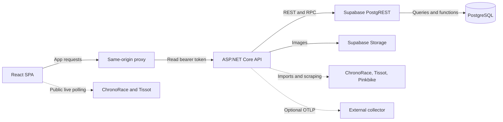
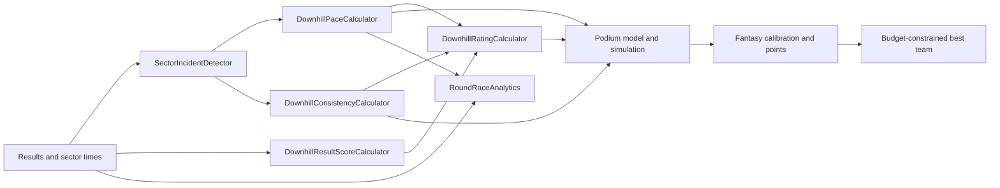
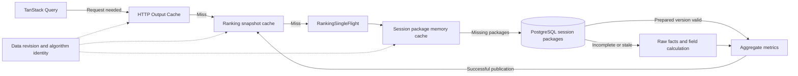
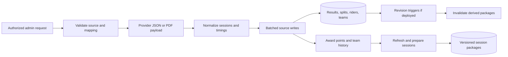
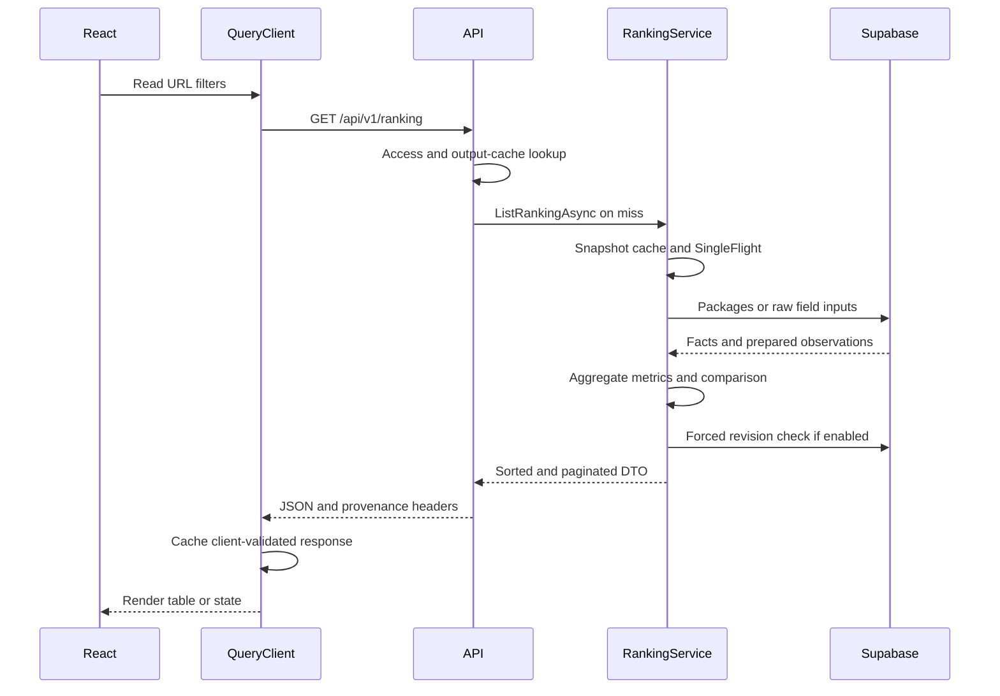

# RaceTrace Architecture

Technical audit of the API and web application, 10 October 2026.

Publication update, 11 October 2026: the audited code and report are included in this release. Both database migrations were subsequently applied to RaceTrace Analytics; see [deployment verification](../deployment/2026-10-11.md). The audit below remains a dated source snapshot, not a claim that runtime feature flags have been enabled.

## Scope and evidence

This document describes the **current working trees**, including uncommitted code, not just the latest releases. At inspection, API HEAD was `839bd096e470579a87ae0780f8260609c7789f46`; web HEAD was `a51589f4ac32eb9446f7cacee3bcf596181ed00e`. In particular, calculation revisions, distributed Fantasy coordination, telemetry and generated contracts exist locally beyond those commits. A checkout of those commits alone will not reproduce all mechanisms below.

This was a source audit. No application code, algorithms, dependencies or database contents were changed. No production configuration, deployed database schema, live performance or external-provider availability was verified. Existing test implementations are evidence of intended coverage, not a claim that tests were rerun for this audit.

Paths use two roots:

- `API/` = the `racetrace-api` repository. Application sources are under `API/racetrace-api/`.
- `WEB/` = the sibling `racetrace-web-app` repository.

Status terminology:

- **Implemented**: executable implementation exists and is connected to the inspected code path. This does not certify production activation.
- **Partial**: implementation exists with incomplete coverage, integration or operational guarantees.
- **Planned / Missing**: no implementation was found in the inspected repositories; this is not a promise to implement it.

Design rationales below explain consequences of the implementation. Where a historical decision record does not exist, the rationale is an architectural interpretation, not an attributed historical decision.

## 1. Executive Summary

RaceTrace is a React browser application backed by a single ASP.NET Core API and Supabase/PostgreSQL. The API owns the main sporting calculations: Pace, Consistency, Result Score, Rating, podium prediction, Fantasy prediction/optimization and round analytics. PostgreSQL stores race facts, reference data, team history, point rules and reusable session packages. The frontend validates responses, manages URL filters and request state, renders tables/charts, and normalizes external live-timing feeds.

The most accurate description is **a service-oriented application monolith with pragmatic layers and selected feature modules**, paired with a **feature-organized SPA**. There is one API deployment, not a microservice system. There are not separate domain/application/infrastructure assemblies enforcing Clean Architecture. Feature folders improve locality, but services and frontend features still depend directly on one another; “strict modular monolith” would overstate isolation.

The principal performance strategy is reuse at several different levels:

1. Persistent session packages avoid repeatedly joining and transporting the entire raw race field.
2. Prepared Pace data avoids repeating session-level field calculations.
3. In-process snapshots reuse filter-specific calculations for 30 seconds.
4. SingleFlight shares concurrent work for an identical snapshot identity.
5. HTTP Output Cache avoids executing selected endpoints at all.
6. TanStack Query avoids unnecessary browser requests and preserves existing content during updates.

New revision-aware keys and PostgreSQL-coordinated Fantasy jobs address multi-instance consistency, but both mechanisms are **opt-in** and require explicit migrations. Their presence must not be confused with production rollout. The browser is not subscribed to database changes; a five-second backend revision window is not a five-second UI refresh guarantee.

| Area | Status | Qualification |
| --- | --- | --- |
| Main sporting calculations in API | Implemented | Frontend still owns presentation calculations and live-provider normalization |
| Raw and prepared database read packages | Implemented | Matching migrations and prepared payload versions required; fallback paths remain |
| Local cache and shared in-flight ranking work | Implemented | Per API process, not distributed |
| Revision-based cache invalidation | Implemented, opt-in | `CacheCoherence:Enabled` defaults false; deployment not verified |
| Distributed Fantasy leases and artifacts | Implemented, opt-in | `Fantasy:DistributedCoordinationEnabled` defaults false |
| Generated OpenAPI/TypeScript with runtime Zod | Partial | Typed contracts covered; several legacy/dynamic JSON sections remain open |
| Performance instrumentation | Implemented | Optional exporter; no bundled collector/dashboard/alerts |
| Reproducible deployment and mandatory CI gates | Planned / Missing | No production infrastructure manifests or CI workflows found |

## 2. Technology Stack

Versions here are project declarations, not independent assertions about deployed binaries. Web `^` and `~` declarations permit compatible resolutions.

| Layer | Technology | Purpose and source |
| --- | --- | --- |
| API host | .NET 10 / ASP.NET Core MVC | `API/racetrace-api/racetrace-api.csproj`, `Program.cs` |
| API contracts | `Microsoft.AspNetCore.OpenApi` 10.0.9; `Microsoft.OpenApi` 2.7.5 | Runtime metadata and isolated contract export |
| JSON/data transport | System.Text.Json, JsonNode, HttpClient | Explicit PostgREST/RPC transport; no EF Core data model |
| Database | Supabase/PostgreSQL, PostgREST, SQL functions | Source data, joins, packages, revision triggers and optional jobs |
| Caching | IMemoryCache; ASP.NET Output Cache | Process-local calculations and HTTP responses |
| Observability | System.Diagnostics; OpenTelemetry 1.15.3 | Custom metrics/spans and optional OTLP export |
| External import | Microsoft.Playwright 1.63.0; PdfPig 0.1.15 | Pinkbike browser fallback and PDF result parsing |
| UI | React / ReactDOM `^19.2.8` | Client-side rendering |
| Routing | React Router DOM `^7.18.2` | Browser routes, lazy pages and nested rider tabs |
| Language/build | TypeScript `~6.0.2`; Vite `^8.2.0` | Strict type checking and static production assets |
| Server state | TanStack React Query `^5.101.4` | Query keys, caching, cancellation, retry and background refresh |
| Runtime contracts | Zod `^4.4.3` | Validate and normalize wire responses |
| Generated types | openapi-typescript `7.13.0` | `WEB/src/types/generated/api.d.ts` |
| Charts/overlays | Recharts `^3.10.1`; Floating UI `^0.27.20` | Responsive chart primitives and shared overlays |
| Styling | CSS Modules, shared CSS tokens, local fonts | IBM Plex Mono, Inter and Orbitron; no theme framework required |
| Verification | xUnit; Vitest `^4.1.10`, Testing Library, ESLint | API behavior, calculations, request contracts and UI helpers |

References: [API project](../../racetrace-api/racetrace-api.csproj), [web package](../../../racetrace-web-app/package.json).

## 3. System Architecture

### 3.1 Deployment and responsibility boundaries

**Implemented:** the API is one executable containing HTTP endpoints, data access, calculations, imports and hosted jobs. The web app builds independently into static assets. Supabase is an external data platform reached through HTTP, not an in-process database or a direct Npgsql connection.



The proxy node is implemented by Vite **during development**. A production equivalent is required by the current authentication arrangement but is not supplied as a deployment manifest. The collector is an optional integration, not a shipped service. Hosted jobs and local caches are inside the API process, not additional independently deployed services.

Normal analytical flow is:

`React → query/client validation boundary → API → Supabase packages or raw facts → C# calculators → DTO/JSON → Zod → React`.

A cache hit can bypass some or all inner steps. A prepared database package is input to calculations, not necessarily a fully materialized final ranking. Live timing is an explicit exception: its frontend adapter polls public providers directly and uses the API for round context and rider identity resolution.

### 3.2 Architecture classification

- **Layered application monolith — accurate:** controllers, orchestration services, transport infrastructure, DTOs and calculators are recognizable layers inside one project.
- **Feature-oriented organization — accurate but partial:** `Features/Fantasy`, `Features/Analytics`, `Features/Metrics`, `Features/Ranking` and `Features/Metadata` group related behavior; much orchestration remains in `Services/`.
- **Strict modular monolith / Clean Architecture — not established:** direct service dependencies, `JsonObject` data throughout several layers, manual construction of helpers, and one assembly leave boundaries largely conventional.
- **DDD — not established:** no evidence of an aggregate/repository/domain-event model governing the complete application.
- **CQRS — only a limited analogy:** there are read-optimized SQL packages and administrative write paths, but no distinct command bus or event-sourced write model.

This arrangement is reasonable for a data-heavy application with one deployment team. Splitting services into separately deployed processes would not itself reduce database transfer or calculation cost.

## 4. Backend Structure

### 4.1 Source map

| Location under `API/` | Responsibility |
| --- | --- |
| `racetrace-api/Program.cs` | Composition and HTTP pipeline |
| `racetrace-api/Infrastructure/ServiceCollectionExtensions.cs` | DI lifetimes, Options, HttpClient, cache policies and hosted services |
| `racetrace-api/Controllers/` | HTTP routes, query/body entry points, response metadata and admin filters |
| `racetrace-api/Services/` | Cross-feature orchestration, calculators, imports, validation and provider helpers |
| `racetrace-api/Features/` | More localized Fantasy, analytics, metrics, ranking, metadata and result logic |
| `racetrace-api/Models/` | DTOs, contexts, query/result records and compatibility models |
| `racetrace-api/Configuration/` | Bound infrastructure/application option classes |
| `racetrace-api/Infrastructure/Supabase/` | Compact/prepared read parsing and transport-related models |
| `racetrace-api/Infrastructure/Calculations/` | Algorithm identity, data revisions and response provenance |
| `racetrace-api/Infrastructure/Telemetry/` | Metrics, spans and measured streams |
| `racetrace-api/Database/` | Historical SQL schema/function/index scripts and SQL verification queries |
| `supabase/migrations/` | Recent ordered SQL migrations; older migration also exists under the app's `supabase/` |
| `racetrace-api.Tests/` | Unit/contract/integration-style tests |
| `tools/` | OpenAPI export, read-path/numerical parity, prediction backtests and SQL concurrency tests |

**Partial:** database evolution is spread across historical scripts and more than one migration location. The repository is not a single self-contained proof of the currently deployed schema or a fully automated fresh-database bootstrap.

### 4.2 Composition and lifetimes

`AddRaceTraceApplication` registers most domain/query services as **scoped**, so one request reuses their request-local caches. `RankingSingleFlight`, `DataRevisionService`, `TimeProvider`, access guards and the Fantasy browser/work coordinator are **singletons**. `IMemoryCache` is shared within the process. `ISupabaseRestClient` is a typed HttpClient with pooled underlying handlers and automatic gzip/deflate/Brotli decompression.

`DomainQueryService` caches its metadata task and team-history reads within the request. This is separate from its injected, process-wide package cache. Scoped `CalculationProvenance` collects metadata from reused computations.

Configuration is bound through `IOptions<T>` from the standard host configuration sources. Specific environment aliases `API_READ_SECRET` and `ADMIN_API_SECRET` override corresponding access Options. Fantasy interval/lease settings have validation; not every option has startup validation. Algorithm defaults are **static shared configuration objects**, not live database-managed or generally hot-reloadable Options.

Checked-in settings enable typed ranking reads, prepared rider details and scheduled Fantasy synchronization. Revision coherence and distributed Fantasy coordination remain false unless overridden. Configuration in a deployed process can differ.

### 4.3 HTTP pipeline and errors

`Program.cs` orders middleware as follows:

1. Response compression.
2. API telemetry.
3. Exception translation.
4. API bearer-secret access check.
5. Development-only OpenAPI mapping; HTTPS redirection.
6. Output Cache.
7. Authorization middleware and controller execution.

Access checks run before cached responses can be served. `ApiExceptionMiddleware` returns an `ApiErrorResponse` envelope with code/message for domain errors; Supabase failures become database errors, with upstream 503 mapped to `DATABASE_UNAVAILABLE`. Client cancellation can produce 499; upstream `TaskCanceledException` becomes retryable 503. Unexpected exceptions are logged and produce a generic 500 response, not their internal payload.

MVC model-binding failures can use `ValidationProblemDetails`, so error responses are **not universally one shape**. OpenAPI explicitly documents the alternative. `UseAuthorization` is present, but actual application access is enforced by custom guards; there is no demonstrated user/JWT login scheme.

### 4.4 Controllers, DTOs and validation

`RankingController.List` delegates to `RankingService.ListRankingAsync`; `RidersController.Overview` delegates to `RidersService.GetOverviewAsync`. Admin controllers apply `AdminAuthorizationFilter`. Many endpoints parse `Request.Query` through `QueryValidationService` and metrics parsers rather than binding a complete request DTO.

Validation includes sort allowlists, ascending/descending validation, CSV normalization, numeric/date parsing and pagination limits (default 30, maximum 150 in `QueryValidationService`). Domain-specific validators add constraints such as category compatibility.

Typed DTOs and HTTP/OpenAPI use camelCase. Legacy `JsonObject`/`JsonNode` response fields are normalized by an HTTP-only writer; database rows, SQL/RPC keys and raw provider input are not mutated. Administrative camelCase PATCH fields are mapped to database columns at the controller boundary. Mappers/adapters bridge nested database JSON, compact transport tuples and typed presentation DTOs. Dictionary identifiers and private stored formats retain their own contracts.

Key references: [composition](../../racetrace-api/Infrastructure/ServiceCollectionExtensions.cs), [pipeline](../../racetrace-api/Program.cs), [query validation](../../racetrace-api/Services/QueryValidationService.cs), [exceptions](../../racetrace-api/Infrastructure/ApiExceptionMiddleware.cs).

## 5. Data Access and Supabase

### 5.1 Transport

**Implemented:** `SupabaseRestClient` wraps `/rest/v1/{table}` and `/rest/v1/rpc/{function}`. `SupabaseQuery` constructs explicit select/filter/order/pagination parameters. REST joins are expressed through PostgREST nested selects. SQL functions are used where a compact, joined read is more efficient than several table requests.

The client selects anonymous or service-role credentials server-side, attaching both `apikey` and Bearer headers. GET defaults to the anonymous role; administrative mutation call sites explicitly use service role. API read authentication and Supabase authorization are two separate layers.

REST GET/POST/PATCH responses are read into strings and parsed as JSON. Successful RPC responses use `ResponseHeadersRead` and stream into `JsonNode.ParseAsync`. This reduces an intermediate string allocation but is **not** row-by-row streaming to React: JSON objects and calculation inputs still reside in API memory. The transport has no automatic retry policy.

### 5.2 Query orchestration

`DomainQueryService` owns session selection, joined results, points, team history, category/session code resolution and read-path fallback. Its broad responsibility makes it useful for reuse, but also a central coupling point.

The result graph includes results → riders/teams/result_points and sessions → round_categories → rounds/tracks/competition_levels/conditions/categories. Rankings use a narrower projection; detailed views need additional timing and display fields. Metrics require the relevant **field**, not just the selected rider, because pace and sector ranks are relative to other riders in the same session/category.

Raw retrieval uses 1,000-row pages, up to three concurrent result-page requests when total count is known, rider filter batches of 100 and result-ID batches of 300. The fallback can therefore execute many physical Supabase requests for one frontend request. A single RPC is also not synonymous with one cheap SQL operation.

### 5.3 Optimized read paths

| Read path / RPC | Role |
| --- | --- |
| `get_ranking_data` | Compact ranking-oriented joined input |
| `get_rider_detail_data` | Detailed input for one rider plus required field context |
| `get_ranking_input_packages` | Reusable source measurements; optional public split display fields |
| `get_rider_input_data` | Target rider metadata and complete reference field; cached or raw measurements |
| `get_ranking_preaggregate_packages`, `get_ranking_metric_packages`, `get_prepared_rider_detail_data` | Legacy read contracts retained for compatibility, not used by the normal optimized path |
| `get_ranking_points_summary` / `get_ranking_points_raw_summary` | Points order without calculating all riders' Rating/Pace/Consistency |

`ReadOptimizations:TypedRanking` selects typed compact processing. The retained configuration name `PreparedRiderDetails` now enables **source-package reuse**, not stored calculator outputs. `get_rider_input_data` uses raw source data when reuse is disabled, a package is missing, or a status filter is present. A missing RPC or structurally incomplete envelope selects the legacy detail read; network/authentication failures are not silently swallowed.

Version 3 inputs contain official results, metadata and cumulative timing measurements (`ix`). Field distributions, sector timing interpretation, incident correction, Pace, Consistency and Rating are calculated in the API through the shared calculator path. Neither `prepared_version` nor `prepared_payload` is consumed. Calculator changes therefore do not require rebuilding source packages; imports, timing/point corrections or a new input schema still do. The `missing` rebuild checks `input_splits` availability. Legacy derived columns and explicit preparation tooling remain available for rollback, but normal imports no longer generate those calculator-dependent artifacts. See [input-package verification](../performance/2026-10-11-input-packages.md).

The optimization changes transport and reuse, not the definition of the field or the sporting formulas. `Infrastructure/Supabase/CompactMetricsPackageParser.cs` and typed metric read models reduce repeated JSON traversal. Prepared-package parsing is memoized by object reference within a request.

### 5.4 Source data versus derived data

Results and splits remain source facts. Point awards are persisted separately with their rule/system association. Team history stores time-bounded membership; explicit result team takes precedence, followed by the applicable historical assignment. Display metadata makes codes, labels and aliases discoverable, while legacy code mappings remain for compatibility.

Persistent session preaggregation collects reusable inputs and prepared session calculations. It does **not** persist a final answer for every possible combination of seasons, tracks, categories and conditions. Request-time aggregation remains necessary.

SQL references: `API/racetrace-api/Database/20260813_ranking_session_preaggregation.sql`, `20260930_separate_read_packages.sql`, `optimize_ranking_reads.sql`; `API/supabase/migrations/20261003214005_prepared_ranking_metrics.sql` and `20261003215623_prepared_rider_detail_read.sql`. Transport/query references: [SupabaseRestClient](../../racetrace-api/Infrastructure/SupabaseRestClient.cs), [DomainQueryService](../../racetrace-api/Services/DomainQueryService.cs).

## 6. Domain Calculators

### 6.1 Shared calculation pipeline

**Implemented:** `MetricsService` delegates to `PaceService`, which prepares field observations and combines the core calculators. `RankingService` and `RidersService` consume the same metric machinery rather than maintaining independent rating formulas.



This diagram is a computational dependency overview, not a call graph of independently deployed services. `AlgorithmCatalog` additionally records transitive invalidation dependencies; these are deliberately broader than individual method arguments.

Defaults live in `Services/AlgorithmOptions.cs` through `AlgorithmConfiguration`. Session weights are Final 4, Semi 2, Qualifying/Q1/Q2 1.5, Seeding 0.6, Training/Timed Training 0. Where applicable, final observations receive 85% aggregate impact and pre-final observations share 15%. `CompetitionClassWeighting.FromPriorities` computes `maximum positive active priority / priority`, with unknown priorities defaulting to 1. These weights must not be assumed to affect every calculator identically.

### 6.2 Pace

**Implemented:** `DownhillPaceCalculator` evaluates speed relative to the same session/category field, accounts for anomalies and combines available stage evidence. Inputs include real sector durations, classified field positions, field distributions, top speed, stage/class weights and incident diagnostics.

The core sector calculation uses robust log times:

```text
z = (median(log(field times)) - log(rider time))
    / max(1.4826 * MAD(log(field times)), 0.003)
rankScore = 100 * percentile^1.60
timeScore = 100 * sigmoid(1.25*z + 0.05)
rawSector = 0.20*rankScore + 0.75*timeScore + winningSectorBonus
```

The bonus is at most 5 and depends on the winning margin relative to field dispersion. Scores above 75 receive a calibrated upper-range transform. Reference-duration square roots weight sectors; with at least four valid sectors the aggregation combines 70% best-half pace and 30% all-sector pace. At least two usable sectors are required.

Further stages include coverage/class weighting, a power mean for repeated stage evidence, final/pre-final impact, stage evidence discounts, an upper-range calibration, and caps when only weaker/non-final evidence exists. Top speed has only a small positive contribution, not an independent replacement for sector timing. Confidence reflects valid evidence and available finals; a high score is not automatically high confidence.

Calibration consists of explicit versioned constants/transforms, not an online training job. Incident-corrected finish data is prepared before affected finish comparisons. Raw imported race times remain unchanged. Prepared session inputs can be persisted; filter-specific aggregate Pace is part of the ranking snapshot.

Consumers: ranking, rider metrics/overview, compare, podium/Fantasy features and round analytics. Source: `Services/DownhillPaceCalculator.cs`, `PaceService.cs`, `AlgorithmOptions.cs`, `RankingPreaggregationService.cs`.

### 6.3 Sector Incident Detection

**Implemented:** `SectorIncidentDetector` detects timing anomalies, not a proven physical cause such as a crash or puncture. It emits Normal, PossibleIncident, LikelyIncident and InvalidTiming classifications.

Expected sector performance uses nearby valid rider sectors relative to field medians. Robust field and rider variability, absolute lost seconds, relative loss, normalized rank deterioration and recovery all contribute. Non-positive/non-finite times, implausibly short sectors and compensating checkpoint errors receive separate handling.

Examples of current gates, not a substitute for the complete branch logic:

- A larger isolated loss needs at least 4 seconds and corroborating robust deviation/rank evidence.
- A smaller isolated loss needs at least 2 seconds plus stronger clean-sector, top-field and recovery evidence.
- Sustained slowdown can remain PossibleIncident rather than being automatically erased from performance.

Not every flagged sector receives finish correction. Correction requires corroboration and consistency checks; an imputed time is not treated as a genuinely measured good sector. The detector is heuristically calibrated using fixed thresholds in `IncidentDetectionOptions`, not runtime supervised learning from the validation CSV.

Incidents influence prepared Pace observations and Consistency incident reliability. Version/configuration changes propagate through dependent fingerprints. Sources: `Services/SectorIncidentDetector.cs`, `DownhillPaceCalculator.cs`, `AlgorithmOptions.cs`; experimental evidence is separate under `API/docs/incident-*.md` and backtest tools.

### 6.4 Consistency

**Implemented:** the current final score is a reliability/qualification/repeatability composite, **not simply sector-time standard deviation**:

```text
Consistency = 0.40*IncidentReliability
            + 0.35*FinalQualification
            + 0.05*QualificationQuality
            + 0.20*PositionRepeatability
```

DNS and disqualification are ignored; fewer than two relevant runs produce no score. DNF and detected incidents affect reliability. Qualification quality distinguishes reaching a final directly from going through Q2. Position repeatability uses normalized finishing rank and robust weighted deviations; insufficient classified position evidence yields a neutral component rather than invented precision.

For `n` runs and `i` incidents, reliability starts at `100*(1-i/(n+2))^1.20`, with an additional repeated-incident penalty for `i > 1`. Position repeatability maps deviation through `100/(1+(deviation/0.12)^2)`. Existing sector timing diagnostics remain in the internal calculator result but do not directly define the final composite above; public metric mapping does not expose that complete diagnostic result.

Parameters: `ConsistencyOptions`; fixed calibration, no online fit. Cached with calculated snapshots, dependent on prepared timing/incident inputs. Used by ranking, rider views, compare and predictions.

**Confirmed limitation:** `Calculate` accepts `CompetitionClassWeighting?`, but the current body does not apply it, despite a class-weights catalog dependency. This is a code/interface mismatch to clarify, not permission to change the score during refactoring. Source: `Services/DownhillConsistencyCalculator.cs`.

### 6.5 Result Score and Rating

**Implemented:** Result Score measures finishing outcome independently from timing pace. It excludes DNS/DSQ, scores DNF as zero and uses valid classified field rank. P1 is 100 and last is zero; interior ranks use a logarithmic transform anchoring second place at 96 when second is not also last:

```text
score = 100 * (1 - ln(rank)/ln(fieldSize))^a
a = ln(0.96) / ln(1 - ln(2)/ln(fieldSize))
```

Session/class weighting and final impact produce an aggregate with a separate evidence confidence. This is not the same as official championship points.

Rating combines the three components:

```text
raw = 0.70*Pace + 0.15*Consistency + 0.15*ResultScore
rating = 50 + 50*tanh(1.2*(raw-50)/50)/tanh(1.2)
```

Values are clamped to 0–100. Missing Result Score removes that component and renormalizes active weights. Raw and contrasted Rating are distinct outputs. Formula parameters are fixed configuration, not fitted on every request. Both calculations are reused through ranking snapshots rather than stored as one permanent rating per rider for all filters.

Sources: `Services/DownhillResultScoreCalculator.cs`, `DownhillRatingCalculator.cs`, `AlgorithmOptions.cs`. Consumers: ranking, rider metrics/overview, compare and prediction inputs.

### 6.6 Podium Predictor

**Implemented:** `PodiumPredictorService` builds pre-race features from current-season history before the target round, earlier history, track/condition affinity and target-weekend observations. Junior categories return an empty prediction. Current-season candidates require PaceConfidence at least 35; at most 30 are simulated, with the top 10 returned. Probabilities are therefore conditional on this selected field, not a verified complete start list.

`PodiumPredictionModel` combines Rating/Pace, recent form, affinity, weekend performance and pressure/WCH terms, shrinking uncertain estimates toward the field mean. It uses fixed model coefficients; the running API does not train a ridge regression. A deterministic Monte Carlo simulation uses 50,000 iterations, seed 20260824, Student-t variation with 5 degrees of freedom and incident penalties. Public outputs include win/podium/top-five probabilities and expected position; the internal simulator additionally produces full position distributions for Fantasy.

Configuration/model identifier: `PodiumPredictionOptions`, `ridge-monte-carlo-v1`. `PodiumPredictionBacktester` and `tools/racetrace-api.PodiumBacktest/` support evaluation, but source inspection does not establish predictive accuracy. The `/api/v1/podium-predictor` response uses the 60-second output policy. Provenance exposes simulation settings and history cutoff; that cutoff must not be misrepresented as the training date of static coefficients.

### 6.7 Fantasy Prediction and Best Team

**Implemented:** this combines imported Pinkbike prices, rider mappings, a persisted prepared race forecast, Fantasy rules, availability information and a constrained team optimizer. Normal public reads do not scrape Pinkbike or run Monte Carlo synchronously.

`FantasyRacePrediction` reuses podium distributions. `FantasyCalibration` fits a category/stage blend over 101 candidate weights, minimizing historical negative log likelihood; at least two historical events are required. Forecast history excludes results at/after the target cutoff. Non-scoring is modeled explicitly. Historical simulations use 10,000 iterations, forecasts 50,000 (`FantasyModelConfiguration`). Version: `fantasy-empirical-blend-v3`.

`FantasyRules2026` currently encodes the 2026 budget of 1,500,000, four men plus two women, placement points and Q1 bonuses. These rules are versioned as `pinkbike-dh-2026-v1`; this is not an automatically season-independent rule engine.

`FantasyOptimizer.Optimize` performs exact decimal-budget optimization: male four-rider combinations plus affordable female pairs with prefix-best lookup. It maximizes projected points, uses cheaper cost and deterministic identity ordering for ties, and does not round prices into coarse budget buckets or use a greedy value ratio.

Current eligibility requires mapped, priced, projected riders and excludes reported injury. A verified start list or available timed-training roster can restrict participation; otherwise the catalogue remains usable with an unconfirmed-participation warning. This is the actual inspected implementation, even where earlier design discussions differed. Wrong-round prices prevent a recommendation; stale but otherwise compatible data can remain visible with warnings. Prepared artifacts enforce rules/model/event/data identity, with a narrow legacy compatibility mode when new coherence/coordination features are disabled.

Persistence is local file snapshots by default, or shared PostgreSQL artifacts when distributed coordination is enabled. Lineup optimization has a five-minute memory cache keyed by relevant snapshot/preparation/event/rules identity. Consumers: `/api/v1/fantasy/current`, `/riders`, `/recommendation`, `/rules`. Sources: `Features/Fantasy/FantasyService.cs`, `FantasyRacePrediction.cs`, `FantasyCalibration.cs`, `FantasyOptimizer.cs`, `FantasyRules2026.cs`, `FantasyPreparationService.cs`.

### 6.8 Round Analytics

**Implemented:** `AnalyticsService` and `Features/Analytics/RoundRaceAnalytics.cs` produce analysis from real projected timings and existing metric observations. `/api/v1/analytics/round-profile` uses the five-minute output policy.

- Sector Efficiency measures a robust adjacent rank/time slope in positions per second, accounting for ties.
- Quali/Final correlation uses Pearson correlation of average ranks, i.e. a Spearman-style comparison, with at least three shared classified riders and a suitable preceding stage.
- Winning Margin decomposition requires complete winner/runner-up sector sets consistent with the official final margin; contributions can be negative.
- Run Efficiency includes sectors won/top-three, mean sector rank and the sectors responsible for 80% of positive gains.
- Performance Distribution uses the classified field's Pace observations.
- Chaos combines movement (0.4), incidents (0.2), DNF (0.2) and pre-final reshuffle (0.2), renormalizing available components. It requires real movement/comparison evidence, not DNF alone.

Chaos calibration is `0.5*(raw + 100*(1-exp(-(raw/25)^2)))`, rounded to one decimal. It is a designed index, not a calibrated probability of an incident. Missing timing must not manufacture a multi-sector duration.

**Partial version coverage:** the payload label `round-analytics-v2` and catalog algorithm version `1.0.0` are different identifiers. The catalog configuration for round analytics is empty; embedded weights/transforms are not automatically discovered by hashing. Changes require an explicit version/configuration update. No Upset Index implementation is asserted here.

### 6.9 Versioning boundaries

`AlgorithmCatalog` contains baseline versions for core calculators and dependency closure hashes. Parameter changes represented in registered configuration alter the fingerprint automatically; source-code changes do not. `VersionLabel` lists transitive component versions, `ConfigurationHash` hashes effective registered configuration, and `Fingerprint` includes both.

The catalog is an identity mechanism, not a historical model registry or executable archive of every previous algorithm. Preserve the code revision and exported manifest together to reproduce a result. Database class priorities and other facts are represented by data revision, not by pretending they are immutable C# configuration.

## 7. Cache Architecture

### 7.1 Layers are not interchangeable



The diagram describes the ranking family, not every endpoint. Rider details may use a prepared detail RPC directly; Fantasy has separate artifact storage. The final arrow represents publishing a computed snapshot, not recursive calculation.

| Mechanism | Contents / identity | Lifetime and invalidation | Scope / restart |
| --- | --- | --- | --- |
| Raw database preaggregation | Per-session compact/full facts, field and point data | Persistent; source refresh/invalidation rather than short TTL | Shared database; survives API restart |
| Prepared session payload | Session-level calculated Pace/finish inputs; source revision + algorithm version | Valid only for matching source UUID/version; raw updates clear preparation | Shared database; survives restart |
| Package IMemoryCache | `ranking-package:{full\|metrics}:{role}:{sessionId}` plus revision when enabled | 30s; new scoped revision makes old keys unreachable | Per process; lost on restart |
| Ranking IMemoryCache | Normalized filter identity, selected sessions/search/rider, plus revision and Rating dependency fingerprint when enabled | 30s; successful snapshots only | Per process; lost on restart |
| Points-position IMemoryCache | `points-position:` + compatible ranking key | 30s; uses summary rather than full calculation when no snapshot exists | Per process; lost on restart |
| Output Cache | Selected HTTP bodies/headers, request query and optionally revision/algorithm identity | Ranking 30s; season overview/podium 60s; analytics 5min | Per process; no distributed store registered |
| Data revision snapshot | Map of scope → revision | Reuse ordinary checks for 5s; forced completion checks bypass | Per process copy of shared database state |
| RankingSingleFlight | Active calculation Task per normalized key | Only while work runs; completion/failure removes entry | Per process; not a result cache |
| Fantasy prepared/price stores | Persistent forecasts and price history | Identity/freshness rules, not a generic 30s TTL | Files by default; DB when enabled |
| Fantasy lineup cache | Optimized team for artifact/event/rules identity | 5min | Per process |
| TanStack Query | Validated response keyed by entity and filters | Default stale 30s, inactive GC 5min; dictionaries fresh 5min | Browser memory; normal reload loses it |

### 7.2 What preaggregation actually saves

The raw package saves repeated joins and repeated JSON field names in transport. The metrics-only package omits detail-only data. Prepared payloads additionally save repeated session-level field computation, including incident-aware finish preparation. The API still combines evidence across the selected sessions and calculates filter-dependent outputs.

`RankingPreaggregationService` refreshes raw packages and publishes prepared values through `save_prepared_ranking_session`. Publication checks the source UUID, so preparation calculated from an older package cannot overwrite the newly refreshed package. Its version is `pace-field-v1:` plus the Pace dependency fingerprint. Imported source results are not rewritten to contain “corrected” sporting scores.

Missing prepared data can therefore make a request slower without making its intended formula different. A database cache miss and an API memory cache miss are different events. Fallback availability is useful but can hide a missing migration or stale preparation unless observed through logs/metrics.

### 7.3 Cache key consequences

`RankingService.BuildSingleFlightKey` normalizes strings, sorts/deduplicates filter sets, and includes category, years, dates, round, track, country, conditions, classes, stages, status, venue, search, rider and resolved session IDs. Page and display sort are outside the expensive snapshot identity, so different pages/sorts can reuse it. HTTP Output Cache varies by all query keys and may still store separate response entries.

Per-session package keys permit reuse between different seasonal/comparison snapshots. Revision hashes include global dependencies. A global dictionary change can intentionally invalidate much more than a single session.

No Redis, distributed ranking cache or shared in-flight ranking lock is registered. Multiple API instances each warm their own caches. Arbitrary distinct filter combinations can create many concurrent calculations; SingleFlight only coalesces identical identities.

References: [ranking](../../racetrace-api/Services/RankingService.cs), [output policy](../../racetrace-api/Infrastructure/ApiReadOutputCachePolicy.cs), [preparation](../../racetrace-api/Services/RankingPreaggregationService.cs), [revision service](../../racetrace-api/Infrastructure/Calculations/DataRevisionService.cs).

## 8. SingleFlight

**Implemented:** `RankingSingleFlight.RunAsync` stores `Lazy<Task<RankingSnapshot>>` in a `ConcurrentDictionary` using the exact calculation key. `GetOrAdd` selects one Lazy; execution/publication semantics ensure its factory starts once. The task is shared, not copied into a new calculation per waiter.

The owner attaches `RemoveWhenCompletedAsync`. That method observes completion/failure and removes the exact key/value pair, avoiding deletion of a newer flight under the same key. Failed tasks are not retained as a persistent negative cache. Every waiter still awaiting the task observes the original failure; a waiter that already cancelled observes its cancellation instead.

Each caller awaits `task.WaitAsync(cancellationToken)`. Disconnecting one caller cancels that wait, not the calculation token. `RankingService` supplies an independent 90-second calculation cancellation source and checks the memory cache again inside the factory. This timeout is cooperative; synchronous CPU loops are not forcibly interrupted merely because a token expires.

Example: 20 simultaneous requests on one instance, same calculation identity, cold snapshot cache:

1. One caller creates the flight and starts data loading/calculation.
2. The other 19 await the same task.
3. A cancelled waiter leaves; the remaining callers continue waiting.
4. Success is revision-checked when coherence is enabled, cached for 30s and returned to all remaining callers.
5. The active-flight entry is removed. Later calls use the snapshot cache.
6. On failure there is no successful snapshot publication; all waiters see failure and a later request may start a new flight.

These are **one new + nineteen shared calculations**, not necessarily one Supabase HTTP call. If identical HTTP requests are already coalesced by Output Cache, fewer callers reach SingleFlight. Conversely, different URLs/pages/endpoints can share a domain snapshot even though they do not share an HTTP response. This is why the two layers are not redundant.

**Partial operational coverage:** the dictionary is process-local and has no global concurrency limit. Shared work captures the requesting service graph; a full HTTP disconnect/scope-disposal integration test would strengthen assurance beyond task-level cancellation tests. This is a lifecycle risk to verify, not an observed production failure in this audit.

Source: [RankingSingleFlight](../../racetrace-api/Services/RankingSingleFlight.cs); tests: `API/racetrace-api.Tests/RankingSingleFlightTests.cs`, `PerformanceTelemetryTests.cs`.

## 9. Cache Invalidation

### 9.1 Data revisions

**Implemented, opt-in:** migration `20261010210121_calculation_revisions.sql` adds private revision storage and service-only `get_calculation_revisions`. Source-table triggers identify affected session/round/season/global scopes, account for old and new relationships, and remove affected raw preaggregates. Revision increments are coalesced per scope per SQL transaction; rollback rolls them back as well.

Covered changes include results, time splits, awarded points, sessions, rounds, round categories, rider/team/history/track metadata and category/condition/class/point-rule dictionaries. Broad reference-data changes use a global dependency and can invalidate all packages. Triggered deletion concerns derived packages, not original results.

`DataRevisionService.GetAsync` serializes local checks with a semaphore, reuses the map for at most five seconds on ordinary reads, and does not extend freshness when a refresh fails. Completion checks force a new read. This is request-driven polling, not a timer polling an idle database and not a push subscription.

`DataRevisionSnapshot.ForScopes` always includes `global`. HTTP scope resolution uses route round/session IDs where available, otherwise selected seasons, otherwise `all`. Podium uses `all` because predictions consume history beyond the requested season. Unrestricted comparison baselines also broaden scope.

### 9.2 Publication checks

- `RankingService.BuildSnapshotAsync` captures a scoped identity before work and force-checks it before cache publication; change yields `503 DATA_REVISION_CHANGED`.
- `CalculationResponseFilter` checks successful analytical actions before serialization and emits provenance headers. Reused snapshots avoid forcing another physical revision read per waiter.
- `ApiReadOutputCachePolicy` varies keys by revision/algorithm identity and rejects cache storage if the revision changes during response generation.
- Prepared session publication compares the raw source UUID in SQL.
- Fantasy prepared artifacts carry their data/model/configuration identity and are checked before use.

Old memory entries normally expire; new revision keys stop addressing them. This is versioned identity, not a global `Clear()` broadcast. Output-cache tags exist, but the main invalidation mechanism is key variation, not an implemented distributed tag-eviction bus.

### 9.3 Change matrix

| Change | Actual protection |
| --- | --- |
| Import/correct result, split or awarded points | Trigger scopes and raw-package invalidation; prepared source revision; in-flight checks when enabled |
| Move session/result between parents | Old and new dependency scopes |
| Change team/rider/track metadata | Affected dependencies and unrestricted/global scope as defined by trigger |
| Change database class priority/point rules | Data revision; broad package invalidation where required |
| Change session/Pace/Consistency/Rating registered parameters | Dependency configuration fingerprint |
| Change calculator code with same parameters | **Requires manual algorithm version bump** |
| Change registered prediction parameters | Model/configuration fingerprint and dependent artifact validation |
| Change embedded analytics constants outside catalog configuration | **Requires explicit version/configuration maintenance** |

### 9.4 What the five-second guarantee does not mean

With coherence enabled, an already cached response may reflect a revision check from up to approximately five seconds earlier. Forced checks reduce publication races, but a database commit immediately after a check is still possible. This is bounded freshness, not serializable execution of every HTTP request.

An import contains multiple HTTP writes/transactions. Transactional revision triggers do not make the **whole import** atomic. A read can encounter a temporarily valid intermediate import state; detected changes during calculation are rejected, but no import-wide staging/commit boundary is implemented.

With coherence disabled, existing TTL behavior remains. Layered TTLs and browser retention mean end-to-end staleness is not simply “30 seconds”. In an idle browser, old data remains until a refetch trigger. The lightweight points-position path has no independent SingleFlight/final publication check, unlike the main snapshot path; enclosing response checks help, but it should not be documented as having identical guarantees.

Activation requires applying the migration and enabling `CacheCoherence:Enabled` on all instances. Rebuilding incompatible prepared values restores the optimized path; it is not a prerequisite for correctness where the raw fallback is available. This audit did not perform or verify that rollout.

### 9.5 Provenance

Analytical responses can expose `X-Algorithm-Version`, `X-Configuration-Hash`, `X-Computed-At` and, when enabled, `X-Data-Revision`. Cached bodies retain their original headers. For combined cached computations, the oldest included computation timestamp is retained rather than substituting delivery time. Podium adds model/as-of/history cutoff/seed/iteration headers. Fantasy artifacts retain their own preparation provenance.

**Partial:** route-based algorithm classification is coarse, several DTO sections remain dynamic, and not all descriptive subcomputations have separately versioned manifests. Headers explain server identity; the browser does not currently consume them as a global cache invalidation protocol.

Sources: `Infrastructure/Calculations/AlgorithmCatalog.cs`, `DataRevisionService.cs`, `DataRevisionSnapshot.cs`, `RequestCalculationIdentity.cs`, `CalculationProvenance.cs`; [rollout notes](../calculation-consistency.md).

## 10. OpenAPI and Contracts

**Implemented with partial schema coverage:** the contract chain is:

`ASP.NET response DTO/metadata → official OpenAPI generator → canonical JSON → generated TypeScript → compile-time Zod-input checks → runtime Zod → normalized React data`.

`ApiContractExtensions.AddRaceTraceOpenApi` aligns the generator's JSON naming with MVC, marks always-serialized response properties as present, preserves nullable values, constrains known finite values and documents error alternatives. Numeric response types remain numbers; DateOnly/DateTimeOffset retain date semantics. Arbitrary string dates and dynamic JSON are not assigned invented structures.

`ApiQueryContracts` documents legacy manually parsed query parameters and aliases. It must be maintained with the parsers; OpenAPI does not generate their runtime validation. Database-driven category codes remain open strings.

`tools/OpenApiExport/Program.cs` starts an isolated loopback metadata host, without production configuration, Supabase clients or hosted jobs. It canonically sorts JSON and removes the ephemeral server address. The inspected exported contract contains 66 paths. `--algorithms` separately exports the configuration/version manifest.

`WEB/scripts/api-contracts.mjs` provides export, generation and freshness checking against the sibling API repository. `openapi-typescript` produces `src/types/generated/api.d.ts`. `ApiSchema` and `AssertApiContract` compare generated wire types with `z.input` rather than normalized Zod output, preserving string-ID presentation conversions and defaults.

Important limits:

- Zod schemas are still independently authored, not automatically generated.
- Assignability checks are one-way compatibility checks, not proof of identical properties/refinements or correct business meaning.
- Dynamic `JsonObject` endpoints remain open: several admin, detail, dictionary and provider payloads do not have closed generated DTO contracts.
- Rider overview child sections have checks; the full preprocessed aggregate does not have the same direct generated-shape assertion.
- Numeric IDs may become frontend strings; nullable, absent and defaulted values must still be handled by runtime adapters.
- Regeneration requires both repositories and the .NET SDK. A frontend-only checkout cannot perform the complete export/check workflow.
- No CI workflow was found enforcing these scripts on every push.
- A targeted npm peer override reuses TypeScript 6 for a generator declaring a TypeScript 5 peer range; it is documented compatibility work, not native upstream support.

Verification entry points exist: `OpenApiContractTests`, `src/types/api-contract.test.ts`, compile-only type tests, `scripts/api-contracts.check.mjs`, `npm run contracts:check` and `npm run contracts:test`. See [API_CONTRACTS.md](../API_CONTRACTS.md).

## 11. Background Jobs

### 11.1 Scheduled Fantasy work

**Implemented:** `FantasySyncHostedService` is an opt-in BackgroundService (enabled in checked-in appsettings). It creates scoped services per cycle. Default price synchronization interval is six hours; preparation follows the regular interval outside live rounds and the 15-minute live interval for live rounds. The loop itself waits the live interval. Initial eligible work can run immediately after startup.

Price synchronization failure does not prevent an independent forecast refresh using preserved history. Failures are logged and last successfully published artifacts are retained. A later cycle is a scheduled attempt, not an invisible HTTP retry. Page reads do not start these expensive jobs.

Pinkbike import has direct retrieval, browser-based fallback and administrative HTML import paths. `PinkbikeFantasyImporter` and `Import/PinkbikeBrowserPage` own provider access; parsing/mapping/snapshot validation are not browser-page UI concerns. External anti-bot behavior, missing prices and rider mapping remain real availability constraints; a browser fallback is not a guarantee of access.

### 11.2 Coordination modes

**Default/local mode:** process-local gates and atomic local snapshot replacement. Files can survive an API restart if the data directory persists, but are not automatically shared among replicas. Losing an ephemeral volume loses the artifacts.

**Implemented distributed mode:** `FantasyJobCoordinator` uses service-only PostgreSQL RPCs from migration `20261010210124_fantasy_job_coordination.sql`:

1. Acquire a short transactional lease for job/run identity.
2. Return a completed run's original payload, or reject a conflicting active owner.
3. Compute/fetch outside a long-held SQL transaction.
4. Renew the default two-minute lease every 30 seconds.
5. Publish only with the matching owner/run/fencing token and an unexpired lease.
6. Atomically persist successful artifact and run completion.

Scheduled IDs derive from time buckets; admin operations support idempotency keys. Heartbeat failure or lease loss signals cooperative cancellation; publication rejects an expired or superseded lease even if computation ignores cancellation. Failure cleanup is best-effort with a bounded three-second timeout. After a crash, another worker can acquire after lease expiry; a stale former owner cannot publish over the new owner.

This provides coordinated/fenced publication, **not exactly-once external scraping**. A replacement worker may fetch again. Completed same-bucket runs replay their result; if configuration/data changed afterwards, current reads can reject that old artifact and await a new bucket or a manual run with a new key. No retention cleanup for durable run history was found.

Both workers and readers must migrate to distributed mode together. Existing local file history is not automatically imported by flipping a flag. Production activation was not verified.

### 11.3 Imports and other hosted services

`PointSystemSeedHostedService` runs once at startup only when a seed file path is configured; it is not a recurring scheduler. Missing configured input can fail startup. There is no shared distributed seed lock shown.

ChronoRace/Tissot/PDF imports are administrative HTTP operations through `AdminImportController`, `ChronoRaceImportService`, `ChronoRaceRoundFormImportService` and `UciResultsPdfParser`, not a durable queue consumer. The importer batches writes, updates riders/teams/results/splits, recalculates points, refreshes team history and attempts preaggregation refresh. Upsert/conflict identities help repeatability but do not create a distributed import lease or whole-import transaction.



The drawing is a logical workflow: writes occur in multiple transactions and triggers fire at the individual write boundary. It does not assert one atomic transaction enclosing all nodes. No Hangfire, Quartz, message broker or general durable import queue was found.

## 12. Performance Monitoring

**Implemented:** `Infrastructure/Telemetry` supplies a custom `ActivitySource` and `Meter` named `RaceTrace.Api`, structured `ILogger` events and optional OpenTelemetry OTLP export. Defaults: enabled and detailed instrumentation true, request-completion logs false, trace sampling ratio 0.1, no collector endpoint.

| Measurement | Meaning / limitation |
| --- | --- |
| `racetrace.http.duration`, requests/errors/timeouts | API pipeline duration/status, including output-cache hits; not browser render latency |
| `racetrace.http.response.body.size` | Body bytes before compression; not HTTP headers or wire transfer |
| `racetrace.supabase.requests` | Physical REST/RPC HTTP attempts; pagination/fallback increase count |
| `racetrace.supabase.duration` | Network plus body consumption, not isolated SQL execution time |
| `racetrace.supabase.downloaded.bytes` | Consumed bytes after automatic decompression, not billed Supabase egress |
| `racetrace.supabase.retries` | Explicitly zero for current transport; repeated pages are not retries |
| `racetrace.operation.duration` | Coarse Pace/Consistency/Rating/podium/Fantasy/analytics/preparation stages |
| `racetrace.cache.requests` | Memory/output/preaggregation outcomes; not all “hits” mean identical saved work |
| `racetrace.singleflight.*` | New/shared work, active waiters and waiting duration |
| `racetrace.job.*` | Outcomes, duration, explicit retries and last observed success |

`ApiTelemetryMiddleware` wraps the response after compression middleware is installed and before exception/cache processing, allowing it to count the uncompressed body and mapped status. `SupabaseTelemetryHandler` wraps response content without buffering it solely for metrics. Its span covers send/headers; duration metrics continue through body consumption/disposal. Partial consumption counts only consumed bytes.

Tags deliberately avoid rider IDs, raw queries, full URLs and secrets. This bounds cardinality, but the Supabase metrics also do not directly identify every RPC name; investigation may need structured traces/logs and database-side measurements. Nested operation timers overlap: summing Rating, Pace and preaggregation timers double-counts work.

Local instruments can be observed through .NET diagnostic tools; request logs can be enabled. OTLP needs an external collector/backend for retained traces, histograms and cross-instance percentiles. No collector, dashboard, alert rules or browser telemetry SDK is bundled. The last-success gauge resets with the process; durable Fantasy records are a separate source of truth.

**Partial end-to-end tracing:** API operations and Supabase calls can share server activity context. `api-client.ts` does not implement browser tracing or explicitly propagate trace metadata. A React interaction → API → SQL trace is therefore not fully implemented; PostgREST/network duration is not a database execution plan.

Frontend request details measure fetch/decode/validation duration and decoded JSON bytes, with optional Content-Length. Those values must not be presented as SQL duration or Supabase egress. See [monitoring guide](../performance-monitoring.md) and `WEB/src/lib/api-response-meta.ts`.

## 13. Frontend Architecture

### 13.1 Structure and routing

**Implemented:** `src/main.tsx` mounts StrictMode, `AppProvider` and `App`. The provider owns the shared QueryClient. `src/app/router.tsx` uses `createBrowserRouter`, lazy feature imports, Suspense route skeletons and error boundaries. This is a client-rendered SPA, not SSR; inspected routes do not use a server-rendered loader architecture.

| Directory under `WEB/src/` | Responsibility |
| --- | --- |
| `app/` | Router, providers and route states |
| `features/` | Home, ranking, results, rounds, riders, compare, live, fantasy and project information |
| `components/` | Shared tables, feedback, controls, filters, charts, layout, overlays and navigation |
| `hooks/` | Shared interaction/filter/table behavior |
| `lib/` | API transport, QueryClient, validation and request metadata |
| `types/` | Common API/UI types, generated schemas and compatibility assertions |
| `styles/` | Global styling and design tokens |
| `utils/` | URL/query serialization, categories, formatting and shared helpers; some maintain local registries |
| `config/` | Environment and feature/demo switches |

Rider routes are nested so statistics, results and tracks reuse one outlet context. Context-preserving route prefixes keep navigation associated with the source page. Legacy route forms redirect. URL filters allow sharing/restoring category, seasons, tracks, conditions and classes. Ephemeral UI state remains local; no Redux/Zustand state store is required by the current package list.

### 13.2 API boundary and query state

`lib/api-client.ts` centralizes request URLs, JSON serialization, fetch, timeout/cancellation, error mapping, runtime `safeParse` and request metadata. The default timeout is 12 seconds (`config/env.ts`). It observes successful payload categories after validation. No Supabase browser client is used.

Feature `api/` modules own endpoint-specific schemas, parameter serialization and query hooks. Query-key factories include IDs/filter values so distinct data sets are isolated. Some live/Fantasy hooks define keys inline. Shared `utils/metrics-api-query.ts` reduces filter transport duplication.

`lib/react-query.ts` currently uses:

- 30-second default freshness and five-minute inactive retention.
- Refetch on window focus when stale, plus normal mount/reconnect behavior.
- `keepPreviousData` for background transitions.
- At most two retries after the initial attempt, only for classified network/timeout errors or HTTP 408/429/500/502/503/504.
- No mutation retry.

Dictionary hooks have five-minute freshness. Categories combine metadata with a locally persisted observed-category registry. The old “categories are only four hardcoded values forever” description is no longer accurate; compatibility defaults still exist.

Global previous-data retention requires careful gating when entity/category changes. Rider layout explicitly avoids initializing categories from placeholder data. It is not safe to infer that every component can render stale data as belonging to a newly selected entity.

### 13.3 Loading, errors, empty states and animation

Shared `components/feedback/states.tsx` supplies spinner/error/empty presentation, optional entry animation and retry actions. `app/routes/route-states.tsx` supplies lazy-page skeletons. These are different from a query's first data load. Background updates keep existing content, show progress and apply shared dimming/fade styles where the feature integrates them; live polling deliberately retains readable content without replaying page-entry animation.

CSS Modules and `styles/tokens` centralize colors, typography, borders, spacing and motion. Recharts components share chart/tooltip presentation; filters and dialogs share overlay/focus behavior. Accessibility mechanisms exist but this audit is not an accessibility certification.

**Confirmed defect:** `ErrorState` declares `title` and `message` props but renders only generic `TableFeedbackState`, ignoring both. `RouteErrorPage` supplies a message that is not displayed. This reduces error specificity; no application change was made here.

### 13.4 Charts and remaining frontend calculation

`components/charts/position-chart.tsx`, `performance-radar.tsx`, `metric-scatter-chart.tsx` and feature charts render Recharts. The frontend chooses scales, labels, margins, colors, tooltip rows and interaction state. Backend overview `chartStatistics` provides cumulative points and other prepared statistics; round Rating/Pace/Consistency are API results.

Some descriptive counts/best places/status summaries are still derived from received data. Live adapters calculate display timing/gaps from provider snapshots. Therefore “the frontend performs no calculations” is incorrect, while “the backend owns the main sporting metrics” is correct.

### 13.5 Live timing exception

`features/live/api/get-live.ts` discovers the active round through the API, selects ChronoRace or Tissot, fetches their public data directly in the browser and normalizes their formats. Catalog/results polling is every 3 seconds. Rider UCI IDs are resolved through `/api/v1/riders/resolve`; these identity queries and the live-round query use infinite stale time.

This is polling, not WebSocket, SSE or Supabase Realtime. External fetches bypass `apiClient`, so they do not inherit its timeout/error/metadata behavior. The global retry predicate recognizes `ApiError`; plain provider network errors are not retried by that predicate, though later polling can try again.

The live-round lookup inspects a limited first page and can stay cached after a status change. This is a concrete coverage limitation and potential stale-selection scenario, not proof that a particular current round is missing. External CORS/schema/availability and one poll stream per open client are additional operational risks.

Championship projection code exists separately in `features/live/api/live-championship.ts`: it combines context/session snapshots and POSTs a read-like projection through a query. `SHOW_LIVE_CHAMPIONSHIP = false` in `live-results-page.tsx` currently prevents mounting that section and its associated fetching.

### 13.6 Feature coupling

**Partial modularity:** feature folders are not independent packages. Examples:

- Round API imports the session-results schema from the live API module.
- Live imports the round-list schema from results.
- Shared results rendering references live types/status behavior.
- Round analysis reuses hooks, rendered sections and CSS from Home.
- Home analytics/prediction code reuses ranking/round modules.

This avoids some duplicate UI but makes ownership less clear. `features/live/api/get-live.ts` combines transport, provider discovery, normalization, schemas and hooks in one large file. Shared stable schemas/provider adapters could be extracted incrementally when touched; a wholesale rewrite is not justified by folder structure alone.

## 14. Data Flow Examples

### 14.1 Ranking



The diagram shows a cold analytical path. The query function calls `apiClient`, which performs Zod validation before returning data to QueryClient. A browser, HTTP or snapshot hit short-circuits the corresponding steps. Comparison may require another snapshot; that is still one frontend response but potentially additional database/calculator work.

`RankingPage` reads URL metrics filters plus search/sort/page, debounces search for 300ms and invokes `useRanking`. The hook serializes `/api/v1/ranking` parameters and validates rows, pagination, summary and comparison basis. API filtering/calculation operates on the appropriate field, then sorts/paginates the output. Position change is comparison logic, not simply the displayed row number after searching.

### 14.2 Rider Details and charts

`RiderRouteLayout` reads rider ID/filters and calls `useRiderOverview`. The API's `GetOverviewAsync`:

1. Parses one shared metrics context.
2. Gets a rider-specific snapshot with required field evidence.
3. Gets points position from an available snapshot or a lightweight points summary.
4. Reuses the snapshot for statistics, round results and track statistics.
5. Builds Pressure Performance from that same snapshot instead of independently refetching the rider's field.
6. Loads team history and builds chart statistics.
7. Returns `RiderOverviewDto` with session results and related sections.

The route layout passes a typed outlet context to all rider tabs. Switching tabs therefore need not fetch three independent legacy endpoints. This is one primary overview request, **not necessarily one total page HTTP request**: filter dictionaries or other shared data can still be requested, and several Supabase reads can occur inside the API.

For a Results chart, the page maps overview session observations to points, joins labels/context, and renders the shared position chart. Backend cumulative-point values are consumed where supplied; client plotting/formatting is not a second Pace calculator.

### 14.3 Comparison and Fantasy

Compare accepts two riders and shared category/time filters in one API calculation. Sharing compatible field data is different from calculating two unrelated rankings. The frontend keeps selections in the URL and displays both series with common chart primitives; local table presentation may still sort/page client-side.

Fantasy reads rules and prepared recommendation data. Expensive provider synchronization, calibration and simulation occur in administrative/background preparation, not as an automatic side effect of every visitor loading the page. Best-team optimization consumes validated prices and precomputed expected Fantasy points and can reuse its lineup cache; distributions are converted into expected points before the optimizer runs.

## 15. Security and Deployment

### 15.1 Authentication and database permissions

**Implemented:** `ApiAccessMiddleware` protects `/api` and `/openapi` except OPTIONS. `ApiAccessGuard` requires a configured static read or admin bearer secret. Missing configuration fails closed with 503; invalid/missing credentials yield 401. `AdminAuthorizationFilter`/`AdminGuard` require the admin secret; a valid read-only token receives 403 for admin operations.

`BearerTokenValidator` compares equal-length UTF-8 values with `CryptographicOperations.FixedTimeEquals`. This is shared-secret service access, not individual users, roles stored in a JWT, expiry/refresh tokens or a complete identity provider. Admin secret rotation and distribution remain operational responsibilities.

Supabase credentials are held in server configuration. Service-role calls bypass normal client-level restrictions and must remain server-owned. New revision/job tables are private/RLS-protected and their RPC execution grants are service-only. Public read RPCs have their own declared grants. Repository SQL is evidence of intended permissions, not proof that a deployed project matches them.

### 15.2 Development proxy versus production

`WEB/vite.config.ts` proxies `/api` to the API during development and adds the read bearer token in the dev server. `api-client.ts` does not bundle that secret. `VITE_API_BASE_URL` is public client configuration; it must not contain private credentials.

**Confirmed configuration mismatch:** Vite still looks up UserSecrets ID `uci-stats-api-2026`, while the API project declares `racetrace-api-2026`. Existing duplicated stores or `API_READ_SECRET` can mask this; a clean developer setup may otherwise use the wrong fallback/token. This audit did not inspect secret values or change the IDs.

Vite's `server.proxy` is not a production hosting solution. Production needs a suitable same-origin reverse proxy/backend bridge for read-secret injection, static asset hosting with SPA history fallback, TLS, secure admin access and API connectivity. No production reverse-proxy configuration or deployment manifest was found in the inspected repositories.

`Program.cs` does not configure CORS. Same-origin proxying avoids that browser boundary; directly switching the browser to another API origin requires deliberate CORS and authentication handling. `UseHttpsRedirection` exists, but forwarded-header trust/TLS termination configuration is not shown. No application rate limiter or health/readiness endpoint registration was found.

### 15.3 Build and release units

- API: restore/build/test the .NET solution/project, publish the ASP.NET application and provide runtime configuration.
- Web: install from the chosen lockfile, run lint/typecheck/tests and Vite production build; serve generated static assets.
- Database: apply ordered compatible SQL changes separately; the app does not automatically apply the new revision/job migrations on startup.
- Fantasy: browser fallback requires a compatible Playwright browser/runtime and a writable persistent data directory in local-store mode.
- Observability: provision a collector/backend only if OTLP export is desired.

No automated CI/CD pipeline was found. Both npm and pnpm lockfiles exist in the web repository, while recent dependency changes affect the npm lockfile; using different installers can cause resolution drift. This is a reproducibility risk, not a demonstrated build failure.

`ReadOptimizations` flags, cache-coherence activation and artifact mode must be part of release configuration. Deploying binaries without required SQL and enabling their flags can fail requests. Keeping flags off preserves compatibility but does not deliver the new cross-instance guarantees.

## 16. Technical Strengths

1. **Shared metric pipeline:** ranking, rider details and compare reuse field-aware calculations; optimization is not implemented as a separate approximate formula.
2. **Purpose-specific read packages:** detailed and metrics-only reads reduce transfer without pretending field context is unnecessary.
3. **Prepared-data safety:** source-revision and algorithm checks guard prepared publication, with fallback for unavailable compatible preparation.
4. **Two distinct reuse layers:** HTTP caching and domain SingleFlight address different duplicate work.
5. **Explicit freshness identity:** data revisions, registered configuration and algorithm versions are separately represented.
6. **Server-owned sensitive access:** admin writes/service-role credentials are not browser responsibilities.
7. **Runtime and compile-time contracts:** generated types supplement rather than replace Zod validation.
8. **Persistent prediction preparation:** Fantasy page traffic does not automatically multiply provider scraping/simulation.
9. **Operationally meaningful telemetry:** physical Supabase calls and decompressed byte counts are separated from frontend request size and calculator timing.
10. **Reusable UI foundations:** shared filters, tables, states, charts and tokens support visual consistency across many features.
11. **Targeted verification tools:** numerical/read-path parity, concurrency, contract and provider normalization tests exist, enabling changes to be checked without changing expected sporting outcomes.

## 17. Risks and Limitations

Priority means suggested attention order, not a claim that a production incident was reproduced. “Confirmed” below means demonstrated by inspected source.

| Priority | Finding | Evidence and consequence |
| --- | --- | --- |
| P1 | Confirmed configuration mismatch | Vite's old UserSecrets ID differs from API csproj; clean local setups can select the wrong read token |
| P1 | Rollout state unknown; new guarantees opt-in | Revision/job flags default false and SQL is not startup-applied; multi-instance consistency must not be assumed |
| P1 | Missing repository deployment safeguards | No production proxy/CI/health/rate-limit configuration found; actual hosting may supply some externally, but cannot be certified here |
| P1 | Multi-write imports are not atomic as a whole | Import REST batches commit independently; revision triggers protect each commit, not one all-or-nothing round import |
| P2 | Versioning coverage requires discipline | Embedded analytics constants and implementation code are not automatically hashed; stale prepared/output identities are possible if version maintenance is missed |
| P2 | Confirmed hidden error messages | `ErrorState` ignores supplied title/message; route-specific diagnostic text is lost |
| P2 | Confirmed partial contract coverage | Dynamic JSON, overview preprocessing and manually documented queries remain outside full generated-shape assurance |
| P2 | Live-selection/provider boundary limitations | First-page/infinite-stale round discovery, direct per-browser polling, external CORS and no common timeout handling |
| P2 | Distinct-filter concurrency remains unbounded | SingleFlight is per-key/per-process; many unique queries can still amplify CPU, allocations and Supabase traffic |
| P2 | Shared-work lifetime deserves HTTP-level test | Independent waiter cancellation does not alone prove safety of captured scoped dependencies after the initiating request is disposed |
| P2 | Partial lightweight cache publication checks | Points-position summaries lack their own final revision check/SingleFlight; do not assume all cache paths share main snapshot guarantees |
| P2 | Confirmed consistency interface mismatch | Competition-class weighting argument is unused; changing it would be a sporting behavior change, not cleanup |
| P2 | Optional job-mode limitations | File mode is not shared; distributed history has no visible retention policy; completed-bucket replay can delay regeneration after identity changes |
| P2 | Trigger cost needs workload measurement | Per-row scope discovery/deletion remains during large imports despite transaction-coalesced revision increments |
| P2 | Prediction limitations | Selected-field podium probabilities, fixed model coefficients, 2026-specific Fantasy rules and external injury/price uncertainty limit generalization |
| P3 | Frontend timeout classification needs reproduction | `abort('timeout')` can reject with a non-DOMException reason, while catch recognizes AbortError; a timeout may be labeled network |
| P3 | Mixed ownership and large orchestration modules | DomainQueryService, import services and live frontend adapter combine several concerns; feature-to-feature schema/CSS imports increase change impact |
| P3 | Build reproducibility/documentation gaps | Two web lockfiles, scaffold README and scattered SQL history; generated-contract checks depend on sibling repositories |
| P3 | Partial observability deployment | No bundled dashboards/alerts/browser traces; local last-success gauge resets on restart; HTTP timing cannot identify SQL plan cost by itself |

None of these findings establishes that current rider ratings are numerically wrong. Formula correctness, prediction accuracy and full production data parity require dedicated tests/data comparisons; they cannot be inferred from architectural neatness.

## 18. Recommended Improvements

These are recommendations only; this audit intentionally implements none.

### 18.1 First: make operation and identity explicit

1. Align the Vite/API UserSecrets identifiers and document secret precedence without exposing values. Verify a clean local setup.
2. Establish a single release checklist for SQL migrations, flags, prepared-data rebuild and rollback. Verify deployed revision/job functions and permissions before enabling all instances together.
3. Add a minimal reproducible production hosting description: proxy/read-secret boundary, TLS/forwarded headers, static SPA fallback, health/readiness and resource/rate limits. Do not put the shared read secret into browser configuration.
4. Enforce existing tests, numerical parity and contract drift checks in CI. This uses already-present tools rather than introducing another framework.

### 18.2 Then: close bounded correctness and observability gaps

5. Add targeted tests for scope disposal during shared work, revision races in lightweight summary paths, and reads during multi-step imports. Decide whether imports need staging/atomic publish based on observed requirements.
6. Require version updates for formula changes and register important currently embedded analytics configuration. Preserve the manifest and exact code revision with releases.
7. Correct error-message propagation and timeout classification in isolated UI/client changes with regression tests, preserving appearance.
8. Make live round discovery refresh/page coverage explicit and give provider adapters consistent cancellation/timeout behavior without replaying UI animations on every poll.
9. Connect existing telemetry to an operational backend and define a small set of alerts: database latency/error rate, prepared fallback rate, unique-flight pressure and age of successful Fantasy artifacts. Measure SQL separately before proposing database redesign.

### 18.3 Incremental maintainability work

10. Extract stable shared response schemas and timing-provider adapters from feature-heavy modules. Keep UI reuse, but avoid making Home or Live the owner of contracts used throughout the application.
11. Consolidate migration entry points and choose one package-manager lockfile policy. Keep compatibility adapters until real contract/DDL coverage permits removing them safely.
12. Extend closed DTO/generated checks where they remove actual ambiguity, beginning with aggregate rider overview and shared dictionaries; do not invent types for provider fields without evidence.
13. Clarify the unused Consistency class-weighting parameter without silently changing calculations. Treat any change to weighting as a separately reviewed model change with parity/backtest expectations.
14. Define Fantasy artifact/run retention and stale-identity regeneration policy for distributed mode. Consider generalized rules only when another season's real rules are available.

No evidence here requires microservices, a new ORM, a message broker or an immediate Redis deployment. The next gains are clearer contracts/rollout, controlled expensive work, reliable measurements and focused ownership improvements within the existing architecture.

### Verification and further reading

Relevant existing evidence/tools, not rerun during this documentation audit:

- `API/racetrace-api.Tests/CalculationIdentityTests.cs`, `DataRevisionTests.cs`, `RankingSingleFlightTests.cs`, `FantasyJobCoordinatorTests.cs`, `PerformanceTelemetryTests.cs`, `OpenApiContractTests.cs`.
- `API/tools/CalculatorParity/`: full fixed-fixture numerical comparisons against a preserved assembly.
- `API/tools/ReadPathParity/`: optimized versus reference read-path comparisons.
- `API/tools/test_calculation_revisions.py`, `test_fantasy_jobs.py`: real disposable-PostgreSQL trigger/lease checks.
- Web query-key, retry, URL-filter, runtime-contract, navigation, live normalization and shared-UI tests; generator checks and compile-only contract checks.
- [Calculation consistency and rollout](../calculation-consistency.md), [API contracts](../API_CONTRACTS.md), [Performance monitoring](../performance-monitoring.md), [Fantasy browser synchronization](../fantasy-browser-sync.md), [Round analytics](../ROUND_ANALYTICS.md).

This report documents mechanisms and their limits. It deliberately does not claim a new production benchmark, production migration, security certification, predictive-accuracy improvement or unchanged output for every historical rider.
