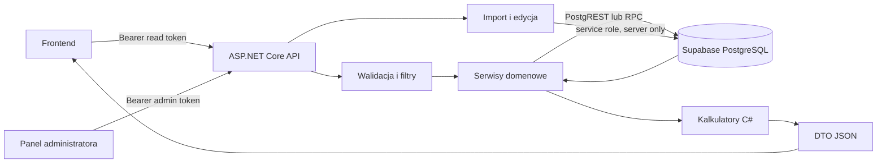

# racetrace-api

## 1. Cel systemu

racetrace-api jest backendem ASP.NET Core dla aplikacji analizującej zawody downhill. Łączy dane zapisane w Supabase z obliczeniami wykonywanymi w C# i udostępnia frontendowi:

- kalendarz, rundy, trasy, sesje i wyniki;
- zawodników, zespoły oraz historię startów;
- dynamiczny ranking z punktami, Rating, Pace, Consistency i Confidence;
- porównanie zawodników;
- podsumowanie bieżącego sezonu i predykcję podium;
- chronione operacje importu, edycji i ponownego przeliczania danych.

API nie zapisuje gotowego Ratingu jako źródła prawdy. Metryki są liczone z aktualnie wybranego zakresu danych. Dzięki temu ten sam zawodnik może mieć inny Rating dla jednego sezonu, pięciu sezonów, konkretnej kategorii, trasy lub klasy zawodów.

## 2. Architektura



Warstwy mają rozdzielone odpowiedzialności:

- kontrolery definiują adresy HTTP i przekazują żądania do serwisów;
- `QueryValidationService` normalizuje paginację, sortowanie, liczby, daty i listy CSV;
- serwisy domenowe pobierają tylko wymagane dane i składają odpowiedzi;
- `DomainQueryService` centralizuje zapytania PostgREST i zoptymalizowane funkcje RPC;
- kalkulatory C# wyliczają Pace, Consistency, Result Score, Rating i Confidence;
- middleware odpowiada za tokeny, obsługę błędów i spójny format odpowiedzi.

JSON używa nazw w formacie `snake_case`.

## 3. Autoryzacja i sekrety

Wszystkie ścieżki zaczynające się od `/api` oraz `/openapi` wymagają nagłówka:

```http
Authorization: Bearer <TOKEN>
```

Są dwa poziomy dostępu:

| Poziom | Konfiguracja | Zastosowanie |
|---|---|---|
| odczyt | `ApiAccess:ReadSecret` lub `API_READ_SECRET` | endpointy `/api/v1/*` |
| administrator | `Admin:ApiSecret` lub `ADMIN_API_SECRET` | import, edycja, usuwanie i przeliczanie |

Konfiguracja Supabase:

- `Supabase:Url` lub odpowiednia zmienna środowiskowa wskazuje projekt;
- `Supabase:AnonKey` służy do odczytu zgodnego z RLS;
- `Supabase:ServiceRoleKey` jest używany wyłącznie po stronie serwera do zapisu.

Token odczytu może być używany przez aplikację frontendową, ale nie należy umieszczać w niej `ServiceRoleKey` ani `ADMIN_API_SECRET`. Token administratora powinien trafiać wyłącznie do zaufanego panelu lub narzędzia administracyjnego.

## 4. Wspólne zasady zapytań

Większość list obsługuje:

- `page`, domyślnie `1`;
- `limit`, `pageSize` lub `page_size`, domyślnie `30`, maksymalnie `150`;
- `sort`, `sortBy` lub `sort_by`;
- `order`, `sortDirection` lub `sort_direction`, wartości `asc` albo `desc`;
- filtry wielowartościowe jako CSV, na przykład `seasons=2024,2025,2026`.

Filtry metryk są stosowane po obliczeniu metryk, a paginacja rankingu po wszystkich filtrach i sortowaniu. Pozycja `rank` opisuje więc miejsce zawodnika w aktualnie przefiltrowanym zestawie, a nie w globalnej tabeli.

Kategorie są normalizowane do czterech podstawowych wartości:

| Nazwa | Kod | Wartość filtra |
|---|---|---|
| Elite Men | `EM` | `elite_men` |
| Elite Women | `EW` | `elite_women` |
| Junior Men | `JM` | `junior_men` |
| Junior Women | `JW` | `junior_women` |

Starsze aliasy są akceptowane tam, gdzie przewiduje to parser, ale frontend powinien wysyłać wartości kanoniczne. Filtr kategorii należy przekazywać również w detalach i porównaniu riderów, aby nie łączyć wyników juniorskich z elitą.

## 5. Endpointy odczytu

### Wyszukiwanie i słowniki

| Metoda i ścieżka | Zastosowanie |
|---|---|
| `GET /api/v1/search` | wyszukiwanie encji publicznych |
| `GET /api/v1/conditions` | lista warunków |
| `GET /api/v1/competition-classes` | klasy zawodów, np. World Cup i World Champs |
| `GET /api/v1/points/systems` | dostępne systemy punktowe |
| `GET /api/v1/metadata` | nazwy, skróty, kolejność i aliasy kategorii, typów sesji oraz statusów |

Metadane prezentacji pochodzą z bazy (`categories`, `session_types`,
`display_statuses`). Odpowiedź zawiera `categories`, `sessionTypes`,
`roundStatuses` i `sessionStatuses` w formacie camelCase. Każdy wpis ma
`code`, `name`, `shortName`, `displayOrder`, `aliases`; kategorie dodatkowo
`gender`, `minAge`, `maxAge`, a sesje `abbreviation` i `groupName`.
To jeden lekki RPC `get_display_metadata`, z pięciominutowym output cache.
Zmiana nazwy lub dodanie wpisu nie wymaga nowej mapy etykiet we frontendzie.
Metadane nie określają wag, punktacji ani tego, czy sesja jest finałem.
Istniejące kody publiczne i ich aliasy pozostają kompatybilne.

Migracja i granice refactoru: `../docs/refactor-display-metadata.md`.

### Rundy i sesje

| Metoda i ścieżka | Zastosowanie |
|---|---|
| `GET /api/v1/rounds` | lekka, stronicowana lista rund posortowana domyślnie po dacie |
| `GET /api/v1/rounds/{round_id}` | szczegóły rundy |
| `GET /api/v1/rounds/{round_id}/image` | obraz rundy (WebP lub starszy PNG) |
| `GET /api/v1/rounds/{round_id}/sessions` | sesje należące do rundy |
| `GET /api/v1/rounds/{round_id}/results` | wyniki rundy |
| `GET /api/v1/sessions/common` | sesje wspólne dla przekazanych zawodników i filtrów |

Lista rund nie zawiera obrazu base64. Zwraca lekkie informacje o jego dostępności i adres endpointu obrazu. Endpoint obrazu przekierowuje do publicznego obiektu w bucketcie Supabase Storage `round-images`, dzięki czemu przeglądarka pobiera obraz bezpośrednio ze Storage i może korzystać z długiego cache. Nowe obrazy PNG są automatycznie kodowane jako WebP podczas importu; istniejące PNG pozostają czytelne. Zdjęcia wspólne dla venue są przechowywane tylko raz w `venue_images` i przypisywane do tras; wszystkie rundy danej trasy korzystają z tego samego obiektu.

### Wyniki

| Metoda i ścieżka | Zastosowanie |
|---|---|
| `GET /api/v1/sessions/{session_id}/results` | kompletna lista wyników sesji z timingiem |
| `GET /api/v1/results/{result_id}` | szczegóły pojedynczego wyniku |
| `GET /api/v1/results/{result_id}/time-splits` | splity pojedynczego wyniku |

Endpoint wyników sesji obsługuje `timeView=sectors` oraz `timeView=splits`:

- split to czas narastający od startu;
- sektor to różnica między kolejnymi splitami;
- `gap_to_best` porównuje czas z najlepszym czasem danego splitu lub sektora;
- jedyny lider może otrzymać wartość ujemną pokazującą przewagę nad drugim czasem;
- `race_time` ma gap do najszybszego wyniku na mecie;
- średnia prędkość przejazdu jest liczona z długości trasy i czasu przejazdu;
- brakujące lub niewiarygodne dane nie są sztucznie uzupełniane.

Na początku listy może pojawić się syntetyczny `Perfect Run`. Nie ma ridera ani numerowanej pozycji. Składa się z najszybszego poprawnego czasu każdego sektora i nie zwiększa liczby rekordów paginacji.

### Riderzy

| Metoda i ścieżka | Zastosowanie |
|---|---|
| `GET /api/v1/riders` | alias listy rankingowej riderów |
| `GET /api/v1/riders/{rider_id}` | dane podstawowe ridera i opcjonalne relacje |
| `GET /api/v1/riders/{rider_id}/metrics` | publiczne statystyki ridera |
| `GET /api/v1/riders/{rider_id}/overview` | zbiorczy ekran szczegółów ridera |
| `GET /api/v1/riders/{rider_id}/results` | historia wyników pogrupowana dla frontendu |
| `GET /api/v1/riders/{rider_id}/venues` | osiągnięcia i metryki na trasach/venue |
| `GET /api/v1/riders/{rider_id}/team-history` | okresy przynależności ridera do teamów |

Metryki ridera używają tego samego źródła i kalkulatorów co główny ranking. Przy tych samych filtrach Rating, Pace, Consistency i Confidence powinny być zgodne.

Detale ridera zwracają `gender` jako `male`, `female` albo `null`. Wartość jest wyprowadzana podczas importu z kategorii Elite Men, Junior Men, Elite Women lub Junior Women. Import kategorii nierozpoznanej nie usuwa wcześniej zapisanej wartości.

Historia teamów obsługuje opcjonalne filtry `dateFrom` i `dateTo`. Każdy okres zawiera `teamId`, `teamName`, `teamCode`, `validFrom`, opcjonalne `validTo`, `isCurrent` i `sourceRoundId`. `validTo = null` oznacza najnowszy znany team, a nie gwarancję aktywnego kontraktu w dniu dzisiejszym.

### Ranking

`GET /api/v1/ranking`

Ranking zwraca między innymi:

- pozycję po aktualnym filtrowaniu i sortowaniu;
- ridera, kraj, zdjęcie profilowe i aktualny lub ostatni znany team;
- punkty, Rating, Pace, Consistency i Confidence;
- liczbę startów oraz startów w finałach;
- `finals_count`, czyli liczbę finałów, w których rider wystartował;
- `quali_rate`, czyli udział rund zakończonych startem w finale spośród rund, w których rider rozpoczął co najmniej jedną sesję;
- średnią pozycję ze wszystkich rozpoczętych sesji;
- wygrane, podia oraz progi Top N liczone z finałów.

Najważniejsze filtry obejmują sezony, daty, trasy, venue, kraj trasy, warunki, klasy zawodów, kategorię, ridera i kraj ridera. Dostępne są też zakresy punktów, Rating, Pace, Consistency, Confidence, liczby startów oraz liczby startów finałowych.

`confidence=81` działa jako minimalny Confidence 81. Można też używać zakresu `minConfidence` i `maxConfidence`.

Opcjonalny parametr `comparison=previousRound` dodaje do każdego ridera lekkie pole `positionChange` bez zwracania drugiej tabeli. Oznacza ono zmianę pozycji po aktualnym sortowaniu; wartość dodatnia to awans. `comparisonBasis` ma wtedy wartość `previousRound`. Jeśli w zakresie istnieje tylko jedna runda, `positionChange` i `comparisonBasis` mają wartość `null`.

`comparison=defaultFilters` porównuje bieżący, zawężony ranking z pełnym zestawem dla tego samego sezonu i kategorii. Filtry trasy, warunków, klasy, dat, sesji, wyszukiwania i progów metryk nie są stosowane do zestawu bazowego. Jeśli zestaw bieżący i bazowy obejmują te same sesje oraz riderów, API automatycznie porównuje go z poprzednią rundą i zwraca `comparisonBasis=previousRound`; w przeciwnym razie zwraca `comparisonBasis=defaultFilters`.

`comparison=previousFilters` przyjmuje bazowy zestaw przez parametry `comparisonSeason`, `comparisonCategory`, `comparisonTrackId`, `comparisonConditionId`, `comparisonCompetitionClassId` i `comparisonSearch`. API przelicza pełny ranking bazowy i zwraca wyłącznie zmianę pozycji przy bieżących rekordach, dzięki czemu porównanie nie jest ograniczone do poprzedniej strony paginacji. Zmiana kolumny lub kierunku sortowania nie zmienia zestawu bazowego; oba zestawy są jedynie ponownie pozycjonowane według tego samego parametru.

### Porównanie

`GET /api/v1/compare?riderIds=12,34&seasons=2025&category=elite_men`

Można porównać od 2 do 10 riderów. Endpoint stosuje te same filtry i kalkulatory co ranking oraz zwraca:

- pełną listę przefiltrowanych sesji i wyników porównywanych riderów w `sessions`;
- wins, podiums, Top 5 i Top 10 z finałów;
- Rating, Pace, Consistency i Confidence;
- wiek, bieżącą kategorię, kategorie z wybranego zakresu oraz najnowszy team z kodem;
- `pointsProgress` z punktami zdobytymi w kolejnych wynikach i sumą narastającą;
- `roundMetrics` z Rating, Pace, Consistency i Confidence wyliczonymi osobno dla każdej rundy;
- wygrane splity i sektory;
- średnią pozycję finałową i przedfinałową;
- sesje, w których wystartowali wszyscy porównywani riderzy;
- średni gap na mecie i na sektorach względem najlepszego ridera z przekazanej listy.

`commonSessions` zawiera tylko sesje rozpoczęte przez wszystkich porównywanych riderów. DNF jest startem, a DNS nie jest. Średni gap na mecie jest liczony względem najszybszego sklasyfikowanego czasu z wybranej grupy. Gap sektora trafia do średniej tylko wtedy, gdy każdy porównywany rider ma prawidłowy czas tego sektora. Dzięki temu niepełny przejazd DNF może uczestniczyć w porównaniu na sektorach ukończonych przez całą grupę. Sesje są zwracane na poziomie odpowiedzi, zamiast powielać pełną historię przy każdym riderze.

### Trasy i teamy

| Metoda i ścieżka | Zastosowanie |
|---|---|
| `GET /api/v1/tracks` | lista tras z nazwą, venue, krajem i parametrami |
| `GET /api/v1/tracks/{track_id}` | szczegóły trasy |
| `GET /api/v1/tracks/{track_id}/records` | rekordy i najlepsze wyniki trasy |
| `GET /api/v1/teams` | lista teamów |
| `GET /api/v1/teams/{team_id}` | team, riderzy, kategorie i średni Rating |

Team zapisany bezpośrednio przy wyniku ma pierwszeństwo i zachowuje dokładny kontekst startu. Jeśli wynik nie zawiera teamu, API dobiera wpis historii obowiązujący w dniu sesji. Ranking dobiera team według daty ostatniego wyniku ridera w aktualnie filtrowanym zakresie, dlatego filtr obejmujący wyłącznie World Champs nadal może zwrócić właściwy team. Lista teamów korzysta z najnowszego otwartego okresu historii zamiast przypisywać ridera do każdego teamu występującego w dawnych wynikach.

### Bieżący sezon

| Metoda i ścieżka | Zastosowanie |
|---|---|
| `GET /api/v1/seasons/{season}/overview` | lekki kalendarz: następna i ostatnia ukończona runda oraz postęp sezonu |
| `GET /api/v1/analytics/round-profile` | wyniki ostatniego finału, field spread i track fingerprint; obsługuje `season`, `category` i opcjonalny `roundId` |
| `GET /api/v1/analytics/riders/{riderId}/pressure-performance` | Pace ridera w kwalifikacjach i finałach, zestawione dla kolejnych rund |
| `GET /api/v1/podium-predictor` | Top 10 kandydatów Elite do podium następnej rundy; opcjonalny `roundId` uruchamia predykcję historyczną as-of wskazanej rundy |

Home składa dane równolegle z `seasons/{season}/overview`, `analytics/round-profile`, dwóch lekkich widoków `ranking` oraz `podium-predictor`. Następna i ostatnia runda są wybierane po dacie, niezależnie od numeru rundy, kolejności importu i klasy zawodów. `round-profile` pobiera jedną paczkę preagregowaną i wykorzystuje ją wspólnie do wyników, prędkości, spreadu stawki i charakterystyki sektorów.

Podium Predictor buduje dla każdego kandydata oczekiwany performance (`expectedPerformance`), niepewność (`performanceUncertainty`) i ryzyko incydentu (`incidentProbability`). Wersjonowana kalibracja korzysta z Ratingu, Pace, ważonej czasowo formy, affinity trasy i warunków, danych bieżącego weekendu, kontekstu WCH oraz reakcji ridera na presję generalki. Confidence wykonuje shrinkage w stronę średniej stawki i razem z Consistency steruje głównie niepewnością, zamiast działać jak prosty bonus do performance.

Cała stawka jest symulowana 50 000 razy rozkładem Student-t. Endpoint zachowuje dotychczasowe pola i dodatkowo zwraca `winProbability`, `top5Probability`, `expectedPosition`, `expectedPerformance`, `performanceUncertainty`, `incidentProbability`, `context` oraz `modelVersion`. Wszystkie historyczne cechy są ograniczone datą przewidywanej rundy, a dane finału będącego celem predykcji są wykluczone.

Walk-forward backtest na 25 finałach Elite Men z sezonów 2023–2025 dał dla starego/nowego modelu: Podium Recall @3 `0.48/0.54`, Podium Recall @5 `0.6333/0.7067` i Brier Score `0.3274/0.1927` (niżej jest lepiej). Winner Accuracy wyniosło `0.32/0.12`, więc nowy model lepiej opisuje całe podium i kalibruje prawdopodobieństwa, ale wymaga dalszej kalibracji, jeżeli priorytetem ma być wyłącznie wskazanie zwycięzcy.

Predykcja jest dostępna tylko dla `elite_men` i `elite_women`. Dla kategorii juniorskich endpoint zwraca `round: null` oraz pustą tablicę `items`. Kandydatem może zostać tylko rider mający wynik w wybranej kategorii w bieżącym sezonie; dane z poprzedniego sezonu i historii trasy wpływają na jego score, ale same nie dodają go do listy. Status juniora jest wyznaczany z daty urodzenia (`wiek < 19`), a nie z kodu kategorii. Jeżeli rider był juniorem w poprzednim sezonie, jego predykcja Elite wykorzystuje wyłącznie Rating z bieżącego sezonu i pomija historię trasy oraz Rating z poprzedniego sezonu.

### Live

| Metoda i ścieżka | Zastosowanie |
|---|---|
| `GET /api/v1/live/sessions` | aktywne sesje |
| `GET /api/v1/live/sessions/{session_id}` | stan sesji live |
| `GET /api/v1/live/sessions/{session_id}/leaderboard` | bieżący leaderboard |

## 6. Jak liczone są metryki

### Pace

Pace opisuje faktyczne tempo ridera, a nie samą końcową pozycję. Obliczenie przebiega etapami:

1. Czasy narastające splitów są zamieniane na czasy sektorów.
2. Rider jest porównywany ze stawką osobno na każdym sektorze.
3. Wynik sektora łączy pozycję/percentyl i względną stratę czasową. Aktualnie czas ma większy udział niż sama ranga.
4. Najmocniejsze sektory i wszystkie poprawne sektory są łączone w Pace sesji.
5. Pokrycie trasy, wielkość stawki i liczba wiarygodnych sektorów określają Confidence oraz efektywną wagę sesji.
6. Pace ridera powstaje z potęgowej średniej ważonej Pace sesji, a na końcu przechodzi kontrolowaną kalibrację skali.

Aktualne proporcje typów sesji:

| Typ sesji | Waga |
|---|---:|
| Final | 8.00 |
| Semi-final | 2.00 |
| Qualifying | 1.50 |
| Seeding | 0.60 |
| Timed training | 0.00 |
| Training | 0.00 |

Wagi są proporcjami w średniej, nie procentami i nie są ręcznie normalizowane. Final ma więc ponad pięć razy większy udział niż kwalifikacje przy identycznym Confidence i pokryciu.

Końcowa pozycja nie dodaje automatycznego bonusu do Pace. Wyjątkiem jest ograniczony bonus dominacji: zwycięzca może otrzymać dodatkowe punkty za rzeczywistą przewagę czasową nad P2. Top speed ma tylko niewielki dodatni wpływ i nie obniża Pace.

Kalkulator wykrywa pojedynczy skrajnie wolny sektor jako możliwy incydent. Taki sektor nie zaniża Pace, a wynik czasu przejazdu jest wtedy oceniany na podstawie ostatniego wiarygodnego splitu. Sektory po incydencie mogą wrócić do obliczeń, ale tylko gdy opcja jest włączona i tempo jest pozytywne oraz reprezentatywne dla ridera.

Rider bez kluczowej sesji nie może uzyskać nieograniczenie wysokiego Pace wyłącznie z małej próbki kwalifikacyjnej. Etap osiągnięty podczas rundy, łączna liczba sektorów i obecność finałów wpływają na dostęp do górnej części skali oraz Confidence.

### Consistency

Consistency opisuje wyłącznie powtarzalność oficjalnych pozycji ridera względem jego własnego trendu. Nie korzysta z Pace, czasów sektorów, wielkości stawki ani jakości zajmowanych miejsc, dlatego stałe P1 i stałe P100 mogą otrzymać 100.

Kalkulator bierze ostatnie 12 sklasyfikowanych wyników, stosuje centralne wagi sesji, wyznacza ważoną regresję liniową pozycji w czasie, a następnie liczy rozrzut residuali jako `0.80 * 1.4826 * weighted MAD + 0.20 * clipped RMSE`. Historyczna kalibracja 18 576 wyników i 16 172 rolling windows dała medianę spreadu `3.4`, dlatego wynik jest mapowany funkcją `100 / (1 + (spread / 6.8001)^2)`. DNS, DNF i DSQ są całkowicie ignorowane. Ilość danych nie obniża Consistency; osobne `consistency_evidence` (kompatybilne z dotychczasowym `consistency_confidence`) opisuje siłę próbki.

### Result Score

Result Score reprezentuje ostateczne pozycje i odpowiada za ich wpływ na Rating. Jest liczony tylko z rozpoczętych, istotnych sesji:

- P1 otrzymuje 100;
- P2 jest zakotwiczone w okolicy 96;
- dalsze miejsca są liczone krzywą logarytmiczno-potęgową zależną również od wielkości stawki;
- różnice w ścisłej czołówce są większe niż w środku tabeli;
- DNS jest pomijany;
- DNF otrzymuje 0 dla danej rozpoczętej sesji;
- wynik sesji jest ważony wagą jej typu oraz względną wagą klasy zawodów.

Klasa ma znaczenie tylko wtedy, gdy w wybranym zakresie występuje więcej niż jeden poziom. Najwyższy poziom uzyskuje większą wagę względem niższego. Jeśli filtr zawiera wyłącznie jedną klasę, wspólny mnożnik nie zmienia wyniku.

### Rating

Surowy Rating jest składany następująco:

```text
Raw Rating = 70% Pace + 15% Consistency + 15% Result Score
```

Jeśli Result Score nie może zostać policzony, aktywne składniki są proporcjonalnie renormalizowane. Następnie stosowana jest łagodna, monotoniczna kalibracja kontrastu. Jej wpływ jest mieszany z wynikiem zgodnie z łącznym Confidence, więc mała próbka nie otrzymuje pełnego efektu kalibracji.

W praktyce Pace jest głównym składnikiem Ratingu, Consistency nagradza powtarzalność, a Result Score rozdziela riderów na podstawie realnych pozycji w ważnych sesjach. Publicznie prezentowane Pace i Consistency są liczone bez wpływu klasy. Do wyliczenia Ratingu powstają osobne warianty Pace, Consistency i Result Score z wagami klas. Dzięki temu klasa wpływa na Rating, ale nie zmienia wartości Pace i Consistency pokazywanych jako niezależne metryki.

### Confidence

Confidence nie jest oceną szybkości. Określa ilość i jakość dowodów stojących za Pace:

- rośnie wraz z liczbą wiarygodnych sektorów i sesji;
- uwzględnia pokrycie trasy i wielkość stawki;
- pełne finały dostarczają najwięcej dowodów;
- brak finałów nakłada ograniczenie;
- udział w części sezonu jest odnoszony do dostępnych kluczowych sesji;
- mała próbka nie może wyglądać równie wiarygodnie jak pełny sezon.

W API Confidence jest zwykle zwracany w skali `0-100`. Pola typu rate w wybranych DTO mogą być znormalizowane do `0-1`; frontend powinien kierować się kontraktem konkretnego pola, a nie mnożyć każdej wartości automatycznie przez 100.

## 7. Punkty

Punkty są oddzielone od Ratingu. System punktowy określa liczbę punktów za pozycję dla sezonu, kategorii i klasy zawodów. Endpoint administracyjny może przeliczyć punkty po zmianie konfiguracji.

Brak skonfigurowanego systemu punktowego nie unieważnia importu wyników. Import może zakończyć się ostrzeżeniem, że `recalculate_session_points` nie zostało wykonane. Wyniki pozostają zapisane, a punkty można przeliczyć później.

## 8. Import i administracja

Endpointy administracyjne wymagają tokena administratora.

| Metoda i ścieżka | Działanie |
|---|---|
| `POST /api/admin/import/chronorace/session` | import pojedynczej sesji ChronoRace |
| `POST /api/admin/import/results/session` | alias importu sesji |
| `POST /api/admin/import/chronorace/round-form` | formularz rundy z wieloma sesjami |
| `POST /api/admin/import/results/round-form` | alias formularza rundy |
| `POST /api/admin/import/results/round-form/pdf` | multipart: formularz rundy oraz jeden lub kilka PDF-ów z wynikami |
| `POST /api/admin/rounds` | utworzenie rundy, również planowanej |
| `POST /api/admin/import/riders/profile-images` | import adresów zdjęć riderów |
| `GET /api/admin/editable-resources` | lista zasobów dopuszczonych do edycji |
| `PATCH /api/admin/riders/{rider_id}` | częściowa edycja ridera, np. zdjęcie lub `has_injury` |
| `PATCH /api/admin/{resource}/{id}` | częściowa edycja dozwolonego zasobu |
| `PATCH /api/admin/rounds/{round_id}/track` | edycja trasy przypisanej do rundy |
| `PUT /api/admin/rounds/{round_id}/image` | dodanie lub zastąpienie obrazu rundy (wejściowy PNG, zapis WebP) |
| `POST /api/admin/round-images/convert-webp?limit=10` | konwersja partii starszych PNG rund i venue do WebP |
| `DELETE /api/admin/rounds/{round_id}` | usunięcie rundy zgodnie z relacjami bazy |
| `POST /api/admin/sessions/{session_id}/reimport` | ponowny import sesji |
| `POST /api/admin/sessions/{session_id}/supplement/uci-mtb-world-series` | uzupełnienie sesji JSON-em UCI MTB World Series |
| `POST /api/admin/points/recalculate` | ponowne przeliczenie punktów |

Importer normalizuje różne źródła do jednego modelu: runda, trasa, kategoria, sesja, rider, team, wynik i splity. Rider jest identyfikowany przede wszystkim przez UCI ID/UCI code, a nie samo nazwisko. To chroni przed połączeniem osób o tym samym nazwisku, na przykład rodzeństwa.

ChronoRace i format mistrzostw świata mogą mieć inne struktury JSON. Warstwa normalizacji mapuje je do wspólnego modelu, natomiast typ sesji może być podany jawnie w formularzu. Zapisy są wykonywane partiami i przez upsert na unikalnych kluczach. Service role pozostaje wyłącznie na serwerze.

Import PDF używa `multipart/form-data`. Pole `request` zawiera JSON o strukturze formularza rundy, ale każda kategoria wskazuje `pdf_file_name`; odpowiadające pliki są przekazywane jako powtarzalne pole `files`. Parser obsługuje oficjalną tabelę Individual Results z UCI ID, numerem, pozycją, statusem, prędkością, czterema splitami i czasem końcowym, także dla Pucharu Świata i Mistrzostw Świata. Konfiguracja sesji, kategorii, warunków, klasy zawodów i kontekstu pochodzi z pola `request`, a nie z nagłówka PDF.

Jeśli źródło nie zawiera teamu, import i odczyt wyników szukają go w `rider_team_history`: najpierw dla okresu obejmującego datę sesji, a następnie w najbliższym znanym okresie. Jawny team z wyniku ma zawsze pierwszeństwo. Fallback nie tworzy wpisu historii i nie zastępuje istniejącego teamu; brak jest zwracany dopiero wtedy, gdy rider nie ma żadnej znanej historii.

Runda może mieć administracyjny status `live`. `POST /api/admin/rounds` przyjmuje też opcjonalny `context_name` i obraz PNG w `image`, kodowany automatycznie jako WebP; formularz importu rundy nadal obsługuje `round.context_name`, `round.status = "live"` oraz `image`. Status wymaga migracji `20260820_live_round_status.sql`.

Po imporcie wyniku zawierającego jawny team API przebudowuje okresy historii tylko dla riderów obecnych w tym imporcie. Import World Champs lub innego źródła bez teamów nie zamyka okresu, nie tworzy pustego wpisu i nie zmienia historii ridera.

## 9. Dlaczego rozwiązanie jest wydajne

### Jedno zwarte pobranie dla rankingu

Najcięższy ekran nie wykonuje osobnego zestawu zapytań dla każdego ridera. Funkcja Supabase `get_ranking_data` zwraca zwarty pakiet danych potrzebnych kalkulatorom. Dla detalu ridera istnieje węższa funkcja `get_rider_detail_data`.

Pakiet rankingowy zawiera tylko niezbędne pola, wyniki riderów oraz preagregowane dane sektorowe. Mediany, MAD, rangi sektorów, cumulative time, finish time i top speed są liczone raz w SQL dla sesji. Surowe wyniki całej stawki i surowe splity nie są przesyłane do głównego rankingu. Statystyki wspólne dla sesji/sektora występują w JSON-ie tylko raz, a przy riderze pozostają jego czas i ranga. Kalkulatory C# zachowują końcową logikę Pace, Consistency, Result Score i Rating.

Endpoint rankingu zwraca nagłówek `Server-Timing` z etapami `supabase`, `calculations` i `api`. `supabase` obejmuje wykonanie RPC, transfer odpowiedzi do API i parsowanie JSON; `calculations` obejmuje kalkulatory C#; `api` oznacza całkowity czas serwera do utworzenia DTO. W narzędziach deweloperskich przeglądarki różnica między pełnym czasem requestu i `api` pokazuje w przybliżeniu serializację oraz transfer API → frontend. Do pomiarów bez trafienia w output cache można dodać unikalny, ignorowany parametr query.

### Filtrowanie przed kosztownymi obliczeniami

Sezony, klasy, kategorie, trasy, daty i warunki ograniczają sesje oraz wyniki jeszcze przed uruchomieniem kalkulatorów. API nie pobiera pełnej bazy tylko po to, aby odrzucić większość danych na końcu.

### Single-flight

Jeżeli kilka równoczesnych żądań potrzebuje identycznego snapshotu rankingu, `RankingSingleFlight` uruchamia jedno obliczenie. Pozostali klienci czekają na ten sam `Task`. Po zakończeniu wpis jest usuwany, więc mechanizm nie przechowuje stale danych i nie zastępuje cache.

### Krótki output cache

- ranking ma output cache 30 sekund;
- season summary ma output cache 60 sekund;
- klucz uwzględnia wszystkie parametry query;
- tylko poprawne odpowiedzi `200` bez `Set-Cookie` trafiają do cache;
- mechanizm blokuje równoległe tworzenie tej samej odpowiedzi.

Cache ogranicza serię identycznych odczytów z frontendu, ale zachowuje dynamiczny charakter danych.

### Obrazy poza JSON-em

Zdjęcia rund są pobierane osobnym endpointem jako WebP (starsze: PNG) i mogą mieć `Cache-Control`. Ranking, detale ridera i pozostałe listy nie przenoszą binarnego obrazu rundy. Eliminuje to base64, które zwiększa rozmiar danych i zużycie pamięci.

Przed pierwszym importem WebP zastosuj `Database/20261013_round_images_webp.sql` (Storage dopuszcza wtedy oba formaty). Istniejące obrazy można konwertować partiami wywołując administracyjny endpoint aż obie liczby `*_converted` będą zerowe. Stare obiekty PNG w Storage pozostają przez czas życia cache przekierowań (24 godziny); usuń je później po upewnieniu się, że żaden rekord już na nie nie wskazuje. Operację należy wykonać po wdrożeniu nowego API i migracji bazy.

### Pozostałe mechanizmy

- kompresja odpowiedzi działa także przez HTTPS;
- klient Supabase automatycznie rozpakowuje gzip, deflate i Brotli;
- zapytania wybierają konkretne kolumny zamiast `select *` w ciężkich ścieżkach;
- indeksy wspierają filtry i relacje używane przez ranking;
- preagregacja detalu ridera ogranicza powtarzane liczenie w PostgreSQL;
- sortowanie i paginacja są wykonywane możliwie blisko właściwego etapu przetwarzania;
- limit 150 chroni listy przed przypadkowym zwróceniem nieograniczonej odpowiedzi;
- zapis importu jest grupowany w paczki.

## 10. Dlaczego obliczenia pozostają dynamiczne

Gotowe Ratingi w tabeli byłyby szybsze dla jednego z góry ustalonego rankingu, ale przestałyby być poprawne po dowolnym filtrze. Obecna architektura pozwala policzyć metryki dla:

- jednego sezonu lub wielu sezonów;
- tylko World Cup, tylko World Champs albo obu klas;
- konkretnej kategorii;
- wybranej trasy, kraju, venue lub warunków;
- dowolnego przedziału dat.

API wykorzystuje więc kompromis: baza wykonuje selekcję, relacje i część preagregacji, a C# wykonuje złożone algorytmy domenowe. Jest to bardziej elastyczne i łatwiejsze do testowania niż przeniesienie całej matematyki do SQL, a zwarte RPC ograniczają główną wadę tego podejścia, czyli liczbę połączeń.

Koszt nadal rośnie wraz z liczbą sezonów, wyników i splitów. Zapytanie obejmujące pięć sezonów musi przeanalizować więcej danych niż jeden sezon. Funkcje RPC, indeksy, preagregacja, single-flight i cache zmniejszają ten wzrost, ale nie mogą go całkowicie usunąć bez materializowania gotowych agregatów w bazie.

## 11. Błędy i statusy HTTP

API zwraca spójny obiekt błędu z kodem aplikacyjnym i komunikatem. Typowe statusy:

- `400` dla niepoprawnego filtra lub danych wejściowych;
- `401` dla brakującego albo błędnego tokena;
- `403` dla próby operacji administracyjnej niewłaściwym tokenem;
- `404` dla nieistniejącego zasobu;
- `409` dla konfliktu unikalności;
- `500` dla błędu bazy lub nieobsłużonego przypadku;
- `503` dla brakującej lub niedostępnej konfiguracji zależności.

Supabase `57014` oznacza przerwanie zapytania przez `statement_timeout`. Dla ciężkiego detalu ridera funkcja bazowa ma wydłużony limit, lecz częste timeouty nadal wskazują na zbyt szeroki zakres, brakujący indeks albo plan zapytania wymagający ponownej analizy.

## 12. Przykładowe użycie

Ranking Elite Men dla sezonów 2024-2026, minimum pięć finałów:

```http
GET /api/v1/ranking?seasons=2024,2025,2026&category=elite_men&minFinalStarts=5&sort=rating&order=desc&page=1&limit=30
Authorization: Bearer <READ_TOKEN>
```

Wyniki sesji w trybie sektorów:

```http
GET /api/v1/sessions/123/results?timeView=sectors&page=1&limit=150
Authorization: Bearer <READ_TOKEN>
```

Porównanie riderów na jednej trasie:

```http
GET /api/v1/compare?riderIds=12,34,56&seasons=2023,2024,2025&tracks=7&category=elite_men
Authorization: Bearer <READ_TOKEN>
```

Pobranie zdjęcia rundy:

```http
GET /api/v1/rounds/12/image
Authorization: Bearer <READ_TOKEN>
```

## 13. Pliki bazodanowe

Repozytorium zawiera skrypty wspierające obecny kontrakt i wydajność:

- `20260720_public_api_read_indexes.sql` dodaje indeksy dla publicznych odczytów;
- `20260720_stage1_competition_levels_and_point_systems.sql` wprowadza klasy zawodów i systemy punktowe;
- `20260726_planned_round_status.sql` obsługuje planowane rundy;
- `20260730_delete_round_cascade.sql` definiuje bezpieczne usuwanie rundy z zależnościami;
- `20260801_compact_ranking_data_rpc.sql` dostarcza zwarty pakiet danych rankingowych;
- `20260801_rider_detail_preaggregation.sql` optymalizuje wielosezonowe detale ridera;
- `20260803_normalize_category_names_and_codes.sql` normalizuje nazwy oraz kody kategorii;
- `20260812_rider_team_history.sql` tworzy i uzupełnia historię teamów na podstawie istniejących wyników;
- `20260812_rider_gender.sql` dodaje płeć ridera i uzupełnia ją na podstawie historycznych kategorii wyników;
- `20260812_rollback_ranking_preaggregation.sql` aktualizuje ranking, aby wybierał team z historii według daty;
- `20260820_round_images_supabase_storage.sql` tworzy publiczny bucket obrazów, współdzielone zdjęcia venue i obsługę ścieżek Storage dla obrazów przypisanych bezpośrednio do rund;
- `20260820_fix_2021_points_and_missing_result_teams.sql` uzupełnia bonusową punktację finału sezonu 2021 z tabeli 2022 oraz przypisuje brakujące teamy w pierwszych dwóch rundach 2021 na podstawie najbliższego wpisu historii.

Skrypty SQL powinny być wdrażane świadomie w Supabase. Dla historii teamów najpierw należy uruchomić `20260812_rider_team_history.sql`, a następnie `20260812_rollback_ranking_preaggregation.sql`. Kod API zakłada istnienie funkcji RPC i indeksów opisanych przez aktualne migracje.

## 14. Najważniejsze gwarancje kontraktu

1. Ten sam zakres filtrów używa wspólnych kalkulatorów w rankingu, porównaniu i detalach ridera.
2. DNS nie obniża metryk opartych na rozpoczętych przejazdach.
3. Wygrane, podia i Top N są statystykami finałów.
4. `finals_count` jest liczbą, nie procentem.
5. Rundy są domyślnie porządkowane chronologicznie, również między różnymi klasami zawodów.
6. Obrazy rund nie są osadzane jako base64 w ciężkich odpowiedziach JSON.
7. Paginacja rankingu następuje po filtrach oraz obliczeniach wymaganych przez sortowanie.
8. Klasa zawodów może zmienić Rating przez wewnętrzne ważenie jego składowych, ale nie zmienia publicznie zwracanych Pace i Consistency.
9. Service role i token administratora nigdy nie powinny trafić do klienta publicznego.
10. Metryki są dynamiczne i opisują dokładnie zakres danych wybrany przez klienta.
11. Brak teamu w źródle importu nie usuwa ani nie skraca istniejącej historii teamów ridera.
