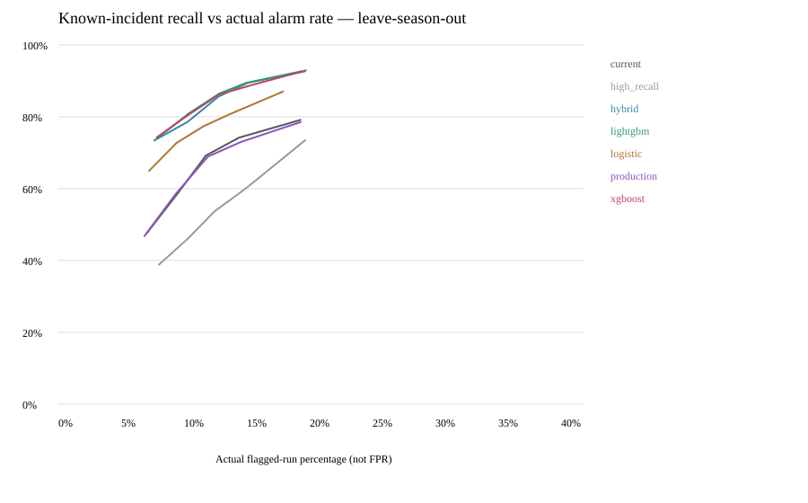

# RaceTrace incident ML research — measured offline results

## Decision

**Current search status: The tighter target of at least 307/341 at no more than 700 actual alarms is not achieved.** Best completed measured point without an explicit stage input: **235/341 (68.91%) at 653 alarms**, `incident-ml-reviewed-history/quarantine-only`. The absence of an explicit stage column does not imply absence of reporting or availability bias. This is the label-quarantine control, not a new scoring formula. Its one-hit gain over the previous 234/657 point is small; forward checks and auxiliary reviewed outcomes do not establish a general improvement.

**Continue ML research; do not deploy yet.** The learned PU ranking improves known-incident recall at comparable alarm rates. This does not establish a lower false-positive rate: a representative negative test set is absent. Forward 2026 performance is weaker than 2025; the ONNX conversion also fails native-score parity. No production calculator, database, API contract or frontend was changed by this research.

## Initial strict-target experiment (historical)

**In the initial conditional-timing experiment, the target of at least 307/341 known hits with at most 700 actual alarms was NOT achieved.** Within that experiment, the highest observed recall among its tested operating points under the cap was 155/341 with 633 alarms (matched-peers). Matched-peer references, learned conditional sector-time reconstruction and their combination were actually trained and tested. These do not establish a solution to the stricter requirement. The original results below are retained for transparency; they must not be presented as meeting the newly agreed goal. The full acceptance experiment is appended at the end of this report.

## Data and audit

Actual corpus: **20,340 runs**, **341 distinct matched positive runs**, 411 source observations; **30 runs with explicit sector labels**. Repeated observations count once. Training/ambiguous sessions and unavailable DNS/DSQ results follow the existing C# matching exclusions. The lists are incomplete and opportunistically reported; unlabelled runs are unknown, never verified clean examples.

Source documents are external; descriptions/health narratives/URLs are not copied into the dataset. Only explicit sector numbers are extracted for localization evaluation, not all sectors of a positive run. No new database/provider requests were made. Input hashes and protected C# source hashes are in the manifest.

| Input check | Observed |
| --- | --- |
| category_mismatches | 0 |
| different_missing_padding | 690 |
| duplicate_run_keys | 0 |
| empty_runs | 50 |
| finish_sum_checked | 19554 |
| finish_sum_mismatch_over_10ms | 0 |
| missing_sectors | 2196 |
| noncontiguous_sector_indices | 0 |
| nonpositive_measured_sectors | 0 |
| run_sector_time_mismatches | 0 |
| runs | 20340 |
| varying_field_sample_count | 13250 |

The 690 representation differences are trailing missing-checkpoint padding, not different measured times. The corpus includes 50 runs without sector entries. Complete measured-sector sums agree with official finish times within 10 ms for all 19,554 checked runs: these are sector durations, not cumulative splits. 13,250 runs have different reference-field counts across sectors; this uncertainty is represented in features, not silently treated as an unchanged cohort. Eight runs have the research compensating-checkpoint quality feature. A missing timing is not evidence of a specific crash location.

## Models, features and validation

Seventy-one features summarize sector timing relative to its field, leave-one-sector-out median expectations, absolute/relative/log losses, robust deviation, rank contrast, neighbour contrast, recovery, field size/spread, sample-size changes, missing data and checkpoint quality. Expected times are diagnostic references, not validated counterfactual corrected race times. Identities, season, venue, team, category, final rank/time and DNF status are not in the feature matrix.

Three deterministic case-control PU bags are fitted per logistic/LightGBM/XGBoost model. Each bag contains observed positives and a subsample of the contaminated unlabelled population. This is a genuine learned observed-label ranking model, not a calibrated crash classifier or an unbiased PU-risk estimator. Scores must not be presented as crash probabilities. Reporting is not assumed random (SCAR). The hybrid is 0.85 × LightGBM score + 0.15 × original C# flag; its weights were fixed before evaluation.

Six leave-whole-season-out tests and two forward tests were actually run. In each training partition, the latest available year is reserved for calibration and selection between two hyperparameter settings; estimator fitting excludes that calibration year. Forward 2025 therefore fits 2021–2023, calibrates on 2024 and tests 2025. Forward 2026 fits 2021–2024, calibrates on 2025 and tests 2026. All categories/sessions of a round stay together. Leave-season-out is transfer testing, not always chronological forecasting: later years can train an earlier-year fold.

Thresholds target each requested budget on calibration data only; strict > handles ties conservatively. Actual held-out alarm rates are shown and are not retrospectively forced to the target. Field summaries and later sectors are available after the session; this is retrospective assessment, not live prediction. All these years influenced earlier detector/feature development; none is a pristine untouched external benchmark. The same rider can recur between years, though no rider identifier is a predictor.

## Fixed C# classifiers at their original operating points

| Classifier | Known hits / 341 | Recall | Alarms / 20,340 | Alarm rate |
| --- | --- | --- | --- | --- |
| production | 205/341 | 60.12% | 1877 | 9.23% |
| current | 216/341 | 63.34% | 2117 | 10.41% |
| high_recall | 298/341 | 87.39% | 6761 | 33.24% |

`production` is the original frozen 205/341 baseline. `current` is the local conservative 216/341 variant that existed before this ML task, not a claim about the deployed server. `high_recall` is the archived 298/341 experiment. These C# implementations were not changed or retrained by this experiment.

## All budgets — pooled leave-season-out predictions

Every run contributes exactly once to this pooled table. C# budget curves prioritize their original flag, then diagnostic deviation; they are explicitly **reranked diagnostic baselines**, not the fixed classifiers above. Archived high-recall diagnostics omit normal sectors, so some ties/budgets cannot be attained exactly.

| Model | Calibration target | Known hits / 341 | Recall | Actual alarms | Actual alarm rate |
| --- | --- | --- | --- | --- | --- |
| current | 7.50% | 162/341 | 47.51% | 1427 | 7.02% |
| current | 10.00% | 200/341 | 58.65% | 1930 | 9.49% |
| current | 12.50% | 236/341 | 69.21% | 2388 | 11.74% |
| current | 15.00% | 253/341 | 74.19% | 2923 | 14.37% |
| current | 20.00% | 270/341 | 79.18% | 3928 | 19.31% |
| high_recall | 7.50% | 132/341 | 38.71% | 1620 | 7.96% |
| high_recall | 10.00% | 158/341 | 46.33% | 2111 | 10.38% |
| high_recall | 12.50% | 183/341 | 53.67% | 2527 | 12.42% |
| high_recall | 15.00% | 205/341 | 60.12% | 3038 | 14.94% |
| high_recall | 20.00% | 251/341 | 73.61% | 4004 | 19.69% |
| hybrid | 7.50% | 250/341 | 73.31% | 1543 | 7.59% |
| hybrid | 10.00% | 268/341 | 78.59% | 2092 | 10.29% |
| hybrid | 12.50% | 292/341 | 85.63% | 2593 | 12.75% |
| hybrid | 15.00% | 305/341 | 89.44% | 3064 | 15.06% |
| hybrid | 20.00% | 316/341 | 92.67% | 3997 | 19.65% |
| lightgbm | 7.50% | 251/341 | 73.61% | 1570 | 7.72% |
| lightgbm | 10.00% | 276/341 | 80.94% | 2111 | 10.38% |
| lightgbm | 12.50% | 295/341 | 86.51% | 2610 | 12.83% |
| lightgbm | 15.00% | 305/341 | 89.44% | 3041 | 14.95% |
| lightgbm | 20.00% | 316/341 | 92.67% | 3936 | 19.35% |
| logistic | 7.50% | 221/341 | 64.81% | 1460 | 7.18% |
| logistic | 10.00% | 248/341 | 72.73% | 1913 | 9.41% |
| logistic | 12.50% | 264/341 | 77.42% | 2356 | 11.58% |
| logistic | 15.00% | 275/341 | 80.65% | 2764 | 13.59% |
| logistic | 20.00% | 297/341 | 87.10% | 3646 | 17.93% |
| production | 7.50% | 159/341 | 46.63% | 1386 | 6.81% |
| production | 10.00% | 199/341 | 58.36% | 1892 | 9.30% |
| production | 12.50% | 235/341 | 68.91% | 2420 | 11.90% |
| production | 15.00% | 249/341 | 73.02% | 2958 | 14.54% |
| production | 20.00% | 268/341 | 78.59% | 3931 | 19.33% |
| xgboost | 7.50% | 253/341 | 74.19% | 1586 | 7.80% |
| xgboost | 10.00% | 274/341 | 80.35% | 2089 | 10.27% |
| xgboost | 12.50% | 294/341 | 86.22% | 2602 | 12.79% |
| xgboost | 15.00% | 303/341 | 88.86% | 3137 | 15.42% |
| xgboost | 20.00% | 317/341 | 92.96% | 4016 | 19.74% |

LightGBM reaches 80.94% known-positive recall at 10.38% actual alarms and 86.51% at 12.83%. At target 15%, it reaches 89.44% at 14.95% actual alarms. This satisfies the exploratory aggregate goal, but is not proof that the same trade-off will hold in a new season or that the extra alarms are correct.

## Forward test: chronological-2025

| Model | Target | Hits / labelled | Recall | Alarms | Actual rate | Added / lost known hits vs fixed original C# | New alarms / added known hit |
| --- | --- | --- | --- | --- | --- | --- | --- |
| production | 7.50% | 44/62 | 70.97% | 338 | 8.48% | +0 / −2 | undefined |
| production | 10.00% | 47/62 | 75.81% | 453 | 11.37% | +1 / −0 | 32.0 |
| production | 12.50% | 52/62 | 83.87% | 529 | 13.28% | +6 / −0 | 18.0 |
| production | 15.00% | 56/62 | 90.32% | 614 | 15.41% | +10 / −0 | 19.3 |
| production | 20.00% | 58/62 | 93.55% | 847 | 21.26% | +12 / −0 | 35.5 |
| current | 7.50% | 45/62 | 72.58% | 344 | 8.63% | +1 / −2 | 13.0 |
| current | 10.00% | 48/62 | 77.42% | 450 | 11.30% | +2 / −0 | 15.5 |
| current | 12.50% | 54/62 | 87.10% | 545 | 13.68% | +8 / −0 | 15.5 |
| current | 15.00% | 58/62 | 93.55% | 618 | 15.51% | +12 / −0 | 16.416666666666668 |
| current | 20.00% | 59/62 | 95.16% | 851 | 21.36% | +13 / −0 | 33.07692307692308 |
| high_recall | 7.50% | 37/62 | 59.68% | 293 | 7.35% | +2 / −11 | 35.0 |
| high_recall | 10.00% | 46/62 | 74.19% | 433 | 10.87% | +3 / −3 | 42.0 |
| high_recall | 12.50% | 51/62 | 82.26% | 545 | 13.68% | +7 / −2 | 27.0 |
| high_recall | 15.00% | 55/62 | 88.71% | 671 | 16.84% | +9 / −0 | 28.555555555555557 |
| high_recall | 20.00% | 59/62 | 95.16% | 835 | 20.96% | +13 / −0 | 31.923076923076923 |
| logistic | 7.50% | 52/62 | 83.87% | 328 | 8.23% | +9 / −3 | 11.0 |
| logistic | 10.00% | 54/62 | 87.10% | 416 | 10.44% | +11 / −3 | 14.363636363636363 |
| logistic | 12.50% | 55/62 | 88.71% | 531 | 13.33% | +12 / −3 | 20.333333333333332 |
| logistic | 15.00% | 58/62 | 93.55% | 663 | 16.64% | +14 / −2 | 24.785714285714285 |
| logistic | 20.00% | 60/62 | 96.77% | 908 | 22.79% | +15 / −1 | 37.4 |
| lightgbm | 7.50% | 59/62 | 95.16% | 363 | 9.11% | +13 / −0 | 9.307692307692308 |
| lightgbm | 10.00% | 60/62 | 96.77% | 492 | 12.35% | +14 / −0 | 14.571428571428571 |
| lightgbm | 12.50% | 62/62 | 100.00% | 586 | 14.71% | +16 / −0 | 16.9375 |
| lightgbm | 15.00% | 62/62 | 100.00% | 698 | 17.52% | +16 / −0 | 22.25 |
| lightgbm | 20.00% | 62/62 | 100.00% | 922 | 23.14% | +16 / −0 | 34.5 |
| xgboost | 7.50% | 59/62 | 95.16% | 384 | 9.64% | +13 / −0 | 10.23076923076923 |
| xgboost | 10.00% | 60/62 | 96.77% | 491 | 12.32% | +14 / −0 | 14.714285714285714 |
| xgboost | 12.50% | 60/62 | 96.77% | 591 | 14.83% | +14 / −0 | 19.071428571428573 |
| xgboost | 15.00% | 61/62 | 98.39% | 688 | 17.27% | +15 / −0 | 22.733333333333334 |
| xgboost | 20.00% | 62/62 | 100.00% | 919 | 23.07% | +16 / −0 | 33.75 |
| hybrid | 7.50% | 58/62 | 93.55% | 396 | 9.94% | +12 / −0 | 9.083333333333334 |
| hybrid | 10.00% | 59/62 | 95.16% | 477 | 11.97% | +13 / −0 | 13.23076923076923 |
| hybrid | 12.50% | 61/62 | 98.39% | 599 | 15.04% | +15 / −0 | 16.533333333333335 |
| hybrid | 15.00% | 62/62 | 100.00% | 679 | 17.04% | +16 / −0 | 19.0 |
| hybrid | 20.00% | 62/62 | 100.00% | 874 | 21.94% | +16 / −0 | 28.3125 |

Added-hit counts exclude known hits already found by fixed original C#. New alarms include unverified runs and recovered known positives; lost hits are shown separately. The ratio is not a precision estimate.

## Forward test: chronological-2026

| Model | Target | Hits / labelled | Recall | Alarms | Actual rate | Added / lost known hits vs fixed original C# | New alarms / added known hit |
| --- | --- | --- | --- | --- | --- | --- | --- |
| production | 7.50% | 36/86 | 41.86% | 263 | 6.92% | +0 / −18 | undefined |
| production | 10.00% | 48/86 | 55.81% | 344 | 9.05% | +0 / −6 | undefined |
| production | 12.50% | 57/86 | 66.28% | 439 | 11.55% | +3 / −0 | 23.0 |
| production | 15.00% | 58/86 | 67.44% | 549 | 14.44% | +4 / −0 | 44.75 |
| production | 20.00% | 64/86 | 74.42% | 760 | 19.99% | +10 / −0 | 39.0 |
| current | 7.50% | 36/86 | 41.86% | 255 | 6.71% | +0 / −18 | undefined |
| current | 10.00% | 45/86 | 52.33% | 334 | 8.78% | +0 / −9 | undefined |
| current | 12.50% | 57/86 | 66.28% | 460 | 12.10% | +3 / −0 | 30.0 |
| current | 15.00% | 58/86 | 67.44% | 554 | 14.57% | +4 / −0 | 46.0 |
| current | 20.00% | 64/86 | 74.42% | 764 | 20.09% | +10 / −0 | 39.4 |
| high_recall | 7.50% | 32/86 | 37.21% | 343 | 9.02% | +1 / −23 | 134.0 |
| high_recall | 10.00% | 36/86 | 41.86% | 456 | 11.99% | +1 / −19 | 204.0 |
| high_recall | 12.50% | 42/86 | 48.84% | 561 | 14.76% | +1 / −13 | 265.0 |
| high_recall | 15.00% | 47/86 | 54.65% | 666 | 17.52% | +2 / −9 | 167.5 |
| high_recall | 20.00% | 58/86 | 67.44% | 924 | 24.30% | +6 / −2 | 93.16666666666667 |
| logistic | 7.50% | 56/86 | 65.12% | 274 | 7.21% | +11 / −9 | 8.454545454545455 |
| logistic | 10.00% | 64/86 | 74.42% | 393 | 10.34% | +16 / −6 | 11.4375 |
| logistic | 12.50% | 70/86 | 81.40% | 504 | 13.26% | +21 / −5 | 12.80952380952381 |
| logistic | 15.00% | 72/86 | 83.72% | 613 | 16.12% | +22 / −4 | 16.272727272727273 |
| logistic | 20.00% | 76/86 | 88.37% | 784 | 20.62% | +24 / −2 | 21.083333333333332 |
| lightgbm | 7.50% | 51/86 | 59.30% | 246 | 6.47% | +4 / −7 | 21.5 |
| lightgbm | 10.00% | 58/86 | 67.44% | 343 | 9.02% | +9 / −5 | 16.88888888888889 |
| lightgbm | 12.50% | 65/86 | 75.58% | 479 | 12.60% | +14 / −3 | 18.714285714285715 |
| lightgbm | 15.00% | 70/86 | 81.40% | 578 | 15.20% | +18 / −2 | 18.333333333333332 |
| lightgbm | 20.00% | 75/86 | 87.21% | 751 | 19.75% | +22 / −1 | 21.727272727272727 |
| xgboost | 7.50% | 50/86 | 58.14% | 239 | 6.29% | +3 / −7 | 27.0 |
| xgboost | 10.00% | 56/86 | 65.12% | 340 | 8.94% | +7 / −5 | 21.571428571428573 |
| xgboost | 12.50% | 63/86 | 73.26% | 462 | 12.15% | +13 / −4 | 19.23076923076923 |
| xgboost | 15.00% | 67/86 | 77.91% | 572 | 15.04% | +16 / −3 | 19.8125 |
| xgboost | 20.00% | 73/86 | 84.88% | 775 | 20.38% | +20 / −1 | 24.8 |
| hybrid | 7.50% | 52/86 | 60.47% | 230 | 6.05% | +3 / −5 | 14.666666666666666 |
| hybrid | 10.00% | 58/86 | 67.44% | 327 | 8.60% | +7 / −3 | 16.428571428571427 |
| hybrid | 12.50% | 63/86 | 73.26% | 461 | 12.13% | +12 / −3 | 18.0 |
| hybrid | 15.00% | 71/86 | 82.56% | 581 | 15.28% | +18 / −1 | 17.055555555555557 |
| hybrid | 20.00% | 74/86 | 86.05% | 732 | 19.25% | +21 / −1 | 20.428571428571427 |

Added-hit counts exclude known hits already found by fixed original C#. New alarms include unverified runs and recovered known positives; lost hits are shown separately. The ratio is not a precision estimate.

## Seasonal stability: LightGBM

| Season | Labelled | Hits at target 10% | Actual alarm rate | Hits at target 15% | Actual alarm rate |
| --- | --- | --- | --- | --- | --- |
| 2021 | 38 | 33 | 15.62% | 34 | 21.18% |
| 2022 | 55 | 41 | 8.30% | 47 | 12.34% |
| 2023 | 60 | 52 | 11.13% | 55 | 14.53% |
| 2024 | 40 | 34 | 9.76% | 38 | 13.64% |
| 2025 | 62 | 58 | 10.22% | 61 | 14.78% |
| 2026 | 86 | 58 | 9.02% | 70 | 15.20% |

For forward 2026 at target 15%, observed-positive recall has event-cluster bootstrap 95% interval 70.06%–91.67%. Intervals condition on fitted models and observed labels; they do not include label-selection or training uncertainty. For perfect recall, the bootstrap may degenerate to [100%,100%]; that is not certainty about future events.

## Categories and DNF: LightGBM at target 15%

| Group | Value | Known hits / labelled | Recall | Alarms / runs | Alarm rate |
| --- | --- | --- | --- | --- | --- |
| category | EM | 185/213 | 86.85% | 1118/10855 | 10.30% |
| category | EW | 97/102 | 95.10% | 609/3055 | 19.93% |
| category | JM | 14/14 | 100.00% | 895/4876 | 18.36% |
| category | JW | 9/12 | 75.00% | 419/1554 | 26.96% |
| status | DNF | 29/31 | 93.55% | 517/591 | 87.48% |
| status | Finished | 276/310 | 89.03% | 2478/19703 | 12.58% |
| status | Unknown | 0/0 | unknown | 46/46 | 100.00% |

All models/budgets/category/status breakdowns are in `subgroups.csv`; full per-season results are in `metrics.csv`. DNF is an evaluation subgroup only, never a model input. Missing-only runs cannot reliably localize an incident.

## Sector localization — separate diagnostic task

The run classifier does not invent sector training labels. A separate robust residual ranking orders candidate sectors; missing-only or compensating-checkpoint cases can remain unknown. This is not a trained sector classifier. The top candidate is evaluated only where a source explicitly identifies a sector. Correct run detection does not prove correct localization or a correct removable time estimate.

| Model, target 15% | Explicit-sector runs | Detected | Exact end-to-end | Adjacent end-to-end | Exact given detection |
| --- | --- | --- | --- | --- | --- |
| logistic | 30 | 27 | 24/30 | 26/30 | 88.89% |
| lightgbm | 30 | 27 | 24/30 | 26/30 | 88.89% |
| xgboost | 30 | 27 | 24/30 | 26/30 | 88.89% |
| hybrid | 30 | 27 | 24/30 | 26/30 | 88.89% |

The conditional sample is very small and selected; these numbers cannot validate general sector accuracy.

## Error analysis

The full forward-2026 review is in `error-analysis.json`: actual and model-reference times, all sector features, scores, C# flags, candidate sectors and native LightGBM feature contributions. Contributions are mean bag logit contributions, not causes or calibrated probability explanations. New unlabelled alarms are **not false positives**.

### missed-labelled

| Rider / venue / session | Actual sector seconds | Reference seconds | Score | Top sector | Largest model contribution |
| --- | --- | --- | --- | --- | --- |
| Max ALRAN / Les Gets, Haute-Savoie / Q1 | 33.565, 66.283, 57.261, 41.361, 33.421 | 32.489, 69.195, 50.118, 44.373, 33.075 | 0.3319 | 3 | sample_count_median |
| Gloria SCARSI / Pal Arinsal / FINAL | 42.930, 59.096, 36.035, 35.052, 20.120 | 42.992, 56.859, 35.781, 35.355, 20.234 | 0.3013 | 2 | duration_min |
| Max ALRAN / Pal Arinsal / FINAL | 38.742, 50.387, 30.762, 29.766, 16.918 | 38.516, 50.475, 30.350, 29.889, 17.639 | 0.2836 | 3 | duration_min |
| Richard RUDE JR / Whistler / FINAL | 35.819, 55.603, 51.285, 36.876, 34.967 | 36.685, 57.716, 48.515, 35.979, 34.992 | 0.2692 | 3 | rank_drop_std |
| Henri KIEFER / Saalfelden Leogang / FINAL | 44.268, 38.739, 38.880, 40.625, 33.979 | 42.282, 39.591, 38.260, 40.948, 34.257 | 0.2349 | 1 | rank_drop_max |
| Aletha OSTGAARD / Lenzerheide / FINAL | 43.883, 55.466, 32.246, 39.448, 24.654 | 45.505, 54.188, 31.450, 40.849, 24.370 | 0.2118 | 3 | sample_count_min |
| Loris VERGIER / Saalfelden Leogang / FINAL | 42.609, 39.972, 39.755, 44.023, 35.041 | 43.767, 40.652, 39.196, 41.616, 34.946 | 0.2112 | 4 | rank_drop_std |
| Ryan PINKERTON / Val di Sole / FINAL | 27.468, 77.273, 33.235, 42.689, 36.386 | 27.558, 73.334, 33.739, 42.963, 36.035 | 0.1626 | 2 | excess_seconds_max |
| Rosa JENSEN / Les Gets, Haute-Savoie / FINAL | 36.917, 84.553, 59.782, 54.187, 36.119 | 37.656, 85.009, 60.516, 53.243, 35.370 | 0.1190 | 5 | sample_count_min |
| Tahnee SEAGRAVE / Mona Yongpyong / Q1 | 40.732, 40.818, 56.449, 55.401, 22.254 | 42.870, 41.925, 56.545, 52.856, 21.629 | 0.0924 | 4 | sample_count_median |

### new-alarm-unverified

| Rider / venue / session | Actual sector seconds | Reference seconds | Score | Top sector | Largest model contribution |
| --- | --- | --- | --- | --- | --- |
| Gianna NEF / Val di Sole / FINAL | 30.586, 123.395, 46.852, 54.316, 44.056 | 33.062, 98.269, 45.992, 53.969, 45.168 | 0.9434 | 2 | excess_seconds_max |
| Noé FORLIN / Pal Arinsal / FINAL | 39.823, 72.396, 37.476, 34.994, 19.313 | 46.049, 57.246, 34.695, 35.020, 20.846 | 0.9144 | 2 | robust_deviation_std |
| Tilly BOADLE / Les Gets, Haute-Savoie / FINAL | 37.977, 84.430, 60.543, 60.558, 35.652 | 37.627, 85.584, 60.713, 53.732, 35.883 | 0.9135 | 4 | sample_count_median |
| Eliana HULSEBOSCH / Mona Yongpyong / Q2 | 42.596, 40.843, 83.046, 55.892, 20.843 | 43.400, 42.418, 55.726, 52.820, 22.245 | 0.9085 | 3 | sample_count_median |
| Luke MALLEN / Mona Yongpyong / Q1 | 36.522, 39.061, 44.602, 42.949, 19.435 | 38.296, 34.739, 45.043, 43.948, 18.807 | 0.9030 | 2 | rank_drop_max |
| Noé FORLIN / Whistler / FINAL | 37.593, 57.848, 55.052, 36.723, 43.467 | 39.051, 62.156, 50.760, 38.341, 36.658 | 0.9024 | 5 | rank_drop_max |
| Jess BLEWITT / Mona Yongpyong / Q2 | 42.089, 41.162, 86.314, 53.467, 23.179 | 44.158, 42.884, 56.106, 54.811, 21.703 | 0.9014 | 3 | excess_seconds_max |
| Sacha Gabriel BRIZIN / Saalfelden Leogang / Q1 | 46.479, 283.114, —, —, — | 294.429, 44.693, —, —, — | 0.9009 | 2 | rank_drop_max |
| Noé FORLIN / Saalfelden Leogang / FINAL | 52.629, 43.163, 40.765, 43.041, 34.963 | 46.549, 42.567, 41.312, 43.066, 36.227 | 0.8967 | 1 | rank_drop_max |
| Zanna LOGAR / Val di Sole / FINAL | 31.960, 109.643, 46.248, 51.888, 46.250 | 33.307, 97.589, 46.425, 54.938, 44.211 | 0.8920 | 2 | excess_seconds_max |

These rows include local time spikes, broadly slow runs, terminal losses and incomplete DNF data. Checkpoint features and small reference fields are explicitly available for review; the model is not authorized to repair those data or infer a physical crash from them. Neither names nor these reviewed examples are used as special runtime rules. No post-test retuning was performed to rescue individual examples.

### Previously discussed cases — held-out-season predictions

These identities select review rows only; they are never model inputs or exceptions in training/inference. Both Pierron examples are detected, but Goldstone remains missed through the 15% calibration target. Aggregate improvement does not mean all previously identified weaknesses are solved.

| Case | Score (not probability) | Target 10% | Target 12.5% | Target 15% |
| --- | --- | --- | --- | --- |
| Amaury Pierron / Les Gets 2025 Final | 0.9294 | detected | detected | detected |
| Amaury Pierron / Lake Placid 2025 Final | 0.9388 | detected | detected | detected |
| Jackson Goldstone / Loudenvielle 2023 Quali | 0.1162 | missed | missed | missed |

## Cost, portability and reproducibility

One full experiment run took 61.38 seconds including input loading, feature extraction, model selection, eight outer tests and artifact export on Intel64 Family 6 Model 151 Stepping 2, GenuineIntel / Windows-10-10.0.26300-SP0, Python 3.10.11. CPU only, two model threads. This is not an API/database latency measurement.

| Forward-2026 ensemble | Runs | Python prediction seconds (excludes features/I/O) |
| --- | --- | --- |
| logistic | 20340 | 0.034014 |
| lightgbm | 20340 | 0.076537 |
| xgboost | 20340 | 0.053150 |

ONNX conversion (onnxmltools 1.14.0, ONNX Runtime 1.23.1 CPU) was actually attempted: native/ONNX maximum score difference **0.00309972** over 20340 runs; 24 runs exceed the 2e-5 tolerance. **Native parity failed.** The converter also emits fixed-label-output shape warnings on batches. The export is diagnostic only; do not treat it as production-compatible or increase tolerance just to make the check pass.

The separate C# console tested 1000 feature rows including the worst conversion case. Python ONNX vs C# ONNX maximum difference: 7.947285962650597e-08. Native Python vs C# ONNX difference: 0.003099728537362567. The runtime boundary works, but conversion fidelity does not meet the chosen requirement. C# feature construction has not been ported: this demo consumes the identical Python feature matrix. A later alternative is a corrected converter / native LightGBM C API, with feature and decision parity tests; none was added to production.

See `README.md` for exact commands, dependency pins, files and availability assumptions; `LICENSES.md` and the generated installed-license inventory for library and native runtime obligations. Raw data/source rights are separate from permissive library licenses.

## Limitations and recommendation

- Observed positives are incomplete, non-random and likely biased toward prominent riders/events. The small purposefully selected human-reviewed negative sample is not a representative clean test set.
- No precision, specificity, FPR or calibrated crash probability can be inferred from this experiment.
- Run-level labels do not establish exact incident sectors; only 30 runs support explicit-sector validation.
- Retrospective finalized-field evaluation is not a live-timing or pre-race deployment claim.
- Seasonal distribution shift is substantial: forward 2025 is much easier than 2026, and calibration targets can be exceeded.
- Models trained on overlapping years are not statistically independent; clustered intervals are conditional and exploratory.
- ONNX native-score parity failed. The runtime demonstration does not make the model deployment-ready.

**Recommendation: develop further, not deploy.** Prioritize blind adjudication of stratified model alarms and matched unlabelled controls (including uniform slow, terminal, small-field and checkpoint cases), independently label incident sectors, and validate a genuinely new event/season. Then lock a model/threshold, verify feature/inference parity in C#, and only separately evaluate effects of any time correction on Pace/Consistency/Rating.

## Verification

A second independent full training/evaluation run produced byte-identical predictions.csv, metrics.csv, pooled.csv, subgroups.csv, localization.csv and error-analysis.json. Protected API/test C# sources match the start-of-experiment hashes. Existing dirty edits from earlier work were retained, not reverted. No commit, push, database mutation or deployment was performed.

## Lower-alarm exploratory follow-up

This follow-up was designed after reviewing the first outer-test results and user feedback. It is **not new independent validation**. The same whole-year/forward fit–calibration–test partitions are retained; thresholds and two leaf-count choices use calibration data only. Known recall at 2.5% and 5% calibration alarm targets replaces the previous broader-budget selection objective. No unlabelled run is asserted to be clean and no production file is changed.

`original-frozen` reuses the first LightGBM models at stricter calibration thresholds. `retuned-full` retrains the same representation for lower-budget concentration. `relative-only` excludes raw sample counts, durations, absolute rank percentiles and absolute field-relative ability (retaining variability). `relative-sequence` additionally aligns time, rank and recovery features on the same two unsupervised candidate sectors. This is an ablation, not proof that context features are harmful.

| Variant | Calibration target | Known hits / 341 | Recall | Actual alarms | Actual rate |
| --- | --- | --- | --- | --- | --- |
| original-frozen | 1.00% | 52/341 | 15.25% | 128 | 0.63% |
| original-frozen | 2.50% | 135/341 | 39.59% | 500 | 2.46% |
| original-frozen | 5.00% | 218/341 | 63.93% | 1068 | 5.25% |
| original-frozen | 7.50% | 251/341 | 73.61% | 1570 | 7.72% |
| original-frozen | 10.00% | 276/341 | 80.94% | 2111 | 10.38% |
| retuned-full | 1.00% | 53/341 | 15.54% | 130 | 0.64% |
| retuned-full | 2.50% | 133/341 | 39.00% | 500 | 2.46% |
| retuned-full | 5.00% | 221/341 | 64.81% | 1085 | 5.33% |
| retuned-full | 7.50% | 250/341 | 73.31% | 1588 | 7.81% |
| retuned-full | 10.00% | 278/341 | 81.52% | 2124 | 10.44% |
| relative-only | 1.00% | 65/341 | 19.06% | 177 | 0.87% |
| relative-only | 2.50% | 128/341 | 37.54% | 499 | 2.45% |
| relative-only | 5.00% | 199/341 | 58.36% | 1035 | 5.09% |
| relative-only | 7.50% | 237/341 | 69.50% | 1590 | 7.82% |
| relative-only | 10.00% | 265/341 | 77.71% | 2129 | 10.47% |
| relative-sequence | 1.00% | 65/341 | 19.06% | 178 | 0.88% |
| relative-sequence | 2.50% | 121/341 | 35.48% | 487 | 2.39% |
| relative-sequence | 5.00% | 191/341 | 56.01% | 1005 | 4.94% |
| relative-sequence | 7.50% | 232/341 | 68.04% | 1529 | 7.52% |
| relative-sequence | 10.00% | 268/341 | 78.59% | 2135 | 10.50% |

### Follow-up chronological-2025

| Variant | Target | Hits / labelled | Recall | Alarms | Actual rate |
| --- | --- | --- | --- | --- | --- |
| original-frozen | 1.00% | 20/62 | 32.26% | 49 | 1.23% |
| original-frozen | 2.50% | 37/62 | 59.68% | 109 | 2.74% |
| original-frozen | 5.00% | 52/62 | 83.87% | 237 | 5.95% |
| original-frozen | 7.50% | 59/62 | 95.16% | 363 | 9.11% |
| original-frozen | 10.00% | 60/62 | 96.77% | 492 | 12.35% |
| retuned-full | 1.00% | 20/62 | 32.26% | 49 | 1.23% |
| retuned-full | 2.50% | 37/62 | 59.68% | 109 | 2.74% |
| retuned-full | 5.00% | 52/62 | 83.87% | 237 | 5.95% |
| retuned-full | 7.50% | 59/62 | 95.16% | 363 | 9.11% |
| retuned-full | 10.00% | 60/62 | 96.77% | 492 | 12.35% |
| relative-only | 1.00% | 17/62 | 27.42% | 37 | 0.93% |
| relative-only | 2.50% | 33/62 | 53.23% | 102 | 2.56% |
| relative-only | 5.00% | 49/62 | 79.03% | 232 | 5.82% |
| relative-only | 7.50% | 54/62 | 87.10% | 321 | 8.06% |
| relative-only | 10.00% | 58/62 | 93.55% | 426 | 10.69% |
| relative-sequence | 1.00% | 20/62 | 32.26% | 41 | 1.03% |
| relative-sequence | 2.50% | 31/62 | 50.00% | 88 | 2.21% |
| relative-sequence | 5.00% | 44/62 | 70.97% | 218 | 5.47% |
| relative-sequence | 7.50% | 55/62 | 88.71% | 331 | 8.31% |
| relative-sequence | 10.00% | 56/62 | 90.32% | 392 | 9.84% |

### Follow-up chronological-2026

| Variant | Target | Hits / labelled | Recall | Alarms | Actual rate |
| --- | --- | --- | --- | --- | --- |
| original-frozen | 1.00% | 13/86 | 15.12% | 28 | 0.74% |
| original-frozen | 2.50% | 30/86 | 34.88% | 85 | 2.24% |
| original-frozen | 5.00% | 47/86 | 54.65% | 168 | 4.42% |
| original-frozen | 7.50% | 51/86 | 59.30% | 246 | 6.47% |
| original-frozen | 10.00% | 58/86 | 67.44% | 343 | 9.02% |
| retuned-full | 1.00% | 13/86 | 15.12% | 28 | 0.74% |
| retuned-full | 2.50% | 30/86 | 34.88% | 85 | 2.24% |
| retuned-full | 5.00% | 47/86 | 54.65% | 168 | 4.42% |
| retuned-full | 7.50% | 51/86 | 59.30% | 246 | 6.47% |
| retuned-full | 10.00% | 58/86 | 67.44% | 343 | 9.02% |
| relative-only | 1.00% | 13/86 | 15.12% | 29 | 0.76% |
| relative-only | 2.50% | 27/86 | 31.40% | 66 | 1.74% |
| relative-only | 5.00% | 46/86 | 53.49% | 179 | 4.71% |
| relative-only | 7.50% | 54/86 | 62.79% | 272 | 7.15% |
| relative-only | 10.00% | 57/86 | 66.28% | 362 | 9.52% |
| relative-sequence | 1.00% | 13/86 | 15.12% | 27 | 0.71% |
| relative-sequence | 2.50% | 26/86 | 30.23% | 67 | 1.76% |
| relative-sequence | 5.00% | 39/86 | 45.35% | 174 | 4.58% |
| relative-sequence | 7.50% | 52/86 | 60.47% | 281 | 7.39% |
| relative-sequence | 10.00% | 58/86 | 67.44% | 364 | 9.57% |

Lower thresholds trade recall against alarm count; they do not turn unknown alarms into verified false positives. No representation is promoted automatically. `artifacts/incident-ml-focus/` contains full predictions, tuning, season/category/status breakdowns and source hashes. Reliable precision assessment still requires independently adjudicated negatives.

### Follow-up conclusion

**No material improvement at low alarm rates.** At the 2.5% calibration target, the frozen original model detects 135/341 known positives with 500 actual alarms. At the 5% target it detects 218 with 1,068 alarms. Low-budget retuning changes that to 221 with 1,085 alarms, a small trade rather than a breakthrough. Removing absolute context and adding the tested same-sector sequence representation reduce recall at these operating points. The hypothesis that these context features were the principal problem was not supported by this ablation. This follow-up does not meet the requested combination of few alarms and very high recall. Do not deploy any of these variants as a resolved detector.

## Conditional timing experiment: 307/341 with at most 700 alarms

The goal is conjunctive: at least 90% of the 341 known-positive runs (307), with **at most 700 actual alarms** in pooled leave-season-out predictions. A calibration target of 700/20,340 is not a hard test quota. Five targets (2%, 2.5%, 3%, 700/20,340, 4%) were fixed before this run. No test-top-700 cutoff or identity-specific rule is used.

This is further exploratory development on already inspected years, not a fresh independent holdout. Each outer training partition reserves its latest year for calibration/hyperparameter selection. The conditional timing regressor additionally cross-fits training-event groups before its errors are used by the run classifier; it never predicts its own training rows for that training feature.

`matched-peers` derives expected sector timing from 5/10/20 nearest same-session riders, matched on other sectors only, excluding the target rider. Ties include all equally close peers. Both the query sector time and finish outcomes are excluded from matching. `learned-reconstruction` uses LightGBM conditional median and 85th-quantile sector-time predictions with the target measurement masked. Field centers exclude the target rider. It learns from the timing mixture, not a verified clean-run set. Quantiles are not calibrated crash intervals. `combined-conditional` includes both representations. The original model is a fixed reference.

| Model | Calibration target | Known hits / 341 | Recall | Actual alarms | Actual rate | Goal passed |
| --- | --- | --- | --- | --- | --- | --- |
| original-frozen | 2.00% | 109/341 | 31.96% | 387 | 1.90% | False |
| original-frozen | 2.50% | 135/341 | 39.59% | 500 | 2.46% | False |
| original-frozen | 3.00% | 151/341 | 44.28% | 601 | 2.95% | False |
| original-frozen | 3.44% | 174/341 | 51.03% | 718 | 3.53% | False |
| original-frozen | 4.00% | 191/341 | 56.01% | 862 | 4.24% | False |
| matched-peers | 2.00% | 103/341 | 30.21% | 384 | 1.89% | False |
| matched-peers | 2.50% | 128/341 | 37.54% | 498 | 2.45% | False |
| matched-peers | 3.00% | 155/341 | 45.45% | 633 | 3.11% | False |
| matched-peers | 3.44% | 167/341 | 48.97% | 715 | 3.52% | False |
| matched-peers | 4.00% | 187/341 | 54.84% | 836 | 4.11% | False |
| learned-reconstruction | 2.00% | 111/341 | 32.55% | 389 | 1.91% | False |
| learned-reconstruction | 2.50% | 135/341 | 39.59% | 494 | 2.43% | False |
| learned-reconstruction | 3.00% | 154/341 | 45.16% | 622 | 3.06% | False |
| learned-reconstruction | 3.44% | 174/341 | 51.03% | 724 | 3.56% | False |
| learned-reconstruction | 4.00% | 189/341 | 55.43% | 866 | 4.26% | False |
| combined-conditional | 2.00% | 113/341 | 33.14% | 394 | 1.94% | False |
| combined-conditional | 2.50% | 128/341 | 37.54% | 511 | 2.51% | False |
| combined-conditional | 3.00% | 152/341 | 44.57% | 609 | 2.99% | False |
| combined-conditional | 3.44% | 174/341 | 51.03% | 737 | 3.62% | False |
| combined-conditional | 4.00% | 186/341 | 54.55% | 858 | 4.22% | False |

### Conditional timing: chronological-2025

| Model | Calibration target | Known hits / labelled | Recall | Actual alarms | Actual rate |
| --- | --- | --- | --- | --- | --- |
| original-frozen | 2.00% | 32/62 | 51.61% | 95 | 2.38% |
| original-frozen | 2.50% | 37/62 | 59.68% | 109 | 2.74% |
| original-frozen | 3.00% | 39/62 | 62.90% | 140 | 3.51% |
| original-frozen | 3.44% | 41/62 | 66.13% | 158 | 3.97% |
| original-frozen | 4.00% | 42/62 | 67.74% | 169 | 4.24% |
| matched-peers | 2.00% | 27/62 | 43.55% | 77 | 1.93% |
| matched-peers | 2.50% | 39/62 | 62.90% | 117 | 2.94% |
| matched-peers | 3.00% | 40/62 | 64.52% | 132 | 3.31% |
| matched-peers | 3.44% | 47/62 | 75.81% | 165 | 4.14% |
| matched-peers | 4.00% | 48/62 | 77.42% | 195 | 4.89% |
| learned-reconstruction | 2.00% | 33/62 | 53.23% | 88 | 2.21% |
| learned-reconstruction | 2.50% | 36/62 | 58.06% | 116 | 2.91% |
| learned-reconstruction | 3.00% | 39/62 | 62.90% | 151 | 3.79% |
| learned-reconstruction | 3.44% | 44/62 | 70.97% | 169 | 4.24% |
| learned-reconstruction | 4.00% | 48/62 | 77.42% | 194 | 4.87% |
| combined-conditional | 2.00% | 32/62 | 51.61% | 82 | 2.06% |
| combined-conditional | 2.50% | 36/62 | 58.06% | 110 | 2.76% |
| combined-conditional | 3.00% | 42/62 | 67.74% | 144 | 3.61% |
| combined-conditional | 3.44% | 43/62 | 69.35% | 170 | 4.27% |
| combined-conditional | 4.00% | 46/62 | 74.19% | 198 | 4.97% |

### Conditional timing: chronological-2026

| Model | Calibration target | Known hits / labelled | Recall | Actual alarms | Actual rate |
| --- | --- | --- | --- | --- | --- |
| original-frozen | 2.00% | 20/86 | 23.26% | 58 | 1.53% |
| original-frozen | 2.50% | 30/86 | 34.88% | 85 | 2.24% |
| original-frozen | 3.00% | 32/86 | 37.21% | 95 | 2.50% |
| original-frozen | 3.44% | 37/86 | 43.02% | 113 | 2.97% |
| original-frozen | 4.00% | 41/86 | 47.67% | 133 | 3.50% |
| matched-peers | 2.00% | 23/86 | 26.74% | 64 | 1.68% |
| matched-peers | 2.50% | 27/86 | 31.40% | 81 | 2.13% |
| matched-peers | 3.00% | 33/86 | 38.37% | 100 | 2.63% |
| matched-peers | 3.44% | 35/86 | 40.70% | 109 | 2.87% |
| matched-peers | 4.00% | 39/86 | 45.35% | 128 | 3.37% |
| learned-reconstruction | 2.00% | 23/86 | 26.74% | 61 | 1.60% |
| learned-reconstruction | 2.50% | 28/86 | 32.56% | 77 | 2.03% |
| learned-reconstruction | 3.00% | 31/86 | 36.05% | 93 | 2.45% |
| learned-reconstruction | 3.44% | 35/86 | 40.70% | 105 | 2.76% |
| learned-reconstruction | 4.00% | 40/86 | 46.51% | 131 | 3.45% |
| combined-conditional | 2.00% | 20/86 | 23.26% | 59 | 1.55% |
| combined-conditional | 2.50% | 27/86 | 31.40% | 84 | 2.21% |
| combined-conditional | 3.00% | 31/86 | 36.05% | 99 | 2.60% |
| combined-conditional | 3.44% | 35/86 | 40.70% | 114 | 3.00% |
| combined-conditional | 4.00% | 37/86 | 43.02% | 125 | 3.29% |

### Acceptance result

**No tested candidate met both requirements. The 307/341 and <=700 goal was not achieved.**

No model is promoted and no production file is changed. Positive-only labels still prevent precision/FPR claims. Exact data, predictions, fits, calibration choices and per-category/status breakdowns are in `artifacts/incident-ml-target/`. Model score is not a physical-crash probability. This run took 320.98 seconds on CPU.

## Full-mixture and learning-to-rank experiment

Same 71 timing features and the same outer-year / latest-training-year calibration partitions. Only the training objective, estimator and control sampling change. All candidates retain every unlabelled fit run. `all-unlabelled` balances observed-positive and unlabelled total weight; `extra-trees` uses the same contaminated observation classes. `season-ranker` uses whole fit seasons as LambdaRank queries, never using year as a predictor. Reported incidents have relevance 1 and unlabelled observations relevance 0: these are observed-label preferences, not verified crash/clean truth. Ranking loss can still suppress unreported crashes.

The full parameter grid is in the manifest. Selection uses only calibration recall at 700/20,340. Five budgets were fixed before fitting, with strict score > calibration threshold; no test quota or test-top-700 selection is used. These years have already influenced research: this is exploratory, not an independent final validation.

| Model | Calibration target | Hits / 341 | Actual alarms | Recall | Goal passed |
| --- | --- | --- | --- | --- | --- |
| original-frozen | 2.00% | 109 | 387 | 31.96% | False |
| original-frozen | 2.50% | 135 | 500 | 39.59% | False |
| original-frozen | 3.00% | 151 | 601 | 44.28% | False |
| original-frozen | 3.44% | 174 | 718 | 51.03% | False |
| original-frozen | 4.00% | 191 | 862 | 56.01% | False |
| all-unlabelled | 2.00% | 110 | 363 | 32.26% | False |
| all-unlabelled | 2.50% | 138 | 480 | 40.47% | False |
| all-unlabelled | 3.00% | 152 | 607 | 44.57% | False |
| all-unlabelled | 3.44% | 171 | 706 | 50.15% | False |
| all-unlabelled | 4.00% | 192 | 835 | 56.30% | False |
| extra-trees | 2.00% | 101 | 366 | 29.62% | False |
| extra-trees | 2.50% | 124 | 469 | 36.36% | False |
| extra-trees | 3.00% | 150 | 575 | 43.99% | False |
| extra-trees | 3.44% | 166 | 658 | 48.68% | False |
| extra-trees | 4.00% | 182 | 773 | 53.37% | False |
| season-ranker | 2.00% | 105 | 369 | 30.79% | False |
| season-ranker | 2.50% | 134 | 497 | 39.30% | False |
| season-ranker | 3.00% | 156 | 629 | 45.75% | False |
| season-ranker | 3.44% | 168 | 725 | 49.27% | False |
| season-ranker | 4.00% | 180 | 826 | 52.79% | False |

### Objective experiment: chronological-2025

| Model | Target | Hits | Positives | Alarms | Recall |
| --- | --- | --- | --- | --- | --- |
| original-frozen | 2.00% | 32 | 62 | 95 | 51.61% |
| original-frozen | 2.50% | 37 | 62 | 109 | 59.68% |
| original-frozen | 3.00% | 39 | 62 | 140 | 62.90% |
| original-frozen | 3.44% | 41 | 62 | 158 | 66.13% |
| original-frozen | 4.00% | 42 | 62 | 169 | 67.74% |
| all-unlabelled | 2.00% | 34 | 62 | 95 | 54.84% |
| all-unlabelled | 2.50% | 35 | 62 | 111 | 56.45% |
| all-unlabelled | 3.00% | 38 | 62 | 131 | 61.29% |
| all-unlabelled | 3.44% | 39 | 62 | 152 | 62.90% |
| all-unlabelled | 4.00% | 41 | 62 | 179 | 66.13% |
| extra-trees | 2.00% | 29 | 62 | 104 | 46.77% |
| extra-trees | 2.50% | 37 | 62 | 127 | 59.68% |
| extra-trees | 3.00% | 39 | 62 | 148 | 62.90% |
| extra-trees | 3.44% | 43 | 62 | 168 | 69.35% |
| extra-trees | 4.00% | 43 | 62 | 187 | 69.35% |
| season-ranker | 2.00% | 26 | 62 | 83 | 41.94% |
| season-ranker | 2.50% | 29 | 62 | 102 | 46.77% |
| season-ranker | 3.00% | 32 | 62 | 137 | 51.61% |
| season-ranker | 3.44% | 34 | 62 | 150 | 54.84% |
| season-ranker | 4.00% | 39 | 62 | 187 | 62.90% |

### Objective experiment: chronological-2026

| Model | Target | Hits | Positives | Alarms | Recall |
| --- | --- | --- | --- | --- | --- |
| original-frozen | 2.00% | 20 | 86 | 58 | 23.26% |
| original-frozen | 2.50% | 30 | 86 | 85 | 34.88% |
| original-frozen | 3.00% | 32 | 86 | 95 | 37.21% |
| original-frozen | 3.44% | 37 | 86 | 113 | 43.02% |
| original-frozen | 4.00% | 41 | 86 | 133 | 47.67% |
| all-unlabelled | 2.00% | 24 | 86 | 69 | 27.91% |
| all-unlabelled | 2.50% | 30 | 86 | 86 | 34.88% |
| all-unlabelled | 3.00% | 32 | 86 | 100 | 37.21% |
| all-unlabelled | 3.44% | 35 | 86 | 116 | 40.70% |
| all-unlabelled | 4.00% | 42 | 86 | 136 | 48.84% |
| extra-trees | 2.00% | 22 | 86 | 56 | 25.58% |
| extra-trees | 2.50% | 29 | 86 | 86 | 33.72% |
| extra-trees | 3.00% | 35 | 86 | 103 | 40.70% |
| extra-trees | 3.44% | 39 | 86 | 117 | 45.35% |
| extra-trees | 4.00% | 42 | 86 | 139 | 48.84% |
| season-ranker | 2.00% | 18 | 86 | 52 | 20.93% |
| season-ranker | 2.50% | 21 | 86 | 65 | 24.42% |
| season-ranker | 3.00% | 29 | 86 | 92 | 33.72% |
| season-ranker | 3.44% | 32 | 86 | 108 | 37.21% |
| season-ranker | 4.00% | 34 | 86 | 118 | 39.53% |

Goal met: **False**. No model is promoted. No production source changed. No precision, FPR or physical-crash-probability claim is possible from this positive-only reference. Scores, per-year/category/status counts and event-cluster recall intervals are in `artifacts/incident-ml-objectives/`.

## Run-shape and historical-tempo experiment

The feature representation is replaced, not just the estimator. Each sector retains its position in the sequence, loss versus other-sector / pre-sector / post-sector pace anchors, jump size, recovery, pre/post disagreement, best measured sector gap, robust spread and missingness. References are clamped to the fastest measured sector to avoid impossible extrapolated pace. Paired position contrasts use an identical measured-rider cohort in both sectors. `run-shape` has no rider history. The other two variants add up to eight strictly earlier different-round observations in the same category, estimated from the 35th percentile of within-run log relative sector times. IDs only join history, never enter predictors. History sources are restricted to the outer fit partition: calibration/test measurements never build training history, and later dates are always excluded. This deliberately discards some history that could be available at deployment.

Recovery is a feature, not a mandatory detection gate: terminal and persistent incidents remain eligible. Missing times cannot invent a loss. Shape localization is diagnostic, not a validated sector correction. The same held-year tests, calibration split, predeclared five budgets and positive/unlabelled limitations apply. No test-top-700 selection. Previously inspected years make this exploratory, not a fresh independent validation.

| Model | Target | Hits / 341 | Actual alarms | Recall | Goal passed |
| --- | --- | --- | --- | --- | --- |
| original-frozen | 2.00% | 109 | 387 | 31.96% | False |
| original-frozen | 2.50% | 135 | 500 | 39.59% | False |
| original-frozen | 3.00% | 151 | 601 | 44.28% | False |
| original-frozen | 3.44% | 174 | 718 | 51.03% | False |
| original-frozen | 4.00% | 191 | 862 | 56.01% | False |
| run-shape | 2.00% | 108 | 342 | 31.67% | False |
| run-shape | 2.50% | 131 | 440 | 38.42% | False |
| run-shape | 3.00% | 150 | 545 | 43.99% | False |
| run-shape | 3.44% | 165 | 632 | 48.39% | False |
| run-shape | 4.00% | 178 | 736 | 52.20% | False |
| shape-history | 2.00% | 143 | 436 | 41.94% | False |
| shape-history | 2.50% | 158 | 546 | 46.33% | False |
| shape-history | 3.00% | 177 | 633 | 51.91% | False |
| shape-history | 3.44% | 189 | 700 | 55.43% | False |
| shape-history | 4.00% | 197 | 802 | 57.77% | False |
| shape-history-trees | 2.00% | 119 | 394 | 34.90% | False |
| shape-history-trees | 2.50% | 142 | 528 | 41.64% | False |
| shape-history-trees | 3.00% | 152 | 631 | 44.57% | False |
| shape-history-trees | 3.44% | 166 | 707 | 48.68% | False |
| shape-history-trees | 4.00% | 177 | 800 | 51.91% | False |

### Objective experiment: chronological-2025

| Model | Target | Hits | Positives | Alarms | Recall |
| --- | --- | --- | --- | --- | --- |
| original-frozen | 2.00% | 32 | 62 | 95 | 51.61% |
| original-frozen | 2.50% | 37 | 62 | 109 | 59.68% |
| original-frozen | 3.00% | 39 | 62 | 140 | 62.90% |
| original-frozen | 3.44% | 41 | 62 | 158 | 66.13% |
| original-frozen | 4.00% | 42 | 62 | 169 | 67.74% |
| run-shape | 2.00% | 33 | 62 | 128 | 53.23% |
| run-shape | 2.50% | 36 | 62 | 174 | 58.06% |
| run-shape | 3.00% | 38 | 62 | 204 | 61.29% |
| run-shape | 3.44% | 39 | 62 | 224 | 62.90% |
| run-shape | 4.00% | 44 | 62 | 245 | 70.97% |
| shape-history | 2.00% | 30 | 62 | 88 | 48.39% |
| shape-history | 2.50% | 33 | 62 | 111 | 53.23% |
| shape-history | 3.00% | 36 | 62 | 125 | 58.06% |
| shape-history | 3.44% | 43 | 62 | 145 | 69.35% |
| shape-history | 4.00% | 44 | 62 | 165 | 70.97% |
| shape-history-trees | 2.00% | 19 | 62 | 65 | 30.65% |
| shape-history-trees | 2.50% | 26 | 62 | 93 | 41.94% |
| shape-history-trees | 3.00% | 30 | 62 | 112 | 48.39% |
| shape-history-trees | 3.44% | 33 | 62 | 119 | 53.23% |
| shape-history-trees | 4.00% | 36 | 62 | 149 | 58.06% |

### Objective experiment: chronological-2026

| Model | Target | Hits | Positives | Alarms | Recall |
| --- | --- | --- | --- | --- | --- |
| original-frozen | 2.00% | 20 | 86 | 58 | 23.26% |
| original-frozen | 2.50% | 30 | 86 | 85 | 34.88% |
| original-frozen | 3.00% | 32 | 86 | 95 | 37.21% |
| original-frozen | 3.44% | 37 | 86 | 113 | 43.02% |
| original-frozen | 4.00% | 41 | 86 | 133 | 47.67% |
| run-shape | 2.00% | 21 | 86 | 59 | 24.42% |
| run-shape | 2.50% | 27 | 86 | 81 | 31.40% |
| run-shape | 3.00% | 30 | 86 | 98 | 34.88% |
| run-shape | 3.44% | 33 | 86 | 105 | 38.37% |
| run-shape | 4.00% | 35 | 86 | 118 | 40.70% |
| shape-history | 2.00% | 22 | 86 | 39 | 25.58% |
| shape-history | 2.50% | 23 | 86 | 48 | 26.74% |
| shape-history | 3.00% | 30 | 86 | 62 | 34.88% |
| shape-history | 3.44% | 33 | 86 | 72 | 38.37% |
| shape-history | 4.00% | 34 | 86 | 81 | 39.53% |
| shape-history-trees | 2.00% | 19 | 86 | 37 | 22.09% |
| shape-history-trees | 2.50% | 23 | 86 | 53 | 26.74% |
| shape-history-trees | 3.00% | 28 | 86 | 77 | 32.56% |
| shape-history-trees | 3.44% | 32 | 86 | 89 | 37.21% |
| shape-history-trees | 4.00% | 33 | 86 | 94 | 38.37% |

Goal met: **False**. No model is promoted. No production source changed. No precision, FPR or physical-crash-probability claim is possible from this positive-only reference. Scores, per-year/category/status counts and event-cluster recall intervals are in `artifacts/incident-ml-trajectory/`.

### Run-shape reproducibility

An independent second full training/evaluation run produced identical alarm decisions at all 160 evaluated operating points, with byte-identical pooled counts, subgroup counts and shape diagnostics. Prediction CSV bytes are not identical: maximum score difference is 2.2204460492503131e-16; 3 threshold values also differ. This verifies decision/count repeatability on frozen inputs, not bitwise score identity, external validity or correctness of incident labels.

## Multiple-instance sector search and calibration-selected ensembles

Each outer partition searches 18 predeclared sector-model configurations, then 15 ensemble weight triples. Choice uses calibration labels only; no outer-test score/label selects a configuration or threshold. Years have been inspected in earlier research: this is still exploratory, not a fresh independent final validation.

`hard-*` alternates between one latent candidate sector per run and a LightGBM classifier. Explicit sector labels anchor fit bags only; they are never supplied to test inference. Other sectors of a positive run are not labelled negative. `hard-mining` adds high-scoring unlabelled controls. `soft-*` optimizes a noisy-OR bag loss directly, with exact bag gradients and a positive Gauss-Newton diagonal; explicit-sector positive anchors have strength 0 or 1. The observed-label loss is not an identified physical-crash risk. Unlabelled controls remain contaminated, not verified clean.

Sector features combine measured contrasts, pre/post shape, strictly fit-sourced prior-round history and same-cohort rank contrasts. Context variants add the original 71 run features. Missing and compensating-checkpoint sectors are excluded from candidate inference; an empty bag scores zero. Localizing a sector does not validate removable time loss. No correction enters production.

Ensembles combine original, shape/history and calibration-selected MIL scores after calibration-only empirical-CDF mapping. Integer weights sum to four. There is no test-top-700 selection. All five calibration budgets were declared before fitting. Threshold transfer may change actual alarm rates. No precision/FPR or calibrated crash-probability claim is made.

| Model | Target | Hits / 341 | Actual alarms | Recall | Goal passed |
| --- | --- | --- | --- | --- | --- |
| hard-sector | 2.00% | 143 | 415 | 41.94% | False |
| hard-sector | 2.50% | 161 | 501 | 47.21% | False |
| hard-sector | 3.00% | 178 | 582 | 52.20% | False |
| hard-sector | 3.44% | 190 | 675 | 55.72% | False |
| hard-sector | 4.00% | 197 | 778 | 57.77% | False |
| hard-context | 2.00% | 135 | 404 | 39.59% | False |
| hard-context | 2.50% | 156 | 494 | 45.75% | False |
| hard-context | 3.00% | 167 | 577 | 48.97% | False |
| hard-context | 3.44% | 180 | 667 | 52.79% | False |
| hard-context | 4.00% | 194 | 793 | 56.89% | False |
| hard-mining | 2.00% | 132 | 400 | 38.71% | False |
| hard-mining | 2.50% | 160 | 505 | 46.92% | False |
| hard-mining | 3.00% | 171 | 580 | 50.15% | False |
| hard-mining | 3.44% | 187 | 670 | 54.84% | False |
| hard-mining | 4.00% | 198 | 772 | 58.06% | False |
| soft-sector | 2.00% | 140 | 409 | 41.06% | False |
| soft-sector | 2.50% | 164 | 531 | 48.09% | False |
| soft-sector | 3.00% | 177 | 629 | 51.91% | False |
| soft-sector | 3.44% | 188 | 711 | 55.13% | False |
| soft-sector | 4.00% | 206 | 815 | 60.41% | False |
| soft-context | 2.00% | 133 | 410 | 39.00% | False |
| soft-context | 2.50% | 154 | 524 | 45.16% | False |
| soft-context | 3.00% | 172 | 627 | 50.44% | False |
| soft-context | 3.44% | 188 | 737 | 55.13% | False |
| soft-context | 4.00% | 205 | 875 | 60.12% | False |
| selected-mil | 2.00% | 142 | 439 | 41.64% | False |
| selected-mil | 2.50% | 164 | 540 | 48.09% | False |
| selected-mil | 3.00% | 177 | 622 | 51.91% | False |
| selected-mil | 3.44% | 187 | 709 | 54.84% | False |
| selected-mil | 4.00% | 203 | 819 | 59.53% | False |
| original-frozen | 2.00% | 109 | 387 | 31.96% | False |
| original-frozen | 2.50% | 135 | 500 | 39.59% | False |
| original-frozen | 3.00% | 151 | 601 | 44.28% | False |
| original-frozen | 3.44% | 174 | 718 | 51.03% | False |
| original-frozen | 4.00% | 191 | 862 | 56.01% | False |
| shape-history | 2.00% | 143 | 436 | 41.94% | False |
| shape-history | 2.50% | 158 | 546 | 46.33% | False |
| shape-history | 3.00% | 177 | 633 | 51.91% | False |
| shape-history | 3.44% | 189 | 700 | 55.43% | False |
| shape-history | 4.00% | 197 | 802 | 57.77% | False |
| selected-ensemble | 2.00% | 143 | 432 | 41.94% | False |
| selected-ensemble | 2.50% | 166 | 537 | 48.68% | False |
| selected-ensemble | 3.00% | 179 | 616 | 52.49% | False |
| selected-ensemble | 3.44% | 188 | 698 | 55.13% | False |
| selected-ensemble | 4.00% | 205 | 821 | 60.12% | False |

### MIL search: chronological-2025

| Model | Target | Hits | Positives | Alarms |
| --- | --- | --- | --- | --- |
| hard-sector | 2.00% | 21 | 62 | 53 |
| hard-sector | 2.50% | 26 | 62 | 69 |
| hard-sector | 3.00% | 32 | 62 | 85 |
| hard-sector | 3.44% | 36 | 62 | 109 |
| hard-sector | 4.00% | 38 | 62 | 125 |
| hard-context | 2.00% | 29 | 62 | 59 |
| hard-context | 2.50% | 29 | 62 | 64 |
| hard-context | 3.00% | 33 | 62 | 82 |
| hard-context | 3.44% | 37 | 62 | 93 |
| hard-context | 4.00% | 41 | 62 | 109 |
| hard-mining | 2.00% | 31 | 62 | 79 |
| hard-mining | 2.50% | 33 | 62 | 91 |
| hard-mining | 3.00% | 37 | 62 | 102 |
| hard-mining | 3.44% | 40 | 62 | 121 |
| hard-mining | 4.00% | 41 | 62 | 135 |
| soft-sector | 2.00% | 29 | 62 | 62 |
| soft-sector | 2.50% | 29 | 62 | 75 |
| soft-sector | 3.00% | 34 | 62 | 92 |
| soft-sector | 3.44% | 38 | 62 | 111 |
| soft-sector | 4.00% | 40 | 62 | 132 |
| soft-context | 2.00% | 29 | 62 | 56 |
| soft-context | 2.50% | 36 | 62 | 74 |
| soft-context | 3.00% | 40 | 62 | 98 |
| soft-context | 3.44% | 40 | 62 | 114 |
| soft-context | 4.00% | 43 | 62 | 127 |
| selected-mil | 2.00% | 29 | 62 | 59 |
| selected-mil | 2.50% | 29 | 62 | 64 |
| selected-mil | 3.00% | 33 | 62 | 82 |
| selected-mil | 3.44% | 37 | 62 | 93 |
| selected-mil | 4.00% | 41 | 62 | 109 |
| original-frozen | 2.00% | 32 | 62 | 95 |
| original-frozen | 2.50% | 37 | 62 | 109 |
| original-frozen | 3.00% | 39 | 62 | 140 |
| original-frozen | 3.44% | 41 | 62 | 158 |
| original-frozen | 4.00% | 42 | 62 | 169 |
| shape-history | 2.00% | 30 | 62 | 88 |
| shape-history | 2.50% | 33 | 62 | 111 |
| shape-history | 3.00% | 36 | 62 | 125 |
| shape-history | 3.44% | 43 | 62 | 145 |
| shape-history | 4.00% | 44 | 62 | 165 |
| selected-ensemble | 2.00% | 29 | 62 | 59 |
| selected-ensemble | 2.50% | 29 | 62 | 64 |
| selected-ensemble | 3.00% | 33 | 62 | 79 |
| selected-ensemble | 3.44% | 37 | 62 | 93 |
| selected-ensemble | 4.00% | 41 | 62 | 109 |

### MIL search: chronological-2026

| Model | Target | Hits | Positives | Alarms |
| --- | --- | --- | --- | --- |
| hard-sector | 2.00% | 16 | 86 | 26 |
| hard-sector | 2.50% | 25 | 86 | 46 |
| hard-sector | 3.00% | 29 | 86 | 50 |
| hard-sector | 3.44% | 32 | 86 | 55 |
| hard-sector | 4.00% | 33 | 86 | 79 |
| hard-context | 2.00% | 21 | 86 | 34 |
| hard-context | 2.50% | 27 | 86 | 43 |
| hard-context | 3.00% | 29 | 86 | 53 |
| hard-context | 3.44% | 33 | 86 | 77 |
| hard-context | 4.00% | 36 | 86 | 97 |
| hard-mining | 2.00% | 24 | 86 | 34 |
| hard-mining | 2.50% | 36 | 86 | 57 |
| hard-mining | 3.00% | 37 | 86 | 68 |
| hard-mining | 3.44% | 41 | 86 | 91 |
| hard-mining | 4.00% | 42 | 86 | 105 |
| soft-sector | 2.00% | 23 | 86 | 34 |
| soft-sector | 2.50% | 27 | 86 | 38 |
| soft-sector | 3.00% | 32 | 86 | 48 |
| soft-sector | 3.44% | 38 | 86 | 64 |
| soft-sector | 4.00% | 41 | 86 | 82 |
| soft-context | 2.00% | 25 | 86 | 39 |
| soft-context | 2.50% | 30 | 86 | 51 |
| soft-context | 3.00% | 33 | 86 | 56 |
| soft-context | 3.44% | 34 | 86 | 68 |
| soft-context | 4.00% | 39 | 86 | 91 |
| selected-mil | 2.00% | 21 | 86 | 34 |
| selected-mil | 2.50% | 27 | 86 | 43 |
| selected-mil | 3.00% | 29 | 86 | 53 |
| selected-mil | 3.44% | 33 | 86 | 77 |
| selected-mil | 4.00% | 36 | 86 | 97 |
| original-frozen | 2.00% | 20 | 86 | 58 |
| original-frozen | 2.50% | 30 | 86 | 85 |
| original-frozen | 3.00% | 32 | 86 | 95 |
| original-frozen | 3.44% | 37 | 86 | 113 |
| original-frozen | 4.00% | 41 | 86 | 133 |
| shape-history | 2.00% | 22 | 86 | 39 |
| shape-history | 2.50% | 23 | 86 | 48 |
| shape-history | 3.00% | 30 | 86 | 62 |
| shape-history | 3.44% | 33 | 86 | 72 |
| shape-history | 4.00% | 34 | 86 | 81 |
| selected-ensemble | 2.00% | 20 | 86 | 31 |
| selected-ensemble | 2.50% | 27 | 86 | 42 |
| selected-ensemble | 3.00% | 29 | 86 | 53 |
| selected-ensemble | 3.44% | 32 | 86 | 73 |
| selected-ensemble | 4.00% | 36 | 86 | 97 |

Goal met: **False**. Protected production source hashes are unchanged. Full calibration choices, per-run predictions, subgroup counts, explicit-sector localization and conditional event-bootstrap recall intervals are in `artifacts/incident-ml-multiple-instance/`.

## Kernel and positive-pattern neighbour search

Two feature views: original relative-only features, and aligned run shape with strictly earlier fit-sourced same-category history. Robust scaling uses fit data only (10th/90th percentiles), with transformed values clipped to [-10,10]. RBF SVM searches C=0.1/1/10 and gamma=scale/0.01/0.1. Observed positives are compared with 1,500 uniformly sampled unlabelled fit controls, never verified clean negatives. Neighbour models use k=1/3/7/15/30: distance to observed-positive patterns, or log mean distance to unlabelled controls minus log distance to positives. Unlabelled reference is capped at 3,000 by deterministic uniform sampling. IDs do not enter distances.

All 38 view/parameter configurations per outer partition and the cross-family selection use only calibration recall at 700/20,340. No test quota or test-top-700 threshold. Same five predeclared calibration targets and eight season tests. No precision, FPR or crash probability is identified. Prior inspection makes these exploratory, not fresh independent validation.

| Model | Target | Hits / 341 | Actual alarms | Recall | Goal passed |
| --- | --- | --- | --- | --- | --- |
| svm-relative | 2.00% | 98 | 399 | 28.74% | False |
| svm-relative | 2.50% | 106 | 488 | 31.09% | False |
| svm-relative | 3.00% | 129 | 590 | 37.83% | False |
| svm-relative | 3.44% | 132 | 659 | 38.71% | False |
| svm-relative | 4.00% | 149 | 777 | 43.70% | False |
| positive-distance-relative | 2.00% | 20 | 383 | 5.87% | False |
| positive-distance-relative | 2.50% | 21 | 477 | 6.16% | False |
| positive-distance-relative | 3.00% | 24 | 562 | 7.04% | False |
| positive-distance-relative | 3.44% | 26 | 632 | 7.62% | False |
| positive-distance-relative | 4.00% | 28 | 754 | 8.21% | False |
| distance-contrast-relative | 2.00% | 91 | 373 | 26.69% | False |
| distance-contrast-relative | 2.50% | 108 | 481 | 31.67% | False |
| distance-contrast-relative | 3.00% | 119 | 589 | 34.90% | False |
| distance-contrast-relative | 3.44% | 134 | 693 | 39.30% | False |
| distance-contrast-relative | 4.00% | 144 | 809 | 42.23% | False |
| svm-shape-history | 2.00% | 81 | 353 | 23.75% | False |
| svm-shape-history | 2.50% | 91 | 431 | 26.69% | False |
| svm-shape-history | 3.00% | 107 | 521 | 31.38% | False |
| svm-shape-history | 3.44% | 112 | 583 | 32.84% | False |
| svm-shape-history | 4.00% | 133 | 712 | 39.00% | False |
| positive-distance-shape-history | 2.00% | 30 | 454 | 8.80% | False |
| positive-distance-shape-history | 2.50% | 35 | 548 | 10.26% | False |
| positive-distance-shape-history | 3.00% | 39 | 646 | 11.44% | False |
| positive-distance-shape-history | 3.44% | 39 | 703 | 11.44% | False |
| positive-distance-shape-history | 4.00% | 40 | 827 | 11.73% | False |
| distance-contrast-shape-history | 2.00% | 56 | 314 | 16.42% | False |
| distance-contrast-shape-history | 2.50% | 69 | 417 | 20.23% | False |
| distance-contrast-shape-history | 3.00% | 76 | 487 | 22.29% | False |
| distance-contrast-shape-history | 3.44% | 90 | 568 | 26.39% | False |
| distance-contrast-shape-history | 4.00% | 99 | 677 | 29.03% | False |
| selected-kernel | 2.00% | 104 | 456 | 30.50% | False |
| selected-kernel | 2.50% | 112 | 545 | 32.84% | False |
| selected-kernel | 3.00% | 134 | 656 | 39.30% | False |
| selected-kernel | 3.44% | 136 | 738 | 39.88% | False |
| selected-kernel | 4.00% | 153 | 879 | 44.87% | False |

### Kernel search: chronological-2025

| Model | Target | Hits | Positives | Alarms |
| --- | --- | --- | --- | --- |
| svm-relative | 2.00% | 25 | 62 | 92 |
| svm-relative | 2.50% | 26 | 62 | 110 |
| svm-relative | 3.00% | 31 | 62 | 124 |
| svm-relative | 3.44% | 32 | 62 | 139 |
| svm-relative | 4.00% | 33 | 62 | 168 |
| positive-distance-relative | 2.00% | 2 | 62 | 64 |
| positive-distance-relative | 2.50% | 2 | 62 | 76 |
| positive-distance-relative | 3.00% | 3 | 62 | 107 |
| positive-distance-relative | 3.44% | 3 | 62 | 119 |
| positive-distance-relative | 4.00% | 3 | 62 | 136 |
| distance-contrast-relative | 2.00% | 18 | 62 | 72 |
| distance-contrast-relative | 2.50% | 20 | 62 | 94 |
| distance-contrast-relative | 3.00% | 24 | 62 | 118 |
| distance-contrast-relative | 3.44% | 27 | 62 | 133 |
| distance-contrast-relative | 4.00% | 29 | 62 | 156 |
| svm-shape-history | 2.00% | 16 | 62 | 71 |
| svm-shape-history | 2.50% | 18 | 62 | 101 |
| svm-shape-history | 3.00% | 22 | 62 | 125 |
| svm-shape-history | 3.44% | 24 | 62 | 149 |
| svm-shape-history | 4.00% | 28 | 62 | 176 |
| positive-distance-shape-history | 2.00% | 2 | 62 | 66 |
| positive-distance-shape-history | 2.50% | 4 | 62 | 82 |
| positive-distance-shape-history | 3.00% | 5 | 62 | 97 |
| positive-distance-shape-history | 3.44% | 6 | 62 | 110 |
| positive-distance-shape-history | 4.00% | 9 | 62 | 128 |
| distance-contrast-shape-history | 2.00% | 18 | 62 | 86 |
| distance-contrast-shape-history | 2.50% | 23 | 62 | 110 |
| distance-contrast-shape-history | 3.00% | 25 | 62 | 123 |
| distance-contrast-shape-history | 3.44% | 25 | 62 | 131 |
| distance-contrast-shape-history | 4.00% | 25 | 62 | 150 |
| selected-kernel | 2.00% | 16 | 62 | 71 |
| selected-kernel | 2.50% | 18 | 62 | 101 |
| selected-kernel | 3.00% | 22 | 62 | 125 |
| selected-kernel | 3.44% | 24 | 62 | 149 |
| selected-kernel | 4.00% | 28 | 62 | 176 |

### Kernel search: chronological-2026

| Model | Target | Hits | Positives | Alarms |
| --- | --- | --- | --- | --- |
| svm-relative | 2.00% | 16 | 86 | 70 |
| svm-relative | 2.50% | 18 | 86 | 91 |
| svm-relative | 3.00% | 24 | 86 | 111 |
| svm-relative | 3.44% | 25 | 86 | 125 |
| svm-relative | 4.00% | 27 | 86 | 146 |
| positive-distance-relative | 2.00% | 5 | 86 | 84 |
| positive-distance-relative | 2.50% | 6 | 86 | 118 |
| positive-distance-relative | 3.00% | 7 | 86 | 144 |
| positive-distance-relative | 3.44% | 8 | 86 | 160 |
| positive-distance-relative | 4.00% | 9 | 86 | 185 |
| distance-contrast-relative | 2.00% | 20 | 86 | 83 |
| distance-contrast-relative | 2.50% | 23 | 86 | 99 |
| distance-contrast-relative | 3.00% | 27 | 86 | 121 |
| distance-contrast-relative | 3.44% | 27 | 86 | 142 |
| distance-contrast-relative | 4.00% | 30 | 86 | 167 |
| svm-shape-history | 2.00% | 13 | 86 | 48 |
| svm-shape-history | 2.50% | 14 | 86 | 59 |
| svm-shape-history | 3.00% | 19 | 86 | 77 |
| svm-shape-history | 3.44% | 20 | 86 | 86 |
| svm-shape-history | 4.00% | 28 | 86 | 109 |
| positive-distance-shape-history | 2.00% | 9 | 86 | 86 |
| positive-distance-shape-history | 2.50% | 9 | 86 | 94 |
| positive-distance-shape-history | 3.00% | 11 | 86 | 103 |
| positive-distance-shape-history | 3.44% | 11 | 86 | 112 |
| positive-distance-shape-history | 4.00% | 11 | 86 | 134 |
| distance-contrast-shape-history | 2.00% | 14 | 86 | 59 |
| distance-contrast-shape-history | 2.50% | 16 | 86 | 73 |
| distance-contrast-shape-history | 3.00% | 17 | 86 | 87 |
| distance-contrast-shape-history | 3.44% | 19 | 86 | 105 |
| distance-contrast-shape-history | 4.00% | 19 | 86 | 118 |
| selected-kernel | 2.00% | 20 | 86 | 83 |
| selected-kernel | 2.50% | 23 | 86 | 99 |
| selected-kernel | 3.00% | 27 | 86 | 121 |
| selected-kernel | 3.44% | 27 | 86 | 142 |
| selected-kernel | 4.00% | 30 | 86 | 167 |

Goal met: **False**. No production changes. Full choices, scores and subgroup counts are in `artifacts/incident-ml-kernels/`.

## Within-field residual standardization and leave-one-out sector prediction

New measurements describe abnormal within-run sector contrasts relative to the distribution of those contrasts in the same session, rather than raw field timing dispersion. Median and 25th-percentile other-sector pace anchors produce residuals, second losses, and leave-row-out median/MAD standardization with a 0.004-log-unit scale floor. A ridge model predicts each sector log time from other measured log times and missingness indicators. Exact ridge leave-one-out leverage correction removes the target measurement from its own prediction; this is tested against explicit refits and a target-time mutation. Rows from the same finalized session provide timing context only, never incident labels.

Three representations are compared with weighted full-mixture LightGBM: residual-only, original plus residual, and relative-only plus residual. Leaves 7/15 use calibration selection. Same 8 season tests, 5 predeclared budgets, no test quota. Context is retrospective, not an online forecast. Positive-only and previously-inspected-year limitations still apply.

| Model | Target | Hits / 341 | Actual alarms | Recall | Goal passed |
| --- | --- | --- | --- | --- | --- |
| original-frozen | 2.00% | 109 | 387 | 31.96% | False |
| original-frozen | 2.50% | 135 | 500 | 39.59% | False |
| original-frozen | 3.00% | 151 | 601 | 44.28% | False |
| original-frozen | 3.44% | 174 | 718 | 51.03% | False |
| original-frozen | 4.00% | 191 | 862 | 56.01% | False |
| field-residual-only | 2.00% | 127 | 468 | 37.24% | False |
| field-residual-only | 2.50% | 145 | 575 | 42.52% | False |
| field-residual-only | 3.00% | 161 | 667 | 47.21% | False |
| field-residual-only | 3.44% | 170 | 742 | 49.85% | False |
| field-residual-only | 4.00% | 186 | 880 | 54.55% | False |
| field-residual-original | 2.00% | 122 | 388 | 35.78% | False |
| field-residual-original | 2.50% | 152 | 520 | 44.57% | False |
| field-residual-original | 3.00% | 178 | 639 | 52.20% | False |
| field-residual-original | 3.44% | 188 | 708 | 55.13% | False |
| field-residual-original | 4.00% | 206 | 873 | 60.41% | False |
| field-residual-relative | 2.00% | 134 | 417 | 39.30% | False |
| field-residual-relative | 2.50% | 155 | 536 | 45.45% | False |
| field-residual-relative | 3.00% | 182 | 637 | 53.37% | False |
| field-residual-relative | 3.44% | 196 | 759 | 57.48% | False |
| field-residual-relative | 4.00% | 207 | 892 | 60.70% | False |

### Objective experiment: chronological-2025

| Model | Target | Hits | Positives | Alarms | Recall |
| --- | --- | --- | --- | --- | --- |
| original-frozen | 2.00% | 32 | 62 | 95 | 51.61% |
| original-frozen | 2.50% | 37 | 62 | 109 | 59.68% |
| original-frozen | 3.00% | 39 | 62 | 140 | 62.90% |
| original-frozen | 3.44% | 41 | 62 | 158 | 66.13% |
| original-frozen | 4.00% | 42 | 62 | 169 | 67.74% |
| field-residual-only | 2.00% | 26 | 62 | 82 | 41.94% |
| field-residual-only | 2.50% | 30 | 62 | 104 | 48.39% |
| field-residual-only | 3.00% | 35 | 62 | 125 | 56.45% |
| field-residual-only | 3.44% | 38 | 62 | 143 | 61.29% |
| field-residual-only | 4.00% | 39 | 62 | 162 | 62.90% |
| field-residual-original | 2.00% | 35 | 62 | 85 | 56.45% |
| field-residual-original | 2.50% | 37 | 62 | 106 | 59.68% |
| field-residual-original | 3.00% | 40 | 62 | 124 | 64.52% |
| field-residual-original | 3.44% | 42 | 62 | 145 | 67.74% |
| field-residual-original | 4.00% | 47 | 62 | 175 | 75.81% |
| field-residual-relative | 2.00% | 35 | 62 | 96 | 56.45% |
| field-residual-relative | 2.50% | 39 | 62 | 117 | 62.90% |
| field-residual-relative | 3.00% | 42 | 62 | 128 | 67.74% |
| field-residual-relative | 3.44% | 44 | 62 | 140 | 70.97% |
| field-residual-relative | 4.00% | 44 | 62 | 159 | 70.97% |

### Objective experiment: chronological-2026

| Model | Target | Hits | Positives | Alarms | Recall |
| --- | --- | --- | --- | --- | --- |
| original-frozen | 2.00% | 20 | 86 | 58 | 23.26% |
| original-frozen | 2.50% | 30 | 86 | 85 | 34.88% |
| original-frozen | 3.00% | 32 | 86 | 95 | 37.21% |
| original-frozen | 3.44% | 37 | 86 | 113 | 43.02% |
| original-frozen | 4.00% | 41 | 86 | 133 | 47.67% |
| field-residual-only | 2.00% | 27 | 86 | 63 | 31.40% |
| field-residual-only | 2.50% | 32 | 86 | 78 | 37.21% |
| field-residual-only | 3.00% | 37 | 86 | 93 | 43.02% |
| field-residual-only | 3.44% | 37 | 86 | 100 | 43.02% |
| field-residual-only | 4.00% | 41 | 86 | 126 | 47.67% |
| field-residual-original | 2.00% | 31 | 86 | 67 | 36.05% |
| field-residual-original | 2.50% | 35 | 86 | 84 | 40.70% |
| field-residual-original | 3.00% | 37 | 86 | 99 | 43.02% |
| field-residual-original | 3.44% | 41 | 86 | 110 | 47.67% |
| field-residual-original | 4.00% | 43 | 86 | 136 | 50.00% |
| field-residual-relative | 2.00% | 25 | 86 | 61 | 29.07% |
| field-residual-relative | 2.50% | 28 | 86 | 76 | 32.56% |
| field-residual-relative | 3.00% | 34 | 86 | 91 | 39.53% |
| field-residual-relative | 3.44% | 37 | 86 | 112 | 43.02% |
| field-residual-relative | 4.00% | 40 | 86 | 124 | 46.51% |

Goal met: **False**. No model is promoted. No production source changed. No precision, FPR or physical-crash-probability claim is possible from this positive-only reference. Scores, per-year/category/status counts and event-cluster recall intervals are in `artifacts/incident-ml-residual/`.

## Run-shape and historical-tempo experiment

Calibration uses the first fixed-seed four-fold stratified group partition of outer-training rounds (three folds fit, one calibration), spanning available training seasons. Whole rounds remain disjoint. Stratification uses outer-training labels only; the outer test year never enters model/threshold selection. The original baseline is retrained on the new fit partition: frozen estimators are not reused on overlapping calibration rows. History still uses fit rows only. This policy differs from earlier latest-year calibration; comparisons are exploratory, not proof of independent improvement.

The feature representation is replaced, not just the estimator. Each sector retains its position in the sequence, loss versus other-sector / pre-sector / post-sector pace anchors, jump size, recovery, pre/post disagreement, best measured sector gap, robust spread and missingness. References are clamped to the fastest measured sector to avoid impossible extrapolated pace. Paired position contrasts use an identical measured-rider cohort in both sectors. `run-shape` has no rider history. The other two variants add up to eight strictly earlier different-round observations in the same category, estimated from the 35th percentile of within-run log relative sector times. IDs only join history, never enter predictors. History sources are restricted to the outer fit partition: calibration/test measurements never build training history, and later dates are always excluded. This deliberately discards some history that could be available at deployment.

Recovery is a feature, not a mandatory detection gate: terminal and persistent incidents remain eligible. Missing times cannot invent a loss. Shape localization is diagnostic, not a validated sector correction. The same held-year tests, calibration split, predeclared five budgets and positive/unlabelled limitations apply. No test-top-700 selection. Previously inspected years make this exploratory, not a fresh independent validation.

| Model | Target | Hits / 341 | Actual alarms | Recall | Goal passed |
| --- | --- | --- | --- | --- | --- |
| reference-grouped | 2.00% | 118 | 389 | 34.60% | False |
| reference-grouped | 2.50% | 138 | 473 | 40.47% | False |
| reference-grouped | 3.00% | 158 | 568 | 46.33% | False |
| reference-grouped | 3.44% | 169 | 662 | 49.56% | False |
| reference-grouped | 4.00% | 182 | 802 | 53.37% | False |
| run-shape | 2.00% | 128 | 398 | 37.54% | False |
| run-shape | 2.50% | 144 | 509 | 42.23% | False |
| run-shape | 3.00% | 162 | 594 | 47.51% | False |
| run-shape | 3.44% | 173 | 687 | 50.73% | False |
| run-shape | 4.00% | 191 | 837 | 56.01% | False |
| shape-history | 2.00% | 139 | 379 | 40.76% | False |
| shape-history | 2.50% | 150 | 459 | 43.99% | False |
| shape-history | 3.00% | 164 | 560 | 48.09% | False |
| shape-history | 3.44% | 171 | 630 | 50.15% | False |
| shape-history | 4.00% | 186 | 708 | 54.55% | False |
| shape-history-trees | 2.00% | 121 | 400 | 35.48% | False |
| shape-history-trees | 2.50% | 143 | 493 | 41.94% | False |
| shape-history-trees | 3.00% | 161 | 604 | 47.21% | False |
| shape-history-trees | 3.44% | 169 | 678 | 49.56% | False |
| shape-history-trees | 4.00% | 180 | 785 | 52.79% | False |
| shape-history-xgboost | 2.00% | 140 | 378 | 41.06% | False |
| shape-history-xgboost | 2.50% | 153 | 458 | 44.87% | False |
| shape-history-xgboost | 3.00% | 166 | 563 | 48.68% | False |
| shape-history-xgboost | 3.44% | 178 | 636 | 52.20% | False |
| shape-history-xgboost | 4.00% | 184 | 714 | 53.96% | False |

### Objective experiment: chronological-2025

| Model | Target | Hits | Positives | Alarms | Recall |
| --- | --- | --- | --- | --- | --- |
| reference-grouped | 2.00% | 36 | 62 | 122 | 58.06% |
| reference-grouped | 2.50% | 39 | 62 | 141 | 62.90% |
| reference-grouped | 3.00% | 49 | 62 | 169 | 79.03% |
| reference-grouped | 3.44% | 50 | 62 | 184 | 80.65% |
| reference-grouped | 4.00% | 51 | 62 | 197 | 82.26% |
| run-shape | 2.00% | 35 | 62 | 122 | 56.45% |
| run-shape | 2.50% | 41 | 62 | 153 | 66.13% |
| run-shape | 3.00% | 45 | 62 | 189 | 72.58% |
| run-shape | 3.44% | 46 | 62 | 224 | 74.19% |
| run-shape | 4.00% | 48 | 62 | 253 | 77.42% |
| shape-history | 2.00% | 37 | 62 | 96 | 59.68% |
| shape-history | 2.50% | 40 | 62 | 126 | 64.52% |
| shape-history | 3.00% | 42 | 62 | 139 | 67.74% |
| shape-history | 3.44% | 45 | 62 | 157 | 72.58% |
| shape-history | 4.00% | 51 | 62 | 189 | 82.26% |
| shape-history-trees | 2.00% | 37 | 62 | 119 | 59.68% |
| shape-history-trees | 2.50% | 43 | 62 | 152 | 69.35% |
| shape-history-trees | 3.00% | 47 | 62 | 165 | 75.81% |
| shape-history-trees | 3.44% | 49 | 62 | 195 | 79.03% |
| shape-history-trees | 4.00% | 50 | 62 | 215 | 80.65% |
| shape-history-xgboost | 2.00% | 39 | 62 | 106 | 62.90% |
| shape-history-xgboost | 2.50% | 40 | 62 | 122 | 64.52% |
| shape-history-xgboost | 3.00% | 43 | 62 | 146 | 69.35% |
| shape-history-xgboost | 3.44% | 47 | 62 | 163 | 75.81% |
| shape-history-xgboost | 4.00% | 49 | 62 | 187 | 79.03% |

### Objective experiment: chronological-2026

| Model | Target | Hits | Positives | Alarms | Recall |
| --- | --- | --- | --- | --- | --- |
| reference-grouped | 2.00% | 28 | 86 | 66 | 32.56% |
| reference-grouped | 2.50% | 34 | 86 | 81 | 39.53% |
| reference-grouped | 3.00% | 38 | 86 | 100 | 44.19% |
| reference-grouped | 3.44% | 39 | 86 | 116 | 45.35% |
| reference-grouped | 4.00% | 40 | 86 | 133 | 46.51% |
| run-shape | 2.00% | 30 | 86 | 72 | 34.88% |
| run-shape | 2.50% | 36 | 86 | 87 | 41.86% |
| run-shape | 3.00% | 41 | 86 | 105 | 47.67% |
| run-shape | 3.44% | 43 | 86 | 123 | 50.00% |
| run-shape | 4.00% | 48 | 86 | 149 | 55.81% |
| shape-history | 2.00% | 39 | 86 | 64 | 45.35% |
| shape-history | 2.50% | 40 | 86 | 83 | 46.51% |
| shape-history | 3.00% | 43 | 86 | 106 | 50.00% |
| shape-history | 3.44% | 45 | 86 | 118 | 52.33% |
| shape-history | 4.00% | 45 | 86 | 123 | 52.33% |
| shape-history-trees | 2.00% | 32 | 86 | 63 | 37.21% |
| shape-history-trees | 2.50% | 36 | 86 | 78 | 41.86% |
| shape-history-trees | 3.00% | 42 | 86 | 107 | 48.84% |
| shape-history-trees | 3.44% | 45 | 86 | 128 | 52.33% |
| shape-history-trees | 4.00% | 47 | 86 | 144 | 54.65% |
| shape-history-xgboost | 2.00% | 35 | 86 | 62 | 40.70% |
| shape-history-xgboost | 2.50% | 41 | 86 | 83 | 47.67% |
| shape-history-xgboost | 3.00% | 44 | 86 | 109 | 51.16% |
| shape-history-xgboost | 3.44% | 46 | 86 | 121 | 53.49% |
| shape-history-xgboost | 4.00% | 49 | 86 | 137 | 56.98% |

Goal met: **False**. No model is promoted. No production source changed. No precision, FPR or physical-crash-probability claim is possible from this positive-only reference. Scores, per-year/category/status counts and event-cluster recall intervals are in `artifacts/incident-ml-trajectory/`.

## Within-field residual standardization and leave-one-out sector prediction

Calibration uses the first fixed-seed four-fold stratified group partition of outer-training rounds (three folds fit, one calibration), spanning available training seasons. Whole rounds remain disjoint. Stratification uses outer-training labels only; the outer test year never enters model/threshold selection. The original baseline is retrained on the new fit partition: frozen estimators are not reused on overlapping calibration rows. History still uses fit rows only. This policy differs from earlier latest-year calibration; comparisons are exploratory, not proof of independent improvement.

New measurements describe abnormal within-run sector contrasts relative to the distribution of those contrasts in the same session, rather than raw field timing dispersion. Median and 25th-percentile other-sector pace anchors produce residuals, second losses, and leave-row-out median/MAD standardization with a 0.004-log-unit scale floor. A ridge model predicts each sector log time from other measured log times and missingness indicators. Exact ridge leave-one-out leverage correction removes the target measurement from its own prediction; this is tested against explicit refits and a target-time mutation. Rows from the same finalized session provide timing context only, never incident labels.

Three representations are compared with weighted full-mixture LightGBM: residual-only, original plus residual, and relative-only plus residual. Leaves 7/15 use calibration selection. Same 8 season tests, 5 predeclared budgets, no test quota. Context is retrospective, not an online forecast. Positive-only and previously-inspected-year limitations still apply.

| Model | Target | Hits / 341 | Actual alarms | Recall | Goal passed |
| --- | --- | --- | --- | --- | --- |
| reference-grouped | 2.00% | 118 | 389 | 34.60% | False |
| reference-grouped | 2.50% | 138 | 473 | 40.47% | False |
| reference-grouped | 3.00% | 158 | 568 | 46.33% | False |
| reference-grouped | 3.44% | 169 | 662 | 49.56% | False |
| reference-grouped | 4.00% | 182 | 802 | 53.37% | False |
| field-residual-only | 2.00% | 116 | 418 | 34.02% | False |
| field-residual-only | 2.50% | 125 | 510 | 36.66% | False |
| field-residual-only | 3.00% | 134 | 592 | 39.30% | False |
| field-residual-only | 3.44% | 150 | 701 | 43.99% | False |
| field-residual-only | 4.00% | 165 | 812 | 48.39% | False |
| field-residual-original | 2.00% | 126 | 375 | 36.95% | False |
| field-residual-original | 2.50% | 145 | 476 | 42.52% | False |
| field-residual-original | 3.00% | 161 | 582 | 47.21% | False |
| field-residual-original | 3.44% | 177 | 664 | 51.91% | False |
| field-residual-original | 4.00% | 190 | 769 | 55.72% | False |
| field-residual-relative | 2.00% | 122 | 387 | 35.78% | False |
| field-residual-relative | 2.50% | 144 | 484 | 42.23% | False |
| field-residual-relative | 3.00% | 155 | 564 | 45.45% | False |
| field-residual-relative | 3.44% | 169 | 656 | 49.56% | False |
| field-residual-relative | 4.00% | 184 | 773 | 53.96% | False |

### Objective experiment: chronological-2025

| Model | Target | Hits | Positives | Alarms | Recall |
| --- | --- | --- | --- | --- | --- |
| reference-grouped | 2.00% | 36 | 62 | 122 | 58.06% |
| reference-grouped | 2.50% | 39 | 62 | 141 | 62.90% |
| reference-grouped | 3.00% | 49 | 62 | 169 | 79.03% |
| reference-grouped | 3.44% | 50 | 62 | 184 | 80.65% |
| reference-grouped | 4.00% | 51 | 62 | 197 | 82.26% |
| field-residual-only | 2.00% | 28 | 62 | 96 | 45.16% |
| field-residual-only | 2.50% | 32 | 62 | 118 | 51.61% |
| field-residual-only | 3.00% | 35 | 62 | 145 | 56.45% |
| field-residual-only | 3.44% | 35 | 62 | 168 | 56.45% |
| field-residual-only | 4.00% | 38 | 62 | 188 | 61.29% |
| field-residual-original | 2.00% | 37 | 62 | 132 | 59.68% |
| field-residual-original | 2.50% | 39 | 62 | 151 | 62.90% |
| field-residual-original | 3.00% | 45 | 62 | 168 | 72.58% |
| field-residual-original | 3.44% | 47 | 62 | 186 | 75.81% |
| field-residual-original | 4.00% | 50 | 62 | 210 | 80.65% |
| field-residual-relative | 2.00% | 28 | 62 | 106 | 45.16% |
| field-residual-relative | 2.50% | 31 | 62 | 134 | 50.00% |
| field-residual-relative | 3.00% | 34 | 62 | 154 | 54.84% |
| field-residual-relative | 3.44% | 36 | 62 | 175 | 58.06% |
| field-residual-relative | 4.00% | 38 | 62 | 189 | 61.29% |

### Objective experiment: chronological-2026

| Model | Target | Hits | Positives | Alarms | Recall |
| --- | --- | --- | --- | --- | --- |
| reference-grouped | 2.00% | 28 | 86 | 66 | 32.56% |
| reference-grouped | 2.50% | 34 | 86 | 81 | 39.53% |
| reference-grouped | 3.00% | 38 | 86 | 100 | 44.19% |
| reference-grouped | 3.44% | 39 | 86 | 116 | 45.35% |
| reference-grouped | 4.00% | 40 | 86 | 133 | 46.51% |
| field-residual-only | 2.00% | 23 | 86 | 48 | 26.74% |
| field-residual-only | 2.50% | 24 | 86 | 54 | 27.91% |
| field-residual-only | 3.00% | 28 | 86 | 66 | 32.56% |
| field-residual-only | 3.44% | 33 | 86 | 81 | 38.37% |
| field-residual-only | 4.00% | 36 | 86 | 97 | 41.86% |
| field-residual-original | 2.00% | 29 | 86 | 58 | 33.72% |
| field-residual-original | 2.50% | 33 | 86 | 69 | 38.37% |
| field-residual-original | 3.00% | 36 | 86 | 90 | 41.86% |
| field-residual-original | 3.44% | 40 | 86 | 106 | 46.51% |
| field-residual-original | 4.00% | 45 | 86 | 124 | 52.33% |
| field-residual-relative | 2.00% | 28 | 86 | 65 | 32.56% |
| field-residual-relative | 2.50% | 36 | 86 | 80 | 41.86% |
| field-residual-relative | 3.00% | 37 | 86 | 90 | 43.02% |
| field-residual-relative | 3.44% | 39 | 86 | 103 | 45.35% |
| field-residual-relative | 4.00% | 43 | 86 | 127 | 50.00% |

Goal met: **False**. No model is promoted. No production source changed. No precision, FPR or physical-crash-probability claim is possible from this positive-only reference. Scores, per-year/category/status counts and event-cluster recall intervals are in `artifacts/incident-ml-residual/`.

## Run-shape and historical-tempo experiment

This study adds one-hot session-stage context fitted on fit rows only; unknown stages get all-zero context. The stage is known before a run, not a final outcome or rider identity. The reference retains its timing-only predictors. IMPORTANT: the reference labels are heavily concentrated in finals (305/341); a stage-aware improvement can learn reporting propensity, not better physical incident detection. This is a bias diagnostic and exploratory candidate, not validation that unlabeled qualifying alarms are false or safe to suppress.

The feature representation is replaced, not just the estimator. Each sector retains its position in the sequence, loss versus other-sector / pre-sector / post-sector pace anchors, jump size, recovery, pre/post disagreement, best measured sector gap, robust spread and missingness. References are clamped to the fastest measured sector to avoid impossible extrapolated pace. Paired position contrasts use an identical measured-rider cohort in both sectors. `run-shape` has no rider history. The other two variants add up to eight strictly earlier different-round observations in the same category, estimated from the 35th percentile of within-run log relative sector times. IDs only join history, never enter predictors. History sources are restricted to the outer fit partition: calibration/test measurements never build training history, and later dates are always excluded. This deliberately discards some history that could be available at deployment.

Recovery is a feature, not a mandatory detection gate: terminal and persistent incidents remain eligible. Missing times cannot invent a loss. Shape localization is diagnostic, not a validated sector correction. The same held-year tests, calibration split, predeclared five budgets and positive/unlabelled limitations apply. No test-top-700 selection. Previously inspected years make this exploratory, not a fresh independent validation.

| Model | Target | Hits / 341 | Actual alarms | Recall | Goal passed |
| --- | --- | --- | --- | --- | --- |
| original-frozen | 2.00% | 109 | 387 | 31.96% | False |
| original-frozen | 2.50% | 135 | 500 | 39.59% | False |
| original-frozen | 3.00% | 151 | 601 | 44.28% | False |
| original-frozen | 3.44% | 174 | 718 | 51.03% | False |
| original-frozen | 4.00% | 191 | 862 | 56.01% | False |
| run-shape | 2.00% | 166 | 404 | 48.68% | False |
| run-shape | 2.50% | 202 | 568 | 59.24% | False |
| run-shape | 3.00% | 219 | 702 | 64.22% | False |
| run-shape | 3.44% | 227 | 873 | 66.57% | False |
| run-shape | 4.00% | 247 | 1019 | 72.43% | False |
| shape-history | 2.00% | 188 | 420 | 55.13% | False |
| shape-history | 2.50% | 209 | 557 | 61.29% | False |
| shape-history | 3.00% | 226 | 695 | 66.28% | False |
| shape-history | 3.44% | 240 | 909 | 70.38% | False |
| shape-history | 4.00% | 252 | 1063 | 73.90% | False |
| shape-history-trees | 2.00% | 177 | 448 | 51.91% | False |
| shape-history-trees | 2.50% | 201 | 599 | 58.94% | False |
| shape-history-trees | 3.00% | 225 | 743 | 65.98% | False |
| shape-history-trees | 3.44% | 235 | 840 | 68.91% | False |
| shape-history-trees | 4.00% | 251 | 1008 | 73.61% | False |

### Objective experiment: chronological-2025

| Model | Target | Hits | Positives | Alarms | Recall |
| --- | --- | --- | --- | --- | --- |
| original-frozen | 2.00% | 32 | 62 | 95 | 51.61% |
| original-frozen | 2.50% | 37 | 62 | 109 | 59.68% |
| original-frozen | 3.00% | 39 | 62 | 140 | 62.90% |
| original-frozen | 3.44% | 41 | 62 | 158 | 66.13% |
| original-frozen | 4.00% | 42 | 62 | 169 | 67.74% |
| run-shape | 2.00% | 40 | 62 | 119 | 64.52% |
| run-shape | 2.50% | 45 | 62 | 146 | 72.58% |
| run-shape | 3.00% | 47 | 62 | 162 | 75.81% |
| run-shape | 3.44% | 48 | 62 | 204 | 77.42% |
| run-shape | 4.00% | 52 | 62 | 225 | 83.87% |
| shape-history | 2.00% | 37 | 62 | 85 | 59.68% |
| shape-history | 2.50% | 42 | 62 | 107 | 67.74% |
| shape-history | 3.00% | 44 | 62 | 128 | 70.97% |
| shape-history | 3.44% | 47 | 62 | 159 | 75.81% |
| shape-history | 4.00% | 50 | 62 | 189 | 80.65% |
| shape-history-trees | 2.00% | 35 | 62 | 79 | 56.45% |
| shape-history-trees | 2.50% | 43 | 62 | 98 | 69.35% |
| shape-history-trees | 3.00% | 43 | 62 | 107 | 69.35% |
| shape-history-trees | 3.44% | 45 | 62 | 118 | 72.58% |
| shape-history-trees | 4.00% | 49 | 62 | 134 | 79.03% |

### Objective experiment: chronological-2026

| Model | Target | Hits | Positives | Alarms | Recall |
| --- | --- | --- | --- | --- | --- |
| original-frozen | 2.00% | 20 | 86 | 58 | 23.26% |
| original-frozen | 2.50% | 30 | 86 | 85 | 34.88% |
| original-frozen | 3.00% | 32 | 86 | 95 | 37.21% |
| original-frozen | 3.44% | 37 | 86 | 113 | 43.02% |
| original-frozen | 4.00% | 41 | 86 | 133 | 47.67% |
| run-shape | 2.00% | 33 | 86 | 63 | 38.37% |
| run-shape | 2.50% | 38 | 86 | 85 | 44.19% |
| run-shape | 3.00% | 43 | 86 | 106 | 50.00% |
| run-shape | 3.44% | 44 | 86 | 118 | 51.16% |
| run-shape | 4.00% | 53 | 86 | 136 | 61.63% |
| shape-history | 2.00% | 33 | 86 | 44 | 38.37% |
| shape-history | 2.50% | 38 | 86 | 64 | 44.19% |
| shape-history | 3.00% | 43 | 86 | 74 | 50.00% |
| shape-history | 3.44% | 44 | 86 | 83 | 51.16% |
| shape-history | 4.00% | 49 | 86 | 111 | 56.98% |
| shape-history-trees | 2.00% | 31 | 86 | 43 | 36.05% |
| shape-history-trees | 2.50% | 34 | 86 | 60 | 39.53% |
| shape-history-trees | 3.00% | 39 | 86 | 78 | 45.35% |
| shape-history-trees | 3.44% | 41 | 86 | 87 | 47.67% |
| shape-history-trees | 4.00% | 45 | 86 | 109 | 52.33% |

Goal met: **False**. No model is promoted. No production source changed. No precision, FPR or physical-crash-probability claim is possible from this positive-only reference. Scores, per-year/category/status counts and event-cluster recall intervals are in `artifacts/incident-ml-trajectory/`.

## Within-field residual standardization and leave-one-out sector prediction

This study adds one-hot session-stage context fitted on fit rows only; unknown stages get all-zero context. The stage is known before a run, not a final outcome or rider identity. The reference retains its timing-only predictors. IMPORTANT: the reference labels are heavily concentrated in finals (305/341); a stage-aware improvement can learn reporting propensity, not better physical incident detection. This is a bias diagnostic and exploratory candidate, not validation that unlabeled qualifying alarms are false or safe to suppress.

New measurements describe abnormal within-run sector contrasts relative to the distribution of those contrasts in the same session, rather than raw field timing dispersion. Median and 25th-percentile other-sector pace anchors produce residuals, second losses, and leave-row-out median/MAD standardization with a 0.004-log-unit scale floor. A ridge model predicts each sector log time from other measured log times and missingness indicators. Exact ridge leave-one-out leverage correction removes the target measurement from its own prediction; this is tested against explicit refits and a target-time mutation. Rows from the same finalized session provide timing context only, never incident labels.

Three representations are compared with weighted full-mixture LightGBM: residual-only, original plus residual, and relative-only plus residual. Leaves 7/15 use calibration selection. Same 8 season tests, 5 predeclared budgets, no test quota. Context is retrospective, not an online forecast. Positive-only and previously-inspected-year limitations still apply.

| Model | Target | Hits / 341 | Actual alarms | Recall | Goal passed |
| --- | --- | --- | --- | --- | --- |
| original-frozen | 2.00% | 109 | 387 | 31.96% | False |
| original-frozen | 2.50% | 135 | 500 | 39.59% | False |
| original-frozen | 3.00% | 151 | 601 | 44.28% | False |
| original-frozen | 3.44% | 174 | 718 | 51.03% | False |
| original-frozen | 4.00% | 191 | 862 | 56.01% | False |
| field-residual-only | 2.00% | 159 | 412 | 46.63% | False |
| field-residual-only | 2.50% | 180 | 529 | 52.79% | False |
| field-residual-only | 3.00% | 209 | 638 | 61.29% | False |
| field-residual-only | 3.44% | 237 | 755 | 69.50% | False |
| field-residual-only | 4.00% | 252 | 958 | 73.90% | False |
| field-residual-original | 2.00% | 170 | 403 | 49.85% | False |
| field-residual-original | 2.50% | 201 | 544 | 58.94% | False |
| field-residual-original | 3.00% | 223 | 669 | 65.40% | False |
| field-residual-original | 3.44% | 237 | 776 | 69.50% | False |
| field-residual-original | 4.00% | 254 | 961 | 74.49% | False |
| field-residual-relative | 2.00% | 164 | 379 | 48.09% | False |
| field-residual-relative | 2.50% | 187 | 484 | 54.84% | False |
| field-residual-relative | 3.00% | 212 | 639 | 62.17% | False |
| field-residual-relative | 3.44% | 229 | 755 | 67.16% | False |
| field-residual-relative | 4.00% | 249 | 919 | 73.02% | False |

### Objective experiment: chronological-2025

| Model | Target | Hits | Positives | Alarms | Recall |
| --- | --- | --- | --- | --- | --- |
| original-frozen | 2.00% | 32 | 62 | 95 | 51.61% |
| original-frozen | 2.50% | 37 | 62 | 109 | 59.68% |
| original-frozen | 3.00% | 39 | 62 | 140 | 62.90% |
| original-frozen | 3.44% | 41 | 62 | 158 | 66.13% |
| original-frozen | 4.00% | 42 | 62 | 169 | 67.74% |
| field-residual-only | 2.00% | 45 | 62 | 109 | 72.58% |
| field-residual-only | 2.50% | 49 | 62 | 142 | 79.03% |
| field-residual-only | 3.00% | 51 | 62 | 171 | 82.26% |
| field-residual-only | 3.44% | 54 | 62 | 210 | 87.10% |
| field-residual-only | 4.00% | 54 | 62 | 230 | 87.10% |
| field-residual-original | 2.00% | 48 | 62 | 110 | 77.42% |
| field-residual-original | 2.50% | 49 | 62 | 128 | 79.03% |
| field-residual-original | 3.00% | 52 | 62 | 152 | 83.87% |
| field-residual-original | 3.44% | 53 | 62 | 172 | 85.48% |
| field-residual-original | 4.00% | 53 | 62 | 199 | 85.48% |
| field-residual-relative | 2.00% | 47 | 62 | 104 | 75.81% |
| field-residual-relative | 2.50% | 51 | 62 | 132 | 82.26% |
| field-residual-relative | 3.00% | 53 | 62 | 152 | 85.48% |
| field-residual-relative | 3.44% | 53 | 62 | 180 | 85.48% |
| field-residual-relative | 4.00% | 54 | 62 | 212 | 87.10% |

### Objective experiment: chronological-2026

| Model | Target | Hits | Positives | Alarms | Recall |
| --- | --- | --- | --- | --- | --- |
| original-frozen | 2.00% | 20 | 86 | 58 | 23.26% |
| original-frozen | 2.50% | 30 | 86 | 85 | 34.88% |
| original-frozen | 3.00% | 32 | 86 | 95 | 37.21% |
| original-frozen | 3.44% | 37 | 86 | 113 | 43.02% |
| original-frozen | 4.00% | 41 | 86 | 133 | 47.67% |
| field-residual-only | 2.00% | 34 | 86 | 69 | 39.53% |
| field-residual-only | 2.50% | 38 | 86 | 85 | 44.19% |
| field-residual-only | 3.00% | 44 | 86 | 101 | 51.16% |
| field-residual-only | 3.44% | 54 | 86 | 124 | 62.79% |
| field-residual-only | 4.00% | 56 | 86 | 138 | 65.12% |
| field-residual-original | 2.00% | 33 | 86 | 75 | 38.37% |
| field-residual-original | 2.50% | 42 | 86 | 101 | 48.84% |
| field-residual-original | 3.00% | 48 | 86 | 119 | 55.81% |
| field-residual-original | 3.44% | 52 | 86 | 131 | 60.47% |
| field-residual-original | 4.00% | 56 | 86 | 153 | 65.12% |
| field-residual-relative | 2.00% | 33 | 86 | 75 | 38.37% |
| field-residual-relative | 2.50% | 39 | 86 | 97 | 45.35% |
| field-residual-relative | 3.00% | 45 | 86 | 112 | 52.33% |
| field-residual-relative | 3.44% | 49 | 86 | 125 | 56.98% |
| field-residual-relative | 4.00% | 55 | 86 | 156 | 63.95% |

Goal met: **False**. No model is promoted. No production source changed. No precision, FPR or physical-crash-probability claim is possible from this positive-only reference. Scores, per-year/category/status counts and event-cluster recall intervals are in `artifacts/incident-ml-residual/`.

## Nonnegative positive-unlabelled risk search

This implements nonnegative PU logistic risk, following the estimator of [Kiryo et al. (2017)](https://proceedings.neurips.cc/paper/2017/hash/7cce53cf90577442771720a370c3c723-Abstract.html). The fit population supplies the U expectation, including observed positives; a separate copy of observed P rows supplies the P expectation. No control is declared clean. Risk is pi * mean_P softplus(-f) + max(0, mean_U softplus(f) - pi * mean_P softplus(f)). Finite-difference tests cover both active and clipped branches. LightGBM uses exact gradients with a positive diagonal curvature preconditioner and bounded leaf updates, not an exact Hessian or the original paper neural-network training algorithm.

Assumed priors 2/5/10/20% and leaves 7/15 are selected on grouped calibration rounds only. The true prior is not identified by these labels, and positive annotations are not a random positive sample: the usual PU consistency assumptions are not established. Scores are not calibrated crash probabilities. Views are original timing and timing plus aligned shape/history. No stage, category label, rider identity, outcome or annotation enters predictors. History joins strictly earlier same-category fit runs only. All measurements remain real frozen observations; no synthetic benchmark incidents are created.

Same eight held-season/chronological tests, five predeclared operating targets, no test quota or test-top-700 selection. Reused years make this exploratory, not fresh validation.

| Model | Target | Hits / 341 | Actual alarms | Recall | Goal passed |
| --- | --- | --- | --- | --- | --- |
| nnpu-timing | 2.00% | 138 | 385 | 40.47% | False |
| nnpu-timing | 2.50% | 148 | 483 | 43.40% | False |
| nnpu-timing | 3.00% | 171 | 596 | 50.15% | False |
| nnpu-timing | 3.44% | 187 | 692 | 54.84% | False |
| nnpu-timing | 4.00% | 195 | 796 | 57.18% | False |
| nnpu-shape-history | 2.00% | 141 | 388 | 41.35% | False |
| nnpu-shape-history | 2.50% | 158 | 495 | 46.33% | False |
| nnpu-shape-history | 3.00% | 168 | 561 | 49.27% | False |
| nnpu-shape-history | 3.44% | 178 | 642 | 52.20% | False |
| nnpu-shape-history | 4.00% | 195 | 726 | 57.18% | False |
| selected-nnpu | 2.00% | 141 | 388 | 41.35% | False |
| selected-nnpu | 2.50% | 158 | 495 | 46.33% | False |
| selected-nnpu | 3.00% | 168 | 561 | 49.27% | False |
| selected-nnpu | 3.44% | 178 | 642 | 52.20% | False |
| selected-nnpu | 4.00% | 195 | 726 | 57.18% | False |

### nnPU: chronological-2025

| Model | Target | Hits | Positives | Alarms |
| --- | --- | --- | --- | --- |
| nnpu-timing | 2.00% | 30 | 62 | 115 |
| nnpu-timing | 2.50% | 36 | 62 | 152 |
| nnpu-timing | 3.00% | 41 | 62 | 169 |
| nnpu-timing | 3.44% | 41 | 62 | 182 |
| nnpu-timing | 4.00% | 45 | 62 | 219 |
| nnpu-shape-history | 2.00% | 39 | 62 | 104 |
| nnpu-shape-history | 2.50% | 41 | 62 | 113 |
| nnpu-shape-history | 3.00% | 43 | 62 | 133 |
| nnpu-shape-history | 3.44% | 47 | 62 | 162 |
| nnpu-shape-history | 4.00% | 49 | 62 | 181 |
| selected-nnpu | 2.00% | 39 | 62 | 104 |
| selected-nnpu | 2.50% | 41 | 62 | 113 |
| selected-nnpu | 3.00% | 43 | 62 | 133 |
| selected-nnpu | 3.44% | 47 | 62 | 162 |
| selected-nnpu | 4.00% | 49 | 62 | 181 |

### nnPU: chronological-2026

| Model | Target | Hits | Positives | Alarms |
| --- | --- | --- | --- | --- |
| nnpu-timing | 2.00% | 35 | 86 | 72 |
| nnpu-timing | 2.50% | 37 | 86 | 86 |
| nnpu-timing | 3.00% | 39 | 86 | 102 |
| nnpu-timing | 3.44% | 44 | 86 | 114 |
| nnpu-timing | 4.00% | 44 | 86 | 122 |
| nnpu-shape-history | 2.00% | 34 | 86 | 67 |
| nnpu-shape-history | 2.50% | 39 | 86 | 88 |
| nnpu-shape-history | 3.00% | 45 | 86 | 110 |
| nnpu-shape-history | 3.44% | 46 | 86 | 119 |
| nnpu-shape-history | 4.00% | 49 | 86 | 139 |
| selected-nnpu | 2.00% | 34 | 86 | 67 |
| selected-nnpu | 2.50% | 39 | 86 | 88 |
| selected-nnpu | 3.00% | 45 | 86 | 110 |
| selected-nnpu | 3.44% | 46 | 86 | 119 |
| selected-nnpu | 4.00% | 49 | 86 | 139 |

Goal met: **False**. Protected production code is unchanged. Metrics, risk diagnostics, subgroup counts (including session stage) and models stay in `artifacts/incident-ml-nnpu/`.

## Nested cross-fitted stacking

Four fixed base recipes: original LightGBM, shape/history LightGBM, shape/history XGBoost, and contextual hard-MIL with unlabelled-control mining. Three round-group inner folds build out-of-fold predictions for each outer-fit row exactly once. Inner estimators never see the held row/event, outer calibration/test labels or calibration/test history. Final base estimators fit all outer-fit rows, then predict outer calibration/test rows. The meta learner is trained only on OOF base logits plus 11 measurement summaries. Five meta recipes (two LightGBM leaf counts and three logistic C values) are selected using outer calibration only. OOF coverage and group-disjointness are asserted and saved.

`timing-stack` excludes stage. `stage-stack` additionally uses fit-only one-hot session stage known before a run. Stage-aware gains can exploit reporting propensity: 305/341 annotated positives are finals. They do not prove improved physical incident detection. Unlabelled controls are not verified clean; no precision/FPR/crash probability is identified. No rider identity, final outcome or label enters predictors.

Same eight outer season tests, grouped outer calibration, five predeclared budgets, no test-top-700 threshold. Earlier test inspection makes this exploratory, not final independent validation. No synthetic incidents, database changes or production modifications.

| Model | Target | Hits / 341 | Actual alarms | Recall | Goal passed |
| --- | --- | --- | --- | --- | --- |
| timing-stack | 2.00% | 138 | 382 | 40.47% | False |
| timing-stack | 2.50% | 156 | 495 | 45.75% | False |
| timing-stack | 3.00% | 175 | 578 | 51.32% | False |
| timing-stack | 3.44% | 189 | 668 | 55.43% | False |
| timing-stack | 4.00% | 207 | 801 | 60.70% | False |
| stage-stack | 2.00% | 171 | 359 | 50.15% | False |
| stage-stack | 2.50% | 198 | 453 | 58.06% | False |
| stage-stack | 3.00% | 212 | 553 | 62.17% | False |
| stage-stack | 3.44% | 224 | 643 | 65.69% | False |
| stage-stack | 4.00% | 241 | 773 | 70.67% | False |

### Stacking: chronological-2025

| Model | Target | Hits | Positives | Alarms |
| --- | --- | --- | --- | --- |
| timing-stack | 2.00% | 33 | 62 | 94 |
| timing-stack | 2.50% | 34 | 62 | 112 |
| timing-stack | 3.00% | 39 | 62 | 138 |
| timing-stack | 3.44% | 42 | 62 | 163 |
| timing-stack | 4.00% | 48 | 62 | 178 |
| stage-stack | 2.00% | 43 | 62 | 92 |
| stage-stack | 2.50% | 51 | 62 | 109 |
| stage-stack | 3.00% | 57 | 62 | 127 |
| stage-stack | 3.44% | 59 | 62 | 140 |
| stage-stack | 4.00% | 59 | 62 | 146 |

### Stacking: chronological-2026

| Model | Target | Hits | Positives | Alarms |
| --- | --- | --- | --- | --- |
| timing-stack | 2.00% | 32 | 86 | 56 |
| timing-stack | 2.50% | 37 | 86 | 74 |
| timing-stack | 3.00% | 41 | 86 | 90 |
| timing-stack | 3.44% | 45 | 86 | 98 |
| timing-stack | 4.00% | 50 | 86 | 122 |
| stage-stack | 2.00% | 42 | 86 | 60 |
| stage-stack | 2.50% | 51 | 86 | 90 |
| stage-stack | 3.00% | 55 | 86 | 110 |
| stage-stack | 3.44% | 59 | 86 | 131 |
| stage-stack | 4.00% | 61 | 86 | 146 |

Goal met: **False**. Full OOF matrices, choices and predictions are in `artifacts/incident-ml-stacking/`. Production remains unchanged.

## Checkpoint rank and gap dynamics

Intermediate checkpoint movement uses complete cumulative measurements from identical rider cohorts at both checkpoints. Features include raw/relative position loss, gap change, robust movement/gap deviation, prior checkpoint position and sample quality. Missing early sectors invalidate later cumulative measurements rather than being filled with zero time. Cumulative final position, final time and final gap are explicitly excluded, including four-sector layouts; final-sector rank remains a sector measurement. The within-session context is retrospective, uses no incident labels and is not an online forecast.

Three full-mixture LightGBM representations (checkpoint only, plus original, plus relative) select leaves 7/15 on calibration. Same eight season tests and five predeclared budgets; no test quota. Positive-only and exploratory inspected-year limitations remain.

| Model | Target | Hits / 341 | Actual alarms | Recall | Goal passed |
| --- | --- | --- | --- | --- | --- |
| original-frozen | 2.00% | 109 | 387 | 31.96% | False |
| original-frozen | 2.50% | 135 | 500 | 39.59% | False |
| original-frozen | 3.00% | 151 | 601 | 44.28% | False |
| original-frozen | 3.44% | 174 | 718 | 51.03% | False |
| original-frozen | 4.00% | 191 | 862 | 56.01% | False |
| checkpoint-only | 2.00% | 115 | 378 | 33.72% | False |
| checkpoint-only | 2.50% | 135 | 474 | 39.59% | False |
| checkpoint-only | 3.00% | 152 | 605 | 44.57% | False |
| checkpoint-only | 3.44% | 161 | 679 | 47.21% | False |
| checkpoint-only | 4.00% | 171 | 765 | 50.15% | False |
| checkpoint-original | 2.00% | 123 | 394 | 36.07% | False |
| checkpoint-original | 2.50% | 145 | 487 | 42.52% | False |
| checkpoint-original | 3.00% | 164 | 583 | 48.09% | False |
| checkpoint-original | 3.44% | 176 | 663 | 51.61% | False |
| checkpoint-original | 4.00% | 193 | 782 | 56.60% | False |
| checkpoint-relative | 2.00% | 110 | 367 | 32.26% | False |
| checkpoint-relative | 2.50% | 137 | 471 | 40.18% | False |
| checkpoint-relative | 3.00% | 156 | 572 | 45.75% | False |
| checkpoint-relative | 3.44% | 172 | 653 | 50.44% | False |
| checkpoint-relative | 4.00% | 192 | 750 | 56.30% | False |

### Objective experiment: chronological-2025

| Model | Target | Hits | Positives | Alarms | Recall |
| --- | --- | --- | --- | --- | --- |
| original-frozen | 2.00% | 32 | 62 | 95 | 51.61% |
| original-frozen | 2.50% | 37 | 62 | 109 | 59.68% |
| original-frozen | 3.00% | 39 | 62 | 140 | 62.90% |
| original-frozen | 3.44% | 41 | 62 | 158 | 66.13% |
| original-frozen | 4.00% | 42 | 62 | 169 | 67.74% |
| checkpoint-only | 2.00% | 31 | 62 | 104 | 50.00% |
| checkpoint-only | 2.50% | 32 | 62 | 119 | 51.61% |
| checkpoint-only | 3.00% | 36 | 62 | 147 | 58.06% |
| checkpoint-only | 3.44% | 38 | 62 | 169 | 61.29% |
| checkpoint-only | 4.00% | 40 | 62 | 193 | 64.52% |
| checkpoint-original | 2.00% | 37 | 62 | 106 | 59.68% |
| checkpoint-original | 2.50% | 40 | 62 | 129 | 64.52% |
| checkpoint-original | 3.00% | 42 | 62 | 145 | 67.74% |
| checkpoint-original | 3.44% | 43 | 62 | 162 | 69.35% |
| checkpoint-original | 4.00% | 44 | 62 | 183 | 70.97% |
| checkpoint-relative | 2.00% | 36 | 62 | 103 | 58.06% |
| checkpoint-relative | 2.50% | 39 | 62 | 135 | 62.90% |
| checkpoint-relative | 3.00% | 41 | 62 | 152 | 66.13% |
| checkpoint-relative | 3.44% | 43 | 62 | 168 | 69.35% |
| checkpoint-relative | 4.00% | 43 | 62 | 172 | 69.35% |

### Objective experiment: chronological-2026

| Model | Target | Hits | Positives | Alarms | Recall |
| --- | --- | --- | --- | --- | --- |
| original-frozen | 2.00% | 20 | 86 | 58 | 23.26% |
| original-frozen | 2.50% | 30 | 86 | 85 | 34.88% |
| original-frozen | 3.00% | 32 | 86 | 95 | 37.21% |
| original-frozen | 3.44% | 37 | 86 | 113 | 43.02% |
| original-frozen | 4.00% | 41 | 86 | 133 | 47.67% |
| checkpoint-only | 2.00% | 19 | 86 | 53 | 22.09% |
| checkpoint-only | 2.50% | 24 | 86 | 73 | 27.91% |
| checkpoint-only | 3.00% | 28 | 86 | 99 | 32.56% |
| checkpoint-only | 3.44% | 32 | 86 | 117 | 37.21% |
| checkpoint-only | 4.00% | 32 | 86 | 124 | 37.21% |
| checkpoint-original | 2.00% | 27 | 86 | 72 | 31.40% |
| checkpoint-original | 2.50% | 27 | 86 | 82 | 31.40% |
| checkpoint-original | 3.00% | 29 | 86 | 97 | 33.72% |
| checkpoint-original | 3.44% | 31 | 86 | 108 | 36.05% |
| checkpoint-original | 4.00% | 41 | 86 | 144 | 47.67% |
| checkpoint-relative | 2.00% | 22 | 86 | 54 | 25.58% |
| checkpoint-relative | 2.50% | 27 | 86 | 65 | 31.40% |
| checkpoint-relative | 3.00% | 30 | 86 | 80 | 34.88% |
| checkpoint-relative | 3.44% | 36 | 86 | 103 | 41.86% |
| checkpoint-relative | 4.00% | 39 | 86 | 121 | 45.35% |

Goal met: **False**. No model is promoted. No production source changed. No precision, FPR or physical-crash-probability claim is possible from this positive-only reference. Scores, per-year/category/status counts and event-cluster recall intervals are in `artifacts/incident-ml-dynamics/`.

## Earlier same-round rider profiles with matched-peer adjustment

References use the same rider, course/category, round and sector count, with a strictly earlier date. Same-day chronology is unknown and never guessed from IDs/stage labels. Common riders across sessions estimate per-sector timing multipliers, excluding the target rider. This adjusts track/weather/session speed changes without mixing field strengths. The target rider global pace change is estimated from other current/prior sector ratios, excluding the candidate sector. Tests mutate that target time and verify its own reference is unchanged. Uniform pace change is not a local loss. No prior incident label or final outcome enters predictors. Missing references remain explicitly missing.

Median/minimum earlier references generate local second/log losses and reference quality. Three timing variants compare paired-only, plus original, plus relative features. `availability-only` uses reference counts/coverage/peer counts but no timing losses: it tests whether history availability alone captures reporting/session-selection bias. Same eight outer-season tests and five predeclared budgets; no test quota. Context uses earlier test-session measurements only as input to later test runs, never as training labels; this is retrospective session context, not an online forecast.

Coverage: 5606 runs / 307 known positives. Per-stage, paired/unpaired, category and status breakdowns are exported. Positive-only and inspected-year limitations still apply.

| Model | Target | Hits / 341 | Actual alarms | Recall | Goal passed |
| --- | --- | --- | --- | --- | --- |
| original-frozen | 2.00% | 109 | 387 | 31.96% | False |
| original-frozen | 2.50% | 135 | 500 | 39.59% | False |
| original-frozen | 3.00% | 151 | 601 | 44.28% | False |
| original-frozen | 3.44% | 174 | 718 | 51.03% | False |
| original-frozen | 4.00% | 191 | 862 | 56.01% | False |
| paired-original | 2.00% | 161 | 423 | 47.21% | False |
| paired-original | 2.50% | 187 | 531 | 54.84% | False |
| paired-original | 3.00% | 216 | 667 | 63.34% | False |
| paired-original | 3.44% | 232 | 773 | 68.04% | False |
| paired-original | 4.00% | 247 | 897 | 72.43% | False |
| paired-relative | 2.00% | 159 | 399 | 46.63% | False |
| paired-relative | 2.50% | 192 | 519 | 56.30% | False |
| paired-relative | 3.00% | 210 | 634 | 61.58% | False |
| paired-relative | 3.44% | 222 | 728 | 65.10% | False |
| paired-relative | 4.00% | 236 | 870 | 69.21% | False |
| paired-only | 2.00% | 166 | 451 | 48.68% | False |
| paired-only | 2.50% | 190 | 597 | 55.72% | False |
| paired-only | 3.00% | 214 | 723 | 62.76% | False |
| paired-only | 3.44% | 229 | 842 | 67.16% | False |
| paired-only | 4.00% | 242 | 994 | 70.97% | False |
| availability-only | 2.00% | 5 | 59 | 1.47% | False |
| availability-only | 2.50% | 6 | 84 | 1.76% | False |
| availability-only | 3.00% | 26 | 323 | 7.62% | False |
| availability-only | 3.44% | 61 | 530 | 17.89% | False |
| availability-only | 4.00% | 62 | 559 | 18.18% | False |

### Objective experiment: chronological-2025

| Model | Target | Hits | Positives | Alarms | Recall |
| --- | --- | --- | --- | --- | --- |
| original-frozen | 2.00% | 32 | 62 | 95 | 51.61% |
| original-frozen | 2.50% | 37 | 62 | 109 | 59.68% |
| original-frozen | 3.00% | 39 | 62 | 140 | 62.90% |
| original-frozen | 3.44% | 41 | 62 | 158 | 66.13% |
| original-frozen | 4.00% | 42 | 62 | 169 | 67.74% |
| paired-original | 2.00% | 36 | 62 | 75 | 58.06% |
| paired-original | 2.50% | 42 | 62 | 104 | 67.74% |
| paired-original | 3.00% | 48 | 62 | 119 | 77.42% |
| paired-original | 3.44% | 51 | 62 | 136 | 82.26% |
| paired-original | 4.00% | 53 | 62 | 155 | 85.48% |
| paired-relative | 2.00% | 43 | 62 | 91 | 69.35% |
| paired-relative | 2.50% | 48 | 62 | 103 | 77.42% |
| paired-relative | 3.00% | 52 | 62 | 125 | 83.87% |
| paired-relative | 3.44% | 53 | 62 | 141 | 85.48% |
| paired-relative | 4.00% | 55 | 62 | 162 | 88.71% |
| paired-only | 2.00% | 35 | 62 | 100 | 56.45% |
| paired-only | 2.50% | 42 | 62 | 114 | 67.74% |
| paired-only | 3.00% | 46 | 62 | 126 | 74.19% |
| paired-only | 3.44% | 49 | 62 | 136 | 79.03% |
| paired-only | 4.00% | 52 | 62 | 155 | 83.87% |
| availability-only | 2.00% | 9 | 62 | 150 | 14.52% |
| availability-only | 2.50% | 41 | 62 | 326 | 66.13% |
| availability-only | 3.00% | 41 | 62 | 326 | 66.13% |
| availability-only | 3.44% | 41 | 62 | 326 | 66.13% |
| availability-only | 4.00% | 41 | 62 | 326 | 66.13% |

### Objective experiment: chronological-2026

| Model | Target | Hits | Positives | Alarms | Recall |
| --- | --- | --- | --- | --- | --- |
| original-frozen | 2.00% | 20 | 86 | 58 | 23.26% |
| original-frozen | 2.50% | 30 | 86 | 85 | 34.88% |
| original-frozen | 3.00% | 32 | 86 | 95 | 37.21% |
| original-frozen | 3.44% | 37 | 86 | 113 | 43.02% |
| original-frozen | 4.00% | 41 | 86 | 133 | 47.67% |
| paired-original | 2.00% | 31 | 86 | 73 | 36.05% |
| paired-original | 2.50% | 42 | 86 | 98 | 48.84% |
| paired-original | 3.00% | 47 | 86 | 111 | 54.65% |
| paired-original | 3.44% | 50 | 86 | 126 | 58.14% |
| paired-original | 4.00% | 56 | 86 | 143 | 65.12% |
| paired-relative | 2.00% | 33 | 86 | 71 | 38.37% |
| paired-relative | 2.50% | 45 | 86 | 106 | 52.33% |
| paired-relative | 3.00% | 50 | 86 | 123 | 58.14% |
| paired-relative | 3.44% | 52 | 86 | 132 | 60.47% |
| paired-relative | 4.00% | 52 | 86 | 144 | 60.47% |
| paired-only | 2.00% | 35 | 86 | 68 | 40.70% |
| paired-only | 2.50% | 40 | 86 | 87 | 46.51% |
| paired-only | 3.00% | 51 | 86 | 111 | 59.30% |
| paired-only | 3.44% | 51 | 86 | 124 | 59.30% |
| paired-only | 4.00% | 55 | 86 | 147 | 63.95% |
| availability-only | 2.00% | 5 | 86 | 19 | 5.81% |
| availability-only | 2.50% | 6 | 86 | 44 | 6.98% |
| availability-only | 3.00% | 6 | 86 | 44 | 6.98% |
| availability-only | 3.44% | 20 | 86 | 125 | 23.26% |
| availability-only | 4.00% | 20 | 86 | 125 | 23.26% |

Goal met: **False**. No model is promoted. No production source changed. No precision, FPR or physical-crash-probability claim is possible from this positive-only reference. Scores, per-year/category/status counts and event-cluster recall intervals are in `artifacts/incident-ml-paired/`.

## Earlier same-round rider profiles with matched-peer adjustment

Enhanced paired features compare each rider sector change with their own other-sector change and with the same change profiles of common peers. They add local second/log excess, peer-MAD deviation, paired sector-rank movement and empirical peer tail rank. All ranks concern individual sectors, not final overall place. This is not a calibrated crash probability.

References use the same rider, course/category, round and sector count, with a strictly earlier date. Same-day chronology is unknown and never guessed from IDs/stage labels. Common riders across sessions estimate per-sector timing multipliers, excluding the target rider. This adjusts track/weather/session speed changes without mixing field strengths. The target rider global pace change is estimated from other current/prior sector ratios, excluding the candidate sector. Tests mutate that target time and verify its own reference is unchanged. Uniform pace change is not a local loss. No prior incident label or final outcome enters predictors. Missing references remain explicitly missing.

Median/minimum earlier references generate local second/log losses and reference quality. Three timing variants compare paired-only, plus original, plus relative features. `availability-only` uses reference counts/coverage/peer counts but no timing losses: it tests whether history availability alone captures reporting/session-selection bias. Same eight outer-season tests and five predeclared budgets; no test quota. Context uses earlier test-session measurements only as input to later test runs, never as training labels; this is retrospective session context, not an online forecast.

Coverage: 5606 runs / 307 known positives. Per-stage, paired/unpaired, category and status breakdowns are exported. Positive-only and inspected-year limitations still apply.

| Model | Target | Hits / 341 | Actual alarms | Recall | Goal passed |
| --- | --- | --- | --- | --- | --- |
| original-frozen | 2.00% | 109 | 387 | 31.96% | False |
| original-frozen | 2.50% | 135 | 500 | 39.59% | False |
| original-frozen | 3.00% | 151 | 601 | 44.28% | False |
| original-frozen | 3.44% | 174 | 718 | 51.03% | False |
| original-frozen | 4.00% | 191 | 862 | 56.01% | False |
| paired-original | 2.00% | 162 | 410 | 47.51% | False |
| paired-original | 2.50% | 189 | 510 | 55.43% | False |
| paired-original | 3.00% | 210 | 632 | 61.58% | False |
| paired-original | 3.44% | 230 | 743 | 67.45% | False |
| paired-original | 4.00% | 248 | 850 | 72.73% | False |
| paired-relative | 2.00% | 157 | 389 | 46.04% | False |
| paired-relative | 2.50% | 188 | 498 | 55.13% | False |
| paired-relative | 3.00% | 207 | 595 | 60.70% | False |
| paired-relative | 3.44% | 228 | 717 | 66.86% | False |
| paired-relative | 4.00% | 242 | 835 | 70.97% | False |
| paired-only | 2.00% | 151 | 378 | 44.28% | False |
| paired-only | 2.50% | 175 | 501 | 51.32% | False |
| paired-only | 3.00% | 199 | 633 | 58.36% | False |
| paired-only | 3.44% | 219 | 779 | 64.22% | False |
| paired-only | 4.00% | 244 | 986 | 71.55% | False |
| availability-only | 2.00% | 5 | 59 | 1.47% | False |
| availability-only | 2.50% | 6 | 84 | 1.76% | False |
| availability-only | 3.00% | 26 | 323 | 7.62% | False |
| availability-only | 3.44% | 61 | 530 | 17.89% | False |
| availability-only | 4.00% | 62 | 559 | 18.18% | False |

### Objective experiment: chronological-2025

| Model | Target | Hits | Positives | Alarms | Recall |
| --- | --- | --- | --- | --- | --- |
| original-frozen | 2.00% | 32 | 62 | 95 | 51.61% |
| original-frozen | 2.50% | 37 | 62 | 109 | 59.68% |
| original-frozen | 3.00% | 39 | 62 | 140 | 62.90% |
| original-frozen | 3.44% | 41 | 62 | 158 | 66.13% |
| original-frozen | 4.00% | 42 | 62 | 169 | 67.74% |
| paired-original | 2.00% | 41 | 62 | 81 | 66.13% |
| paired-original | 2.50% | 42 | 62 | 94 | 67.74% |
| paired-original | 3.00% | 47 | 62 | 106 | 75.81% |
| paired-original | 3.44% | 48 | 62 | 120 | 77.42% |
| paired-original | 4.00% | 51 | 62 | 146 | 82.26% |
| paired-relative | 2.00% | 33 | 62 | 68 | 53.23% |
| paired-relative | 2.50% | 46 | 62 | 95 | 74.19% |
| paired-relative | 3.00% | 48 | 62 | 112 | 77.42% |
| paired-relative | 3.44% | 50 | 62 | 119 | 80.65% |
| paired-relative | 4.00% | 52 | 62 | 144 | 83.87% |
| paired-only | 2.00% | 33 | 62 | 77 | 53.23% |
| paired-only | 2.50% | 39 | 62 | 102 | 62.90% |
| paired-only | 3.00% | 47 | 62 | 127 | 75.81% |
| paired-only | 3.44% | 48 | 62 | 137 | 77.42% |
| paired-only | 4.00% | 49 | 62 | 155 | 79.03% |
| availability-only | 2.00% | 9 | 62 | 150 | 14.52% |
| availability-only | 2.50% | 41 | 62 | 326 | 66.13% |
| availability-only | 3.00% | 41 | 62 | 326 | 66.13% |
| availability-only | 3.44% | 41 | 62 | 326 | 66.13% |
| availability-only | 4.00% | 41 | 62 | 326 | 66.13% |

### Objective experiment: chronological-2026

| Model | Target | Hits | Positives | Alarms | Recall |
| --- | --- | --- | --- | --- | --- |
| original-frozen | 2.00% | 20 | 86 | 58 | 23.26% |
| original-frozen | 2.50% | 30 | 86 | 85 | 34.88% |
| original-frozen | 3.00% | 32 | 86 | 95 | 37.21% |
| original-frozen | 3.44% | 37 | 86 | 113 | 43.02% |
| original-frozen | 4.00% | 41 | 86 | 133 | 47.67% |
| paired-original | 2.00% | 32 | 86 | 66 | 37.21% |
| paired-original | 2.50% | 38 | 86 | 90 | 44.19% |
| paired-original | 3.00% | 46 | 86 | 119 | 53.49% |
| paired-original | 3.44% | 50 | 86 | 127 | 58.14% |
| paired-original | 4.00% | 58 | 86 | 154 | 67.44% |
| paired-relative | 2.00% | 34 | 86 | 70 | 39.53% |
| paired-relative | 2.50% | 42 | 86 | 90 | 48.84% |
| paired-relative | 3.00% | 50 | 86 | 124 | 58.14% |
| paired-relative | 3.44% | 54 | 86 | 138 | 62.79% |
| paired-relative | 4.00% | 55 | 86 | 146 | 63.95% |
| paired-only | 2.00% | 43 | 86 | 84 | 50.00% |
| paired-only | 2.50% | 44 | 86 | 98 | 51.16% |
| paired-only | 3.00% | 47 | 86 | 113 | 54.65% |
| paired-only | 3.44% | 49 | 86 | 118 | 56.98% |
| paired-only | 4.00% | 57 | 86 | 136 | 66.28% |
| availability-only | 2.00% | 5 | 86 | 19 | 5.81% |
| availability-only | 2.50% | 6 | 86 | 44 | 6.98% |
| availability-only | 3.00% | 6 | 86 | 44 | 6.98% |
| availability-only | 3.44% | 20 | 86 | 125 | 23.26% |
| availability-only | 4.00% | 20 | 86 | 125 | 23.26% |

Goal met: **False**. No model is promoted. No production source changed. No precision, FPR or physical-crash-probability claim is possible from this positive-only reference. Scores, per-year/category/status counts and event-cluster recall intervals are in `artifacts/incident-ml-paired/`.

## Earlier same-round rider profiles with matched-peer adjustment

PLACEBO CONTROL: the target prior profile is replaced by another complete common rider profile, preserving the target prior missingness mask. Peer multipliers exclude the target row, and reference availability/counts remain the same. This deliberately removes correct personal profile alignment without changing current measurements or labels. It is an ablation, not a proposed detector or synthetic benchmark incident.

References use the same rider, course/category, round and sector count, with a strictly earlier date. Same-day chronology is unknown and never guessed from IDs/stage labels. Common riders across sessions estimate per-sector timing multipliers, excluding the target rider. This adjusts track/weather/session speed changes without mixing field strengths. The target rider global pace change is estimated from other current/prior sector ratios, excluding the candidate sector. Tests mutate that target time and verify its own reference is unchanged. Uniform pace change is not a local loss. No prior incident label or final outcome enters predictors. Missing references remain explicitly missing.

Median/minimum earlier references generate local second/log losses and reference quality. Three timing variants compare paired-only, plus original, plus relative features. `availability-only` uses reference counts/coverage/peer counts but no timing losses: it tests whether history availability alone captures reporting/session-selection bias. Same eight outer-season tests and five predeclared budgets; no test quota. Context uses earlier test-session measurements only as input to later test runs, never as training labels; this is retrospective session context, not an online forecast.

Coverage: 5606 runs / 307 known positives. Per-stage, paired/unpaired, category and status breakdowns are exported. Positive-only and inspected-year limitations still apply.

| Model | Target | Hits / 341 | Actual alarms | Recall | Goal passed |
| --- | --- | --- | --- | --- | --- |
| original-frozen | 2.00% | 109 | 387 | 31.96% | False |
| original-frozen | 2.50% | 135 | 500 | 39.59% | False |
| original-frozen | 3.00% | 151 | 601 | 44.28% | False |
| original-frozen | 3.44% | 174 | 718 | 51.03% | False |
| original-frozen | 4.00% | 191 | 862 | 56.01% | False |
| paired-original | 2.00% | 157 | 404 | 46.04% | False |
| paired-original | 2.50% | 189 | 539 | 55.43% | False |
| paired-original | 3.00% | 217 | 664 | 63.64% | False |
| paired-original | 3.44% | 233 | 760 | 68.33% | False |
| paired-original | 4.00% | 245 | 881 | 71.85% | False |
| paired-relative | 2.00% | 156 | 387 | 45.75% | False |
| paired-relative | 2.50% | 191 | 547 | 56.01% | False |
| paired-relative | 3.00% | 213 | 660 | 62.46% | False |
| paired-relative | 3.44% | 227 | 782 | 66.57% | False |
| paired-relative | 4.00% | 241 | 898 | 70.67% | False |
| paired-only | 2.00% | 169 | 484 | 49.56% | False |
| paired-only | 2.50% | 200 | 646 | 58.65% | False |
| paired-only | 3.00% | 219 | 775 | 64.22% | False |
| paired-only | 3.44% | 232 | 895 | 68.04% | False |
| paired-only | 4.00% | 242 | 1065 | 70.97% | False |
| availability-only | 2.00% | 5 | 59 | 1.47% | False |
| availability-only | 2.50% | 6 | 84 | 1.76% | False |
| availability-only | 3.00% | 26 | 323 | 7.62% | False |
| availability-only | 3.44% | 61 | 530 | 17.89% | False |
| availability-only | 4.00% | 62 | 559 | 18.18% | False |

### Objective experiment: chronological-2025

| Model | Target | Hits | Positives | Alarms | Recall |
| --- | --- | --- | --- | --- | --- |
| original-frozen | 2.00% | 32 | 62 | 95 | 51.61% |
| original-frozen | 2.50% | 37 | 62 | 109 | 59.68% |
| original-frozen | 3.00% | 39 | 62 | 140 | 62.90% |
| original-frozen | 3.44% | 41 | 62 | 158 | 66.13% |
| original-frozen | 4.00% | 42 | 62 | 169 | 67.74% |
| paired-original | 2.00% | 39 | 62 | 74 | 62.90% |
| paired-original | 2.50% | 43 | 62 | 90 | 69.35% |
| paired-original | 3.00% | 48 | 62 | 115 | 77.42% |
| paired-original | 3.44% | 50 | 62 | 129 | 80.65% |
| paired-original | 4.00% | 53 | 62 | 152 | 85.48% |
| paired-relative | 2.00% | 43 | 62 | 85 | 69.35% |
| paired-relative | 2.50% | 47 | 62 | 101 | 75.81% |
| paired-relative | 3.00% | 48 | 62 | 119 | 77.42% |
| paired-relative | 3.44% | 50 | 62 | 128 | 80.65% |
| paired-relative | 4.00% | 53 | 62 | 150 | 85.48% |
| paired-only | 2.00% | 37 | 62 | 85 | 59.68% |
| paired-only | 2.50% | 41 | 62 | 99 | 66.13% |
| paired-only | 3.00% | 41 | 62 | 111 | 66.13% |
| paired-only | 3.44% | 46 | 62 | 125 | 74.19% |
| paired-only | 4.00% | 47 | 62 | 148 | 75.81% |
| availability-only | 2.00% | 9 | 62 | 150 | 14.52% |
| availability-only | 2.50% | 41 | 62 | 326 | 66.13% |
| availability-only | 3.00% | 41 | 62 | 326 | 66.13% |
| availability-only | 3.44% | 41 | 62 | 326 | 66.13% |
| availability-only | 4.00% | 41 | 62 | 326 | 66.13% |

### Objective experiment: chronological-2026

| Model | Target | Hits | Positives | Alarms | Recall |
| --- | --- | --- | --- | --- | --- |
| original-frozen | 2.00% | 20 | 86 | 58 | 23.26% |
| original-frozen | 2.50% | 30 | 86 | 85 | 34.88% |
| original-frozen | 3.00% | 32 | 86 | 95 | 37.21% |
| original-frozen | 3.44% | 37 | 86 | 113 | 43.02% |
| original-frozen | 4.00% | 41 | 86 | 133 | 47.67% |
| paired-original | 2.00% | 32 | 86 | 79 | 37.21% |
| paired-original | 2.50% | 37 | 86 | 89 | 43.02% |
| paired-original | 3.00% | 46 | 86 | 108 | 53.49% |
| paired-original | 3.44% | 50 | 86 | 122 | 58.14% |
| paired-original | 4.00% | 52 | 86 | 145 | 60.47% |
| paired-relative | 2.00% | 28 | 86 | 61 | 32.56% |
| paired-relative | 2.50% | 41 | 86 | 96 | 47.67% |
| paired-relative | 3.00% | 45 | 86 | 111 | 52.33% |
| paired-relative | 3.44% | 47 | 86 | 126 | 54.65% |
| paired-relative | 4.00% | 49 | 86 | 145 | 56.98% |
| paired-only | 2.00% | 26 | 86 | 44 | 30.23% |
| paired-only | 2.50% | 37 | 86 | 74 | 43.02% |
| paired-only | 3.00% | 44 | 86 | 99 | 51.16% |
| paired-only | 3.44% | 47 | 86 | 118 | 54.65% |
| paired-only | 4.00% | 48 | 86 | 136 | 55.81% |
| availability-only | 2.00% | 5 | 86 | 19 | 5.81% |
| availability-only | 2.50% | 6 | 86 | 44 | 6.98% |
| availability-only | 3.00% | 6 | 86 | 44 | 6.98% |
| availability-only | 3.44% | 20 | 86 | 125 | 23.26% |
| availability-only | 4.00% | 20 | 86 | 125 | 23.26% |

Goal met: **False**. No model is promoted. No production source changed. No precision, FPR or physical-crash-probability claim is possible from this positive-only reference. Scores, per-year/category/status counts and event-cluster recall intervals are in `artifacts/incident-ml-paired/`.

## Fixed-heuristic hybrid with focused unlabelled controls

Inputs add frozen production/current/high-recall C# flags and deviation scores, plus agreement count. These are heuristic predictions, not manual incident labels. Their rules were developed on these historical years, so this cannot be claimed as independent validation of the heuristics. `flags-only` is a control; `physics-hybrid` adds original timing and enhanced same-round paired profiles; `history-hybrid` adds original timing and fit-sourced earlier-round profile features. No stage label, rider identity or final outcome is used as an ML predictor.

LightGBM leaves 7/15 and hard-control multipliers 1/3/10 are selected on calibration only. Unlabelled controls flagged by any fixed heuristic receive extra weight; total positive and unlabelled mass remains balanced. This deliberately changes the contaminated observation-ranking objective, not verified-clean risk; no crash probabilities or FPR are identified. Calibration policy: grouped. Same eight season tests, five predeclared operating targets and no test quota. All studies remain exploratory on previously inspected years.

| Model | Target | Hits / 341 | Actual alarms | Recall | Goal passed |
| --- | --- | --- | --- | --- | --- |
| physics-hybrid | 2.00% | 175 | 426 | 51.32% | False |
| physics-hybrid | 2.50% | 199 | 526 | 58.36% | False |
| physics-hybrid | 3.00% | 218 | 624 | 63.93% | False |
| physics-hybrid | 3.44% | 225 | 718 | 65.98% | False |
| physics-hybrid | 4.00% | 243 | 837 | 71.26% | False |
| history-hybrid | 2.00% | 138 | 341 | 40.47% | False |
| history-hybrid | 2.50% | 153 | 431 | 44.87% | False |
| history-hybrid | 3.00% | 172 | 529 | 50.44% | False |
| history-hybrid | 3.44% | 179 | 626 | 52.49% | False |
| history-hybrid | 4.00% | 195 | 735 | 57.18% | False |
| flags-only | 2.00% | 42 | 364 | 12.32% | False |
| flags-only | 2.50% | 52 | 447 | 15.25% | False |
| flags-only | 3.00% | 60 | 512 | 17.60% | False |
| flags-only | 3.44% | 79 | 646 | 23.17% | False |
| flags-only | 4.00% | 94 | 791 | 27.57% | False |

### Hybrid: chronological-2025

| Model | Target | Hits | Positives | Alarms |
| --- | --- | --- | --- | --- |
| physics-hybrid | 2.00% | 41 | 62 | 86 |
| physics-hybrid | 2.50% | 47 | 62 | 102 |
| physics-hybrid | 3.00% | 48 | 62 | 113 |
| physics-hybrid | 3.44% | 51 | 62 | 131 |
| physics-hybrid | 4.00% | 51 | 62 | 131 |
| history-hybrid | 2.00% | 27 | 62 | 84 |
| history-hybrid | 2.50% | 32 | 62 | 105 |
| history-hybrid | 3.00% | 38 | 62 | 132 |
| history-hybrid | 3.44% | 39 | 62 | 146 |
| history-hybrid | 4.00% | 41 | 62 | 173 |
| flags-only | 2.00% | 22 | 62 | 143 |
| flags-only | 2.50% | 30 | 62 | 177 |
| flags-only | 3.00% | 30 | 62 | 178 |
| flags-only | 3.44% | 32 | 62 | 203 |
| flags-only | 4.00% | 33 | 62 | 228 |

### Hybrid: chronological-2026

| Model | Target | Hits | Positives | Alarms |
| --- | --- | --- | --- | --- |
| physics-hybrid | 2.00% | 42 | 86 | 78 |
| physics-hybrid | 2.50% | 50 | 86 | 99 |
| physics-hybrid | 3.00% | 56 | 86 | 124 |
| physics-hybrid | 3.44% | 59 | 86 | 142 |
| physics-hybrid | 4.00% | 60 | 86 | 148 |
| history-hybrid | 2.00% | 33 | 86 | 53 |
| history-hybrid | 2.50% | 42 | 86 | 75 |
| history-hybrid | 3.00% | 44 | 86 | 96 |
| history-hybrid | 3.44% | 45 | 86 | 120 |
| history-hybrid | 4.00% | 48 | 86 | 136 |
| flags-only | 2.00% | 12 | 86 | 67 |
| flags-only | 2.50% | 14 | 86 | 95 |
| flags-only | 3.00% | 15 | 86 | 103 |
| flags-only | 3.44% | 17 | 86 | 119 |
| flags-only | 4.00% | 22 | 86 | 158 |

Goal met: **False**. Full choices, scores and subgroup counts are in `artifacts\incident-ml-hybrid-grouped`. Production code remains unchanged.

## Fixed-heuristic hybrid with focused unlabelled controls

Inputs add frozen production/current/high-recall C# flags and deviation scores, plus agreement count. These are heuristic predictions, not manual incident labels. Their rules were developed on these historical years, so this cannot be claimed as independent validation of the heuristics. `flags-only` is a control; `physics-hybrid` adds original timing and enhanced same-round paired profiles; `history-hybrid` adds original timing and fit-sourced earlier-round profile features. No stage label, rider identity or final outcome is used as an ML predictor.

LightGBM leaves 7/15 and hard-control multipliers 1/3/10 are selected on calibration only. Unlabelled controls flagged by any fixed heuristic receive extra weight; total positive and unlabelled mass remains balanced. This deliberately changes the contaminated observation-ranking objective, not verified-clean risk; no crash probabilities or FPR are identified. Calibration policy: latest. Same eight season tests, five predeclared operating targets and no test quota. All studies remain exploratory on previously inspected years.

| Model | Target | Hits / 341 | Actual alarms | Recall | Goal passed |
| --- | --- | --- | --- | --- | --- |
| physics-hybrid | 2.00% | 146 | 413 | 42.82% | False |
| physics-hybrid | 2.50% | 176 | 536 | 51.61% | False |
| physics-hybrid | 3.00% | 207 | 656 | 60.70% | False |
| physics-hybrid | 3.44% | 221 | 728 | 64.81% | False |
| physics-hybrid | 4.00% | 231 | 822 | 67.74% | False |
| history-hybrid | 2.00% | 140 | 412 | 41.06% | False |
| history-hybrid | 2.50% | 161 | 543 | 47.21% | False |
| history-hybrid | 3.00% | 185 | 671 | 54.25% | False |
| history-hybrid | 3.44% | 198 | 762 | 58.06% | False |
| history-hybrid | 4.00% | 210 | 893 | 61.58% | False |
| flags-only | 2.00% | 37 | 280 | 10.85% | False |
| flags-only | 2.50% | 49 | 411 | 14.37% | False |
| flags-only | 3.00% | 61 | 492 | 17.89% | False |
| flags-only | 3.44% | 75 | 585 | 21.99% | False |
| flags-only | 4.00% | 93 | 682 | 27.27% | False |

### Hybrid: chronological-2025

| Model | Target | Hits | Positives | Alarms |
| --- | --- | --- | --- | --- |
| physics-hybrid | 2.00% | 33 | 62 | 66 |
| physics-hybrid | 2.50% | 39 | 62 | 88 |
| physics-hybrid | 3.00% | 44 | 62 | 106 |
| physics-hybrid | 3.44% | 47 | 62 | 126 |
| physics-hybrid | 4.00% | 51 | 62 | 146 |
| history-hybrid | 2.00% | 28 | 62 | 66 |
| history-hybrid | 2.50% | 33 | 62 | 85 |
| history-hybrid | 3.00% | 37 | 62 | 108 |
| history-hybrid | 3.44% | 42 | 62 | 128 |
| history-hybrid | 4.00% | 45 | 62 | 145 |
| flags-only | 2.00% | 14 | 62 | 75 |
| flags-only | 2.50% | 15 | 62 | 114 |
| flags-only | 3.00% | 20 | 62 | 146 |
| flags-only | 3.44% | 20 | 62 | 146 |
| flags-only | 4.00% | 20 | 62 | 146 |

### Hybrid: chronological-2026

| Model | Target | Hits | Positives | Alarms |
| --- | --- | --- | --- | --- |
| physics-hybrid | 2.00% | 34 | 86 | 77 |
| physics-hybrid | 2.50% | 42 | 86 | 103 |
| physics-hybrid | 3.00% | 52 | 86 | 124 |
| physics-hybrid | 3.44% | 55 | 86 | 138 |
| physics-hybrid | 4.00% | 57 | 86 | 150 |
| history-hybrid | 2.00% | 25 | 86 | 39 |
| history-hybrid | 2.50% | 30 | 86 | 54 |
| history-hybrid | 3.00% | 36 | 86 | 79 |
| history-hybrid | 3.44% | 39 | 86 | 92 |
| history-hybrid | 4.00% | 41 | 86 | 105 |
| flags-only | 2.00% | 12 | 86 | 73 |
| flags-only | 2.50% | 14 | 86 | 93 |
| flags-only | 3.00% | 17 | 86 | 102 |
| flags-only | 3.44% | 20 | 86 | 125 |
| flags-only | 4.00% | 21 | 86 | 149 |

Goal met: **False**. Full choices, scores and subgroup counts are in `artifacts\incident-ml-hybrid-latest`. Production code remains unchanged.

## Speed-trap and round-condition context

Only already frozen sporting inputs are used: measured top speed and round-condition name. Speed features are within-session log ratio, MAD deviation, percentile, and leave-one-out speed-vs-sector-tempo residual. They are invariant to a common speed-unit conversion; missing speed is not measured zero. There are no rider IDs, session labels or final places in predictors. Weather labels are dynamic fit-only one-hot values; unknown labels are ignored. Conditions describe a round, not verified weather at every individual session.

Models compare timing+speed, paired+speed, paired+weather, paired+both, and XGBoost on all context. Speed-only and availability/weather-only controls diagnose selection and reporting confounding. Paired references use strictly earlier dates and common peers. LightGBM leaves 7/15 or XGBoost depths 2/3/4 use calibration only. Same eight outer season tests and five predeclared budgets, no test quota. Positive-only, prior-stage availability and previously inspected-year limitations still prevent a physical-crash/precision claim.

| Model | Target | Hits / 341 | Actual alarms | Recall | Goal passed |
| --- | --- | --- | --- | --- | --- |
| original-frozen | 2.00% | 109 | 387 | 31.96% | False |
| original-frozen | 2.50% | 135 | 500 | 39.59% | False |
| original-frozen | 3.00% | 151 | 601 | 44.28% | False |
| original-frozen | 3.44% | 174 | 718 | 51.03% | False |
| original-frozen | 4.00% | 191 | 862 | 56.01% | False |
| timing-speed | 2.00% | 114 | 360 | 33.43% | False |
| timing-speed | 2.50% | 134 | 474 | 39.30% | False |
| timing-speed | 3.00% | 155 | 570 | 45.45% | False |
| timing-speed | 3.44% | 176 | 680 | 51.61% | False |
| timing-speed | 4.00% | 191 | 803 | 56.01% | False |
| paired-speed | 2.00% | 161 | 405 | 47.21% | False |
| paired-speed | 2.50% | 187 | 506 | 54.84% | False |
| paired-speed | 3.00% | 210 | 629 | 61.58% | False |
| paired-speed | 3.44% | 225 | 738 | 65.98% | False |
| paired-speed | 4.00% | 244 | 865 | 71.55% | False |
| paired-weather | 2.00% | 164 | 403 | 48.09% | False |
| paired-weather | 2.50% | 189 | 508 | 55.43% | False |
| paired-weather | 3.00% | 214 | 620 | 62.76% | False |
| paired-weather | 3.44% | 229 | 728 | 67.16% | False |
| paired-weather | 4.00% | 245 | 864 | 71.85% | False |
| paired-speed-weather | 2.00% | 164 | 396 | 48.09% | False |
| paired-speed-weather | 2.50% | 191 | 512 | 56.01% | False |
| paired-speed-weather | 3.00% | 208 | 616 | 61.00% | False |
| paired-speed-weather | 3.44% | 225 | 721 | 65.98% | False |
| paired-speed-weather | 4.00% | 249 | 860 | 73.02% | False |
| paired-speed-xgboost | 2.00% | 170 | 411 | 49.85% | False |
| paired-speed-xgboost | 2.50% | 188 | 501 | 55.13% | False |
| paired-speed-xgboost | 3.00% | 211 | 614 | 61.88% | False |
| paired-speed-xgboost | 3.44% | 230 | 730 | 67.45% | False |
| paired-speed-xgboost | 4.00% | 245 | 879 | 71.85% | False |
| speed-only | 2.00% | 33 | 230 | 9.68% | False |
| speed-only | 2.50% | 40 | 276 | 11.73% | False |
| speed-only | 3.00% | 46 | 328 | 13.49% | False |
| speed-only | 3.44% | 48 | 374 | 14.08% | False |
| speed-only | 4.00% | 55 | 449 | 16.13% | False |
| availability-weather-only | 2.00% | 22 | 270 | 6.45% | False |
| availability-weather-only | 2.50% | 22 | 270 | 6.45% | False |
| availability-weather-only | 3.00% | 38 | 330 | 11.14% | False |
| availability-weather-only | 3.44% | 50 | 428 | 14.66% | False |
| availability-weather-only | 4.00% | 51 | 466 | 14.96% | False |

### Objective experiment: chronological-2025

| Model | Target | Hits | Positives | Alarms | Recall |
| --- | --- | --- | --- | --- | --- |
| original-frozen | 2.00% | 32 | 62 | 95 | 51.61% |
| original-frozen | 2.50% | 37 | 62 | 109 | 59.68% |
| original-frozen | 3.00% | 39 | 62 | 140 | 62.90% |
| original-frozen | 3.44% | 41 | 62 | 158 | 66.13% |
| original-frozen | 4.00% | 42 | 62 | 169 | 67.74% |
| timing-speed | 2.00% | 27 | 62 | 72 | 43.55% |
| timing-speed | 2.50% | 30 | 62 | 93 | 48.39% |
| timing-speed | 3.00% | 33 | 62 | 112 | 53.23% |
| timing-speed | 3.44% | 36 | 62 | 133 | 58.06% |
| timing-speed | 4.00% | 41 | 62 | 151 | 66.13% |
| paired-speed | 2.00% | 34 | 62 | 68 | 54.84% |
| paired-speed | 2.50% | 41 | 62 | 88 | 66.13% |
| paired-speed | 3.00% | 47 | 62 | 113 | 75.81% |
| paired-speed | 3.44% | 48 | 62 | 121 | 77.42% |
| paired-speed | 4.00% | 52 | 62 | 151 | 83.87% |
| paired-weather | 2.00% | 38 | 62 | 75 | 61.29% |
| paired-weather | 2.50% | 40 | 62 | 85 | 64.52% |
| paired-weather | 3.00% | 46 | 62 | 106 | 74.19% |
| paired-weather | 3.44% | 47 | 62 | 119 | 75.81% |
| paired-weather | 4.00% | 51 | 62 | 142 | 82.26% |
| paired-speed-weather | 2.00% | 34 | 62 | 69 | 54.84% |
| paired-speed-weather | 2.50% | 41 | 62 | 85 | 66.13% |
| paired-speed-weather | 3.00% | 48 | 62 | 115 | 77.42% |
| paired-speed-weather | 3.44% | 48 | 62 | 126 | 77.42% |
| paired-speed-weather | 4.00% | 53 | 62 | 150 | 85.48% |
| paired-speed-xgboost | 2.00% | 36 | 62 | 74 | 58.06% |
| paired-speed-xgboost | 2.50% | 40 | 62 | 87 | 64.52% |
| paired-speed-xgboost | 3.00% | 46 | 62 | 118 | 74.19% |
| paired-speed-xgboost | 3.44% | 50 | 62 | 142 | 80.65% |
| paired-speed-xgboost | 4.00% | 52 | 62 | 158 | 83.87% |
| speed-only | 2.00% | 8 | 62 | 93 | 12.90% |
| speed-only | 2.50% | 10 | 62 | 117 | 16.13% |
| speed-only | 3.00% | 10 | 62 | 130 | 16.13% |
| speed-only | 3.44% | 11 | 62 | 172 | 17.74% |
| speed-only | 4.00% | 12 | 62 | 209 | 19.35% |
| availability-weather-only | 2.00% | 9 | 62 | 63 | 14.52% |
| availability-weather-only | 2.50% | 9 | 62 | 63 | 14.52% |
| availability-weather-only | 3.00% | 9 | 62 | 69 | 14.52% |
| availability-weather-only | 3.44% | 9 | 62 | 69 | 14.52% |
| availability-weather-only | 4.00% | 9 | 62 | 117 | 14.52% |

### Objective experiment: chronological-2026

| Model | Target | Hits | Positives | Alarms | Recall |
| --- | --- | --- | --- | --- | --- |
| original-frozen | 2.00% | 20 | 86 | 58 | 23.26% |
| original-frozen | 2.50% | 30 | 86 | 85 | 34.88% |
| original-frozen | 3.00% | 32 | 86 | 95 | 37.21% |
| original-frozen | 3.44% | 37 | 86 | 113 | 43.02% |
| original-frozen | 4.00% | 41 | 86 | 133 | 47.67% |
| timing-speed | 2.00% | 28 | 86 | 71 | 32.56% |
| timing-speed | 2.50% | 31 | 86 | 85 | 36.05% |
| timing-speed | 3.00% | 32 | 86 | 90 | 37.21% |
| timing-speed | 3.44% | 35 | 86 | 113 | 40.70% |
| timing-speed | 4.00% | 39 | 86 | 130 | 45.35% |
| paired-speed | 2.00% | 33 | 86 | 72 | 38.37% |
| paired-speed | 2.50% | 37 | 86 | 88 | 43.02% |
| paired-speed | 3.00% | 45 | 86 | 113 | 52.33% |
| paired-speed | 3.44% | 50 | 86 | 136 | 58.14% |
| paired-speed | 4.00% | 56 | 86 | 169 | 65.12% |
| paired-weather | 2.00% | 33 | 86 | 67 | 38.37% |
| paired-weather | 2.50% | 39 | 86 | 93 | 45.35% |
| paired-weather | 3.00% | 45 | 86 | 117 | 52.33% |
| paired-weather | 3.44% | 51 | 86 | 128 | 59.30% |
| paired-weather | 4.00% | 59 | 86 | 154 | 68.60% |
| paired-speed-weather | 2.00% | 33 | 86 | 62 | 38.37% |
| paired-speed-weather | 2.50% | 37 | 86 | 84 | 43.02% |
| paired-speed-weather | 3.00% | 45 | 86 | 103 | 52.33% |
| paired-speed-weather | 3.44% | 55 | 86 | 134 | 63.95% |
| paired-speed-weather | 4.00% | 61 | 86 | 154 | 70.93% |
| paired-speed-xgboost | 2.00% | 33 | 86 | 74 | 38.37% |
| paired-speed-xgboost | 2.50% | 40 | 86 | 93 | 46.51% |
| paired-speed-xgboost | 3.00% | 47 | 86 | 115 | 54.65% |
| paired-speed-xgboost | 3.44% | 55 | 86 | 127 | 63.95% |
| paired-speed-xgboost | 4.00% | 57 | 86 | 138 | 66.28% |
| speed-only | 2.00% | 13 | 86 | 84 | 15.12% |
| speed-only | 2.50% | 14 | 86 | 97 | 16.28% |
| speed-only | 3.00% | 17 | 86 | 117 | 19.77% |
| speed-only | 3.44% | 18 | 86 | 131 | 20.93% |
| speed-only | 4.00% | 22 | 86 | 162 | 25.58% |
| availability-weather-only | 2.00% | 17 | 86 | 174 | 19.77% |
| availability-weather-only | 2.50% | 17 | 86 | 174 | 19.77% |
| availability-weather-only | 3.00% | 33 | 86 | 234 | 38.37% |
| availability-weather-only | 3.44% | 33 | 86 | 234 | 38.37% |
| availability-weather-only | 4.00% | 33 | 86 | 234 | 38.37% |

Goal met: **False**. No model is promoted. No production source changed. No precision, FPR or physical-crash-probability claim is possible from this positive-only reference. Scores, per-year/category/status counts and event-cluster recall intervals are in `artifacts/incident-ml-environment/`.

## Speed-trap and round-condition context

Calibration uses the first fixed-seed four-fold stratified group partition of outer-training rounds (three folds fit, one calibration), spanning available training seasons. Whole rounds remain disjoint. Stratification uses outer-training labels only; the outer test year never enters model/threshold selection. The original baseline is retrained on the new fit partition: frozen estimators are not reused on overlapping calibration rows. History still uses fit rows only. This policy differs from earlier latest-year calibration; comparisons are exploratory, not proof of independent improvement.

Only already frozen sporting inputs are used: measured top speed and round-condition name. Speed features are within-session log ratio, MAD deviation, percentile, and leave-one-out speed-vs-sector-tempo residual. They are invariant to a common speed-unit conversion; missing speed is not measured zero. There are no rider IDs, session labels or final places in predictors. Weather labels are dynamic fit-only one-hot values; unknown labels are ignored. Conditions describe a round, not verified weather at every individual session.

Models compare timing+speed, paired+speed, paired+weather, paired+both, and XGBoost on all context. Speed-only and availability/weather-only controls diagnose selection and reporting confounding. Paired references use strictly earlier dates and common peers. LightGBM leaves 7/15 or XGBoost depths 2/3/4 use calibration only. Same eight outer season tests and five predeclared budgets, no test quota. Positive-only, prior-stage availability and previously inspected-year limitations still prevent a physical-crash/precision claim.

| Model | Target | Hits / 341 | Actual alarms | Recall | Goal passed |
| --- | --- | --- | --- | --- | --- |
| reference-grouped | 2.00% | 118 | 389 | 34.60% | False |
| reference-grouped | 2.50% | 138 | 473 | 40.47% | False |
| reference-grouped | 3.00% | 158 | 568 | 46.33% | False |
| reference-grouped | 3.44% | 169 | 662 | 49.56% | False |
| reference-grouped | 4.00% | 182 | 802 | 53.37% | False |
| timing-speed | 2.00% | 128 | 351 | 37.54% | False |
| timing-speed | 2.50% | 146 | 460 | 42.82% | False |
| timing-speed | 3.00% | 159 | 544 | 46.63% | False |
| timing-speed | 3.44% | 173 | 623 | 50.73% | False |
| timing-speed | 4.00% | 186 | 732 | 54.55% | False |
| paired-speed | 2.00% | 173 | 420 | 50.73% | False |
| paired-speed | 2.50% | 197 | 510 | 57.77% | False |
| paired-speed | 3.00% | 220 | 623 | 64.52% | False |
| paired-speed | 3.44% | 237 | 730 | 69.50% | False |
| paired-speed | 4.00% | 251 | 842 | 73.61% | False |
| paired-weather | 2.00% | 179 | 423 | 52.49% | False |
| paired-weather | 2.50% | 198 | 515 | 58.06% | False |
| paired-weather | 3.00% | 224 | 640 | 65.69% | False |
| paired-weather | 3.44% | 235 | 720 | 68.91% | False |
| paired-weather | 4.00% | 248 | 855 | 72.73% | False |
| paired-speed-weather | 2.00% | 176 | 413 | 51.61% | False |
| paired-speed-weather | 2.50% | 194 | 510 | 56.89% | False |
| paired-speed-weather | 3.00% | 219 | 627 | 64.22% | False |
| paired-speed-weather | 3.44% | 234 | 735 | 68.62% | False |
| paired-speed-weather | 4.00% | 250 | 839 | 73.31% | False |
| paired-speed-xgboost | 2.00% | 170 | 413 | 49.85% | False |
| paired-speed-xgboost | 2.50% | 178 | 513 | 52.20% | False |
| paired-speed-xgboost | 3.00% | 203 | 631 | 59.53% | False |
| paired-speed-xgboost | 3.44% | 223 | 723 | 65.40% | False |
| paired-speed-xgboost | 4.00% | 241 | 855 | 70.67% | False |
| speed-only | 2.00% | 47 | 394 | 13.78% | False |
| speed-only | 2.50% | 58 | 482 | 17.01% | False |
| speed-only | 3.00% | 68 | 578 | 19.94% | False |
| speed-only | 3.44% | 73 | 664 | 21.41% | False |
| speed-only | 4.00% | 81 | 747 | 23.75% | False |
| availability-weather-only | 2.00% | 57 | 454 | 16.72% | False |
| availability-weather-only | 2.50% | 64 | 500 | 18.77% | False |
| availability-weather-only | 3.00% | 78 | 625 | 22.87% | False |
| availability-weather-only | 3.44% | 78 | 675 | 22.87% | False |
| availability-weather-only | 4.00% | 84 | 780 | 24.63% | False |

### Objective experiment: chronological-2025

| Model | Target | Hits | Positives | Alarms | Recall |
| --- | --- | --- | --- | --- | --- |
| reference-grouped | 2.00% | 36 | 62 | 122 | 58.06% |
| reference-grouped | 2.50% | 39 | 62 | 141 | 62.90% |
| reference-grouped | 3.00% | 49 | 62 | 169 | 79.03% |
| reference-grouped | 3.44% | 50 | 62 | 184 | 80.65% |
| reference-grouped | 4.00% | 51 | 62 | 197 | 82.26% |
| timing-speed | 2.00% | 36 | 62 | 128 | 58.06% |
| timing-speed | 2.50% | 39 | 62 | 148 | 62.90% |
| timing-speed | 3.00% | 43 | 62 | 171 | 69.35% |
| timing-speed | 3.44% | 45 | 62 | 183 | 72.58% |
| timing-speed | 4.00% | 46 | 62 | 208 | 74.19% |
| paired-speed | 2.00% | 46 | 62 | 101 | 74.19% |
| paired-speed | 2.50% | 47 | 62 | 118 | 75.81% |
| paired-speed | 3.00% | 52 | 62 | 134 | 83.87% |
| paired-speed | 3.44% | 52 | 62 | 142 | 83.87% |
| paired-speed | 4.00% | 55 | 62 | 157 | 88.71% |
| paired-weather | 2.00% | 45 | 62 | 98 | 72.58% |
| paired-weather | 2.50% | 50 | 62 | 119 | 80.65% |
| paired-weather | 3.00% | 52 | 62 | 135 | 83.87% |
| paired-weather | 3.44% | 56 | 62 | 145 | 90.32% |
| paired-weather | 4.00% | 56 | 62 | 148 | 90.32% |
| paired-speed-weather | 2.00% | 41 | 62 | 96 | 66.13% |
| paired-speed-weather | 2.50% | 47 | 62 | 107 | 75.81% |
| paired-speed-weather | 3.00% | 48 | 62 | 119 | 77.42% |
| paired-speed-weather | 3.44% | 48 | 62 | 129 | 77.42% |
| paired-speed-weather | 4.00% | 51 | 62 | 140 | 82.26% |
| paired-speed-xgboost | 2.00% | 48 | 62 | 101 | 77.42% |
| paired-speed-xgboost | 2.50% | 49 | 62 | 114 | 79.03% |
| paired-speed-xgboost | 3.00% | 51 | 62 | 131 | 82.26% |
| paired-speed-xgboost | 3.44% | 53 | 62 | 148 | 85.48% |
| paired-speed-xgboost | 4.00% | 55 | 62 | 155 | 88.71% |
| speed-only | 2.00% | 20 | 62 | 205 | 32.26% |
| speed-only | 2.50% | 21 | 62 | 242 | 33.87% |
| speed-only | 3.00% | 21 | 62 | 274 | 33.87% |
| speed-only | 3.44% | 23 | 62 | 294 | 37.10% |
| speed-only | 4.00% | 25 | 62 | 332 | 40.32% |
| availability-weather-only | 2.00% | 9 | 62 | 132 | 14.52% |
| availability-weather-only | 2.50% | 10 | 62 | 151 | 16.13% |
| availability-weather-only | 3.00% | 10 | 62 | 151 | 16.13% |
| availability-weather-only | 3.44% | 33 | 62 | 286 | 53.23% |
| availability-weather-only | 4.00% | 37 | 62 | 346 | 59.68% |

### Objective experiment: chronological-2026

| Model | Target | Hits | Positives | Alarms | Recall |
| --- | --- | --- | --- | --- | --- |
| reference-grouped | 2.00% | 28 | 86 | 66 | 32.56% |
| reference-grouped | 2.50% | 34 | 86 | 81 | 39.53% |
| reference-grouped | 3.00% | 38 | 86 | 100 | 44.19% |
| reference-grouped | 3.44% | 39 | 86 | 116 | 45.35% |
| reference-grouped | 4.00% | 40 | 86 | 133 | 46.51% |
| timing-speed | 2.00% | 29 | 86 | 65 | 33.72% |
| timing-speed | 2.50% | 32 | 86 | 82 | 37.21% |
| timing-speed | 3.00% | 33 | 86 | 95 | 38.37% |
| timing-speed | 3.44% | 37 | 86 | 107 | 43.02% |
| timing-speed | 4.00% | 41 | 86 | 126 | 47.67% |
| paired-speed | 2.00% | 37 | 86 | 68 | 43.02% |
| paired-speed | 2.50% | 41 | 86 | 85 | 47.67% |
| paired-speed | 3.00% | 52 | 86 | 117 | 60.47% |
| paired-speed | 3.44% | 55 | 86 | 137 | 63.95% |
| paired-speed | 4.00% | 60 | 86 | 151 | 69.77% |
| paired-weather | 2.00% | 40 | 86 | 75 | 46.51% |
| paired-weather | 2.50% | 45 | 86 | 89 | 52.33% |
| paired-weather | 3.00% | 53 | 86 | 109 | 61.63% |
| paired-weather | 3.44% | 54 | 86 | 115 | 62.79% |
| paired-weather | 4.00% | 57 | 86 | 127 | 66.28% |
| paired-speed-weather | 2.00% | 37 | 86 | 67 | 43.02% |
| paired-speed-weather | 2.50% | 41 | 86 | 84 | 47.67% |
| paired-speed-weather | 3.00% | 53 | 86 | 120 | 61.63% |
| paired-speed-weather | 3.44% | 54 | 86 | 132 | 62.79% |
| paired-speed-weather | 4.00% | 60 | 86 | 149 | 69.77% |
| paired-speed-xgboost | 2.00% | 36 | 86 | 68 | 41.86% |
| paired-speed-xgboost | 2.50% | 38 | 86 | 86 | 44.19% |
| paired-speed-xgboost | 3.00% | 44 | 86 | 103 | 51.16% |
| paired-speed-xgboost | 3.44% | 51 | 86 | 119 | 59.30% |
| paired-speed-xgboost | 4.00% | 56 | 86 | 137 | 65.12% |
| speed-only | 2.00% | 23 | 86 | 154 | 26.74% |
| speed-only | 2.50% | 25 | 86 | 180 | 29.07% |
| speed-only | 3.00% | 29 | 86 | 217 | 33.72% |
| speed-only | 3.44% | 30 | 86 | 236 | 34.88% |
| speed-only | 4.00% | 32 | 86 | 252 | 37.21% |
| availability-weather-only | 2.00% | 28 | 86 | 166 | 32.56% |
| availability-weather-only | 2.50% | 35 | 86 | 211 | 40.70% |
| availability-weather-only | 3.00% | 40 | 86 | 273 | 46.51% |
| availability-weather-only | 3.44% | 40 | 86 | 273 | 46.51% |
| availability-weather-only | 4.00% | 41 | 86 | 316 | 47.67% |

Goal met: **False**. No model is promoted. No production source changed. No precision, FPR or physical-crash-probability claim is possible from this positive-only reference. Scores, per-year/category/status counts and event-cluster recall intervals are in `artifacts/incident-ml-environment/`.

## Wide combined-feature hyperparameter search

A fixed seed declares 48 distinct LightGBM configurations before fitting. Dimensions include leaves 3/7/15/31/63, minimum leaf samples 5/15/35/75, learning rate .03/.06/.1, L2 0/1/5/20, L1 0/.5/2, column fraction .6/.8/1, row fraction .7/.9/1, observed-positive weight mass .25/.5/.75, and suspicious-unlabelled multiplier 1/3/10. Screening uses 100 rounds on all fit positives and a deterministic sample of up to 6,000 fit unlabelled rows. The top four calibration configurations are retrained on all fit rows for 100/300/600 rounds.

Selection objective is mean known-positive calibration recall at the predeclared 2.5%,3%, 700/20,340 targets. Outer test labels/scores never select parameters, training length or thresholds. Repeated calibration search can overfit its small positive set; outer tests remain exploratory because these years were inspected in earlier research.

Combined inputs: original measurements, enhanced earlier-session paired profiles, normalized speed, dynamic fit-only round-condition encoding and frozen C# heuristic predictions. There is no session label, rider ID, event ID or final outcome predictor. These inputs can still encode selection/reporting effects; no precision, FPR or calibrated crash probability is identified from positive-only labels. Fixed C# rules were previously developed on these years.

| Model | Target | Hits / 341 | Actual alarms | Recall | Goal passed |
| --- | --- | --- | --- | --- | --- |
| wide-no-stage | 2.00% | 171 | 420 | 50.15% | False |
| wide-no-stage | 2.50% | 192 | 518 | 56.30% | False |
| wide-no-stage | 3.00% | 206 | 620 | 60.41% | False |
| wide-no-stage | 3.44% | 220 | 725 | 64.52% | False |
| wide-no-stage | 4.00% | 239 | 833 | 70.09% | False |

### Wide search: chronological-2025

| Target | Hits | Positives | Alarms |
| --- | --- | --- | --- |
| 2.00% | 46 | 62 | 94 |
| 2.50% | 48 | 62 | 111 |
| 3.00% | 51 | 62 | 132 |
| 3.44% | 52 | 62 | 138 |
| 4.00% | 53 | 62 | 147 |

### Wide search: chronological-2026

| Target | Hits | Positives | Alarms |
| --- | --- | --- | --- |
| 2.00% | 35 | 86 | 81 |
| 2.50% | 42 | 86 | 99 |
| 3.00% | 47 | 86 | 111 |
| 3.44% | 51 | 86 | 128 |
| 4.00% | 58 | 86 | 144 |

Goal met: **False**. Full choices, final calibration scores and test predictions are in `artifacts/incident-ml-wide/`. Production remains unchanged.

## Robust normal-tempo covariance and sparse positive-delay model

Sector log times relative to their field medians form five-dimensional profiles. Fit-only robust covariance estimation removes arbitrary uniform pace, optionally a linear sector trend, then iteratively retains the closest 70% or 90% of the contaminated fit mixture. This assumes a normal majority; retained rows are not verified clean labels. Missing dimensions use marginal covariances. One measured sector has no identifiable local delay with a free pace intercept.

Generalized model comparisons fit a nonnegative log-time delay on one sector or up to three contiguous sectors. Gaussian and heavy-tailed Student-t (nu=4) residual improvements are diagnostic scores, not calibrated crash probabilities. Smooth tempo and partial observations are covered by numerical tests. Learned variants use these diagnostics alone or with original timing features; no explicit stage, identity or final-result predictor. Calibration selects support, trend, interval length and LightGBM leaves 7/15, never test labels or quotas.

Same eight held-season/chronological tests, grouped-round calibration and five fixed budgets. Previously inspected years remain exploratory, positive-only reporting bias remains unresolved. No production algorithm was changed.

| Model | Target | Hits / 341 | Actual alarms | Recall | Goal passed |
| --- | --- | --- | --- | --- | --- |
| gaussian-delay | 2.00% | 18 | 388 | 5.28% | False |
| gaussian-delay | 2.50% | 28 | 492 | 8.21% | False |
| gaussian-delay | 3.00% | 38 | 592 | 11.14% | False |
| gaussian-delay | 3.44% | 42 | 662 | 12.32% | False |
| gaussian-delay | 4.00% | 59 | 784 | 17.30% | False |
| heavy-tail-delay | 2.00% | 44 | 426 | 12.90% | False |
| heavy-tail-delay | 2.50% | 54 | 510 | 15.84% | False |
| heavy-tail-delay | 3.00% | 68 | 610 | 19.94% | False |
| heavy-tail-delay | 3.44% | 80 | 703 | 23.46% | False |
| heavy-tail-delay | 4.00% | 94 | 823 | 27.57% | False |
| delay-only-learned | 2.00% | 59 | 385 | 17.30% | False |
| delay-only-learned | 2.50% | 72 | 494 | 21.11% | False |
| delay-only-learned | 3.00% | 80 | 580 | 23.46% | False |
| delay-only-learned | 3.44% | 92 | 669 | 26.98% | False |
| delay-only-learned | 4.00% | 103 | 770 | 30.21% | False |
| delay-original-learned | 2.00% | 134 | 354 | 39.30% | False |
| delay-original-learned | 2.50% | 155 | 462 | 45.45% | False |
| delay-original-learned | 3.00% | 171 | 566 | 50.15% | False |
| delay-original-learned | 3.44% | 176 | 653 | 51.61% | False |
| delay-original-learned | 4.00% | 184 | 741 | 53.96% | False |

### Sparse-delay study: chronological-2025

| Model | Target | Hits | Positives | Alarms |
| --- | --- | --- | --- | --- |
| gaussian-delay | 2.00% | 5 | 62 | 104 |
| gaussian-delay | 2.50% | 8 | 62 | 117 |
| gaussian-delay | 3.00% | 8 | 62 | 139 |
| gaussian-delay | 3.44% | 11 | 62 | 168 |
| gaussian-delay | 4.00% | 15 | 62 | 191 |
| heavy-tail-delay | 2.00% | 12 | 62 | 140 |
| heavy-tail-delay | 2.50% | 16 | 62 | 166 |
| heavy-tail-delay | 3.00% | 21 | 62 | 185 |
| heavy-tail-delay | 3.44% | 25 | 62 | 222 |
| heavy-tail-delay | 4.00% | 29 | 62 | 253 |
| delay-only-learned | 2.00% | 17 | 62 | 124 |
| delay-only-learned | 2.50% | 22 | 62 | 148 |
| delay-only-learned | 3.00% | 23 | 62 | 176 |
| delay-only-learned | 3.44% | 26 | 62 | 202 |
| delay-only-learned | 4.00% | 29 | 62 | 240 |
| delay-original-learned | 2.00% | 43 | 62 | 134 |
| delay-original-learned | 2.50% | 48 | 62 | 162 |
| delay-original-learned | 3.00% | 48 | 62 | 175 |
| delay-original-learned | 3.44% | 48 | 62 | 179 |
| delay-original-learned | 4.00% | 48 | 62 | 179 |

### Sparse-delay study: chronological-2026

| Model | Target | Hits | Positives | Alarms |
| --- | --- | --- | --- | --- |
| gaussian-delay | 2.00% | 3 | 86 | 75 |
| gaussian-delay | 2.50% | 5 | 86 | 93 |
| gaussian-delay | 3.00% | 9 | 86 | 121 |
| gaussian-delay | 3.44% | 9 | 86 | 139 |
| gaussian-delay | 4.00% | 14 | 86 | 170 |
| heavy-tail-delay | 2.00% | 12 | 86 | 82 |
| heavy-tail-delay | 2.50% | 15 | 86 | 106 |
| heavy-tail-delay | 3.00% | 17 | 86 | 117 |
| heavy-tail-delay | 3.44% | 20 | 86 | 140 |
| heavy-tail-delay | 4.00% | 23 | 86 | 164 |
| delay-only-learned | 2.00% | 16 | 86 | 83 |
| delay-only-learned | 2.50% | 17 | 86 | 96 |
| delay-only-learned | 3.00% | 17 | 86 | 112 |
| delay-only-learned | 3.44% | 20 | 86 | 124 |
| delay-only-learned | 4.00% | 23 | 86 | 144 |
| delay-original-learned | 2.00% | 31 | 86 | 60 |
| delay-original-learned | 2.50% | 38 | 86 | 80 |
| delay-original-learned | 3.00% | 39 | 86 | 94 |
| delay-original-learned | 3.44% | 41 | 86 | 111 |
| delay-original-learned | 4.00% | 43 | 86 | 130 |

Goal met: **False**. All scores/thresholds and selections are retained under `artifacts/incident-ml-sparse-delay/`. No detector was promoted.

## Within-field ranking and event-balanced observed-label learning

LambdaRank (leaves 7/15, truncation 5/20) and XE-NDCG (leaves 7/15) compare observed positives against contaminated unlabelled controls within the same session or round/category. Query IDs only group fit comparisons and never enter predictors. Categories are never mixed within a query. Uniform-label queries offer no observed-label contrast; their counts are exported. LambdaRank has no unequal-label pairs there, while an explicit native-library characterization confirms that XE-NDCG still fits nonzero scores through tie randomization. Neither is evidence of a clean query. This can amplify reporting-selection bias and does not identify clean qualifying runs or physical-crash probabilities.

Separate event-balanced classification equalizes round/category mass within each observed class. A pointwise reference retains equal total positive/unlabelled mass. Calibration-only midrank CDFs blend rank and pointwise scores with rank weights .25/.5/.75; ties remain ties. The blend retains a pointwise anchor for fields without annotated positives. It does not turn unlabelled controls into known negatives. Both timing-only and original+paired+weather views are evaluated. Earlier references require strictly earlier dates; weather encoding is fit-only. No explicit stage, rider identity, event ID or final result is a predictor.

Same eight held-year/chronological tests, grouped-round calibration and five fixed budgets. Model/weight/threshold selection never uses test labels or test-top-700 quotas. These previously inspected seasons are exploratory; no independent deployment validation is claimed. This study uses plain earlier-session paired profiles, without the enhanced paired-change/rank features.

| Model | Target | Hits / 341 | Actual alarms | Recall | Goal passed |
| --- | --- | --- | --- | --- | --- |
| timing-pointwise | 2.00% | 131 | 351 | 38.42% | False |
| timing-pointwise | 2.50% | 144 | 455 | 42.23% | False |
| timing-pointwise | 3.00% | 167 | 564 | 48.97% | False |
| timing-pointwise | 3.44% | 181 | 640 | 53.08% | False |
| timing-pointwise | 4.00% | 188 | 739 | 55.13% | False |
| timing-event-balanced | 2.00% | 127 | 407 | 37.24% | False |
| timing-event-balanced | 2.50% | 147 | 497 | 43.11% | False |
| timing-event-balanced | 3.00% | 161 | 589 | 47.21% | False |
| timing-event-balanced | 3.44% | 171 | 652 | 50.15% | False |
| timing-event-balanced | 4.00% | 180 | 757 | 52.79% | False |
| timing-session-rank | 2.00% | 109 | 394 | 31.96% | False |
| timing-session-rank | 2.50% | 127 | 495 | 37.24% | False |
| timing-session-rank | 3.00% | 150 | 616 | 43.99% | False |
| timing-session-rank | 3.44% | 169 | 710 | 49.56% | False |
| timing-session-rank | 4.00% | 186 | 812 | 54.55% | False |
| timing-session-blend | 2.00% | 136 | 381 | 39.88% | False |
| timing-session-blend | 2.50% | 153 | 493 | 44.87% | False |
| timing-session-blend | 3.00% | 171 | 583 | 50.15% | False |
| timing-session-blend | 3.44% | 180 | 687 | 52.79% | False |
| timing-session-blend | 4.00% | 191 | 785 | 56.01% | False |
| timing-round-category-rank | 2.00% | 122 | 403 | 35.78% | False |
| timing-round-category-rank | 2.50% | 146 | 510 | 42.82% | False |
| timing-round-category-rank | 3.00% | 160 | 637 | 46.92% | False |
| timing-round-category-rank | 3.44% | 176 | 736 | 51.61% | False |
| timing-round-category-rank | 4.00% | 192 | 851 | 56.30% | False |
| timing-round-category-blend | 2.00% | 131 | 383 | 38.42% | False |
| timing-round-category-blend | 2.50% | 153 | 501 | 44.87% | False |
| timing-round-category-blend | 3.00% | 169 | 607 | 49.56% | False |
| timing-round-category-blend | 3.44% | 178 | 695 | 52.20% | False |
| timing-round-category-blend | 4.00% | 191 | 843 | 56.01% | False |
| paired-weather-pointwise | 2.00% | 169 | 408 | 49.56% | False |
| paired-weather-pointwise | 2.50% | 195 | 532 | 57.18% | False |
| paired-weather-pointwise | 3.00% | 214 | 624 | 62.76% | False |
| paired-weather-pointwise | 3.44% | 230 | 723 | 67.45% | False |
| paired-weather-pointwise | 4.00% | 241 | 838 | 70.67% | False |
| paired-weather-event-balanced | 2.00% | 165 | 408 | 48.39% | False |
| paired-weather-event-balanced | 2.50% | 195 | 529 | 57.18% | False |
| paired-weather-event-balanced | 3.00% | 210 | 634 | 61.58% | False |
| paired-weather-event-balanced | 3.44% | 226 | 735 | 66.28% | False |
| paired-weather-event-balanced | 4.00% | 236 | 856 | 69.21% | False |
| paired-weather-session-rank | 2.00% | 152 | 395 | 44.57% | False |
| paired-weather-session-rank | 2.50% | 175 | 501 | 51.32% | False |
| paired-weather-session-rank | 3.00% | 204 | 633 | 59.82% | False |
| paired-weather-session-rank | 3.44% | 221 | 733 | 64.81% | False |
| paired-weather-session-rank | 4.00% | 241 | 842 | 70.67% | False |
| paired-weather-session-blend | 2.00% | 169 | 413 | 49.56% | False |
| paired-weather-session-blend | 2.50% | 199 | 531 | 58.36% | False |
| paired-weather-session-blend | 3.00% | 214 | 624 | 62.76% | False |
| paired-weather-session-blend | 3.44% | 233 | 743 | 68.33% | False |
| paired-weather-session-blend | 4.00% | 248 | 860 | 72.73% | False |
| paired-weather-round-category-rank | 2.00% | 155 | 397 | 45.45% | False |
| paired-weather-round-category-rank | 2.50% | 180 | 508 | 52.79% | False |
| paired-weather-round-category-rank | 3.00% | 205 | 612 | 60.12% | False |
| paired-weather-round-category-rank | 3.44% | 225 | 697 | 65.98% | False |
| paired-weather-round-category-rank | 4.00% | 241 | 815 | 70.67% | False |
| paired-weather-round-category-blend | 2.00% | 165 | 401 | 48.39% | False |
| paired-weather-round-category-blend | 2.50% | 194 | 518 | 56.89% | False |
| paired-weather-round-category-blend | 3.00% | 215 | 612 | 63.05% | False |
| paired-weather-round-category-blend | 3.44% | 230 | 711 | 67.45% | False |
| paired-weather-round-category-blend | 4.00% | 245 | 846 | 71.85% | False |

### Field-objective study: chronological-2025

| Model | Target | Hits | Positives | Alarms |
| --- | --- | --- | --- | --- |
| timing-pointwise | 2.00% | 32 | 62 | 117 |
| timing-pointwise | 2.50% | 36 | 62 | 141 |
| timing-pointwise | 3.00% | 40 | 62 | 155 |
| timing-pointwise | 3.44% | 42 | 62 | 166 |
| timing-pointwise | 4.00% | 42 | 62 | 166 |
| timing-event-balanced | 2.00% | 38 | 62 | 119 |
| timing-event-balanced | 2.50% | 38 | 62 | 119 |
| timing-event-balanced | 3.00% | 42 | 62 | 151 |
| timing-event-balanced | 3.44% | 43 | 62 | 164 |
| timing-event-balanced | 4.00% | 47 | 62 | 187 |
| timing-session-rank | 2.00% | 14 | 62 | 92 |
| timing-session-rank | 2.50% | 19 | 62 | 114 |
| timing-session-rank | 3.00% | 21 | 62 | 132 |
| timing-session-rank | 3.44% | 26 | 62 | 156 |
| timing-session-rank | 4.00% | 27 | 62 | 169 |
| timing-session-blend | 2.00% | 30 | 62 | 113 |
| timing-session-blend | 2.50% | 37 | 62 | 138 |
| timing-session-blend | 3.00% | 43 | 62 | 162 |
| timing-session-blend | 3.44% | 43 | 62 | 162 |
| timing-session-blend | 4.00% | 43 | 62 | 175 |
| timing-round-category-rank | 2.00% | 34 | 62 | 130 |
| timing-round-category-rank | 2.50% | 38 | 62 | 157 |
| timing-round-category-rank | 3.00% | 45 | 62 | 190 |
| timing-round-category-rank | 3.44% | 45 | 62 | 208 |
| timing-round-category-rank | 4.00% | 48 | 62 | 243 |
| timing-round-category-blend | 2.00% | 34 | 62 | 123 |
| timing-round-category-blend | 2.50% | 39 | 62 | 147 |
| timing-round-category-blend | 3.00% | 42 | 62 | 162 |
| timing-round-category-blend | 3.44% | 48 | 62 | 190 |
| timing-round-category-blend | 4.00% | 49 | 62 | 219 |
| paired-weather-pointwise | 2.00% | 45 | 62 | 93 |
| paired-weather-pointwise | 2.50% | 46 | 62 | 113 |
| paired-weather-pointwise | 3.00% | 48 | 62 | 123 |
| paired-weather-pointwise | 3.44% | 50 | 62 | 131 |
| paired-weather-pointwise | 4.00% | 54 | 62 | 143 |
| paired-weather-event-balanced | 2.00% | 37 | 62 | 67 |
| paired-weather-event-balanced | 2.50% | 43 | 62 | 90 |
| paired-weather-event-balanced | 3.00% | 50 | 62 | 105 |
| paired-weather-event-balanced | 3.44% | 53 | 62 | 117 |
| paired-weather-event-balanced | 4.00% | 53 | 62 | 125 |
| paired-weather-session-rank | 2.00% | 36 | 62 | 68 |
| paired-weather-session-rank | 2.50% | 41 | 62 | 92 |
| paired-weather-session-rank | 3.00% | 41 | 62 | 100 |
| paired-weather-session-rank | 3.44% | 44 | 62 | 119 |
| paired-weather-session-rank | 4.00% | 47 | 62 | 141 |
| paired-weather-session-blend | 2.00% | 46 | 62 | 99 |
| paired-weather-session-blend | 2.50% | 47 | 62 | 107 |
| paired-weather-session-blend | 3.00% | 48 | 62 | 120 |
| paired-weather-session-blend | 3.44% | 48 | 62 | 125 |
| paired-weather-session-blend | 4.00% | 52 | 62 | 138 |
| paired-weather-round-category-rank | 2.00% | 40 | 62 | 85 |
| paired-weather-round-category-rank | 2.50% | 42 | 62 | 101 |
| paired-weather-round-category-rank | 3.00% | 44 | 62 | 108 |
| paired-weather-round-category-rank | 3.44% | 48 | 62 | 120 |
| paired-weather-round-category-rank | 4.00% | 50 | 62 | 136 |
| paired-weather-round-category-blend | 2.00% | 46 | 62 | 101 |
| paired-weather-round-category-blend | 2.50% | 47 | 62 | 111 |
| paired-weather-round-category-blend | 3.00% | 50 | 62 | 125 |
| paired-weather-round-category-blend | 3.44% | 51 | 62 | 133 |
| paired-weather-round-category-blend | 4.00% | 54 | 62 | 141 |

### Field-objective study: chronological-2026

| Model | Target | Hits | Positives | Alarms |
| --- | --- | --- | --- | --- |
| timing-pointwise | 2.00% | 29 | 86 | 54 |
| timing-pointwise | 2.50% | 32 | 86 | 73 |
| timing-pointwise | 3.00% | 39 | 86 | 91 |
| timing-pointwise | 3.44% | 42 | 86 | 107 |
| timing-pointwise | 4.00% | 44 | 86 | 126 |
| timing-event-balanced | 2.00% | 31 | 86 | 58 |
| timing-event-balanced | 2.50% | 33 | 86 | 69 |
| timing-event-balanced | 3.00% | 37 | 86 | 96 |
| timing-event-balanced | 3.44% | 39 | 86 | 102 |
| timing-event-balanced | 4.00% | 44 | 86 | 128 |
| timing-session-rank | 2.00% | 23 | 86 | 71 |
| timing-session-rank | 2.50% | 26 | 86 | 80 |
| timing-session-rank | 3.00% | 30 | 86 | 100 |
| timing-session-rank | 3.44% | 35 | 86 | 123 |
| timing-session-rank | 4.00% | 41 | 86 | 142 |
| timing-session-blend | 2.00% | 29 | 86 | 53 |
| timing-session-blend | 2.50% | 36 | 86 | 83 |
| timing-session-blend | 3.00% | 38 | 86 | 88 |
| timing-session-blend | 3.44% | 41 | 86 | 116 |
| timing-session-blend | 4.00% | 45 | 86 | 141 |
| timing-round-category-rank | 2.00% | 37 | 86 | 79 |
| timing-round-category-rank | 2.50% | 42 | 86 | 105 |
| timing-round-category-rank | 3.00% | 44 | 86 | 116 |
| timing-round-category-rank | 3.44% | 46 | 86 | 126 |
| timing-round-category-rank | 4.00% | 48 | 86 | 140 |
| timing-round-category-blend | 2.00% | 34 | 86 | 69 |
| timing-round-category-blend | 2.50% | 40 | 86 | 89 |
| timing-round-category-blend | 3.00% | 41 | 86 | 101 |
| timing-round-category-blend | 3.44% | 43 | 86 | 114 |
| timing-round-category-blend | 4.00% | 45 | 86 | 136 |
| paired-weather-pointwise | 2.00% | 37 | 86 | 74 |
| paired-weather-pointwise | 2.50% | 43 | 86 | 93 |
| paired-weather-pointwise | 3.00% | 49 | 86 | 115 |
| paired-weather-pointwise | 3.44% | 51 | 86 | 122 |
| paired-weather-pointwise | 4.00% | 53 | 86 | 129 |
| paired-weather-event-balanced | 2.00% | 38 | 86 | 72 |
| paired-weather-event-balanced | 2.50% | 45 | 86 | 86 |
| paired-weather-event-balanced | 3.00% | 48 | 86 | 102 |
| paired-weather-event-balanced | 3.44% | 55 | 86 | 120 |
| paired-weather-event-balanced | 4.00% | 58 | 86 | 141 |
| paired-weather-session-rank | 2.00% | 27 | 86 | 66 |
| paired-weather-session-rank | 2.50% | 33 | 86 | 80 |
| paired-weather-session-rank | 3.00% | 44 | 86 | 102 |
| paired-weather-session-rank | 3.44% | 50 | 86 | 121 |
| paired-weather-session-rank | 4.00% | 53 | 86 | 138 |
| paired-weather-session-blend | 2.00% | 34 | 86 | 69 |
| paired-weather-session-blend | 2.50% | 43 | 86 | 98 |
| paired-weather-session-blend | 3.00% | 47 | 86 | 110 |
| paired-weather-session-blend | 3.44% | 51 | 86 | 126 |
| paired-weather-session-blend | 4.00% | 55 | 86 | 142 |
| paired-weather-round-category-rank | 2.00% | 31 | 86 | 71 |
| paired-weather-round-category-rank | 2.50% | 35 | 86 | 82 |
| paired-weather-round-category-rank | 3.00% | 45 | 86 | 98 |
| paired-weather-round-category-rank | 3.44% | 52 | 86 | 114 |
| paired-weather-round-category-rank | 4.00% | 54 | 86 | 137 |
| paired-weather-round-category-blend | 2.00% | 31 | 86 | 70 |
| paired-weather-round-category-blend | 2.50% | 43 | 86 | 90 |
| paired-weather-round-category-blend | 3.00% | 47 | 86 | 104 |
| paired-weather-round-category-blend | 3.44% | 52 | 86 | 122 |
| paired-weather-round-category-blend | 4.00% | 56 | 86 | 143 |

Goal met: **False**. No production source changed; saved scores, models and query-contrast diagnostics are under `artifacts/incident-ml-field-objectives/`.

## Within-field ranking and event-balanced observed-label learning

LambdaRank (leaves 7/15, truncation 5/20) and XE-NDCG (leaves 7/15) compare observed positives against contaminated unlabelled controls within the same session or round/category. Query IDs only group fit comparisons and never enter predictors. Categories are never mixed within a query. Uniform-label queries offer no observed-label contrast; their counts are exported. LambdaRank has no unequal-label pair in such a query, but an explicit native-library characterization confirms that XE-NDCG still fits nonzero scores through tie randomization. Neither is evidence of a clean query. This can amplify reporting-selection bias and does not identify clean qualifying runs or physical-crash probabilities.

Separate event-balanced classification equalizes round/category mass within each observed class. A pointwise reference retains equal total positive/unlabelled mass. Calibration-only midrank CDFs blend rank and pointwise scores with rank weights .25/.5/.75; ties remain ties. The blend retains a pointwise anchor for fields without annotated positives. It does not turn unlabelled controls into known negatives. Both timing-only and original+paired+weather views are evaluated. Earlier references require strictly earlier dates; weather encoding is fit-only. No explicit stage, rider identity, event ID or final result is a predictor.

Same eight held-year/chronological tests, grouped-round calibration and five fixed budgets. Model/weight/threshold selection never uses test labels or test-top-700 quotas. These previously inspected seasons are exploratory; no independent deployment validation is claimed.

| Model | Target | Hits / 341 | Actual alarms | Recall | Goal passed |
| --- | --- | --- | --- | --- | --- |
| timing-pointwise | 2.00% | 131 | 351 | 38.42% | False |
| timing-pointwise | 2.50% | 144 | 455 | 42.23% | False |
| timing-pointwise | 3.00% | 167 | 564 | 48.97% | False |
| timing-pointwise | 3.44% | 181 | 640 | 53.08% | False |
| timing-pointwise | 4.00% | 188 | 739 | 55.13% | False |
| timing-event-balanced | 2.00% | 127 | 407 | 37.24% | False |
| timing-event-balanced | 2.50% | 147 | 497 | 43.11% | False |
| timing-event-balanced | 3.00% | 161 | 589 | 47.21% | False |
| timing-event-balanced | 3.44% | 171 | 652 | 50.15% | False |
| timing-event-balanced | 4.00% | 180 | 757 | 52.79% | False |
| timing-session-rank | 2.00% | 109 | 394 | 31.96% | False |
| timing-session-rank | 2.50% | 127 | 495 | 37.24% | False |
| timing-session-rank | 3.00% | 150 | 616 | 43.99% | False |
| timing-session-rank | 3.44% | 169 | 710 | 49.56% | False |
| timing-session-rank | 4.00% | 186 | 812 | 54.55% | False |
| timing-session-blend | 2.00% | 136 | 381 | 39.88% | False |
| timing-session-blend | 2.50% | 153 | 493 | 44.87% | False |
| timing-session-blend | 3.00% | 171 | 583 | 50.15% | False |
| timing-session-blend | 3.44% | 180 | 687 | 52.79% | False |
| timing-session-blend | 4.00% | 191 | 785 | 56.01% | False |
| timing-round-category-rank | 2.00% | 122 | 403 | 35.78% | False |
| timing-round-category-rank | 2.50% | 146 | 510 | 42.82% | False |
| timing-round-category-rank | 3.00% | 160 | 637 | 46.92% | False |
| timing-round-category-rank | 3.44% | 176 | 736 | 51.61% | False |
| timing-round-category-rank | 4.00% | 192 | 851 | 56.30% | False |
| timing-round-category-blend | 2.00% | 131 | 383 | 38.42% | False |
| timing-round-category-blend | 2.50% | 153 | 501 | 44.87% | False |
| timing-round-category-blend | 3.00% | 169 | 607 | 49.56% | False |
| timing-round-category-blend | 3.44% | 178 | 695 | 52.20% | False |
| timing-round-category-blend | 4.00% | 191 | 843 | 56.01% | False |
| paired-weather-pointwise | 2.00% | 179 | 423 | 52.49% | False |
| paired-weather-pointwise | 2.50% | 198 | 515 | 58.06% | False |
| paired-weather-pointwise | 3.00% | 224 | 640 | 65.69% | False |
| paired-weather-pointwise | 3.44% | 235 | 720 | 68.91% | False |
| paired-weather-pointwise | 4.00% | 248 | 855 | 72.73% | False |
| paired-weather-event-balanced | 2.00% | 173 | 418 | 50.73% | False |
| paired-weather-event-balanced | 2.50% | 198 | 526 | 58.06% | False |
| paired-weather-event-balanced | 3.00% | 216 | 641 | 63.34% | False |
| paired-weather-event-balanced | 3.44% | 222 | 711 | 65.10% | False |
| paired-weather-event-balanced | 4.00% | 235 | 840 | 68.91% | False |
| paired-weather-session-rank | 2.00% | 167 | 435 | 48.97% | False |
| paired-weather-session-rank | 2.50% | 190 | 541 | 55.72% | False |
| paired-weather-session-rank | 3.00% | 209 | 639 | 61.29% | False |
| paired-weather-session-rank | 3.44% | 228 | 732 | 66.86% | False |
| paired-weather-session-rank | 4.00% | 245 | 839 | 71.85% | False |
| paired-weather-session-blend | 2.00% | 176 | 422 | 51.61% | False |
| paired-weather-session-blend | 2.50% | 198 | 519 | 58.06% | False |
| paired-weather-session-blend | 3.00% | 220 | 636 | 64.52% | False |
| paired-weather-session-blend | 3.44% | 235 | 727 | 68.91% | False |
| paired-weather-session-blend | 4.00% | 247 | 837 | 72.43% | False |
| paired-weather-round-category-rank | 2.00% | 160 | 422 | 46.92% | False |
| paired-weather-round-category-rank | 2.50% | 190 | 508 | 55.72% | False |
| paired-weather-round-category-rank | 3.00% | 212 | 618 | 62.17% | False |
| paired-weather-round-category-rank | 3.44% | 228 | 699 | 66.86% | False |
| paired-weather-round-category-rank | 4.00% | 240 | 832 | 70.38% | False |
| paired-weather-round-category-blend | 2.00% | 178 | 414 | 52.20% | False |
| paired-weather-round-category-blend | 2.50% | 203 | 529 | 59.53% | False |
| paired-weather-round-category-blend | 3.00% | 224 | 623 | 65.69% | False |
| paired-weather-round-category-blend | 3.44% | 237 | 733 | 69.50% | False |
| paired-weather-round-category-blend | 4.00% | 251 | 858 | 73.61% | False |

Enhanced paired change/rank features enabled: **True**.

### Field-objective study: chronological-2025

| Model | Target | Hits | Positives | Alarms |
| --- | --- | --- | --- | --- |
| timing-pointwise | 2.00% | 32 | 62 | 117 |
| timing-pointwise | 2.50% | 36 | 62 | 141 |
| timing-pointwise | 3.00% | 40 | 62 | 155 |
| timing-pointwise | 3.44% | 42 | 62 | 166 |
| timing-pointwise | 4.00% | 42 | 62 | 166 |
| timing-event-balanced | 2.00% | 38 | 62 | 119 |
| timing-event-balanced | 2.50% | 38 | 62 | 119 |
| timing-event-balanced | 3.00% | 42 | 62 | 151 |
| timing-event-balanced | 3.44% | 43 | 62 | 164 |
| timing-event-balanced | 4.00% | 47 | 62 | 187 |
| timing-session-rank | 2.00% | 14 | 62 | 92 |
| timing-session-rank | 2.50% | 19 | 62 | 114 |
| timing-session-rank | 3.00% | 21 | 62 | 132 |
| timing-session-rank | 3.44% | 26 | 62 | 156 |
| timing-session-rank | 4.00% | 27 | 62 | 169 |
| timing-session-blend | 2.00% | 30 | 62 | 113 |
| timing-session-blend | 2.50% | 37 | 62 | 138 |
| timing-session-blend | 3.00% | 43 | 62 | 162 |
| timing-session-blend | 3.44% | 43 | 62 | 162 |
| timing-session-blend | 4.00% | 43 | 62 | 175 |
| timing-round-category-rank | 2.00% | 34 | 62 | 130 |
| timing-round-category-rank | 2.50% | 38 | 62 | 157 |
| timing-round-category-rank | 3.00% | 45 | 62 | 190 |
| timing-round-category-rank | 3.44% | 45 | 62 | 208 |
| timing-round-category-rank | 4.00% | 48 | 62 | 243 |
| timing-round-category-blend | 2.00% | 34 | 62 | 123 |
| timing-round-category-blend | 2.50% | 39 | 62 | 147 |
| timing-round-category-blend | 3.00% | 42 | 62 | 162 |
| timing-round-category-blend | 3.44% | 48 | 62 | 190 |
| timing-round-category-blend | 4.00% | 49 | 62 | 219 |
| paired-weather-pointwise | 2.00% | 45 | 62 | 98 |
| paired-weather-pointwise | 2.50% | 50 | 62 | 119 |
| paired-weather-pointwise | 3.00% | 52 | 62 | 135 |
| paired-weather-pointwise | 3.44% | 56 | 62 | 145 |
| paired-weather-pointwise | 4.00% | 56 | 62 | 148 |
| paired-weather-event-balanced | 2.00% | 40 | 62 | 88 |
| paired-weather-event-balanced | 2.50% | 44 | 62 | 102 |
| paired-weather-event-balanced | 3.00% | 46 | 62 | 111 |
| paired-weather-event-balanced | 3.44% | 49 | 62 | 117 |
| paired-weather-event-balanced | 4.00% | 51 | 62 | 137 |
| paired-weather-session-rank | 2.00% | 39 | 62 | 78 |
| paired-weather-session-rank | 2.50% | 45 | 62 | 100 |
| paired-weather-session-rank | 3.00% | 48 | 62 | 108 |
| paired-weather-session-rank | 3.44% | 50 | 62 | 119 |
| paired-weather-session-rank | 4.00% | 50 | 62 | 146 |
| paired-weather-session-blend | 2.00% | 47 | 62 | 92 |
| paired-weather-session-blend | 2.50% | 49 | 62 | 112 |
| paired-weather-session-blend | 3.00% | 51 | 62 | 133 |
| paired-weather-session-blend | 3.44% | 52 | 62 | 136 |
| paired-weather-session-blend | 4.00% | 54 | 62 | 144 |
| paired-weather-round-category-rank | 2.00% | 38 | 62 | 82 |
| paired-weather-round-category-rank | 2.50% | 45 | 62 | 107 |
| paired-weather-round-category-rank | 3.00% | 47 | 62 | 118 |
| paired-weather-round-category-rank | 3.44% | 50 | 62 | 125 |
| paired-weather-round-category-rank | 4.00% | 52 | 62 | 138 |
| paired-weather-round-category-blend | 2.00% | 46 | 62 | 97 |
| paired-weather-round-category-blend | 2.50% | 51 | 62 | 117 |
| paired-weather-round-category-blend | 3.00% | 53 | 62 | 137 |
| paired-weather-round-category-blend | 3.44% | 54 | 62 | 142 |
| paired-weather-round-category-blend | 4.00% | 55 | 62 | 146 |

### Field-objective study: chronological-2026

| Model | Target | Hits | Positives | Alarms |
| --- | --- | --- | --- | --- |
| timing-pointwise | 2.00% | 29 | 86 | 54 |
| timing-pointwise | 2.50% | 32 | 86 | 73 |
| timing-pointwise | 3.00% | 39 | 86 | 91 |
| timing-pointwise | 3.44% | 42 | 86 | 107 |
| timing-pointwise | 4.00% | 44 | 86 | 126 |
| timing-event-balanced | 2.00% | 31 | 86 | 58 |
| timing-event-balanced | 2.50% | 33 | 86 | 69 |
| timing-event-balanced | 3.00% | 37 | 86 | 96 |
| timing-event-balanced | 3.44% | 39 | 86 | 102 |
| timing-event-balanced | 4.00% | 44 | 86 | 128 |
| timing-session-rank | 2.00% | 23 | 86 | 71 |
| timing-session-rank | 2.50% | 26 | 86 | 80 |
| timing-session-rank | 3.00% | 30 | 86 | 100 |
| timing-session-rank | 3.44% | 35 | 86 | 123 |
| timing-session-rank | 4.00% | 41 | 86 | 142 |
| timing-session-blend | 2.00% | 29 | 86 | 53 |
| timing-session-blend | 2.50% | 36 | 86 | 83 |
| timing-session-blend | 3.00% | 38 | 86 | 88 |
| timing-session-blend | 3.44% | 41 | 86 | 116 |
| timing-session-blend | 4.00% | 45 | 86 | 141 |
| timing-round-category-rank | 2.00% | 37 | 86 | 79 |
| timing-round-category-rank | 2.50% | 42 | 86 | 105 |
| timing-round-category-rank | 3.00% | 44 | 86 | 116 |
| timing-round-category-rank | 3.44% | 46 | 86 | 126 |
| timing-round-category-rank | 4.00% | 48 | 86 | 140 |
| timing-round-category-blend | 2.00% | 34 | 86 | 69 |
| timing-round-category-blend | 2.50% | 40 | 86 | 89 |
| timing-round-category-blend | 3.00% | 41 | 86 | 101 |
| timing-round-category-blend | 3.44% | 43 | 86 | 114 |
| timing-round-category-blend | 4.00% | 45 | 86 | 136 |
| paired-weather-pointwise | 2.00% | 40 | 86 | 75 |
| paired-weather-pointwise | 2.50% | 45 | 86 | 89 |
| paired-weather-pointwise | 3.00% | 53 | 86 | 109 |
| paired-weather-pointwise | 3.44% | 54 | 86 | 115 |
| paired-weather-pointwise | 4.00% | 57 | 86 | 127 |
| paired-weather-event-balanced | 2.00% | 38 | 86 | 71 |
| paired-weather-event-balanced | 2.50% | 48 | 86 | 94 |
| paired-weather-event-balanced | 3.00% | 57 | 86 | 115 |
| paired-weather-event-balanced | 3.44% | 58 | 86 | 129 |
| paired-weather-event-balanced | 4.00% | 63 | 86 | 151 |
| paired-weather-session-rank | 2.00% | 35 | 86 | 84 |
| paired-weather-session-rank | 2.50% | 42 | 86 | 98 |
| paired-weather-session-rank | 3.00% | 44 | 86 | 108 |
| paired-weather-session-rank | 3.44% | 53 | 86 | 126 |
| paired-weather-session-rank | 4.00% | 57 | 86 | 146 |
| paired-weather-session-blend | 2.00% | 37 | 86 | 79 |
| paired-weather-session-blend | 2.50% | 43 | 86 | 96 |
| paired-weather-session-blend | 3.00% | 50 | 86 | 119 |
| paired-weather-session-blend | 3.44% | 56 | 86 | 133 |
| paired-weather-session-blend | 4.00% | 59 | 86 | 149 |
| paired-weather-round-category-rank | 2.00% | 35 | 86 | 83 |
| paired-weather-round-category-rank | 2.50% | 42 | 86 | 99 |
| paired-weather-round-category-rank | 3.00% | 47 | 86 | 114 |
| paired-weather-round-category-rank | 3.44% | 53 | 86 | 125 |
| paired-weather-round-category-rank | 4.00% | 55 | 86 | 137 |
| paired-weather-round-category-blend | 2.00% | 38 | 86 | 76 |
| paired-weather-round-category-blend | 2.50% | 46 | 86 | 96 |
| paired-weather-round-category-blend | 3.00% | 54 | 86 | 121 |
| paired-weather-round-category-blend | 3.44% | 59 | 86 | 140 |
| paired-weather-round-category-blend | 4.00% | 60 | 86 | 150 |

Goal met: **False**. No production source changed; saved scores, models and query-contrast diagnostics are under `artifacts/incident-ml-field-objectives/`.

## Full run-level sector alignment and small neural models

Three run-level representations share the same original aggregate, enhanced earlier-session paired and fit-only round-condition features. Ordered adds all five aligned 17-feature sector rows; loss-sorted adds those complete rows sorted by log excess (missing rows last, deterministic lexicographic ties). Time, rank and recovery remain attached to the same sector. Original sector fraction remains a physical-location feature. Missing slots have explicit missing flags; no timing or label is invented. Unlike the earlier top-two feature view or latent-sector MIL, this preserves all sector combinations for a run-level supervised learner.

Trees select leaves 7/15 using the existing recipe. Small scikit-learn MLPs select a single 16-unit tanh or 32-unit ReLU layer, alpha=10, Adam batch=512, at most 150 epochs, and seed 20261026. Fit-only signed-log compression, robust scaling and clipping at +/-10 precede the MLP. Weighted observed-positive/unlabelled classes have equal total mass; this is not an identified clean/crash likelihood. Early stopping uses training-loss stability only: no random validation rows can leak an outer calibration event. Warnings and actual iterations are retained, and a max-iteration warning is not described as convergence. CPU BLAS is limited to two threads. No dependencies were added.

Same eight held-year/chronological tests, grouped-round calibration and five fixed budgets. Configuration/threshold selection uses calibration only. No stage, identity or final-result column is a predictor. Reporting/availability bias and reuse of inspected seasons remain; scores cannot establish crash probabilities or verified precision.

| Model | Target | Hits / 341 | Actual alarms | Recall | Goal passed |
| --- | --- | --- | --- | --- | --- |
| aggregate-trees | 2.00% | 179 | 423 | 52.49% | False |
| aggregate-trees | 2.50% | 198 | 515 | 58.06% | False |
| aggregate-trees | 3.00% | 224 | 640 | 65.69% | False |
| aggregate-trees | 3.44% | 235 | 720 | 68.91% | False |
| aggregate-trees | 4.00% | 248 | 855 | 72.73% | False |
| aggregate-neural | 2.00% | 159 | 412 | 46.63% | False |
| aggregate-neural | 2.50% | 186 | 495 | 54.55% | False |
| aggregate-neural | 3.00% | 203 | 590 | 59.53% | False |
| aggregate-neural | 3.44% | 215 | 667 | 63.05% | False |
| aggregate-neural | 4.00% | 232 | 779 | 68.04% | False |
| ordered-trees | 2.00% | 170 | 415 | 49.85% | False |
| ordered-trees | 2.50% | 198 | 522 | 58.06% | False |
| ordered-trees | 3.00% | 213 | 625 | 62.46% | False |
| ordered-trees | 3.44% | 226 | 707 | 66.28% | False |
| ordered-trees | 4.00% | 246 | 833 | 72.14% | False |
| ordered-neural | 2.00% | 174 | 458 | 51.03% | False |
| ordered-neural | 2.50% | 193 | 569 | 56.60% | False |
| ordered-neural | 3.00% | 204 | 649 | 59.82% | False |
| ordered-neural | 3.44% | 215 | 733 | 63.05% | False |
| ordered-neural | 4.00% | 230 | 842 | 67.45% | False |
| loss-sorted-trees | 2.00% | 182 | 435 | 53.37% | False |
| loss-sorted-trees | 2.50% | 200 | 531 | 58.65% | False |
| loss-sorted-trees | 3.00% | 218 | 639 | 63.93% | False |
| loss-sorted-trees | 3.44% | 230 | 776 | 67.45% | False |
| loss-sorted-trees | 4.00% | 247 | 872 | 72.43% | False |
| loss-sorted-neural | 2.00% | 151 | 402 | 44.28% | False |
| loss-sorted-neural | 2.50% | 181 | 511 | 53.08% | False |
| loss-sorted-neural | 3.00% | 212 | 622 | 62.17% | False |
| loss-sorted-neural | 3.44% | 224 | 712 | 65.69% | False |
| loss-sorted-neural | 4.00% | 236 | 831 | 69.21% | False |

### Aligned-run study: chronological-2025

| Model | Target | Hits | Positives | Alarms |
| --- | --- | --- | --- | --- |
| aggregate-trees | 2.00% | 45 | 62 | 98 |
| aggregate-trees | 2.50% | 50 | 62 | 119 |
| aggregate-trees | 3.00% | 52 | 62 | 135 |
| aggregate-trees | 3.44% | 56 | 62 | 145 |
| aggregate-trees | 4.00% | 56 | 62 | 148 |
| aggregate-neural | 2.00% | 38 | 62 | 73 |
| aggregate-neural | 2.50% | 39 | 62 | 84 |
| aggregate-neural | 3.00% | 44 | 62 | 103 |
| aggregate-neural | 3.44% | 48 | 62 | 117 |
| aggregate-neural | 4.00% | 50 | 62 | 128 |
| ordered-trees | 2.00% | 48 | 62 | 98 |
| ordered-trees | 2.50% | 49 | 62 | 108 |
| ordered-trees | 3.00% | 52 | 62 | 131 |
| ordered-trees | 3.44% | 54 | 62 | 136 |
| ordered-trees | 4.00% | 56 | 62 | 149 |
| ordered-neural | 2.00% | 38 | 62 | 83 |
| ordered-neural | 2.50% | 43 | 62 | 101 |
| ordered-neural | 3.00% | 45 | 62 | 116 |
| ordered-neural | 3.44% | 49 | 62 | 124 |
| ordered-neural | 4.00% | 51 | 62 | 138 |
| loss-sorted-trees | 2.00% | 44 | 62 | 89 |
| loss-sorted-trees | 2.50% | 45 | 62 | 95 |
| loss-sorted-trees | 3.00% | 46 | 62 | 108 |
| loss-sorted-trees | 3.44% | 48 | 62 | 113 |
| loss-sorted-trees | 4.00% | 49 | 62 | 136 |
| loss-sorted-neural | 2.00% | 39 | 62 | 86 |
| loss-sorted-neural | 2.50% | 44 | 62 | 104 |
| loss-sorted-neural | 3.00% | 48 | 62 | 119 |
| loss-sorted-neural | 3.44% | 51 | 62 | 130 |
| loss-sorted-neural | 4.00% | 54 | 62 | 148 |

### Aligned-run study: chronological-2026

| Model | Target | Hits | Positives | Alarms |
| --- | --- | --- | --- | --- |
| aggregate-trees | 2.00% | 40 | 86 | 75 |
| aggregate-trees | 2.50% | 45 | 86 | 89 |
| aggregate-trees | 3.00% | 53 | 86 | 109 |
| aggregate-trees | 3.44% | 54 | 86 | 115 |
| aggregate-trees | 4.00% | 57 | 86 | 127 |
| aggregate-neural | 2.00% | 36 | 86 | 87 |
| aggregate-neural | 2.50% | 42 | 86 | 101 |
| aggregate-neural | 3.00% | 44 | 86 | 110 |
| aggregate-neural | 3.44% | 47 | 86 | 122 |
| aggregate-neural | 4.00% | 53 | 86 | 136 |
| ordered-trees | 2.00% | 40 | 86 | 82 |
| ordered-trees | 2.50% | 47 | 86 | 99 |
| ordered-trees | 3.00% | 49 | 86 | 113 |
| ordered-trees | 3.44% | 52 | 86 | 129 |
| ordered-trees | 4.00% | 59 | 86 | 150 |
| ordered-neural | 2.00% | 44 | 86 | 93 |
| ordered-neural | 2.50% | 45 | 86 | 103 |
| ordered-neural | 3.00% | 46 | 86 | 115 |
| ordered-neural | 3.44% | 48 | 86 | 121 |
| ordered-neural | 4.00% | 50 | 86 | 133 |
| loss-sorted-trees | 2.00% | 38 | 86 | 73 |
| loss-sorted-trees | 2.50% | 45 | 86 | 93 |
| loss-sorted-trees | 3.00% | 51 | 86 | 113 |
| loss-sorted-trees | 3.44% | 55 | 86 | 133 |
| loss-sorted-trees | 4.00% | 59 | 86 | 147 |
| loss-sorted-neural | 2.00% | 28 | 86 | 75 |
| loss-sorted-neural | 2.50% | 36 | 86 | 91 |
| loss-sorted-neural | 3.00% | 44 | 86 | 111 |
| loss-sorted-neural | 3.44% | 46 | 86 | 121 |
| loss-sorted-neural | 4.00% | 50 | 86 | 134 |

Goal met: **False**. Scores, warnings, actual training iterations and model choices stay in `artifacts/incident-ml-aligned/`. Production remains unchanged.

## Unsupervised-mixture isolation and local-density novelty

Isolation Forest (300 trees, max samples 256/1024) and novelty LOF (20/50 neighbors) fit the entire fit mixture without incident labels. Known positives are not removed or asserted clean. Relative timing removes absolute field-size/duration/ability columns; one-sided profiles retain paired positive time/rank/recovery channels, explicit measurement fraction and timing-quality context. Faster-sector channels are not flipped into positive losses. Quality-only models are bias controls, not proposed detectors.

Signed-log compression and fit-only robust scaling precede both estimators. More positive score means more unusual; native contamination thresholds are never used. LOF is scored only on disjoint calibration/test rows, never its own fit rows. BLAS/OpenMP is limited to two threads and pairwise working memory to 64 MiB. Warnings, including duplicate-profile density warnings, are retained rather than interpreted as evidence of an incident.

Configuration selection and external thresholds still use observed-positive calibration labels: fitting is unsupervised, the complete selection protocol is not label-free. Same eight held-year/chronological tests, grouped-round calibration and five fixed budgets. No identity, stage, official final result or status predictor; no test quota. Outliers need not be incidents. Positive-only reporting and reused-season limitations still apply.

| Model | Control | Target | Hits / 341 | Actual alarms | Recall | Goal passed |
| --- | --- | --- | --- | --- | --- | --- |
| relative-isolation | False | 2.00% | 19 | 390 | 5.57% | False |
| relative-isolation | False | 2.50% | 25 | 469 | 7.33% | False |
| relative-isolation | False | 3.00% | 31 | 582 | 9.09% | False |
| relative-isolation | False | 3.44% | 33 | 651 | 9.68% | False |
| relative-isolation | False | 4.00% | 37 | 752 | 10.85% | False |
| relative-density | False | 2.00% | 13 | 482 | 3.81% | False |
| relative-density | False | 2.50% | 16 | 571 | 4.69% | False |
| relative-density | False | 3.00% | 21 | 700 | 6.16% | False |
| relative-density | False | 3.44% | 25 | 767 | 7.33% | False |
| relative-density | False | 4.00% | 28 | 853 | 8.21% | False |
| one-sided-isolation | False | 2.00% | 25 | 395 | 7.33% | False |
| one-sided-isolation | False | 2.50% | 32 | 492 | 9.38% | False |
| one-sided-isolation | False | 3.00% | 40 | 611 | 11.73% | False |
| one-sided-isolation | False | 3.44% | 44 | 704 | 12.90% | False |
| one-sided-isolation | False | 4.00% | 49 | 820 | 14.37% | False |
| one-sided-density | False | 2.00% | 11 | 337 | 3.23% | False |
| one-sided-density | False | 2.50% | 15 | 459 | 4.40% | False |
| one-sided-density | False | 3.00% | 18 | 610 | 5.28% | False |
| one-sided-density | False | 3.44% | 18 | 698 | 5.28% | False |
| one-sided-density | False | 4.00% | 23 | 823 | 6.74% | False |
| quality-only-isolation | True | 2.00% | 9 | 362 | 2.64% | False |
| quality-only-isolation | True | 2.50% | 13 | 464 | 3.81% | False |
| quality-only-isolation | True | 3.00% | 21 | 618 | 6.16% | False |
| quality-only-isolation | True | 3.44% | 23 | 711 | 6.74% | False |
| quality-only-isolation | True | 4.00% | 25 | 843 | 7.33% | False |
| quality-only-density | True | 2.00% | 3 | 446 | 0.88% | False |
| quality-only-density | True | 2.50% | 3 | 446 | 0.88% | False |
| quality-only-density | True | 3.00% | 3 | 581 | 0.88% | False |
| quality-only-density | True | 3.44% | 3 | 581 | 0.88% | False |
| quality-only-density | True | 4.00% | 3 | 581 | 0.88% | False |

### Novelty study: chronological-2025

| Model | Target | Hits | Positives | Alarms |
| --- | --- | --- | --- | --- |
| relative-isolation | 2.00% | 2 | 62 | 56 |
| relative-isolation | 2.50% | 6 | 62 | 73 |
| relative-isolation | 3.00% | 8 | 62 | 94 |
| relative-isolation | 3.44% | 9 | 62 | 112 |
| relative-isolation | 4.00% | 10 | 62 | 118 |
| relative-density | 2.00% | 0 | 62 | 0 |
| relative-density | 2.50% | 0 | 62 | 7 |
| relative-density | 3.00% | 1 | 62 | 57 |
| relative-density | 3.44% | 2 | 62 | 87 |
| relative-density | 4.00% | 2 | 62 | 108 |
| one-sided-isolation | 2.00% | 8 | 62 | 72 |
| one-sided-isolation | 2.50% | 9 | 62 | 90 |
| one-sided-isolation | 3.00% | 10 | 62 | 110 |
| one-sided-isolation | 3.44% | 10 | 62 | 123 |
| one-sided-isolation | 4.00% | 11 | 62 | 136 |
| one-sided-density | 2.00% | 1 | 62 | 3 |
| one-sided-density | 2.50% | 1 | 62 | 7 |
| one-sided-density | 3.00% | 1 | 62 | 68 |
| one-sided-density | 3.44% | 2 | 62 | 78 |
| one-sided-density | 4.00% | 2 | 62 | 88 |
| quality-only-isolation | 2.00% | 0 | 62 | 13 |
| quality-only-isolation | 2.50% | 0 | 62 | 13 |
| quality-only-isolation | 3.00% | 1 | 62 | 68 |
| quality-only-isolation | 3.44% | 1 | 62 | 68 |
| quality-only-isolation | 4.00% | 1 | 62 | 68 |
| quality-only-density | 2.00% | 0 | 62 | 282 |
| quality-only-density | 2.50% | 0 | 62 | 355 |
| quality-only-density | 3.00% | 0 | 62 | 355 |
| quality-only-density | 3.44% | 0 | 62 | 355 |
| quality-only-density | 4.00% | 0 | 62 | 514 |

### Novelty study: chronological-2026

| Model | Target | Hits | Positives | Alarms |
| --- | --- | --- | --- | --- |
| relative-isolation | 2.00% | 0 | 86 | 56 |
| relative-isolation | 2.50% | 2 | 86 | 77 |
| relative-isolation | 3.00% | 5 | 86 | 102 |
| relative-isolation | 3.44% | 5 | 86 | 114 |
| relative-isolation | 4.00% | 5 | 86 | 119 |
| relative-density | 2.00% | 0 | 86 | 0 |
| relative-density | 2.50% | 0 | 86 | 16 |
| relative-density | 3.00% | 1 | 86 | 27 |
| relative-density | 3.44% | 1 | 86 | 38 |
| relative-density | 4.00% | 3 | 86 | 52 |
| one-sided-isolation | 2.00% | 3 | 86 | 96 |
| one-sided-isolation | 2.50% | 4 | 86 | 120 |
| one-sided-isolation | 3.00% | 7 | 86 | 148 |
| one-sided-isolation | 3.44% | 9 | 86 | 168 |
| one-sided-isolation | 4.00% | 10 | 86 | 197 |
| one-sided-density | 2.00% | 0 | 86 | 7 |
| one-sided-density | 2.50% | 1 | 86 | 50 |
| one-sided-density | 3.00% | 1 | 86 | 65 |
| one-sided-density | 3.44% | 1 | 86 | 79 |
| one-sided-density | 4.00% | 4 | 86 | 107 |
| quality-only-isolation | 2.00% | 1 | 86 | 29 |
| quality-only-isolation | 2.50% | 1 | 86 | 29 |
| quality-only-isolation | 3.00% | 1 | 86 | 29 |
| quality-only-isolation | 3.44% | 2 | 86 | 45 |
| quality-only-isolation | 4.00% | 2 | 86 | 52 |
| quality-only-density | 2.00% | 0 | 86 | 18 |
| quality-only-density | 2.50% | 0 | 86 | 18 |
| quality-only-density | 3.00% | 0 | 86 | 18 |
| quality-only-density | 3.44% | 0 | 86 | 18 |
| quality-only-density | 4.00% | 0 | 86 | 18 |

Candidate goal met: **False**. Full scores/warnings stay in `artifacts/incident-ml-unsupervised/`. No production source changed.

## Same-session density context and learned augmentation

This is explicitly retrospective/transductive current-field context, not an inductive novelty estimator trained exclusively on prior seasons. Each session is normalized and compared independently using only its measured sporting profiles, without incident labels or other sessions. Public fit-time LOF factors exclude each point from its own neighbor set. Neighbor counts are ceil(10%/25% of the field), bounded by available peers and a two-neighbor preference when possible. Current-field scaling includes the current field as field medians already do. It is not an online/pre-start forecast.

No measured profile or no field peer leaves the density score unknown (blank/available=false), not zero time or a verified clean run. Direct thresholds use only available calibration scores but retain the whole calibration population in the alarm-budget denominator. All 20,340 runs / 341 positives still count in evaluation, including unknowns as missed positives.

Two pure density views compare relative timing and one-sided positive loss/rank/recovery. Learned variants compare density-only, unchanged enhanced paired/weather reference and density-augmented reference; explicit missing flags accompany encoded log-density inputs. Availability-only is a bias control. Learned estimators and weather encoding fit only outer-fit rounds. Calibration selects parameters/thresholds; test labels never do. Same eight held-year/forward checks and five budgets. Reporting/availability bias and previously inspected-year limitations remain; an outlier is not an identified physical crash.

| Model | Control | Target | Hits / 341 | Actual alarms | Recall | Goal passed |
| --- | --- | --- | --- | --- | --- | --- |
| direct-relative | False | 2.00% | 51 | 433 | 14.96% | False |
| direct-relative | False | 2.50% | 58 | 556 | 17.01% | False |
| direct-relative | False | 3.00% | 61 | 636 | 17.89% | False |
| direct-relative | False | 3.44% | 69 | 741 | 20.23% | False |
| direct-relative | False | 4.00% | 76 | 849 | 22.29% | False |
| direct-one-sided | False | 2.00% | 40 | 386 | 11.73% | False |
| direct-one-sided | False | 2.50% | 47 | 503 | 13.78% | False |
| direct-one-sided | False | 3.00% | 55 | 602 | 16.13% | False |
| direct-one-sided | False | 3.44% | 57 | 693 | 16.72% | False |
| direct-one-sided | False | 4.00% | 66 | 833 | 19.35% | False |
| density-only | False | 2.00% | 52 | 383 | 15.25% | False |
| density-only | False | 2.50% | 60 | 459 | 17.60% | False |
| density-only | False | 3.00% | 65 | 564 | 19.06% | False |
| density-only | False | 3.44% | 76 | 645 | 22.29% | False |
| density-only | False | 4.00% | 88 | 776 | 25.81% | False |
| context-reference | False | 2.00% | 179 | 423 | 52.49% | False |
| context-reference | False | 2.50% | 198 | 515 | 58.06% | False |
| context-reference | False | 3.00% | 224 | 640 | 65.69% | False |
| context-reference | False | 3.44% | 235 | 720 | 68.91% | False |
| context-reference | False | 4.00% | 248 | 855 | 72.73% | False |
| density-augmented | False | 2.00% | 178 | 450 | 52.20% | False |
| density-augmented | False | 2.50% | 198 | 541 | 58.06% | False |
| density-augmented | False | 3.00% | 215 | 649 | 63.05% | False |
| density-augmented | False | 3.44% | 230 | 803 | 67.45% | False |
| density-augmented | False | 4.00% | 249 | 916 | 73.02% | False |
| availability-only | True | 2.00% | 1 | 109 | 0.29% | False |
| availability-only | True | 2.50% | 1 | 109 | 0.29% | False |
| availability-only | True | 3.00% | 1 | 109 | 0.29% | False |
| availability-only | True | 3.44% | 1 | 109 | 0.29% | False |
| availability-only | True | 4.00% | 1 | 109 | 0.29% | False |

### Local-density study: chronological-2025

| Model | Target | Hits | Positives | Alarms |
| --- | --- | --- | --- | --- |
| direct-relative | 2.00% | 17 | 62 | 109 |
| direct-relative | 2.50% | 20 | 62 | 145 |
| direct-relative | 3.00% | 23 | 62 | 164 |
| direct-relative | 3.44% | 24 | 62 | 176 |
| direct-relative | 4.00% | 25 | 62 | 212 |
| direct-one-sided | 2.00% | 12 | 62 | 126 |
| direct-one-sided | 2.50% | 14 | 62 | 149 |
| direct-one-sided | 3.00% | 16 | 62 | 178 |
| direct-one-sided | 3.44% | 17 | 62 | 193 |
| direct-one-sided | 4.00% | 17 | 62 | 210 |
| density-only | 2.00% | 8 | 62 | 70 |
| density-only | 2.50% | 11 | 62 | 85 |
| density-only | 3.00% | 18 | 62 | 130 |
| density-only | 3.44% | 19 | 62 | 149 |
| density-only | 4.00% | 21 | 62 | 174 |
| context-reference | 2.00% | 45 | 62 | 98 |
| context-reference | 2.50% | 50 | 62 | 119 |
| context-reference | 3.00% | 52 | 62 | 135 |
| context-reference | 3.44% | 56 | 62 | 145 |
| context-reference | 4.00% | 56 | 62 | 148 |
| density-augmented | 2.00% | 47 | 62 | 105 |
| density-augmented | 2.50% | 51 | 62 | 122 |
| density-augmented | 3.00% | 52 | 62 | 133 |
| density-augmented | 3.44% | 55 | 62 | 144 |
| density-augmented | 4.00% | 56 | 62 | 149 |
| availability-only | 2.00% | 0 | 62 | 0 |
| availability-only | 2.50% | 0 | 62 | 0 |
| availability-only | 3.00% | 0 | 62 | 0 |
| availability-only | 3.44% | 0 | 62 | 0 |
| availability-only | 4.00% | 0 | 62 | 0 |

### Local-density study: chronological-2026

| Model | Target | Hits | Positives | Alarms |
| --- | --- | --- | --- | --- |
| direct-relative | 2.00% | 10 | 86 | 85 |
| direct-relative | 2.50% | 11 | 86 | 107 |
| direct-relative | 3.00% | 11 | 86 | 119 |
| direct-relative | 3.44% | 13 | 86 | 142 |
| direct-relative | 4.00% | 17 | 86 | 160 |
| direct-one-sided | 2.00% | 4 | 86 | 74 |
| direct-one-sided | 2.50% | 8 | 86 | 97 |
| direct-one-sided | 3.00% | 10 | 86 | 126 |
| direct-one-sided | 3.44% | 11 | 86 | 139 |
| direct-one-sided | 4.00% | 13 | 86 | 169 |
| density-only | 2.00% | 7 | 86 | 45 |
| density-only | 2.50% | 11 | 86 | 60 |
| density-only | 3.00% | 13 | 86 | 90 |
| density-only | 3.44% | 14 | 86 | 92 |
| density-only | 4.00% | 17 | 86 | 118 |
| context-reference | 2.00% | 40 | 86 | 75 |
| context-reference | 2.50% | 45 | 86 | 89 |
| context-reference | 3.00% | 53 | 86 | 109 |
| context-reference | 3.44% | 54 | 86 | 115 |
| context-reference | 4.00% | 57 | 86 | 127 |
| density-augmented | 2.00% | 41 | 86 | 82 |
| density-augmented | 2.50% | 49 | 86 | 106 |
| density-augmented | 3.00% | 52 | 86 | 119 |
| density-augmented | 3.44% | 56 | 86 | 139 |
| density-augmented | 4.00% | 61 | 86 | 160 |
| availability-only | 2.00% | 0 | 86 | 0 |
| availability-only | 2.50% | 0 | 86 | 0 |
| availability-only | 3.00% | 0 | 86 | 0 |
| availability-only | 3.44% | 0 | 86 | 0 |
| availability-only | 4.00% | 0 | 86 | 0 |

Candidate goal met: **False**. Full scores/availability/warnings stay in `artifacts/incident-ml-local-density/`. Production remains unchanged.

## Nested round-group recipe selection

This tests whether a small outer calibration set selects unstable recipes. Three GroupKFold partitions inside outer-fit rounds select pointwise leaves 7/15 or the same six round/category LambdaRank/XE-NDCG recipes already tested. The objective averages known-positive recall at 2.5%, 3%, 700/20,340 budgets, weighted by inner-validation positive counts. Each fit row is validated once; all inner indices and groups are saved. Inner weather encoding fits inner training only. Neither outer calibration nor test labels select the nested recipe.

After selection, the model refits all outer-fit rows. Outer calibration is used only for final threshold ranks, not recipe choice. Fit/cal/test population and five alarm budgets remain unchanged. Cached outer-calibration-selected pointwise and rank references use identical frozen inputs and exact matching calibration/test identities. This isolates selection protocol rather than adding features or test quotas.

Features are the same enhanced earlier-session paired/weather context, without identity, stage or official final-result columns. Unlabelled controls remain contaminated and unverified. Previously inspected years remain exploratory; a gain does not identify crash probabilities or establish precision.

| Model | Target | Hits / 341 | Actual alarms | Recall | Goal passed |
| --- | --- | --- | --- | --- | --- |
| nested-pointwise | 2.00% | 174 | 421 | 51.03% | False |
| nested-pointwise | 2.50% | 197 | 526 | 57.77% | False |
| nested-pointwise | 3.00% | 219 | 642 | 64.22% | False |
| nested-pointwise | 3.44% | 234 | 718 | 68.62% | False |
| nested-pointwise | 4.00% | 250 | 859 | 73.31% | False |
| nested-rank | 2.00% | 167 | 414 | 48.97% | False |
| nested-rank | 2.50% | 198 | 532 | 58.06% | False |
| nested-rank | 3.00% | 223 | 633 | 65.40% | False |
| nested-rank | 3.44% | 234 | 719 | 68.62% | False |
| nested-rank | 4.00% | 241 | 832 | 70.67% | False |
| reference-pointwise | 2.00% | 179 | 423 | 52.49% | False |
| reference-pointwise | 2.50% | 198 | 515 | 58.06% | False |
| reference-pointwise | 3.00% | 224 | 640 | 65.69% | False |
| reference-pointwise | 3.44% | 235 | 720 | 68.91% | False |
| reference-pointwise | 4.00% | 248 | 855 | 72.73% | False |
| reference-rank | 2.00% | 160 | 422 | 46.92% | False |
| reference-rank | 2.50% | 190 | 508 | 55.72% | False |
| reference-rank | 3.00% | 212 | 618 | 62.17% | False |
| reference-rank | 3.44% | 228 | 699 | 66.86% | False |
| reference-rank | 4.00% | 240 | 832 | 70.38% | False |

### Nested selection: chronological-2025

| Model | Target | Hits | Positives | Alarms |
| --- | --- | --- | --- | --- |
| nested-pointwise | 2.00% | 42 | 62 | 89 |
| nested-pointwise | 2.50% | 44 | 62 | 109 |
| nested-pointwise | 3.00% | 49 | 62 | 123 |
| nested-pointwise | 3.44% | 51 | 62 | 135 |
| nested-pointwise | 4.00% | 52 | 62 | 149 |
| nested-rank | 2.00% | 40 | 62 | 86 |
| nested-rank | 2.50% | 46 | 62 | 101 |
| nested-rank | 3.00% | 47 | 62 | 111 |
| nested-rank | 3.44% | 50 | 62 | 125 |
| nested-rank | 4.00% | 51 | 62 | 135 |
| reference-pointwise | 2.00% | 45 | 62 | 98 |
| reference-pointwise | 2.50% | 50 | 62 | 119 |
| reference-pointwise | 3.00% | 52 | 62 | 135 |
| reference-pointwise | 3.44% | 56 | 62 | 145 |
| reference-pointwise | 4.00% | 56 | 62 | 148 |
| reference-rank | 2.00% | 38 | 62 | 82 |
| reference-rank | 2.50% | 45 | 62 | 107 |
| reference-rank | 3.00% | 47 | 62 | 118 |
| reference-rank | 3.44% | 50 | 62 | 125 |
| reference-rank | 4.00% | 52 | 62 | 138 |

### Nested selection: chronological-2026

| Model | Target | Hits | Positives | Alarms |
| --- | --- | --- | --- | --- |
| nested-pointwise | 2.00% | 40 | 86 | 75 |
| nested-pointwise | 2.50% | 46 | 86 | 105 |
| nested-pointwise | 3.00% | 49 | 86 | 118 |
| nested-pointwise | 3.44% | 52 | 86 | 125 |
| nested-pointwise | 4.00% | 57 | 86 | 143 |
| nested-rank | 2.00% | 35 | 86 | 70 |
| nested-rank | 2.50% | 45 | 86 | 104 |
| nested-rank | 3.00% | 48 | 86 | 115 |
| nested-rank | 3.44% | 50 | 86 | 131 |
| nested-rank | 4.00% | 52 | 86 | 144 |
| reference-pointwise | 2.00% | 40 | 86 | 75 |
| reference-pointwise | 2.50% | 45 | 86 | 89 |
| reference-pointwise | 3.00% | 53 | 86 | 109 |
| reference-pointwise | 3.44% | 54 | 86 | 115 |
| reference-pointwise | 4.00% | 57 | 86 | 127 |
| reference-rank | 2.00% | 35 | 86 | 83 |
| reference-rank | 2.50% | 42 | 86 | 99 |
| reference-rank | 3.00% | 47 | 86 | 114 |
| reference-rank | 3.44% | 53 | 86 | 125 |
| reference-rank | 4.00% | 55 | 86 | 137 |

Goal met: **False**. Choices, inner partitions, scores and thresholds are retained in `artifacts/incident-ml-nested-selection/`. Production remains unchanged.

## Human-reviewed auxiliary supervision

The user completed 60 purposefully sampled blind cases: 46 yes, 14 no, 39 sector annotations. All displayed measurements match the original CSV, and the XLSX source is read-only. Six human negatives conflict with the frozen positive reference; they are quarantined from training only, never removed or relabelled in calibration/test metrics. Outcome-only DNF/winner explanations are not treated as independent evidence for new strict labels. The original 20,340-run / 341-positive benchmark remains unchanged.

Strict annotations supply 21 additional positive reviews and 8 negative reviews. They are human-adjudicated, not independently video-verified by this program. Unknown controls remain unverified, and no overall precision/FPR can be estimated from this selected sample. Notes, identities, status, review membership and sector labels are not prediction features.

A quarantine-only control isolates removal of disputed fitting labels. Negative-only upweights strict reviewed negatives by 10/50 while retaining balanced class mass. Reviewed-labels also promotes new positive annotations within fit rows only. Leaves 7/15 and multipliers use calibration selection. Every annotated test/calibration run is excluded from supervision for its fold; exact used/quarantined keys are retained. Input features are unchanged enhanced paired/weather context. Same eight season/forward checks and five budgets, no test quota. Sector annotations are preserved for subsequent localization work, not silently assigned to every sector of a positive run.

| Model | Target | Hits / 341 | Actual alarms | Recall | Goal passed |
| --- | --- | --- | --- | --- | --- |
| reference | 2.00% | 179 | 423 | 52.49% | False |
| reference | 2.50% | 198 | 515 | 58.06% | False |
| reference | 3.00% | 224 | 640 | 65.69% | False |
| reference | 3.44% | 235 | 720 | 68.91% | False |
| reference | 4.00% | 248 | 855 | 72.73% | False |
| quarantine-only | 2.00% | 185 | 444 | 54.25% | False |
| quarantine-only | 2.50% | 206 | 542 | 60.41% | False |
| quarantine-only | 3.00% | 222 | 648 | 65.10% | False |
| quarantine-only | 3.44% | 235 | 722 | 68.91% | False |
| quarantine-only | 4.00% | 246 | 833 | 72.14% | False |
| negative-only | 2.00% | 188 | 450 | 55.13% | False |
| negative-only | 2.50% | 208 | 552 | 61.00% | False |
| negative-only | 3.00% | 221 | 659 | 64.81% | False |
| negative-only | 3.44% | 234 | 752 | 68.62% | False |
| negative-only | 4.00% | 250 | 881 | 73.31% | False |
| reviewed-labels | 2.00% | 186 | 442 | 54.55% | False |
| reviewed-labels | 2.50% | 208 | 549 | 61.00% | False |
| reviewed-labels | 3.00% | 220 | 627 | 64.52% | False |
| reviewed-labels | 3.44% | 234 | 741 | 68.62% | False |
| reviewed-labels | 4.00% | 252 | 922 | 73.90% | False |

### Reviewed supervision: chronological-2025

| Model | Target | Hits | Positives | Alarms |
| --- | --- | --- | --- | --- |
| reference | 2.00% | 45 | 62 | 98 |
| reference | 2.50% | 50 | 62 | 119 |
| reference | 3.00% | 52 | 62 | 135 |
| reference | 3.44% | 56 | 62 | 145 |
| reference | 4.00% | 56 | 62 | 148 |
| quarantine-only | 2.00% | 41 | 62 | 81 |
| quarantine-only | 2.50% | 44 | 62 | 93 |
| quarantine-only | 3.00% | 45 | 62 | 116 |
| quarantine-only | 3.44% | 48 | 62 | 127 |
| quarantine-only | 4.00% | 51 | 62 | 139 |
| negative-only | 2.00% | 50 | 62 | 106 |
| negative-only | 2.50% | 52 | 62 | 127 |
| negative-only | 3.00% | 55 | 62 | 134 |
| negative-only | 3.44% | 55 | 62 | 138 |
| negative-only | 4.00% | 56 | 62 | 147 |
| reviewed-labels | 2.00% | 41 | 62 | 83 |
| reviewed-labels | 2.50% | 46 | 62 | 101 |
| reviewed-labels | 3.00% | 48 | 62 | 118 |
| reviewed-labels | 3.44% | 52 | 62 | 140 |
| reviewed-labels | 4.00% | 54 | 62 | 156 |

### Reviewed supervision: chronological-2026

| Model | Target | Hits | Positives | Alarms |
| --- | --- | --- | --- | --- |
| reference | 2.00% | 40 | 86 | 75 |
| reference | 2.50% | 45 | 86 | 89 |
| reference | 3.00% | 53 | 86 | 109 |
| reference | 3.44% | 54 | 86 | 115 |
| reference | 4.00% | 57 | 86 | 127 |
| quarantine-only | 2.00% | 47 | 86 | 87 |
| quarantine-only | 2.50% | 50 | 86 | 103 |
| quarantine-only | 3.00% | 54 | 86 | 117 |
| quarantine-only | 3.44% | 57 | 86 | 125 |
| quarantine-only | 4.00% | 59 | 86 | 138 |
| negative-only | 2.00% | 44 | 86 | 81 |
| negative-only | 2.50% | 48 | 86 | 102 |
| negative-only | 3.00% | 51 | 86 | 120 |
| negative-only | 3.44% | 51 | 86 | 123 |
| negative-only | 4.00% | 56 | 86 | 136 |
| reviewed-labels | 2.00% | 43 | 86 | 90 |
| reviewed-labels | 2.50% | 48 | 86 | 106 |
| reviewed-labels | 3.00% | 51 | 86 | 122 |
| reviewed-labels | 3.44% | 54 | 86 | 130 |
| reviewed-labels | 4.00% | 57 | 86 | 139 |

Goal met: **False**. Source hashes, label conflicts, exact fold usage and scores stay in `artifacts/incident-ml-reviewed/`. Production remains unchanged.

## Human sector anchors and reviewed negative controls

The frozen 20,340-run / 341-positive benchmark is unchanged. Original-MIL uses original fitting labels; reviewed-runs promotes strict reviewed positives and quarantines six conflicting fit labels, without new sector anchors. Reviewed-sectors differs only by unioning explicit human sector annotations into positive fit bags. Both reviewed models include all valid sectors of strict reviewed negative fit runs with 10x weight, normalized within the U control mass. Other sectors of positive bags are never labelled negative. Outcome-only review rationales cannot supply new strict supervision. Identities/notes/status/annotations are not predictors.

All three models use the same 33 local sector features plus repeated aggregate, earlier-session paired and fit-only weather context. Three latent-assignment steps, 150 trees, leaves 7/15. Calibration alone selects leaves. A separate blend selects reviewed-runs/sectors and 25/50/75% weight against the existing round/category ranker using calibration CDFs, not test ranks or quotas. Exact fitting keys and sector anchors are saved for auditing. Original and selected human sector localization are reported separately, regardless of the detection threshold.

| Model | Target | Hits / 341 | Actual alarms | Recall | Goal passed |
| --- | --- | --- | --- | --- | --- |
| reference-rank | 2.00% | 160 | 422 | 46.92% | False |
| reference-rank | 2.50% | 190 | 508 | 55.72% | False |
| reference-rank | 3.00% | 212 | 618 | 62.17% | False |
| reference-rank | 3.44% | 228 | 699 | 66.86% | False |
| reference-rank | 4.00% | 240 | 832 | 70.38% | False |
| original-mil | 2.00% | 155 | 410 | 45.45% | False |
| original-mil | 2.50% | 175 | 492 | 51.32% | False |
| original-mil | 3.00% | 197 | 621 | 57.77% | False |
| original-mil | 3.44% | 217 | 699 | 63.64% | False |
| original-mil | 4.00% | 242 | 822 | 70.97% | False |
| reviewed-runs | 2.00% | 146 | 368 | 42.82% | False |
| reviewed-runs | 2.50% | 180 | 495 | 52.79% | False |
| reviewed-runs | 3.00% | 209 | 611 | 61.29% | False |
| reviewed-runs | 3.44% | 221 | 705 | 64.81% | False |
| reviewed-runs | 4.00% | 250 | 856 | 73.31% | False |
| reviewed-sectors | 2.00% | 150 | 382 | 43.99% | False |
| reviewed-sectors | 2.50% | 174 | 490 | 51.03% | False |
| reviewed-sectors | 3.00% | 209 | 609 | 61.29% | False |
| reviewed-sectors | 3.44% | 227 | 717 | 66.57% | False |
| reviewed-sectors | 4.00% | 249 | 844 | 73.02% | False |
| reviewed-blend | 2.00% | 159 | 415 | 46.63% | False |
| reviewed-blend | 2.50% | 192 | 507 | 56.30% | False |
| reviewed-blend | 3.00% | 212 | 598 | 62.17% | False |
| reviewed-blend | 3.44% | 226 | 699 | 66.28% | False |
| reviewed-blend | 4.00% | 249 | 831 | 73.02% | False |

### Reviewed sector model: chronological-2025

| Model | Target | Hits | Positives | Alarms |
| --- | --- | --- | --- | --- |
| reference-rank | 2.00% | 38 | 62 | 82 |
| reference-rank | 2.50% | 45 | 62 | 107 |
| reference-rank | 3.00% | 47 | 62 | 118 |
| reference-rank | 3.44% | 50 | 62 | 125 |
| reference-rank | 4.00% | 52 | 62 | 138 |
| original-mil | 2.00% | 41 | 62 | 89 |
| original-mil | 2.50% | 43 | 62 | 98 |
| original-mil | 3.00% | 49 | 62 | 116 |
| original-mil | 3.44% | 52 | 62 | 128 |
| original-mil | 4.00% | 53 | 62 | 142 |
| reviewed-runs | 2.00% | 34 | 62 | 67 |
| reviewed-runs | 2.50% | 37 | 62 | 76 |
| reviewed-runs | 3.00% | 42 | 62 | 95 |
| reviewed-runs | 3.44% | 44 | 62 | 111 |
| reviewed-runs | 4.00% | 51 | 62 | 131 |
| reviewed-sectors | 2.00% | 34 | 62 | 77 |
| reviewed-sectors | 2.50% | 39 | 62 | 89 |
| reviewed-sectors | 3.00% | 41 | 62 | 95 |
| reviewed-sectors | 3.44% | 45 | 62 | 107 |
| reviewed-sectors | 4.00% | 49 | 62 | 129 |
| reviewed-blend | 2.00% | 40 | 62 | 88 |
| reviewed-blend | 2.50% | 44 | 62 | 103 |
| reviewed-blend | 3.00% | 46 | 62 | 110 |
| reviewed-blend | 3.44% | 49 | 62 | 123 |
| reviewed-blend | 4.00% | 51 | 62 | 133 |

### Reviewed sector model: chronological-2026

| Model | Target | Hits | Positives | Alarms |
| --- | --- | --- | --- | --- |
| reference-rank | 2.00% | 35 | 86 | 83 |
| reference-rank | 2.50% | 42 | 86 | 99 |
| reference-rank | 3.00% | 47 | 86 | 114 |
| reference-rank | 3.44% | 53 | 86 | 125 |
| reference-rank | 4.00% | 55 | 86 | 137 |
| original-mil | 2.00% | 32 | 86 | 79 |
| original-mil | 2.50% | 37 | 86 | 90 |
| original-mil | 3.00% | 43 | 86 | 110 |
| original-mil | 3.44% | 48 | 86 | 121 |
| original-mil | 4.00% | 58 | 86 | 145 |
| reviewed-runs | 2.00% | 32 | 86 | 73 |
| reviewed-runs | 2.50% | 43 | 86 | 101 |
| reviewed-runs | 3.00% | 47 | 86 | 116 |
| reviewed-runs | 3.44% | 48 | 86 | 122 |
| reviewed-runs | 4.00% | 55 | 86 | 147 |
| reviewed-sectors | 2.00% | 35 | 86 | 81 |
| reviewed-sectors | 2.50% | 40 | 86 | 100 |
| reviewed-sectors | 3.00% | 50 | 86 | 123 |
| reviewed-sectors | 3.44% | 53 | 86 | 131 |
| reviewed-sectors | 4.00% | 58 | 86 | 143 |
| reviewed-blend | 2.00% | 36 | 86 | 85 |
| reviewed-blend | 2.50% | 41 | 86 | 95 |
| reviewed-blend | 3.00% | 46 | 86 | 112 |
| reviewed-blend | 3.44% | 51 | 86 | 126 |
| reviewed-blend | 4.00% | 59 | 86 | 141 |

Review sampling is purposeful and neither precision nor FPR is identifiable from it. Previously inspected seasons make this exploratory, not a fresh locked-model evaluation. Production and source workbook remain unchanged.

### Sector selection is not incident detection

| Model | Label source | Labelled runs | Exact top-sector choices |
| --- | --- | --- | --- |
| original-mil | human | 39 | 35 |
| original-mil | original | 30 | 27 |
| reviewed-runs | human | 39 | 35 |
| reviewed-runs | original | 30 | 26 |
| reviewed-sectors | human | 39 | 33 |
| reviewed-sectors | original | 30 | 26 |

These are forced top-sector choices across every labelled run with usable measurements, without an incident-detection threshold. They must not be counted as detected incidents. The human subset was purposefully sampled, not representative. Explicit fit anchors did not improve these held-season localization counts; the tested blend also remains below the earlier 228/341 at 699 alarms. Additional localization supervision has not resolved separation of ordinary loss from actionable anomalies.

## Same-session low-rank tempo and sparse positive delay

Within each session/category, log-sector times are centered by field columns and robust row tempo. A fixed column offset is removed before alternating rank-1/2 SVD and nonnegative soft-threshold delay for 20 steps. Penalties are 1.5/3 times robust residual scales, floored at .002 log units. Missing entries use model completion only inside SVD and remain unknown in exported scores. Fields require eight usable riders and three usable sector columns; each rider needs two measurements. No labels, names, status or other sessions enter this retrospective/transductive field fit. It is not a prior-only or live forecasting model.

Direct standardized positive residual, learned factor-only features and factor-augmented paired/weather context use the same eight season/forward tests and five calibration budgets. Context-reference and availability-only are explicit controls. Calibration selects rank/penalty or leaves 7/15; test labels never select thresholds or quotas. Unknown density/field scores count in the whole population. Decomposed losses are not validated counterfactual corrected race times or crash probabilities. U remains contaminated, not verified clean.

| Model | Control | Target | Hits / 341 | Alarms | Recall |
| --- | --- | --- | --- | --- | --- |
| direct-factor | False | 2.00% | 35 | 389 | 10.26% |
| direct-factor | False | 2.50% | 45 | 477 | 13.20% |
| direct-factor | False | 3.00% | 54 | 585 | 15.84% |
| direct-factor | False | 3.44% | 61 | 697 | 17.89% |
| direct-factor | False | 4.00% | 75 | 827 | 21.99% |
| factor-only | False | 2.00% | 53 | 400 | 15.54% |
| factor-only | False | 2.50% | 60 | 491 | 17.60% |
| factor-only | False | 3.00% | 66 | 582 | 19.35% |
| factor-only | False | 3.44% | 74 | 670 | 21.70% |
| factor-only | False | 4.00% | 79 | 734 | 23.17% |
| factor-context | False | 2.00% | 174 | 426 | 51.03% |
| factor-context | False | 2.50% | 194 | 517 | 56.89% |
| factor-context | False | 3.00% | 215 | 618 | 63.05% |
| factor-context | False | 3.44% | 232 | 698 | 68.04% |
| factor-context | False | 4.00% | 249 | 881 | 73.02% |
| context-reference | True | 2.00% | 179 | 423 | 52.49% |
| context-reference | True | 2.50% | 198 | 515 | 58.06% |
| context-reference | True | 3.00% | 224 | 640 | 65.69% |
| context-reference | True | 3.44% | 235 | 720 | 68.91% |
| context-reference | True | 4.00% | 248 | 855 | 72.73% |
| availability-only | True | 2.00% | 10 | 440 | 2.93% |
| availability-only | True | 2.50% | 10 | 481 | 2.93% |
| availability-only | True | 3.00% | 13 | 532 | 3.81% |
| availability-only | True | 3.44% | 17 | 601 | 4.99% |
| availability-only | True | 4.00% | 17 | 601 | 4.99% |

All scores, subgroups, models and source hashes remain in `artifacts/incident-ml-field-factor/`. Production is unchanged; previously inspected years make this exploratory.

### Field-factor forward test: chronological-2025

| Model | Target | Hits | Positives | Alarms |
| --- | --- | --- | --- | --- |
| direct-factor | 2.00% | 13 | 62 | 129 |
| direct-factor | 2.50% | 19 | 62 | 153 |
| direct-factor | 3.00% | 22 | 62 | 165 |
| direct-factor | 3.44% | 25 | 62 | 190 |
| direct-factor | 4.00% | 28 | 62 | 217 |
| factor-only | 2.00% | 10 | 62 | 113 |
| factor-only | 2.50% | 12 | 62 | 133 |
| factor-only | 3.00% | 12 | 62 | 154 |
| factor-only | 3.44% | 13 | 62 | 177 |
| factor-only | 4.00% | 13 | 62 | 195 |
| factor-context | 2.00% | 47 | 62 | 94 |
| factor-context | 2.50% | 48 | 62 | 107 |
| factor-context | 3.00% | 49 | 62 | 124 |
| factor-context | 3.44% | 53 | 62 | 137 |
| factor-context | 4.00% | 54 | 62 | 150 |
| context-reference | 2.00% | 45 | 62 | 98 |
| context-reference | 2.50% | 50 | 62 | 119 |
| context-reference | 3.00% | 52 | 62 | 135 |
| context-reference | 3.44% | 56 | 62 | 145 |
| context-reference | 4.00% | 56 | 62 | 148 |
| availability-only | 2.00% | 2 | 62 | 55 |
| availability-only | 2.50% | 2 | 62 | 55 |
| availability-only | 3.00% | 2 | 62 | 55 |
| availability-only | 3.44% | 2 | 62 | 94 |
| availability-only | 4.00% | 2 | 62 | 94 |

### Field-factor forward test: chronological-2026

| Model | Target | Hits | Positives | Alarms |
| --- | --- | --- | --- | --- |
| direct-factor | 2.00% | 9 | 86 | 56 |
| direct-factor | 2.50% | 9 | 86 | 77 |
| direct-factor | 3.00% | 11 | 86 | 98 |
| direct-factor | 3.44% | 14 | 86 | 123 |
| direct-factor | 4.00% | 18 | 86 | 155 |
| factor-only | 2.00% | 9 | 86 | 60 |
| factor-only | 2.50% | 9 | 86 | 79 |
| factor-only | 3.00% | 10 | 86 | 93 |
| factor-only | 3.44% | 12 | 86 | 111 |
| factor-only | 4.00% | 12 | 86 | 112 |
| factor-context | 2.00% | 40 | 86 | 75 |
| factor-context | 2.50% | 43 | 86 | 88 |
| factor-context | 3.00% | 50 | 86 | 105 |
| factor-context | 3.44% | 56 | 86 | 121 |
| factor-context | 4.00% | 59 | 86 | 138 |
| context-reference | 2.00% | 40 | 86 | 75 |
| context-reference | 2.50% | 45 | 86 | 89 |
| context-reference | 3.00% | 53 | 86 | 109 |
| context-reference | 3.44% | 54 | 86 | 115 |
| context-reference | 4.00% | 57 | 86 | 127 |
| availability-only | 2.00% | 1 | 86 | 21 |
| availability-only | 2.50% | 1 | 86 | 21 |
| availability-only | 3.00% | 2 | 86 | 37 |
| availability-only | 3.44% | 2 | 86 | 38 |
| availability-only | 4.00% | 2 | 86 | 38 |

## Factor/ranking score complementarity

Frozen factor-context and enhanced within-round/category rank scores use identical fit/calibration/test keys and unchanged input hashes. Calibration-only midrank CDFs remove score-unit differences. Three means (25/50/75% factor weight), minimum consensus and maximum union compete on known-positive calibration recall at the existing budget. The chosen rule is then evaluated on all five fixed budgets. No test percentile, test quota or test label selects the rule. Base scores are controls, not newly trained models. U remains unverified; disagreement counts do not establish false positives. Previously inspected years remain exploratory.

| Model | Control | Target | Hits / 341 | Alarms | Recall |
| --- | --- | --- | --- | --- | --- |
| factor-reference | True | 2.00% | 174 | 426 | 51.03% |
| factor-reference | True | 2.50% | 194 | 517 | 56.89% |
| factor-reference | True | 3.00% | 215 | 618 | 63.05% |
| factor-reference | True | 3.44% | 232 | 698 | 68.04% |
| factor-reference | True | 4.00% | 249 | 881 | 73.02% |
| rank-reference | True | 2.00% | 160 | 422 | 46.92% |
| rank-reference | True | 2.50% | 190 | 508 | 55.72% |
| rank-reference | True | 3.00% | 212 | 618 | 62.17% |
| rank-reference | True | 3.44% | 228 | 699 | 66.86% |
| rank-reference | True | 4.00% | 240 | 832 | 70.38% |
| selected-combination | False | 2.00% | 171 | 423 | 50.15% |
| selected-combination | False | 2.50% | 197 | 516 | 57.77% |
| selected-combination | False | 3.00% | 215 | 634 | 63.05% |
| selected-combination | False | 3.44% | 239 | 741 | 70.09% |
| selected-combination | False | 4.00% | 249 | 831 | 73.02% |

### Score combination: chronological-2025

| Model | Target | Hits | Positives | Alarms |
| --- | --- | --- | --- | --- |
| factor-reference | 2.00% | 47 | 62 | 94 |
| factor-reference | 2.50% | 48 | 62 | 107 |
| factor-reference | 3.00% | 49 | 62 | 124 |
| factor-reference | 3.44% | 53 | 62 | 137 |
| factor-reference | 4.00% | 54 | 62 | 150 |
| rank-reference | 2.00% | 38 | 62 | 82 |
| rank-reference | 2.50% | 45 | 62 | 107 |
| rank-reference | 3.00% | 47 | 62 | 118 |
| rank-reference | 3.44% | 50 | 62 | 125 |
| rank-reference | 4.00% | 52 | 62 | 138 |
| selected-combination | 2.00% | 43 | 62 | 94 |
| selected-combination | 2.50% | 48 | 62 | 112 |
| selected-combination | 3.00% | 51 | 62 | 124 |
| selected-combination | 3.44% | 52 | 62 | 137 |
| selected-combination | 4.00% | 54 | 62 | 148 |

### Score combination: chronological-2026

| Model | Target | Hits | Positives | Alarms |
| --- | --- | --- | --- | --- |
| factor-reference | 2.00% | 40 | 86 | 75 |
| factor-reference | 2.50% | 43 | 86 | 88 |
| factor-reference | 3.00% | 50 | 86 | 105 |
| factor-reference | 3.44% | 56 | 86 | 121 |
| factor-reference | 4.00% | 59 | 86 | 138 |
| rank-reference | 2.00% | 35 | 86 | 83 |
| rank-reference | 2.50% | 42 | 86 | 99 |
| rank-reference | 3.00% | 47 | 86 | 114 |
| rank-reference | 3.44% | 53 | 86 | 125 |
| rank-reference | 4.00% | 55 | 86 | 137 |
| selected-combination | 2.00% | 36 | 86 | 81 |
| selected-combination | 2.50% | 44 | 86 | 101 |
| selected-combination | 3.00% | 49 | 86 | 119 |
| selected-combination | 3.44% | 58 | 86 | 136 |
| selected-combination | 4.00% | 60 | 86 | 147 |

Component hashes, selections, scores and subgroup/disagreement counts stay in `artifacts/incident-ml-factor-blend/`. Production remains unchanged.

### Shared misses at fixed component thresholds

At the existing 700/20,340 calibration budget, the two components share 210 known hits; factor alone adds 22 and rank alone adds 18. Both miss 91. Their plain union would flag 837 runs for 250/341 known hits, so it exceeds the alarm cap and is not an accepted detector. This is a diagnostic at those fixed thresholds, not an information-theoretic bound on all combinations. No thresholds are adjusted using these test-region counts.

## Post-round sibling-run profiles

This is deliberately post-round retrospective analysis, NOT live detection or a causal pre-session forecast. All other scored runs of the same rider/round/course/category/sector layout may supply a median normalized sector profile, including later or unordered sessions. No same-day ordering is invented. Same-session/self references are excluded. Whole rounds remain inside their held season: labels never enter profile construction or cross fit/calibration/test round boundaries. No official finish positions/status, identities or notes become prediction columns.

Raw and centered profile changes, diagnostic seconds and support are used together, retaining multi-sector slowdown instead of subtracting it from every feature. Missing references stay unknown with explicit support. The placebo substitutes a different rider within the current session, same round/course/category and exact reference-count/missingness pattern. References that cannot be swapped stay unchanged; permutation coverage is exported. Support-only and unchanged factor/context are separate controls. Models compare leaves 7/15 on calibration only, then all five budgets/eight held-year/forward tests. No test quota. This purpose is more permissive about measurement availability than earlier-session models; gains cannot be sold as live gains.

Reference coverage: 14834 runs / 328 original positives; placebo can swap 14670 rows.

| Model | Control | Target | Hits / 341 | Alarms | Recall |
| --- | --- | --- | --- | --- | --- |
| sibling-only | False | 2.00% | 102 | 377 | 29.91% |
| sibling-only | False | 2.50% | 121 | 484 | 35.48% |
| sibling-only | False | 3.00% | 134 | 576 | 39.30% |
| sibling-only | False | 3.44% | 144 | 642 | 42.23% |
| sibling-only | False | 4.00% | 152 | 737 | 44.57% |
| sibling-augmented | False | 2.00% | 187 | 435 | 54.84% |
| sibling-augmented | False | 2.50% | 207 | 544 | 60.70% |
| sibling-augmented | False | 3.00% | 222 | 636 | 65.10% |
| sibling-augmented | False | 3.44% | 239 | 724 | 70.09% |
| sibling-augmented | False | 4.00% | 248 | 831 | 72.73% |
| placebo-augmented | True | 2.00% | 178 | 426 | 52.20% |
| placebo-augmented | True | 2.50% | 195 | 512 | 57.18% |
| placebo-augmented | True | 3.00% | 218 | 631 | 63.93% |
| placebo-augmented | True | 3.44% | 227 | 697 | 66.57% |
| placebo-augmented | True | 4.00% | 243 | 884 | 71.26% |
| support-only | True | 2.00% | 0 | 4 | 0.00% |
| support-only | True | 2.50% | 0 | 4 | 0.00% |
| support-only | True | 3.00% | 0 | 4 | 0.00% |
| support-only | True | 3.44% | 0 | 4 | 0.00% |
| support-only | True | 4.00% | 0 | 4 | 0.00% |
| context-reference | True | 2.00% | 174 | 426 | 51.03% |
| context-reference | True | 2.50% | 194 | 517 | 56.89% |
| context-reference | True | 3.00% | 215 | 618 | 63.05% |
| context-reference | True | 3.44% | 232 | 698 | 68.04% |
| context-reference | True | 4.00% | 249 | 881 | 73.02% |

### Post-round sibling model: chronological-2025

| Model | Target | Hits | Positives | Alarms |
| --- | --- | --- | --- | --- |
| sibling-only | 2.00% | 26 | 62 | 123 |
| sibling-only | 2.50% | 35 | 62 | 150 |
| sibling-only | 3.00% | 36 | 62 | 162 |
| sibling-only | 3.44% | 39 | 62 | 183 |
| sibling-only | 4.00% | 42 | 62 | 199 |
| sibling-augmented | 2.00% | 46 | 62 | 90 |
| sibling-augmented | 2.50% | 49 | 62 | 110 |
| sibling-augmented | 3.00% | 52 | 62 | 123 |
| sibling-augmented | 3.44% | 53 | 62 | 132 |
| sibling-augmented | 4.00% | 54 | 62 | 142 |
| placebo-augmented | 2.00% | 43 | 62 | 90 |
| placebo-augmented | 2.50% | 48 | 62 | 105 |
| placebo-augmented | 3.00% | 49 | 62 | 117 |
| placebo-augmented | 3.44% | 50 | 62 | 131 |
| placebo-augmented | 4.00% | 52 | 62 | 146 |
| support-only | 2.00% | 0 | 62 | 25 |
| support-only | 2.50% | 0 | 62 | 25 |
| support-only | 3.00% | 0 | 62 | 25 |
| support-only | 3.44% | 0 | 62 | 25 |
| support-only | 4.00% | 0 | 62 | 25 |
| context-reference | 2.00% | 47 | 62 | 94 |
| context-reference | 2.50% | 48 | 62 | 107 |
| context-reference | 3.00% | 49 | 62 | 124 |
| context-reference | 3.44% | 53 | 62 | 137 |
| context-reference | 4.00% | 54 | 62 | 150 |

### Post-round sibling model: chronological-2026

| Model | Target | Hits | Positives | Alarms |
| --- | --- | --- | --- | --- |
| sibling-only | 2.00% | 27 | 86 | 94 |
| sibling-only | 2.50% | 29 | 86 | 115 |
| sibling-only | 3.00% | 31 | 86 | 134 |
| sibling-only | 3.44% | 35 | 86 | 150 |
| sibling-only | 4.00% | 38 | 86 | 173 |
| sibling-augmented | 2.00% | 43 | 86 | 87 |
| sibling-augmented | 2.50% | 53 | 86 | 113 |
| sibling-augmented | 3.00% | 56 | 86 | 126 |
| sibling-augmented | 3.44% | 58 | 86 | 133 |
| sibling-augmented | 4.00% | 60 | 86 | 148 |
| placebo-augmented | 2.00% | 39 | 86 | 74 |
| placebo-augmented | 2.50% | 44 | 86 | 91 |
| placebo-augmented | 3.00% | 50 | 86 | 114 |
| placebo-augmented | 3.44% | 52 | 86 | 121 |
| placebo-augmented | 4.00% | 57 | 86 | 147 |
| support-only | 2.00% | 0 | 86 | 4 |
| support-only | 2.50% | 0 | 86 | 4 |
| support-only | 3.00% | 0 | 86 | 4 |
| support-only | 3.44% | 0 | 86 | 4 |
| support-only | 4.00% | 0 | 86 | 4 |
| context-reference | 2.00% | 40 | 86 | 75 |
| context-reference | 2.50% | 43 | 86 | 88 |
| context-reference | 3.00% | 50 | 86 | 105 |
| context-reference | 3.44% | 56 | 86 | 121 |
| context-reference | 4.00% | 59 | 86 | 138 |

U remains unverified; these retrospective tests cannot identify crash probabilities or precision. All artifacts remain in `artifacts/incident-ml-siblings/`; production is unchanged.

## Derived finish-checkpoint movement ablation

The earlier checkpoint study intentionally suppressed movement at the final checkpoint. This separate after-run experiment derives rank CHANGE and gap CHANGE through that checkpoint from validated raw sector measurements, not official finish-rank/time/status fields. Absolute prior/final rank and absolute cumulative finish time/gap are not exported as columns. These changes still contain finish-related physical information and are explicitly tagged; they cannot be used before the final sector is measured. No later session or incident label enters the feature computation. An event-completing cohort is fixed before calculating both ranks, so missing/DNF arrivals do not manufacture movement. A missing prefix invalidates later cumulative movement rather than filling it with zero time.

Intermediate-context and all-checkpoints-context differ only in the finish-change slots. Both use the same scored-run cohort and quality mask; they are not claimed identical to the older broad-cohort checkpoint experiment. Movement-only, support-only and unchanged factor/context are separate controls. Leaves 7/15 use calibration-only selection; all eight season/forward checks, five budgets and full 20,340/341 evaluation stay unchanged.

| Model | Control | Target | Hits / 341 | Alarms | Recall |
| --- | --- | --- | --- | --- | --- |
| intermediate-context | True | 2.00% | 170 | 404 | 49.85% |
| intermediate-context | True | 2.50% | 200 | 521 | 58.65% |
| intermediate-context | True | 3.00% | 221 | 641 | 64.81% |
| intermediate-context | True | 3.44% | 233 | 717 | 68.33% |
| intermediate-context | True | 4.00% | 241 | 875 | 70.67% |
| all-checkpoints-context | False | 2.00% | 176 | 406 | 51.61% |
| all-checkpoints-context | False | 2.50% | 207 | 518 | 60.70% |
| all-checkpoints-context | False | 3.00% | 223 | 619 | 65.40% |
| all-checkpoints-context | False | 3.44% | 236 | 738 | 69.21% |
| all-checkpoints-context | False | 4.00% | 244 | 835 | 71.55% |
| movements-only | False | 2.00% | 130 | 392 | 38.12% |
| movements-only | False | 2.50% | 146 | 498 | 42.82% |
| movements-only | False | 3.00% | 159 | 602 | 46.63% |
| movements-only | False | 3.44% | 172 | 691 | 50.44% |
| movements-only | False | 4.00% | 179 | 761 | 52.49% |
| support-only | True | 2.00% | 8 | 75 | 2.35% |
| support-only | True | 2.50% | 9 | 80 | 2.64% |
| support-only | True | 3.00% | 21 | 363 | 6.16% |
| support-only | True | 3.44% | 21 | 363 | 6.16% |
| support-only | True | 4.00% | 27 | 485 | 7.92% |
| context-reference | True | 2.00% | 174 | 426 | 51.03% |
| context-reference | True | 2.50% | 194 | 517 | 56.89% |
| context-reference | True | 3.00% | 215 | 618 | 63.05% |
| context-reference | True | 3.44% | 232 | 698 | 68.04% |
| context-reference | True | 4.00% | 249 | 881 | 73.02% |

### Derived checkpoint changes: chronological-2025

| Model | Target | Hits | Positives | Alarms |
| --- | --- | --- | --- | --- |
| intermediate-context | 2.00% | 47 | 62 | 89 |
| intermediate-context | 2.50% | 48 | 62 | 110 |
| intermediate-context | 3.00% | 53 | 62 | 131 |
| intermediate-context | 3.44% | 55 | 62 | 143 |
| intermediate-context | 4.00% | 55 | 62 | 153 |
| all-checkpoints-context | 2.00% | 42 | 62 | 87 |
| all-checkpoints-context | 2.50% | 45 | 62 | 112 |
| all-checkpoints-context | 3.00% | 49 | 62 | 126 |
| all-checkpoints-context | 3.44% | 53 | 62 | 145 |
| all-checkpoints-context | 4.00% | 56 | 62 | 164 |
| movements-only | 2.00% | 45 | 62 | 149 |
| movements-only | 2.50% | 49 | 62 | 181 |
| movements-only | 3.00% | 51 | 62 | 192 |
| movements-only | 3.44% | 52 | 62 | 207 |
| movements-only | 4.00% | 54 | 62 | 235 |
| support-only | 2.00% | 2 | 62 | 7 |
| support-only | 2.50% | 2 | 62 | 78 |
| support-only | 3.00% | 2 | 62 | 109 |
| support-only | 3.44% | 30 | 62 | 336 |
| support-only | 4.00% | 30 | 62 | 336 |
| context-reference | 2.00% | 47 | 62 | 94 |
| context-reference | 2.50% | 48 | 62 | 107 |
| context-reference | 3.00% | 49 | 62 | 124 |
| context-reference | 3.44% | 53 | 62 | 137 |
| context-reference | 4.00% | 54 | 62 | 150 |

### Derived checkpoint changes: chronological-2026

| Model | Target | Hits | Positives | Alarms |
| --- | --- | --- | --- | --- |
| intermediate-context | 2.00% | 40 | 86 | 77 |
| intermediate-context | 2.50% | 45 | 86 | 93 |
| intermediate-context | 3.00% | 50 | 86 | 108 |
| intermediate-context | 3.44% | 55 | 86 | 120 |
| intermediate-context | 4.00% | 56 | 86 | 139 |
| all-checkpoints-context | 2.00% | 41 | 86 | 71 |
| all-checkpoints-context | 2.50% | 52 | 86 | 95 |
| all-checkpoints-context | 3.00% | 53 | 86 | 111 |
| all-checkpoints-context | 3.44% | 56 | 86 | 124 |
| all-checkpoints-context | 4.00% | 58 | 86 | 133 |
| movements-only | 2.00% | 29 | 86 | 67 |
| movements-only | 2.50% | 32 | 86 | 83 |
| movements-only | 3.00% | 34 | 86 | 93 |
| movements-only | 3.44% | 37 | 86 | 100 |
| movements-only | 4.00% | 42 | 86 | 126 |
| support-only | 2.00% | 7 | 86 | 32 |
| support-only | 2.50% | 7 | 86 | 32 |
| support-only | 3.00% | 7 | 86 | 61 |
| support-only | 3.44% | 7 | 86 | 61 |
| support-only | 4.00% | 7 | 86 | 61 |
| context-reference | 2.00% | 40 | 86 | 75 |
| context-reference | 2.50% | 43 | 86 | 88 |
| context-reference | 3.00% | 50 | 86 | 105 |
| context-reference | 3.44% | 56 | 86 | 121 |
| context-reference | 4.00% | 59 | 86 | 138 |

Previously inspected years remain exploratory; U is not verified clean. No precision or crash probabilities are claimed. Production remains unchanged. Artifacts stay in `artifacts/incident-ml-finish-change/`.

## Causal unlabelled history updates during a held season

The earlier history helper used only fit-row measurements for every target. This experiment keeps that frozen control and the SAME historical formulas: per-run 35% log-relative pace, median/MAD over the last eight eligible prior runs, current-sector diagnostic losses floored by measured field best. Category, strictly earlier calendar day and different-round restrictions remain. Same-day order is not inferred. Checkpoint-quality-invalid timings are omitted.

Fit features use fit measurements only. Calibration may add earlier calibration measurements, never any test row. Test inference may add earlier calibration/test measurements. Labels from those streams are never read by feature construction or used to refit the learner. This is an operational causal history state, not independently sampled test covariates: later test events can depend on observed earlier test-event inputs. Frozen/rolling learners share identical fitting matrices and fitted weights per candidate. Leaves 7/15 are selected using each mode’s calibration inputs/labels only. No test quota or future/same-round measurement.

A different-rider placebo matches current session/category/history count and recomputes the target’s own losses from swapped historical center/dispersion. Support-only and unchanged factor/context are controls; history-only is an ablation. Identities are joins, not prediction columns. U is not verified clean. Exact source scopes, history arrays and swap coverage are saved for every split. The full 20,340/341 benchmark and eight season/forward checks remain.

| Model | Control | Target | Hits / 341 | Alarms | Recall |
| --- | --- | --- | --- | --- | --- |
| history-frozen | True | 2.00% | 167 | 363 | 48.97% |
| history-frozen | True | 2.50% | 192 | 458 | 56.30% |
| history-frozen | True | 3.00% | 216 | 556 | 63.34% |
| history-frozen | True | 3.44% | 223 | 647 | 65.40% |
| history-frozen | True | 4.00% | 236 | 745 | 69.21% |
| history-rolling | False | 2.00% | 175 | 414 | 51.32% |
| history-rolling | False | 2.50% | 204 | 521 | 59.82% |
| history-rolling | False | 3.00% | 234 | 657 | 68.62% |
| history-rolling | False | 3.44% | 247 | 734 | 72.43% |
| history-rolling | False | 4.00% | 255 | 844 | 74.78% |
| history-placebo | True | 2.00% | 177 | 421 | 51.91% |
| history-placebo | True | 2.50% | 202 | 539 | 59.24% |
| history-placebo | True | 3.00% | 221 | 647 | 64.81% |
| history-placebo | True | 3.44% | 239 | 765 | 70.09% |
| history-placebo | True | 4.00% | 252 | 860 | 73.90% |
| history-only | False | 2.00% | 112 | 457 | 32.84% |
| history-only | False | 2.50% | 129 | 545 | 37.83% |
| history-only | False | 3.00% | 150 | 657 | 43.99% |
| history-only | False | 3.44% | 166 | 751 | 48.68% |
| history-only | False | 4.00% | 188 | 899 | 55.13% |
| support-only | True | 2.00% | 0 | 0 | 0.00% |
| support-only | True | 2.50% | 0 | 0 | 0.00% |
| support-only | True | 3.00% | 0 | 0 | 0.00% |
| support-only | True | 3.44% | 0 | 0 | 0.00% |
| support-only | True | 4.00% | 0 | 0 | 0.00% |
| context-reference | True | 2.00% | 174 | 426 | 51.03% |
| context-reference | True | 2.50% | 194 | 517 | 56.89% |
| context-reference | True | 3.00% | 215 | 618 | 63.05% |
| context-reference | True | 3.44% | 232 | 698 | 68.04% |
| context-reference | True | 4.00% | 249 | 881 | 73.02% |

### Causal history: chronological-2025

| Model | Target | Hits | Positives | Alarms |
| --- | --- | --- | --- | --- |
| history-frozen | 2.00% | 42 | 62 | 79 |
| history-frozen | 2.50% | 49 | 62 | 104 |
| history-frozen | 3.00% | 51 | 62 | 114 |
| history-frozen | 3.44% | 52 | 62 | 128 |
| history-frozen | 4.00% | 52 | 62 | 135 |
| history-rolling | 2.00% | 47 | 62 | 101 |
| history-rolling | 2.50% | 48 | 62 | 115 |
| history-rolling | 3.00% | 50 | 62 | 129 |
| history-rolling | 3.44% | 52 | 62 | 140 |
| history-rolling | 4.00% | 55 | 62 | 150 |
| history-placebo | 2.00% | 45 | 62 | 95 |
| history-placebo | 2.50% | 46 | 62 | 103 |
| history-placebo | 3.00% | 47 | 62 | 118 |
| history-placebo | 3.44% | 53 | 62 | 137 |
| history-placebo | 4.00% | 55 | 62 | 147 |
| history-only | 2.00% | 30 | 62 | 124 |
| history-only | 2.50% | 37 | 62 | 149 |
| history-only | 3.00% | 39 | 62 | 186 |
| history-only | 3.44% | 41 | 62 | 213 |
| history-only | 4.00% | 42 | 62 | 242 |
| support-only | 2.00% | 0 | 62 | 0 |
| support-only | 2.50% | 0 | 62 | 0 |
| support-only | 3.00% | 0 | 62 | 0 |
| support-only | 3.44% | 0 | 62 | 0 |
| support-only | 4.00% | 0 | 62 | 0 |
| context-reference | 2.00% | 47 | 62 | 94 |
| context-reference | 2.50% | 48 | 62 | 107 |
| context-reference | 3.00% | 49 | 62 | 124 |
| context-reference | 3.44% | 53 | 62 | 137 |
| context-reference | 4.00% | 54 | 62 | 150 |

### Causal history: chronological-2026

| Model | Target | Hits | Positives | Alarms |
| --- | --- | --- | --- | --- |
| history-frozen | 2.00% | 39 | 86 | 59 |
| history-frozen | 2.50% | 44 | 86 | 74 |
| history-frozen | 3.00% | 51 | 86 | 97 |
| history-frozen | 3.44% | 53 | 86 | 109 |
| history-frozen | 4.00% | 57 | 86 | 120 |
| history-rolling | 2.00% | 39 | 86 | 68 |
| history-rolling | 2.50% | 44 | 86 | 80 |
| history-rolling | 3.00% | 56 | 86 | 111 |
| history-rolling | 3.44% | 60 | 86 | 122 |
| history-rolling | 4.00% | 62 | 86 | 146 |
| history-placebo | 2.00% | 39 | 86 | 72 |
| history-placebo | 2.50% | 47 | 86 | 104 |
| history-placebo | 3.00% | 54 | 86 | 119 |
| history-placebo | 3.44% | 62 | 86 | 141 |
| history-placebo | 4.00% | 62 | 86 | 147 |
| history-only | 2.00% | 21 | 86 | 88 |
| history-only | 2.50% | 25 | 86 | 106 |
| history-only | 3.00% | 27 | 86 | 121 |
| history-only | 3.44% | 31 | 86 | 137 |
| history-only | 4.00% | 38 | 86 | 165 |
| support-only | 2.00% | 0 | 86 | 0 |
| support-only | 2.50% | 0 | 86 | 0 |
| support-only | 3.00% | 0 | 86 | 0 |
| support-only | 3.44% | 0 | 86 | 0 |
| support-only | 4.00% | 0 | 86 | 0 |
| context-reference | 2.00% | 40 | 86 | 75 |
| context-reference | 2.50% | 43 | 86 | 88 |
| context-reference | 3.00% | 50 | 86 | 105 |
| context-reference | 3.44% | 56 | 86 | 121 |
| context-reference | 4.00% | 59 | 86 | 138 |

These previously inspected years remain exploratory. No crash probability or precision is identifiable. Artifacts stay in `artifacts/incident-ml-rolling-history/`; production is unchanged.

## Joint causal time and sector-percentile history

Raw sector ranks/counts produce percentiles only with valid timing/checkpoint quality, a measured rank in [1,count], and count >=3. Unknown/invalid ranks remain unknown, not the generic midpoint used by some earlier feature encodings. No official finish rank/time or status is read. Historical ability is the 35% sector percentile of each prior run, then median/MAD over the last eight eligible earlier runs. Source scopes, same-category and different-round restrictions match the causal time-history experiment. Fit never consumes held rows; calibration never consumes test rows; inference may update from strictly earlier calendar-day unlabelled observations. Same-day order and test labels are never inferred.

Current-sector rank deficits, standardized deficits (MAD floor .05), missingness and prior statistics supplement the unchanged time-history/context model. A rank/context ablation omits time history. Placebo swaps only rank references within current session/category and exact history count, keeping time history fixed. Ability-only (past center/MAD/count, no current loss) and support-only are reporting/availability-bias controls, not incident detectors. All models select leaves 7/15 on calibration only and use the same eight season/forward checks, five budgets and unchanged 20,340/341 benchmark.

| Model | Control | Target | Hits / 341 | Alarms | Recall |
| --- | --- | --- | --- | --- | --- |
| time-reference | True | 2.00% | 175 | 414 | 51.32% |
| time-reference | True | 2.50% | 204 | 521 | 59.82% |
| time-reference | True | 3.00% | 234 | 657 | 68.62% |
| time-reference | True | 3.44% | 247 | 734 | 72.43% |
| time-reference | True | 4.00% | 255 | 844 | 74.78% |
| time-rank-joint | False | 2.00% | 179 | 414 | 52.49% |
| time-rank-joint | False | 2.50% | 208 | 525 | 61.00% |
| time-rank-joint | False | 3.00% | 228 | 633 | 66.86% |
| time-rank-joint | False | 3.44% | 241 | 731 | 70.67% |
| time-rank-joint | False | 4.00% | 252 | 845 | 73.90% |
| rank-context | False | 2.00% | 185 | 418 | 54.25% |
| rank-context | False | 2.50% | 206 | 524 | 60.41% |
| rank-context | False | 3.00% | 232 | 652 | 68.04% |
| rank-context | False | 3.44% | 248 | 759 | 72.73% |
| rank-context | False | 4.00% | 260 | 868 | 76.25% |
| rank-placebo | True | 2.00% | 171 | 423 | 50.15% |
| rank-placebo | True | 2.50% | 210 | 542 | 61.58% |
| rank-placebo | True | 3.00% | 228 | 638 | 66.86% |
| rank-placebo | True | 3.44% | 245 | 760 | 71.85% |
| rank-placebo | True | 4.00% | 255 | 859 | 74.78% |
| ability-only | True | 2.00% | 29 | 411 | 8.50% |
| ability-only | True | 2.50% | 39 | 512 | 11.44% |
| ability-only | True | 3.00% | 50 | 634 | 14.66% |
| ability-only | True | 3.44% | 54 | 704 | 15.84% |
| ability-only | True | 4.00% | 63 | 835 | 18.48% |
| support-only | True | 2.00% | 23 | 347 | 6.74% |
| support-only | True | 2.50% | 23 | 347 | 6.74% |
| support-only | True | 3.00% | 23 | 347 | 6.74% |
| support-only | True | 3.44% | 23 | 347 | 6.74% |
| support-only | True | 4.00% | 23 | 347 | 6.74% |

### Joint historical profiles: chronological-2025

| Model | Target | Hits | Positives | Alarms |
| --- | --- | --- | --- | --- |
| time-reference | 2.00% | 47 | 62 | 101 |
| time-reference | 2.50% | 48 | 62 | 115 |
| time-reference | 3.00% | 50 | 62 | 129 |
| time-reference | 3.44% | 52 | 62 | 140 |
| time-reference | 4.00% | 55 | 62 | 150 |
| time-rank-joint | 2.00% | 42 | 62 | 89 |
| time-rank-joint | 2.50% | 42 | 62 | 93 |
| time-rank-joint | 3.00% | 45 | 62 | 110 |
| time-rank-joint | 3.44% | 49 | 62 | 125 |
| time-rank-joint | 4.00% | 51 | 62 | 143 |
| rank-context | 2.00% | 41 | 62 | 85 |
| rank-context | 2.50% | 42 | 62 | 96 |
| rank-context | 3.00% | 43 | 62 | 112 |
| rank-context | 3.44% | 46 | 62 | 123 |
| rank-context | 4.00% | 49 | 62 | 142 |
| rank-placebo | 2.00% | 46 | 62 | 96 |
| rank-placebo | 2.50% | 47 | 62 | 112 |
| rank-placebo | 3.00% | 51 | 62 | 131 |
| rank-placebo | 3.44% | 51 | 62 | 138 |
| rank-placebo | 4.00% | 51 | 62 | 142 |
| ability-only | 2.00% | 3 | 62 | 67 |
| ability-only | 2.50% | 4 | 62 | 90 |
| ability-only | 3.00% | 7 | 62 | 129 |
| ability-only | 3.44% | 7 | 62 | 129 |
| ability-only | 4.00% | 8 | 62 | 172 |
| support-only | 2.00% | 2 | 62 | 34 |
| support-only | 2.50% | 2 | 62 | 34 |
| support-only | 3.00% | 2 | 62 | 34 |
| support-only | 3.44% | 2 | 62 | 34 |
| support-only | 4.00% | 2 | 62 | 34 |

### Joint historical profiles: chronological-2026

| Model | Target | Hits | Positives | Alarms |
| --- | --- | --- | --- | --- |
| time-reference | 2.00% | 39 | 86 | 68 |
| time-reference | 2.50% | 44 | 86 | 80 |
| time-reference | 3.00% | 56 | 86 | 111 |
| time-reference | 3.44% | 60 | 86 | 122 |
| time-reference | 4.00% | 62 | 86 | 146 |
| time-rank-joint | 2.00% | 38 | 86 | 63 |
| time-rank-joint | 2.50% | 45 | 86 | 77 |
| time-rank-joint | 3.00% | 52 | 86 | 95 |
| time-rank-joint | 3.44% | 53 | 86 | 110 |
| time-rank-joint | 4.00% | 56 | 86 | 125 |
| rank-context | 2.00% | 37 | 86 | 61 |
| rank-context | 2.50% | 43 | 86 | 80 |
| rank-context | 3.00% | 55 | 86 | 106 |
| rank-context | 3.44% | 60 | 86 | 127 |
| rank-context | 4.00% | 63 | 86 | 144 |
| rank-placebo | 2.00% | 37 | 86 | 67 |
| rank-placebo | 2.50% | 45 | 86 | 86 |
| rank-placebo | 3.00% | 52 | 86 | 103 |
| rank-placebo | 3.44% | 57 | 86 | 120 |
| rank-placebo | 4.00% | 63 | 86 | 142 |
| ability-only | 2.00% | 2 | 86 | 25 |
| ability-only | 2.50% | 4 | 86 | 48 |
| ability-only | 3.00% | 6 | 86 | 70 |
| ability-only | 3.44% | 6 | 86 | 74 |
| ability-only | 4.00% | 9 | 86 | 103 |
| support-only | 2.00% | 5 | 86 | 49 |
| support-only | 2.50% | 5 | 86 | 49 |
| support-only | 3.00% | 5 | 86 | 49 |
| support-only | 3.44% | 5 | 86 | 49 |
| support-only | 4.00% | 5 | 86 | 49 |

Causal refers to history-input availability; leave-year-out can train on later seasons. Chronological checks train on earlier years. Finalized snapshots and previously inspected years keep this exploratory. U is not verified clean; no precision/crash probabilities are claimed. All artifacts stay in `artifacts/incident-ml-rank-history/`; production is unchanged.

### Added rank-history alignment control

At the predeclared 3% calibration budget, joint time/rank history detects 228/341 at 633 alarms; the rank-only reference swap detects 228/341 at 638. This does not establish an extra personal-rank alignment benefit. Past-ability-only and support-only controls are reported separately; neither is promoted as an incident detector. Within this rank-history comparison, neither ablation improves the earlier time-history operating point under the cap.

## Nonnegative observed-pattern kernel density ratio

A different learner fits r(x)=sum alpha_k RBF(x,center_k), alpha>=0, minimizing 0.5*mean_U(r²)-mean_observedP(r)+lambda*||alpha||²/2. U is the contaminated unlabelled fit population, not a verified clean class. Cholesky converts the strictly regularized quadratic exactly to NNLS; every fit checks active/inactive KKT residual <=1e-7. This is an approximate observed-pattern density ratio, NOT a decontaminated incident posterior, prevalence estimate or calibrated crash probability. Scores need not be <=1.

Signed-log, RobustScaler, clipping +/-8 and optional full-SVD PCA(12) fit only fit rows. Up to 64 centres come only from fit positives. Base bandwidth is median positive pair distance among at most 512 fit-mixture rows; an all-identical mixture uses a unit bandwidth and remains tied. Calibration selects bandwidth multipliers .5/1/2 and ridge .01/.1. PCA/full-space models use the identical strongest causal time/context feature inputs. A support-only ratio and the frozen time learner are controls. No new dependencies, GPU, test scaling, test quota or held labels in fitting. Same eight splits/five budgets.

| Model | Control | Target | Hits / 341 | Alarms | Recall |
| --- | --- | --- | --- | --- | --- |
| time-reference | True | 2.00% | 175 | 414 | 51.32% |
| time-reference | True | 2.50% | 204 | 521 | 59.82% |
| time-reference | True | 3.00% | 234 | 657 | 68.62% |
| time-reference | True | 3.44% | 247 | 734 | 72.43% |
| time-reference | True | 4.00% | 255 | 844 | 74.78% |
| ratio-pca12 | False | 2.00% | 133 | 450 | 39.00% |
| ratio-pca12 | False | 2.50% | 154 | 538 | 45.16% |
| ratio-pca12 | False | 3.00% | 167 | 618 | 48.97% |
| ratio-pca12 | False | 3.44% | 183 | 738 | 53.67% |
| ratio-pca12 | False | 4.00% | 198 | 859 | 58.06% |
| ratio-full | False | 2.00% | 125 | 432 | 36.66% |
| ratio-full | False | 2.50% | 145 | 541 | 42.52% |
| ratio-full | False | 3.00% | 158 | 616 | 46.33% |
| ratio-full | False | 3.44% | 178 | 728 | 52.20% |
| ratio-full | False | 4.00% | 203 | 871 | 59.53% |
| support-control | True | 2.00% | 26 | 386 | 7.62% |
| support-control | True | 2.50% | 26 | 386 | 7.62% |
| support-control | True | 3.00% | 26 | 386 | 7.62% |
| support-control | True | 3.44% | 26 | 386 | 7.62% |
| support-control | True | 4.00% | 26 | 386 | 7.62% |

### Kernel ratio: chronological-2025

| Model | Target | Hits | Positives | Alarms |
| --- | --- | --- | --- | --- |
| time-reference | 2.00% | 47 | 62 | 101 |
| time-reference | 2.50% | 48 | 62 | 115 |
| time-reference | 3.00% | 50 | 62 | 129 |
| time-reference | 3.44% | 52 | 62 | 140 |
| time-reference | 4.00% | 55 | 62 | 150 |
| ratio-pca12 | 2.00% | 21 | 62 | 72 |
| ratio-pca12 | 2.50% | 23 | 62 | 82 |
| ratio-pca12 | 3.00% | 23 | 62 | 88 |
| ratio-pca12 | 3.44% | 24 | 62 | 100 |
| ratio-pca12 | 4.00% | 31 | 62 | 126 |
| ratio-full | 2.00% | 25 | 62 | 76 |
| ratio-full | 2.50% | 31 | 62 | 90 |
| ratio-full | 3.00% | 32 | 62 | 99 |
| ratio-full | 3.44% | 35 | 62 | 114 |
| ratio-full | 4.00% | 40 | 62 | 124 |
| support-control | 2.00% | 0 | 62 | 0 |
| support-control | 2.50% | 0 | 62 | 0 |
| support-control | 3.00% | 0 | 62 | 0 |
| support-control | 3.44% | 0 | 62 | 0 |
| support-control | 4.00% | 0 | 62 | 0 |

### Kernel ratio: chronological-2026

| Model | Target | Hits | Positives | Alarms |
| --- | --- | --- | --- | --- |
| time-reference | 2.00% | 39 | 86 | 68 |
| time-reference | 2.50% | 44 | 86 | 80 |
| time-reference | 3.00% | 56 | 86 | 111 |
| time-reference | 3.44% | 60 | 86 | 122 |
| time-reference | 4.00% | 62 | 86 | 146 |
| ratio-pca12 | 2.00% | 32 | 86 | 90 |
| ratio-pca12 | 2.50% | 34 | 86 | 94 |
| ratio-pca12 | 3.00% | 38 | 86 | 103 |
| ratio-pca12 | 3.44% | 41 | 86 | 116 |
| ratio-pca12 | 4.00% | 46 | 86 | 132 |
| ratio-full | 2.00% | 29 | 86 | 78 |
| ratio-full | 2.50% | 32 | 86 | 89 |
| ratio-full | 3.00% | 37 | 86 | 102 |
| ratio-full | 3.44% | 45 | 86 | 121 |
| ratio-full | 4.00% | 50 | 86 | 142 |
| support-control | 2.00% | 6 | 86 | 70 |
| support-control | 2.50% | 6 | 86 | 70 |
| support-control | 3.00% | 6 | 86 | 70 |
| support-control | 3.44% | 6 | 86 | 70 |
| support-control | 4.00% | 6 | 86 | 70 |

Source selection bias and previously inspected years remain. U is not verified clean; precision/FPR cannot be inferred. Artifacts stay in `artifacts/incident-ml-density-ratio/`; production remains unchanged.

## Exact-path weak-bag positive-delay sector sequence

Five ordered measured-sector residuals use within-run 35% log-relative tempo, or the same strictly earlier causal history centre when available. Expected clock=field median*exp(centre). The normal state is Gaussian on relative residuals; the delayed state is Gaussian plus a positive exponential delay whose learned mean is expressed in seconds. These are diagnostic reference clocks, not validated corrected race times. No official finish time/rank/status or identity is a predictor.

A two-state Markov prior sums all 32 five-sector paths exactly. Positive fit bags require at least one delayed measured sector; explicit original fit sector labels anchor only those sectors. U bags allow every path: U is not forced clean. Missing emissions are marginalized; all-missing runs remain unknown and in the full benchmark denominator. EM fits emissions and transition rates on fit only for 20 iterations, with analytical gradients and Beta(2,2) transition MAP smoothing. Calibration chooses natural or equal-total-mass P/U bag weights. Bounds: relative mean +/-0.3, normal SD .002–.5, exponential mean .1–300 seconds. These are model assumptions, not incident decision thresholds. Independent-state history and the cached strongest tree are controls.

Scores are sequence likelihood log-odds of any delayed observed state, NOT calibrated crash probabilities; reporting propensity is not identified. Same eight splits/five budgets, no test quota, no held labels used for fitting or history. Previously inspected years remain exploratory.

| Model | Control | Target | Hits / 341 | Alarms | Recall |
| --- | --- | --- | --- | --- | --- |
| time-reference | True | 2.00% | 175 | 414 | 51.32% |
| time-reference | True | 2.50% | 204 | 521 | 59.82% |
| time-reference | True | 3.00% | 234 | 657 | 68.62% |
| time-reference | True | 3.44% | 247 | 734 | 72.43% |
| time-reference | True | 4.00% | 255 | 844 | 74.78% |
| sequence-history | False | 2.00% | 19 | 395 | 5.57% |
| sequence-history | False | 2.50% | 27 | 496 | 7.92% |
| sequence-history | False | 3.00% | 35 | 599 | 10.26% |
| sequence-history | False | 3.44% | 45 | 675 | 13.20% |
| sequence-history | False | 4.00% | 59 | 797 | 17.30% |
| sequence-within | False | 2.00% | 21 | 385 | 6.16% |
| sequence-within | False | 2.50% | 29 | 490 | 8.50% |
| sequence-within | False | 3.00% | 38 | 588 | 11.14% |
| sequence-within | False | 3.44% | 45 | 672 | 13.20% |
| sequence-within | False | 4.00% | 57 | 789 | 16.72% |
| independent-history | True | 2.00% | 19 | 395 | 5.57% |
| independent-history | True | 2.50% | 27 | 496 | 7.92% |
| independent-history | True | 3.00% | 36 | 601 | 10.56% |
| independent-history | True | 3.44% | 45 | 673 | 13.20% |
| independent-history | True | 4.00% | 59 | 796 | 17.30% |

### Sequence: chronological-2025

| Model | Target | Hits | Positives | Alarms |
| --- | --- | --- | --- | --- |
| time-reference | 2.00% | 47 | 62 | 101 |
| time-reference | 2.50% | 48 | 62 | 115 |
| time-reference | 3.00% | 50 | 62 | 129 |
| time-reference | 3.44% | 52 | 62 | 140 |
| time-reference | 4.00% | 55 | 62 | 150 |
| sequence-history | 2.00% | 5 | 62 | 85 |
| sequence-history | 2.50% | 7 | 62 | 127 |
| sequence-history | 3.00% | 8 | 62 | 136 |
| sequence-history | 3.44% | 9 | 62 | 153 |
| sequence-history | 4.00% | 13 | 62 | 195 |
| sequence-within | 2.00% | 7 | 62 | 105 |
| sequence-within | 2.50% | 7 | 62 | 114 |
| sequence-within | 3.00% | 8 | 62 | 140 |
| sequence-within | 3.44% | 12 | 62 | 176 |
| sequence-within | 4.00% | 12 | 62 | 187 |
| independent-history | 2.00% | 5 | 62 | 85 |
| independent-history | 2.50% | 7 | 62 | 127 |
| independent-history | 3.00% | 8 | 62 | 138 |
| independent-history | 3.44% | 9 | 62 | 153 |
| independent-history | 4.00% | 13 | 62 | 194 |

### Sequence: chronological-2026

| Model | Target | Hits | Positives | Alarms |
| --- | --- | --- | --- | --- |
| time-reference | 2.00% | 39 | 86 | 68 |
| time-reference | 2.50% | 44 | 86 | 80 |
| time-reference | 3.00% | 56 | 86 | 111 |
| time-reference | 3.44% | 60 | 86 | 122 |
| time-reference | 4.00% | 62 | 86 | 146 |
| sequence-history | 2.00% | 3 | 86 | 68 |
| sequence-history | 2.50% | 7 | 86 | 101 |
| sequence-history | 3.00% | 7 | 86 | 117 |
| sequence-history | 3.44% | 10 | 86 | 135 |
| sequence-history | 4.00% | 13 | 86 | 167 |
| sequence-within | 2.00% | 4 | 86 | 80 |
| sequence-within | 2.50% | 5 | 86 | 97 |
| sequence-within | 3.00% | 9 | 86 | 122 |
| sequence-within | 3.44% | 10 | 86 | 146 |
| sequence-within | 4.00% | 14 | 86 | 167 |
| independent-history | 2.00% | 3 | 86 | 68 |
| independent-history | 2.50% | 7 | 86 | 101 |
| independent-history | 3.00% | 7 | 86 | 118 |
| independent-history | 3.44% | 10 | 86 | 135 |
| independent-history | 4.00% | 13 | 86 | 167 |

Artifacts: `artifacts/incident-ml-sector-sequence/`. No production changes.

## Heteroscedastic field-dispersion sequence ablation

This tests whether the earlier sequence model absorbed moderate losses into an overly broad common normal distribution. Each sector scales its residual by s=field log-MAD/.04 and its reference clock by s inversely to the residual: r_new=r/s, E_new=E*s. Thus r_new*E_new preserves diagnostic seconds and the reused exponential-delay solver retains seconds units. The Gaussian SD now varies with current measured field dispersion. Field MAD is floored at .005; counts below 8 or absent/nonpositive dispersion retain neutral scale 1. These assumptions were fixed before the sweep, not fitted on test outcomes.

The joint-noise ablation adds squared supported prior-history MAD before the square root; the within-run ablation omits the prior centre. All models reuse the exact archived 32-path solver, 20 EM steps, original fit-only sector anchors, and calibration choice of natural or balanced bag weights. Cached homoscedastic sequence and strongest causal tree scores are controls. Missing measurements remain unknown; no final rank/status/identity is a predictor. These are model likelihood scores, not identified crash probabilities.

| Model | Control | Target | Hits / 341 | Alarms | Recall |
| --- | --- | --- | --- | --- | --- |
| time-reference | True | 2.00% | 175 | 414 | 51.32% |
| time-reference | True | 2.50% | 204 | 521 | 59.82% |
| time-reference | True | 3.00% | 234 | 657 | 68.62% |
| time-reference | True | 3.44% | 247 | 734 | 72.43% |
| time-reference | True | 4.00% | 255 | 844 | 74.78% |
| sequence-reference | True | 2.00% | 19 | 395 | 5.57% |
| sequence-reference | True | 2.50% | 27 | 496 | 7.92% |
| sequence-reference | True | 3.00% | 35 | 599 | 10.26% |
| sequence-reference | True | 3.44% | 45 | 675 | 13.20% |
| sequence-reference | True | 4.00% | 59 | 797 | 17.30% |
| field-history | False | 2.00% | 45 | 421 | 13.20% |
| field-history | False | 2.50% | 56 | 522 | 16.42% |
| field-history | False | 3.00% | 64 | 605 | 18.77% |
| field-history | False | 3.44% | 76 | 696 | 22.29% |
| field-history | False | 4.00% | 90 | 800 | 26.39% |
| field-within | False | 2.00% | 43 | 398 | 12.61% |
| field-within | False | 2.50% | 57 | 505 | 16.72% |
| field-within | False | 3.00% | 65 | 597 | 19.06% |
| field-within | False | 3.44% | 79 | 690 | 23.17% |
| field-within | False | 4.00% | 94 | 786 | 27.57% |
| field-and-history-noise | False | 2.00% | 35 | 409 | 10.26% |
| field-and-history-noise | False | 2.50% | 42 | 508 | 12.32% |
| field-and-history-noise | False | 3.00% | 55 | 609 | 16.13% |
| field-and-history-noise | False | 3.44% | 72 | 702 | 21.11% |
| field-and-history-noise | False | 4.00% | 87 | 800 | 25.51% |

### Field-noise: chronological-2025

| Model | Target | Hits | Positives | Alarms |
| --- | --- | --- | --- | --- |
| time-reference | 2.00% | 47 | 62 | 101 |
| time-reference | 2.50% | 48 | 62 | 115 |
| time-reference | 3.00% | 50 | 62 | 129 |
| time-reference | 3.44% | 52 | 62 | 140 |
| time-reference | 4.00% | 55 | 62 | 150 |
| sequence-reference | 2.00% | 5 | 62 | 85 |
| sequence-reference | 2.50% | 7 | 62 | 127 |
| sequence-reference | 3.00% | 8 | 62 | 136 |
| sequence-reference | 3.44% | 9 | 62 | 153 |
| sequence-reference | 4.00% | 13 | 62 | 195 |
| field-history | 2.00% | 16 | 62 | 119 |
| field-history | 2.50% | 22 | 62 | 146 |
| field-history | 3.00% | 22 | 62 | 155 |
| field-history | 3.44% | 28 | 62 | 177 |
| field-history | 4.00% | 33 | 62 | 206 |
| field-within | 2.00% | 17 | 62 | 121 |
| field-within | 2.50% | 22 | 62 | 140 |
| field-within | 3.00% | 24 | 62 | 166 |
| field-within | 3.44% | 25 | 62 | 176 |
| field-within | 4.00% | 37 | 62 | 217 |
| field-and-history-noise | 2.00% | 11 | 62 | 109 |
| field-and-history-noise | 2.50% | 12 | 62 | 130 |
| field-and-history-noise | 3.00% | 15 | 62 | 146 |
| field-and-history-noise | 3.44% | 21 | 62 | 172 |
| field-and-history-noise | 4.00% | 29 | 62 | 198 |

### Field-noise: chronological-2026

| Model | Target | Hits | Positives | Alarms |
| --- | --- | --- | --- | --- |
| time-reference | 2.00% | 39 | 86 | 68 |
| time-reference | 2.50% | 44 | 86 | 80 |
| time-reference | 3.00% | 56 | 86 | 111 |
| time-reference | 3.44% | 60 | 86 | 122 |
| time-reference | 4.00% | 62 | 86 | 146 |
| sequence-reference | 2.00% | 3 | 86 | 68 |
| sequence-reference | 2.50% | 7 | 86 | 101 |
| sequence-reference | 3.00% | 7 | 86 | 117 |
| sequence-reference | 3.44% | 10 | 86 | 135 |
| sequence-reference | 4.00% | 13 | 86 | 167 |
| field-history | 2.00% | 12 | 86 | 70 |
| field-history | 2.50% | 12 | 86 | 85 |
| field-history | 3.00% | 15 | 86 | 100 |
| field-history | 3.44% | 17 | 86 | 113 |
| field-history | 4.00% | 17 | 86 | 136 |
| field-within | 2.00% | 11 | 86 | 74 |
| field-within | 2.50% | 14 | 86 | 89 |
| field-within | 3.00% | 16 | 86 | 109 |
| field-within | 3.44% | 16 | 86 | 119 |
| field-within | 4.00% | 18 | 86 | 127 |
| field-and-history-noise | 2.00% | 10 | 86 | 72 |
| field-and-history-noise | 2.50% | 10 | 86 | 82 |
| field-and-history-noise | 3.00% | 12 | 86 | 103 |
| field-and-history-noise | 3.44% | 14 | 86 | 116 |
| field-and-history-noise | 4.00% | 15 | 86 | 134 |

U remains contaminated; source reporting bias and previously inspected years remain. No precision/FPR claim. Artifacts: `artifacts/incident-ml-field-noise/`. Production unchanged.

## Pruned upper-tail ranking trial (incomplete study)

Training was deliberately stopped after the retained leave-year tests made the target mathematically unattainable at EVERY predeclared operating point, even assuming perfect detection of all remaining original positives. This is a negative stopping proof, not a complete six-year/forward evaluation and not a claim that the partial method improves the incumbent. No threshold or model was adjusted from this stopping decision. The partial trial is excluded from pooled study rankings.

Replayed 75 operating points from 10 saved native models and frozen controls, including calibration-only thresholds and full original test labels for completed years. No models were retrained in this partial audit; chronological 2025/2026 tests were not run.

| Target fraction | Completed hits | Completed P | Remaining P | Optimistic final hits |
| --- | --- | --- | --- | --- |
| 0.02 | 147 | 255 | 86 | 233 |
| 0.025 | 164 | 255 | 86 | 250 |
| 0.03 | 177 | 255 | 86 | 263 |
| 0.0344149459193707 | 184 | 255 | 86 | 270 |
| 0.04 | 190 | 255 | 86 | 276 |

Artifacts and original outputs remain in `artifacts/incident-ml-tail-ranking-pruned/`. Source hashes, native hashes and replayed partial scores are retained. Production unchanged.

## Coordinate-monotone physical-loss tree constraints

An exploratory audit of the previous best .03 point found 107 missed original positives: 87 retain five quality-valid sectors, so missing measurements do not explain most misses. Some missed cases have very large diagnostic sector losses. This motivates testing structural constraints, NOT relabelling them or choosing thresholds on their identities.

Identical strongest causal features and binary observed-label learner settings are retained. Basic LightGBM monotonic constraints require nondecreasing score in aggregate maximum log loss, seconds loss, relative loss and robust deviation; another model also constrains max rank drop. All other coordinates are unconstrained. The guarantee is coordinate-wise WITH OTHER INPUTS FIXED, not a guarantee along a real timed run where several correlated features change. Synthetic probes are property checks, not added measured runs or counterfactual race results.

No identity/status/official finish input, reporting correction or crash-probability claim. U is contaminated, not verified clean. Same 300 trees/.025/min-leaf35/L2=5, balanced observed labels, leaves 7/15 chosen on calibration only, eight splits/five budgets. The earlier unconstrained tree is a frozen control; years remain previously inspected exploratory data.

| Model | Control | Target | Hits / 341 | Alarms | Recall |
| --- | --- | --- | --- | --- | --- |
| time-reference | True | 2.00% | 175 | 414 | 51.32% |
| time-reference | True | 2.50% | 204 | 521 | 59.82% |
| time-reference | True | 3.00% | 234 | 657 | 68.62% |
| time-reference | True | 3.44% | 247 | 734 | 72.43% |
| time-reference | True | 4.00% | 255 | 844 | 74.78% |
| monotone-loss | False | 2.00% | 175 | 408 | 51.32% |
| monotone-loss | False | 2.50% | 206 | 532 | 60.41% |
| monotone-loss | False | 3.00% | 230 | 638 | 67.45% |
| monotone-loss | False | 3.44% | 252 | 746 | 73.90% |
| monotone-loss | False | 4.00% | 256 | 842 | 75.07% |
| monotone-loss-rank | False | 2.00% | 177 | 408 | 51.91% |
| monotone-loss-rank | False | 2.50% | 205 | 528 | 60.12% |
| monotone-loss-rank | False | 3.00% | 229 | 630 | 67.16% |
| monotone-loss-rank | False | 3.44% | 244 | 717 | 71.55% |
| monotone-loss-rank | False | 4.00% | 253 | 827 | 74.19% |

### Monotone: chronological-2025

| Model | Target | Hits | Positives | Alarms |
| --- | --- | --- | --- | --- |
| time-reference | 2.00% | 47 | 62 | 101 |
| time-reference | 2.50% | 48 | 62 | 115 |
| time-reference | 3.00% | 50 | 62 | 129 |
| time-reference | 3.44% | 52 | 62 | 140 |
| time-reference | 4.00% | 55 | 62 | 150 |
| monotone-loss | 2.00% | 48 | 62 | 97 |
| monotone-loss | 2.50% | 49 | 62 | 116 |
| monotone-loss | 3.00% | 51 | 62 | 129 |
| monotone-loss | 3.44% | 53 | 62 | 143 |
| monotone-loss | 4.00% | 53 | 62 | 146 |
| monotone-loss-rank | 2.00% | 47 | 62 | 97 |
| monotone-loss-rank | 2.50% | 49 | 62 | 115 |
| monotone-loss-rank | 3.00% | 51 | 62 | 129 |
| monotone-loss-rank | 3.44% | 53 | 62 | 143 |
| monotone-loss-rank | 4.00% | 53 | 62 | 146 |

### Monotone: chronological-2026

| Model | Target | Hits | Positives | Alarms |
| --- | --- | --- | --- | --- |
| time-reference | 2.00% | 39 | 86 | 68 |
| time-reference | 2.50% | 44 | 86 | 80 |
| time-reference | 3.00% | 56 | 86 | 111 |
| time-reference | 3.44% | 60 | 86 | 122 |
| time-reference | 4.00% | 62 | 86 | 146 |
| monotone-loss | 2.00% | 39 | 86 | 66 |
| monotone-loss | 2.50% | 44 | 86 | 82 |
| monotone-loss | 3.00% | 52 | 86 | 104 |
| monotone-loss | 3.44% | 61 | 86 | 120 |
| monotone-loss | 4.00% | 62 | 86 | 143 |
| monotone-loss-rank | 2.00% | 38 | 86 | 65 |
| monotone-loss-rank | 2.50% | 45 | 86 | 89 |
| monotone-loss-rank | 3.00% | 54 | 86 | 108 |
| monotone-loss-rank | 3.44% | 59 | 86 | 120 |
| monotone-loss-rank | 4.00% | 60 | 86 | 127 |

Artifacts: `artifacts/incident-ml-monotone/`. Production unchanged.

## Reviewed labels with strongest causal context

This applies the existing human-review supervision to the strongest causal-history/factor representation, not the earlier weaker paired/weather view. The SAME 60 selected reviews supply 21 strict additional positive and 8 strict negative annotations; six conflicts with original positives are quarantined from FIT only. No new review or independent video check is claimed. Outcome-only explanations remain ineligible. U is not verified clean.

Reviews from calibration/test do not supervise their fold. Original 341-positive targets, split identities and thresholds stay unchanged. Quarantined measurements may still enter label-free sporting history/current-field summaries; the disputed LABELS never enter fitting. The fit weather vocabulary and all raw feature arrays are identical to the frozen reference. Review membership, decision, note, rider identity and status are not predictor columns.

Quarantine-only isolates removed fitting labels. Negative-only upweights strict reviewed negatives 10/50 while preserving balanced class mass. Reviewed-labels also adds fit-only positive reviews. Existing 300-tree/.025/min-leaf35/L2=5 learner is reused; leaves 7/15 and weights are calibration-selected. The original strongest tree is retained as a control. All eight splits/five budgets, no held-test quota. Purposeful reviews do not identify population precision, FPR or physical crash probabilities.

| Model | Control | Target | Hits / 341 | Alarms | Recall |
| --- | --- | --- | --- | --- | --- |
| time-reference | True | 2.00% | 175 | 414 | 51.32% |
| time-reference | True | 2.50% | 204 | 521 | 59.82% |
| time-reference | True | 3.00% | 234 | 657 | 68.62% |
| time-reference | True | 3.44% | 247 | 734 | 72.43% |
| time-reference | True | 4.00% | 255 | 844 | 74.78% |
| quarantine-only | True | 2.00% | 186 | 428 | 54.55% |
| quarantine-only | True | 2.50% | 215 | 543 | 63.05% |
| quarantine-only | True | 3.00% | 235 | 653 | 68.91% |
| quarantine-only | True | 3.44% | 248 | 742 | 72.73% |
| quarantine-only | True | 4.00% | 253 | 849 | 74.19% |
| negative-only | False | 2.00% | 186 | 440 | 54.55% |
| negative-only | False | 2.50% | 215 | 558 | 63.05% |
| negative-only | False | 3.00% | 231 | 644 | 67.74% |
| negative-only | False | 3.44% | 247 | 760 | 72.43% |
| negative-only | False | 4.00% | 255 | 876 | 74.78% |
| reviewed-labels | False | 2.00% | 188 | 433 | 55.13% |
| reviewed-labels | False | 2.50% | 211 | 545 | 61.88% |
| reviewed-labels | False | 3.00% | 231 | 652 | 67.74% |
| reviewed-labels | False | 3.44% | 241 | 747 | 70.67% |
| reviewed-labels | False | 4.00% | 251 | 868 | 73.61% |

### Reviewed causal context: chronological-2025

| Model | Target | Hits | Positives | Alarms |
| --- | --- | --- | --- | --- |
| time-reference | 2.00% | 47 | 62 | 101 |
| time-reference | 2.50% | 48 | 62 | 115 |
| time-reference | 3.00% | 50 | 62 | 129 |
| time-reference | 3.44% | 52 | 62 | 140 |
| time-reference | 4.00% | 55 | 62 | 150 |
| quarantine-only | 2.00% | 45 | 62 | 89 |
| quarantine-only | 2.50% | 50 | 62 | 113 |
| quarantine-only | 3.00% | 52 | 62 | 123 |
| quarantine-only | 3.44% | 53 | 62 | 131 |
| quarantine-only | 4.00% | 56 | 62 | 148 |
| negative-only | 2.00% | 45 | 62 | 93 |
| negative-only | 2.50% | 47 | 62 | 111 |
| negative-only | 3.00% | 51 | 62 | 126 |
| negative-only | 3.44% | 53 | 62 | 131 |
| negative-only | 4.00% | 56 | 62 | 146 |
| reviewed-labels | 2.00% | 47 | 62 | 97 |
| reviewed-labels | 2.50% | 50 | 62 | 121 |
| reviewed-labels | 3.00% | 52 | 62 | 132 |
| reviewed-labels | 3.44% | 54 | 62 | 143 |
| reviewed-labels | 4.00% | 54 | 62 | 147 |

### Reviewed causal context: chronological-2026

| Model | Target | Hits | Positives | Alarms |
| --- | --- | --- | --- | --- |
| time-reference | 2.00% | 39 | 86 | 68 |
| time-reference | 2.50% | 44 | 86 | 80 |
| time-reference | 3.00% | 56 | 86 | 111 |
| time-reference | 3.44% | 60 | 86 | 122 |
| time-reference | 4.00% | 62 | 86 | 146 |
| quarantine-only | 2.00% | 43 | 86 | 69 |
| quarantine-only | 2.50% | 49 | 86 | 86 |
| quarantine-only | 3.00% | 54 | 86 | 104 |
| quarantine-only | 3.44% | 59 | 86 | 122 |
| quarantine-only | 4.00% | 59 | 86 | 131 |
| negative-only | 2.00% | 41 | 86 | 67 |
| negative-only | 2.50% | 51 | 86 | 98 |
| negative-only | 3.00% | 55 | 86 | 111 |
| negative-only | 3.44% | 58 | 86 | 122 |
| negative-only | 4.00% | 61 | 86 | 136 |
| reviewed-labels | 2.00% | 41 | 86 | 72 |
| reviewed-labels | 2.50% | 48 | 86 | 96 |
| reviewed-labels | 3.00% | 54 | 86 | 104 |
| reviewed-labels | 3.44% | 56 | 86 | 119 |
| reviewed-labels | 4.00% | 58 | 86 | 133 |

Artifacts: `artifacts/incident-ml-reviewed-history/`. Previously inspected years remain exploratory. Production and completed workbook unchanged.

### Held human reviews: auxiliary outcomes only

Each review contributes only in its held year; these answers did not supervise that fold or select its model/threshold. Added human-positive cases outside the original 341 are shown separately, not inserted into the primary denominator. Disputed original positives are also kept separate. Purposeful case selection does not identify population precision or FPR.

| Model | Target | Additional human-positive alerts / reviews | Alerts on human No / reviews | Alerts on disputed original P / reviews |
| --- | --- | --- | --- | --- |
| negative-only | 2.00% | 8/21 | 2/8 | 0/6 |
| negative-only | 2.50% | 9/21 | 2/8 | 0/6 |
| negative-only | 3.00% | 9/21 | 3/8 | 0/6 |
| negative-only | 3.44% | 9/21 | 3/8 | 0/6 |
| negative-only | 4.00% | 10/21 | 4/8 | 0/6 |
| quarantine-only | 2.00% | 8/21 | 2/8 | 0/6 |
| quarantine-only | 2.50% | 9/21 | 2/8 | 0/6 |
| quarantine-only | 3.00% | 9/21 | 3/8 | 0/6 |
| quarantine-only | 3.44% | 9/21 | 3/8 | 0/6 |
| quarantine-only | 4.00% | 9/21 | 3/8 | 0/6 |
| reviewed-labels | 2.00% | 7/21 | 2/8 | 0/6 |
| reviewed-labels | 2.50% | 8/21 | 2/8 | 0/6 |
| reviewed-labels | 3.00% | 8/21 | 3/8 | 0/6 |
| reviewed-labels | 3.44% | 9/21 | 3/8 | 0/6 |
| reviewed-labels | 4.00% | 9/21 | 3/8 | 0/6 |
| time-reference | 2.00% | 9/21 | 2/8 | 0/6 |
| time-reference | 2.50% | 10/21 | 3/8 | 0/6 |
| time-reference | 3.00% | 10/21 | 3/8 | 0/6 |
| time-reference | 3.44% | 10/21 | 3/8 | 0/6 |
| time-reference | 4.00% | 10/21 | 3/8 | 0/6 |

At the predeclared 3% point, the label-quarantine control adds one original benchmark hit but loses one additional human-positive hit versus the frozen reference. This is not evidence of a general detection breakthrough. The chronological 2026 check also loses two original hits while reducing alarms.

## Fit-positive profile specialist ensembles

This tests whether one global discriminator suppresses rarer observed-positive profiles. Fit positives with at least two quality-valid measurements are clustered using their five ordered within-run-centred log-relative sector times plus five missing masks. RobustScaler fits these positives only; transformed grouping vectors are clipped +/-4. Up to three KMeans clusters (10 initializations, fixed seed) are used, reduced only when fewer unique profiles exist. Clusters have no asserted causal incident-type names. A mask-only grouping control diagnoses availability/reporting-pattern effects.

Each expert learns its positive cluster plus ALL eligible U. Other known fit positives are excluded, never turned into negative controls. Positives with fewer than two valid sectors are shared among experts rather than dropped or assigned an invented shape. Original positive/human-No conflicts are quarantined from fit labels as in the frozen reference. No held labels determine centres, memberships or fitting rows. Zero profile placeholders are masked latent values, not fabricated sector measurements. U is not verified clean.

All experts use the SAME strongest causal input view and 300-tree/.025/min-leaf35/L2=5 observed-label learner. Leaves 7/15 are selected jointly for an ensemble on calibration. Each component score is mapped through its CALIBRATION-only empirical midrank CDF, then the fixed maximum pools experts. No test CDF, test quota or held-stage/identity input. These are observed-pattern ranking scores, not physical crash probabilities. The 235/653 label-quarantine pipeline is a cached reference. All years remain exploratory.

| Model | Control | Target | Hits / 341 | Alarms | Recall |
| --- | --- | --- | --- | --- | --- |
| quarantine-reference | True | 2.00% | 186 | 428 | 54.55% |
| quarantine-reference | True | 2.50% | 215 | 543 | 63.05% |
| quarantine-reference | True | 3.00% | 235 | 653 | 68.91% |
| quarantine-reference | True | 3.44% | 248 | 742 | 72.73% |
| quarantine-reference | True | 4.00% | 253 | 849 | 74.19% |
| shape-specialists | False | 2.00% | 164 | 448 | 48.09% |
| shape-specialists | False | 2.50% | 189 | 561 | 55.43% |
| shape-specialists | False | 3.00% | 200 | 640 | 58.65% |
| shape-specialists | False | 3.44% | 220 | 755 | 64.52% |
| shape-specialists | False | 4.00% | 234 | 851 | 68.62% |
| availability-specialists | True | 2.00% | 130 | 465 | 38.12% |
| availability-specialists | True | 2.50% | 154 | 600 | 45.16% |
| availability-specialists | True | 3.00% | 171 | 711 | 50.15% |
| availability-specialists | True | 3.44% | 186 | 812 | 54.55% |
| availability-specialists | True | 4.00% | 201 | 913 | 58.94% |

### Specialists: chronological-2025

| Model | Target | Hits | Positives | Alarms |
| --- | --- | --- | --- | --- |
| quarantine-reference | 2.00% | 45 | 62 | 89 |
| quarantine-reference | 2.50% | 50 | 62 | 113 |
| quarantine-reference | 3.00% | 52 | 62 | 123 |
| quarantine-reference | 3.44% | 53 | 62 | 131 |
| quarantine-reference | 4.00% | 56 | 62 | 148 |
| shape-specialists | 2.00% | 34 | 62 | 72 |
| shape-specialists | 2.50% | 43 | 62 | 109 |
| shape-specialists | 3.00% | 43 | 62 | 115 |
| shape-specialists | 3.44% | 44 | 62 | 127 |
| shape-specialists | 4.00% | 45 | 62 | 142 |
| availability-specialists | 2.00% | 30 | 62 | 65 |
| availability-specialists | 2.50% | 34 | 62 | 78 |
| availability-specialists | 3.00% | 37 | 62 | 87 |
| availability-specialists | 3.44% | 38 | 62 | 94 |
| availability-specialists | 4.00% | 40 | 62 | 100 |

### Specialists: chronological-2026

| Model | Target | Hits | Positives | Alarms |
| --- | --- | --- | --- | --- |
| quarantine-reference | 2.00% | 43 | 86 | 69 |
| quarantine-reference | 2.50% | 49 | 86 | 86 |
| quarantine-reference | 3.00% | 54 | 86 | 104 |
| quarantine-reference | 3.44% | 59 | 86 | 122 |
| quarantine-reference | 4.00% | 59 | 86 | 131 |
| shape-specialists | 2.00% | 40 | 86 | 75 |
| shape-specialists | 2.50% | 48 | 86 | 100 |
| shape-specialists | 3.00% | 49 | 86 | 109 |
| shape-specialists | 3.44% | 53 | 86 | 129 |
| shape-specialists | 4.00% | 53 | 86 | 133 |
| availability-specialists | 2.00% | 28 | 86 | 74 |
| availability-specialists | 2.50% | 35 | 86 | 95 |
| availability-specialists | 3.00% | 37 | 86 | 105 |
| availability-specialists | 3.44% | 40 | 86 | 120 |
| availability-specialists | 4.00% | 44 | 86 | 133 |

Artifacts: `artifacts/incident-ml-specialists/`. Production unchanged.

## Frozen-component specialist routing

This matched-component ablation changes only pooling. A measured query profile with at least two valid sectors is routed to the nearest fit-positive KMeans centre using its frozen RobustScaler and +/-4 clipping. The selected expert supplies its calibration-CDF rank. Low-support rows retain the old maximum pooling rule; a single cluster needs no routing. No query labels, refitting, test CDF, test quota or new model/leaf selection is used. Leaves were selected earlier for max pooling and are deliberately NOT retuned for routing.

The exact same saved components and calibration arrays serve max controls and gates. The mask-only gate is an availability control. Component fit-only provenance and repeat training were established in the base study; this experiment fits zero new experts. A change cannot be attributed to a different classifier or newly selected fit data. Scores remain observed-pattern ranks, not physical crash probabilities; all years are exploratory.

| Model | Control | Target | Hits / 341 | Alarms | Recall |
| --- | --- | --- | --- | --- | --- |
| quarantine-reference | True | 2.00% | 186 | 428 | 54.55% |
| quarantine-reference | True | 2.50% | 215 | 543 | 63.05% |
| quarantine-reference | True | 3.00% | 235 | 653 | 68.91% |
| quarantine-reference | True | 3.44% | 248 | 742 | 72.73% |
| quarantine-reference | True | 4.00% | 253 | 849 | 74.19% |
| shape-max-control | True | 2.00% | 164 | 448 | 48.09% |
| shape-max-control | True | 2.50% | 189 | 561 | 55.43% |
| shape-max-control | True | 3.00% | 200 | 640 | 58.65% |
| shape-max-control | True | 3.44% | 220 | 755 | 64.52% |
| shape-max-control | True | 4.00% | 234 | 851 | 68.62% |
| shape-gated | False | 2.00% | 163 | 446 | 47.80% |
| shape-gated | False | 2.50% | 184 | 541 | 53.96% |
| shape-gated | False | 3.00% | 205 | 647 | 60.12% |
| shape-gated | False | 3.44% | 219 | 728 | 64.22% |
| shape-gated | False | 4.00% | 236 | 849 | 69.21% |
| availability-max-control | True | 2.00% | 130 | 465 | 38.12% |
| availability-max-control | True | 2.50% | 154 | 600 | 45.16% |
| availability-max-control | True | 3.00% | 171 | 711 | 50.15% |
| availability-max-control | True | 3.44% | 186 | 812 | 54.55% |
| availability-max-control | True | 4.00% | 201 | 913 | 58.94% |
| availability-gated | True | 2.00% | 131 | 473 | 38.42% |
| availability-gated | True | 2.50% | 153 | 593 | 44.87% |
| availability-gated | True | 3.00% | 174 | 710 | 51.03% |
| availability-gated | True | 3.44% | 189 | 819 | 55.43% |
| availability-gated | True | 4.00% | 202 | 929 | 59.24% |

### Frozen routing: chronological-2025

| Model | Target | Hits | Positives | Alarms |
| --- | --- | --- | --- | --- |
| quarantine-reference | 2.00% | 45 | 62 | 89 |
| quarantine-reference | 2.50% | 50 | 62 | 113 |
| quarantine-reference | 3.00% | 52 | 62 | 123 |
| quarantine-reference | 3.44% | 53 | 62 | 131 |
| quarantine-reference | 4.00% | 56 | 62 | 148 |
| shape-max-control | 2.00% | 34 | 62 | 72 |
| shape-max-control | 2.50% | 43 | 62 | 109 |
| shape-max-control | 3.00% | 43 | 62 | 115 |
| shape-max-control | 3.44% | 44 | 62 | 127 |
| shape-max-control | 4.00% | 45 | 62 | 142 |
| shape-gated | 2.00% | 34 | 62 | 72 |
| shape-gated | 2.50% | 42 | 62 | 105 |
| shape-gated | 3.00% | 43 | 62 | 115 |
| shape-gated | 3.44% | 44 | 62 | 125 |
| shape-gated | 4.00% | 45 | 62 | 131 |
| availability-max-control | 2.00% | 30 | 62 | 65 |
| availability-max-control | 2.50% | 34 | 62 | 78 |
| availability-max-control | 3.00% | 37 | 62 | 87 |
| availability-max-control | 3.44% | 38 | 62 | 94 |
| availability-max-control | 4.00% | 40 | 62 | 100 |
| availability-gated | 2.00% | 30 | 62 | 69 |
| availability-gated | 2.50% | 32 | 62 | 77 |
| availability-gated | 3.00% | 35 | 62 | 84 |
| availability-gated | 3.44% | 37 | 62 | 95 |
| availability-gated | 4.00% | 39 | 62 | 108 |

### Frozen routing: chronological-2026

| Model | Target | Hits | Positives | Alarms |
| --- | --- | --- | --- | --- |
| quarantine-reference | 2.00% | 43 | 86 | 69 |
| quarantine-reference | 2.50% | 49 | 86 | 86 |
| quarantine-reference | 3.00% | 54 | 86 | 104 |
| quarantine-reference | 3.44% | 59 | 86 | 122 |
| quarantine-reference | 4.00% | 59 | 86 | 131 |
| shape-max-control | 2.00% | 40 | 86 | 75 |
| shape-max-control | 2.50% | 48 | 86 | 100 |
| shape-max-control | 3.00% | 49 | 86 | 109 |
| shape-max-control | 3.44% | 53 | 86 | 129 |
| shape-max-control | 4.00% | 53 | 86 | 133 |
| shape-gated | 2.00% | 39 | 86 | 73 |
| shape-gated | 2.50% | 46 | 86 | 96 |
| shape-gated | 3.00% | 49 | 86 | 110 |
| shape-gated | 3.44% | 52 | 86 | 125 |
| shape-gated | 4.00% | 56 | 86 | 143 |
| availability-max-control | 2.00% | 28 | 86 | 74 |
| availability-max-control | 2.50% | 35 | 86 | 95 |
| availability-max-control | 3.00% | 37 | 86 | 105 |
| availability-max-control | 3.44% | 40 | 86 | 120 |
| availability-max-control | 4.00% | 44 | 86 | 133 |
| availability-gated | 2.00% | 28 | 86 | 72 |
| availability-gated | 2.50% | 35 | 86 | 92 |
| availability-gated | 3.00% | 38 | 86 | 107 |
| availability-gated | 3.44% | 42 | 86 | 123 |
| availability-gated | 4.00% | 44 | 86 | 138 |

Artifacts: `artifacts/incident-ml-gated-specialists/`. Production unchanged.

## Fixed-learner label quantity versus positive-event diversity

This diagnostic keeps all eligible U rows, full timing/context measurements, original held 341-positive targets and model settings. It retains 25/50/75% of fit positive annotations by run or positive-bearing event, using two fixed nested random permutations. Hidden original P rows are EXCLUDED from supervised fitting, never relabelled U/clean. Their unlabelled sporting measurements still enter the same frozen history/field features. No fabricated measurements, new annotations or data downloads are used.

The same native learner and leaves inherited from the full-label calibration-selected quarantine model are used; leaves are not retuned at each fraction. Calibration data and its threshold policy remain complete/fixed across arms. Thus fractions count FIT positive labels only, not total annotation cost. Dropping known P instead of contaminating U is an optimistic controlled ablation, not a realistic random missing-label process. All 341 original positives still contribute to held evaluation. No seed/fraction is selected as a new detector from these test outcomes; these curves are excluded from the detector scoreboard.

| Fit-label arm | Target | Held hits / 341 | Alarms | Recall |
| --- | --- | --- | --- | --- |
| full-reference | 3.00% | 235 | 653 | 68.91% |
| run-0.25-s0 | 3.00% | 200 | 579 | 58.65% |
| run-0.5-s0 | 3.00% | 225 | 662 | 65.98% |
| run-0.75-s0 | 3.00% | 220 | 634 | 64.52% |
| run-0.25-s1 | 3.00% | 205 | 641 | 60.12% |
| run-0.5-s1 | 3.00% | 213 | 648 | 62.46% |
| run-0.75-s1 | 3.00% | 229 | 684 | 67.16% |
| event-0.25-s0 | 3.00% | 195 | 668 | 57.18% |
| event-0.5-s0 | 3.00% | 208 | 611 | 61.00% |
| event-0.75-s0 | 3.00% | 228 | 642 | 66.86% |
| event-0.25-s1 | 3.00% | 213 | 704 | 62.46% |
| event-0.5-s1 | 3.00% | 212 | 687 | 62.17% |
| event-0.75-s1 | 3.00% | 220 | 684 | 64.52% |

Per-fold recipes retain exact label/event counts. Training observed-positive recall uses the SAME calibration threshold, not a favourable fit-only cutoff. Training rows overlap between leave-year folds and are not pooled as independent observations. Two seeds are perturbations, not confidence intervals or evidence for extrapolation to 307 hits.

### Label-efficiency diagnostic: chronological-2025

| Arm | Fit P | Fit hits | Held hits | Held P | Alarms |
| --- | --- | --- | --- | --- | --- |
| full-reference | 142 | 141 | 52 | 62 | 123 |
| run-0.25-s0 | 36 | 36 | 36 | 62 | 93 |
| run-0.5-s0 | 71 | 71 | 39 | 62 | 113 |
| run-0.75-s0 | 107 | 106 | 48 | 62 | 120 |
| run-0.25-s1 | 36 | 36 | 47 | 62 | 107 |
| run-0.5-s1 | 71 | 71 | 51 | 62 | 136 |
| run-0.75-s1 | 107 | 107 | 50 | 62 | 120 |
| event-0.25-s0 | 31 | 31 | 43 | 62 | 120 |
| event-0.5-s0 | 60 | 60 | 50 | 62 | 154 |
| event-0.75-s0 | 89 | 89 | 54 | 62 | 156 |
| event-0.25-s1 | 35 | 35 | 37 | 62 | 106 |
| event-0.5-s1 | 67 | 67 | 48 | 62 | 122 |
| event-0.75-s1 | 107 | 107 | 46 | 62 | 115 |

### Label-efficiency diagnostic: chronological-2026

| Arm | Fit P | Fit hits | Held hits | Held P | Alarms |
| --- | --- | --- | --- | --- | --- |
| full-reference | 188 | 188 | 54 | 86 | 104 |
| run-0.25-s0 | 47 | 47 | 44 | 86 | 106 |
| run-0.5-s0 | 94 | 94 | 53 | 86 | 113 |
| run-0.75-s0 | 141 | 141 | 51 | 86 | 99 |
| run-0.25-s1 | 47 | 47 | 41 | 86 | 105 |
| run-0.5-s1 | 94 | 94 | 46 | 86 | 109 |
| run-0.75-s1 | 141 | 141 | 47 | 86 | 106 |
| event-0.25-s0 | 54 | 54 | 49 | 86 | 118 |
| event-0.5-s0 | 97 | 97 | 48 | 86 | 108 |
| event-0.75-s0 | 146 | 146 | 51 | 86 | 107 |
| event-0.25-s1 | 46 | 46 | 53 | 86 | 129 |
| event-0.5-s1 | 103 | 103 | 53 | 86 | 117 |
| event-0.75-s1 | 154 | 154 | 56 | 86 | 118 |

Artifacts: `artifacts/incident-ml-label-efficiency/`. Unknown U remains contaminated; no precision/FPR claim, no new detector selected and no production changes.

### Label-efficiency observations, not a new detector selection

At the fixed 3% calibration policy, full-label fitting observed-positive recall spans 94.57%–100.00% across leave-year folds; held-year recall spans 58.18%–88.71%. This is consistent with limited transfer/overfitting, but does not isolate its cause from reporting or season shift.

The full reference detects 235/341 at 653 alarms. Reduced-label arms detect 195–229/341 at 579–704 alarms. Actual alarm counts differ, so this is not a matched-alarm-rate superiority test. These observations do not justify extrapolating that more labels will attain 307 hits.

Fit counts are operations, not independent replications. With only 2021–2026 in the frozen corpus, leave-2026-out and chronological-2026 share the same outer train/test split. Forward checks are shown separately and are not added into pooled coverage.

## Positive-event soft worst-risk boosting

Observed-positive event losses are averaged (strength 0) or soft-max aggregated (strength 1/5). The U loss remains uniform over contaminated unlabelled runs, not verified clean runs. Event identifiers only group fit losses, never enter predictor columns. Same strongest causal inputs and fit-only label quarantine; leaves inherited from its calibration-selected reference. Strength selection uses calibration recall only. Exact diagonal objective curvature is used with a training-only 1e-8 floor. Scores are raw margins, not crash probabilities. All original held targets remain untouched; this is exploratory reuse of inspected years.

| Model | Control | Target | Hits / 341 | Alarms | Recall |
| --- | --- | --- | --- | --- | --- |
| quarantine-reference | True | 2.00% | 186 | 428 | 54.55% |
| quarantine-reference | True | 2.50% | 215 | 543 | 63.05% |
| quarantine-reference | True | 3.00% | 235 | 653 | 68.91% |
| quarantine-reference | True | 3.44% | 248 | 742 | 72.73% |
| quarantine-reference | True | 4.00% | 253 | 849 | 74.19% |
| static-positive-events | False | 2.00% | 184 | 420 | 53.96% |
| static-positive-events | False | 2.50% | 214 | 523 | 62.76% |
| static-positive-events | False | 3.00% | 230 | 626 | 67.45% |
| static-positive-events | False | 3.44% | 241 | 732 | 70.67% |
| static-positive-events | False | 4.00% | 251 | 840 | 73.61% |
| soft-worst-events | False | 2.00% | 188 | 422 | 55.13% |
| soft-worst-events | False | 2.50% | 209 | 520 | 61.29% |
| soft-worst-events | False | 3.00% | 228 | 619 | 66.86% |
| soft-worst-events | False | 3.44% | 240 | 732 | 70.38% |
| soft-worst-events | False | 4.00% | 249 | 837 | 73.02% |

### Event risk: chronological-2025

| Model | Target | Hits | Positives | Alarms |
| --- | --- | --- | --- | --- |
| quarantine-reference | 2.00% | 45 | 62 | 89 |
| quarantine-reference | 2.50% | 50 | 62 | 113 |
| quarantine-reference | 3.00% | 52 | 62 | 123 |
| quarantine-reference | 3.44% | 53 | 62 | 131 |
| quarantine-reference | 4.00% | 56 | 62 | 148 |
| static-positive-events | 2.00% | 48 | 62 | 98 |
| static-positive-events | 2.50% | 50 | 62 | 115 |
| static-positive-events | 3.00% | 50 | 62 | 121 |
| static-positive-events | 3.44% | 56 | 62 | 135 |
| static-positive-events | 4.00% | 56 | 62 | 149 |
| soft-worst-events | 2.00% | 47 | 62 | 103 |
| soft-worst-events | 2.50% | 51 | 62 | 125 |
| soft-worst-events | 3.00% | 52 | 62 | 129 |
| soft-worst-events | 3.44% | 54 | 62 | 140 |
| soft-worst-events | 4.00% | 55 | 62 | 149 |

### Event risk: chronological-2026

| Model | Target | Hits | Positives | Alarms |
| --- | --- | --- | --- | --- |
| quarantine-reference | 2.00% | 43 | 86 | 69 |
| quarantine-reference | 2.50% | 49 | 86 | 86 |
| quarantine-reference | 3.00% | 54 | 86 | 104 |
| quarantine-reference | 3.44% | 59 | 86 | 122 |
| quarantine-reference | 4.00% | 59 | 86 | 131 |
| static-positive-events | 2.00% | 44 | 86 | 70 |
| static-positive-events | 2.50% | 52 | 86 | 87 |
| static-positive-events | 3.00% | 57 | 86 | 111 |
| static-positive-events | 3.44% | 58 | 86 | 122 |
| static-positive-events | 4.00% | 60 | 86 | 131 |
| soft-worst-events | 2.00% | 44 | 86 | 70 |
| soft-worst-events | 2.50% | 51 | 86 | 83 |
| soft-worst-events | 3.00% | 55 | 86 | 106 |
| soft-worst-events | 3.44% | 58 | 86 | 124 |
| soft-worst-events | 4.00% | 62 | 86 | 141 |

Artifacts: `artifacts/incident-ml-event-robust/`. Production unchanged.

## Frozen positive-label subbagging ensembles

Fixed ensembles reuse every earlier run- or event-subsampled component: 25/50/75% fit P and both predeclared seeds, with fixed eligible U. Hidden known P was excluded, not relabelled clean; all timing context remains. No component, seed or fraction is selected from test outcomes. Equal mean of six run components, six event components or all twelve is tested; the all-twelve raw-score mean is a normalization ablation. Other means use component midrank CDF fitted on calibration only. No new model fitting or new data. Component leaves were inherited from the full-label calibration-selected reference. Previous label-efficiency outcomes have been inspected, so this remains exploratory, not an independent confirmation. Unknown runs are not verified clean.

| Model | Control | Target | Hits / 341 | Alarms | Recall |
| --- | --- | --- | --- | --- | --- |
| full-reference | True | 2.00% | 186 | 428 | 54.55% |
| full-reference | True | 2.50% | 215 | 543 | 63.05% |
| full-reference | True | 3.00% | 235 | 653 | 68.91% |
| full-reference | True | 3.44% | 248 | 742 | 72.73% |
| full-reference | True | 4.00% | 253 | 849 | 74.19% |
| run-subbagging | False | 2.00% | 182 | 430 | 53.37% |
| run-subbagging | False | 2.50% | 212 | 552 | 62.17% |
| run-subbagging | False | 3.00% | 233 | 653 | 68.33% |
| run-subbagging | False | 3.44% | 244 | 735 | 71.55% |
| run-subbagging | False | 4.00% | 256 | 856 | 75.07% |
| event-subbagging | False | 2.00% | 186 | 463 | 54.55% |
| event-subbagging | False | 2.50% | 211 | 560 | 61.88% |
| event-subbagging | False | 3.00% | 225 | 637 | 65.98% |
| event-subbagging | False | 3.44% | 233 | 720 | 68.33% |
| event-subbagging | False | 4.00% | 249 | 854 | 73.02% |
| all-subbagging | False | 2.00% | 190 | 449 | 55.72% |
| all-subbagging | False | 2.50% | 214 | 559 | 62.76% |
| all-subbagging | False | 3.00% | 226 | 643 | 66.28% |
| all-subbagging | False | 3.44% | 242 | 730 | 70.97% |
| all-subbagging | False | 4.00% | 257 | 852 | 75.37% |
| all-raw-subbagging | False | 2.00% | 186 | 440 | 54.55% |
| all-raw-subbagging | False | 2.50% | 212 | 554 | 62.17% |
| all-raw-subbagging | False | 3.00% | 231 | 656 | 67.74% |
| all-raw-subbagging | False | 3.44% | 246 | 747 | 72.14% |
| all-raw-subbagging | False | 4.00% | 258 | 850 | 75.66% |

### Subbagging: chronological-2025

| Model | Target | Hits | Positives | Alarms |
| --- | --- | --- | --- | --- |
| full-reference | 2.00% | 45 | 62 | 89 |
| full-reference | 2.50% | 50 | 62 | 113 |
| full-reference | 3.00% | 52 | 62 | 123 |
| full-reference | 3.44% | 53 | 62 | 131 |
| full-reference | 4.00% | 56 | 62 | 148 |
| run-subbagging | 2.00% | 44 | 62 | 97 |
| run-subbagging | 2.50% | 49 | 62 | 117 |
| run-subbagging | 3.00% | 51 | 62 | 127 |
| run-subbagging | 3.44% | 52 | 62 | 132 |
| run-subbagging | 4.00% | 52 | 62 | 141 |
| event-subbagging | 2.00% | 46 | 62 | 112 |
| event-subbagging | 2.50% | 50 | 62 | 125 |
| event-subbagging | 3.00% | 54 | 62 | 142 |
| event-subbagging | 3.44% | 55 | 62 | 154 |
| event-subbagging | 4.00% | 56 | 62 | 172 |
| all-subbagging | 2.00% | 49 | 62 | 106 |
| all-subbagging | 2.50% | 51 | 62 | 121 |
| all-subbagging | 3.00% | 53 | 62 | 133 |
| all-subbagging | 3.44% | 54 | 62 | 147 |
| all-subbagging | 4.00% | 55 | 62 | 161 |
| all-raw-subbagging | 2.00% | 48 | 62 | 109 |
| all-raw-subbagging | 2.50% | 51 | 62 | 116 |
| all-raw-subbagging | 3.00% | 52 | 62 | 123 |
| all-raw-subbagging | 3.44% | 52 | 62 | 132 |
| all-raw-subbagging | 4.00% | 54 | 62 | 145 |

### Subbagging: chronological-2026

| Model | Target | Hits | Positives | Alarms |
| --- | --- | --- | --- | --- |
| full-reference | 2.00% | 43 | 86 | 69 |
| full-reference | 2.50% | 49 | 86 | 86 |
| full-reference | 3.00% | 54 | 86 | 104 |
| full-reference | 3.44% | 59 | 86 | 122 |
| full-reference | 4.00% | 59 | 86 | 131 |
| run-subbagging | 2.00% | 41 | 86 | 80 |
| run-subbagging | 2.50% | 45 | 86 | 95 |
| run-subbagging | 3.00% | 51 | 86 | 109 |
| run-subbagging | 3.44% | 52 | 86 | 116 |
| run-subbagging | 4.00% | 56 | 86 | 134 |
| event-subbagging | 2.00% | 42 | 86 | 76 |
| event-subbagging | 2.50% | 52 | 86 | 105 |
| event-subbagging | 3.00% | 55 | 86 | 122 |
| event-subbagging | 3.44% | 56 | 86 | 125 |
| event-subbagging | 4.00% | 59 | 86 | 144 |
| all-subbagging | 2.00% | 40 | 86 | 72 |
| all-subbagging | 2.50% | 47 | 86 | 97 |
| all-subbagging | 3.00% | 50 | 86 | 112 |
| all-subbagging | 3.44% | 56 | 86 | 126 |
| all-subbagging | 4.00% | 60 | 86 | 143 |
| all-raw-subbagging | 2.00% | 42 | 86 | 67 |
| all-raw-subbagging | 2.50% | 45 | 86 | 91 |
| all-raw-subbagging | 3.00% | 54 | 86 | 116 |
| all-raw-subbagging | 3.44% | 58 | 86 | 127 |
| all-raw-subbagging | 4.00% | 60 | 86 | 138 |

Artifacts: `artifacts/incident-ml-subbagging/`. Production unchanged.

## Within-field frozen-score location/scale adjustment

The strongest frozen predictor is unchanged. Its probabilities are clipped only for finite logit conversion, then each run uses the median score of OTHER runs in the same session/category (at least eight total scored runs). Shrinkage n/(n+20) tempers small fields. Calibration-wide median/MAD provide the global location/scale; studentization clips the scale ratio to 0.5–2, MAD floor 0.1. Strength 0.5/1 is calibration-selected; no held labels, identities, status or official finish data enter the transform. Test context is explicitly transductive within its own completed field. Neither a within-field percentile cutoff nor an alarm quota is imposed. No online claim. U remains contaminated, and margins are not crash probabilities.

| Model | Control | Target | Hits / 341 | Alarms | Recall |
| --- | --- | --- | --- | --- | --- |
| quarantine-reference | True | 2.00% | 186 | 428 | 54.55% |
| quarantine-reference | True | 2.50% | 215 | 543 | 63.05% |
| quarantine-reference | True | 3.00% | 235 | 653 | 68.91% |
| quarantine-reference | True | 3.44% | 248 | 742 | 72.73% |
| quarantine-reference | True | 4.00% | 253 | 849 | 74.19% |
| field-centering | False | 2.00% | 182 | 433 | 53.37% |
| field-centering | False | 2.50% | 203 | 549 | 59.53% |
| field-centering | False | 3.00% | 219 | 650 | 64.22% |
| field-centering | False | 3.44% | 240 | 754 | 70.38% |
| field-centering | False | 4.00% | 254 | 853 | 74.49% |
| field-studentized | False | 2.00% | 137 | 397 | 40.18% |
| field-studentized | False | 2.50% | 163 | 515 | 47.80% |
| field-studentized | False | 3.00% | 190 | 618 | 55.72% |
| field-studentized | False | 3.44% | 206 | 711 | 60.41% |
| field-studentized | False | 4.00% | 224 | 817 | 65.69% |

### Field-score context: chronological-2025

| Model | Target | Hits | Positives | Alarms |
| --- | --- | --- | --- | --- |
| quarantine-reference | 2.00% | 45 | 62 | 89 |
| quarantine-reference | 2.50% | 50 | 62 | 113 |
| quarantine-reference | 3.00% | 52 | 62 | 123 |
| quarantine-reference | 3.44% | 53 | 62 | 131 |
| quarantine-reference | 4.00% | 56 | 62 | 148 |
| field-centering | 2.00% | 44 | 62 | 85 |
| field-centering | 2.50% | 48 | 62 | 102 |
| field-centering | 3.00% | 51 | 62 | 112 |
| field-centering | 3.44% | 51 | 62 | 129 |
| field-centering | 4.00% | 54 | 62 | 145 |
| field-studentized | 2.00% | 33 | 62 | 74 |
| field-studentized | 2.50% | 43 | 62 | 114 |
| field-studentized | 3.00% | 47 | 62 | 129 |
| field-studentized | 3.44% | 49 | 62 | 142 |
| field-studentized | 4.00% | 51 | 62 | 159 |

### Field-score context: chronological-2026

| Model | Target | Hits | Positives | Alarms |
| --- | --- | --- | --- | --- |
| quarantine-reference | 2.00% | 43 | 86 | 69 |
| quarantine-reference | 2.50% | 49 | 86 | 86 |
| quarantine-reference | 3.00% | 54 | 86 | 104 |
| quarantine-reference | 3.44% | 59 | 86 | 122 |
| quarantine-reference | 4.00% | 59 | 86 | 131 |
| field-centering | 2.00% | 39 | 86 | 61 |
| field-centering | 2.50% | 47 | 86 | 90 |
| field-centering | 3.00% | 51 | 86 | 105 |
| field-centering | 3.44% | 57 | 86 | 123 |
| field-centering | 4.00% | 61 | 86 | 141 |
| field-studentized | 2.00% | 41 | 86 | 68 |
| field-studentized | 2.50% | 44 | 86 | 80 |
| field-studentized | 3.00% | 50 | 86 | 100 |
| field-studentized | 3.44% | 53 | 86 | 120 |
| field-studentized | 4.00% | 56 | 86 | 143 |

Artifacts: `artifacts/incident-ml-field-score/`. Production unchanged.

## Continuous additive observed-label risk

Signed-log features use fit-only median and max(10–90% range, standard deviation, 1e-6) scaling. Continuous hinge knots are fit 25/50/75% quantiles, unique and strictly interior; binary columns remain linear and fit-constant columns are omitted. The predictor sums univariate piecewise-linear contributions without interactions, and extrapolates linearly in signed-log space beyond terminal knots. Logistic L2 regularization C=0.001/0.01/0.1 is calibration-selected among converged fits only. All candidate warnings/iterations are retained. This is balanced observed-positive versus contaminated-U loss, not clean labels or a calibrated crash probability. Same strongest causal inputs/quarantine are used; a linear strong-input and local-only additive ablation are retained. Basis fitting never sees calibration/test measurements. All original held labels remain; no identifiers, status or official finish fields are predictor columns. Years have been inspected previously: results are exploratory. The initial q90-q10-only scaling pilot failed convergence on all three first-fold linear fits; its failure is retained in unconverged-pilot.json and is not a benchmark.

| Model | Control | Target | Hits / 341 | Alarms | Recall |
| --- | --- | --- | --- | --- | --- |
| quarantine-reference | True | 2.00% | 186 | 428 | 54.55% |
| quarantine-reference | True | 2.50% | 215 | 543 | 63.05% |
| quarantine-reference | True | 3.00% | 235 | 653 | 68.91% |
| quarantine-reference | True | 3.44% | 248 | 742 | 72.73% |
| quarantine-reference | True | 4.00% | 253 | 849 | 74.19% |
| linear-strong | False | 2.00% | 135 | 418 | 39.59% |
| linear-strong | False | 2.50% | 170 | 520 | 49.85% |
| linear-strong | False | 3.00% | 190 | 632 | 55.72% |
| linear-strong | False | 3.44% | 211 | 741 | 61.88% |
| linear-strong | False | 4.00% | 225 | 846 | 65.98% |
| additive-strong | False | 2.00% | 152 | 446 | 44.57% |
| additive-strong | False | 2.50% | 173 | 537 | 50.73% |
| additive-strong | False | 3.00% | 199 | 643 | 58.36% |
| additive-strong | False | 3.44% | 212 | 736 | 62.17% |
| additive-strong | False | 4.00% | 229 | 859 | 67.16% |
| additive-local | False | 2.00% | 127 | 489 | 37.24% |
| additive-local | False | 2.50% | 142 | 578 | 41.64% |
| additive-local | False | 3.00% | 156 | 663 | 45.75% |
| additive-local | False | 3.44% | 168 | 768 | 49.27% |
| additive-local | False | 4.00% | 184 | 885 | 53.96% |

### Additive risk: chronological-2025

| Model | Target | Hits | Positives | Alarms |
| --- | --- | --- | --- | --- |
| quarantine-reference | 2.00% | 45 | 62 | 89 |
| quarantine-reference | 2.50% | 50 | 62 | 113 |
| quarantine-reference | 3.00% | 52 | 62 | 123 |
| quarantine-reference | 3.44% | 53 | 62 | 131 |
| quarantine-reference | 4.00% | 56 | 62 | 148 |
| linear-strong | 2.00% | 37 | 62 | 85 |
| linear-strong | 2.50% | 40 | 62 | 95 |
| linear-strong | 3.00% | 42 | 62 | 104 |
| linear-strong | 3.44% | 44 | 62 | 117 |
| linear-strong | 4.00% | 45 | 62 | 128 |
| additive-strong | 2.00% | 41 | 62 | 100 |
| additive-strong | 2.50% | 43 | 62 | 113 |
| additive-strong | 3.00% | 47 | 62 | 125 |
| additive-strong | 3.44% | 47 | 62 | 131 |
| additive-strong | 4.00% | 49 | 62 | 143 |
| additive-local | 2.00% | 45 | 62 | 145 |
| additive-local | 2.50% | 48 | 62 | 172 |
| additive-local | 3.00% | 49 | 62 | 187 |
| additive-local | 3.44% | 51 | 62 | 206 |
| additive-local | 4.00% | 51 | 62 | 238 |

### Additive risk: chronological-2026

| Model | Target | Hits | Positives | Alarms |
| --- | --- | --- | --- | --- |
| quarantine-reference | 2.00% | 43 | 86 | 69 |
| quarantine-reference | 2.50% | 49 | 86 | 86 |
| quarantine-reference | 3.00% | 54 | 86 | 104 |
| quarantine-reference | 3.44% | 59 | 86 | 122 |
| quarantine-reference | 4.00% | 59 | 86 | 131 |
| linear-strong | 2.00% | 26 | 86 | 58 |
| linear-strong | 2.50% | 37 | 86 | 83 |
| linear-strong | 3.00% | 39 | 86 | 95 |
| linear-strong | 3.44% | 44 | 86 | 106 |
| linear-strong | 4.00% | 45 | 86 | 124 |
| additive-strong | 2.00% | 25 | 86 | 56 |
| additive-strong | 2.50% | 37 | 86 | 79 |
| additive-strong | 3.00% | 44 | 86 | 101 |
| additive-strong | 3.44% | 45 | 86 | 111 |
| additive-strong | 4.00% | 48 | 86 | 121 |
| additive-local | 2.00% | 32 | 86 | 83 |
| additive-local | 2.50% | 35 | 86 | 101 |
| additive-local | 3.00% | 41 | 86 | 117 |
| additive-local | 3.44% | 43 | 86 | 140 |
| additive-local | 4.00% | 48 | 86 | 167 |

Artifacts: `artifacts/incident-ml-additive/`. Production unchanged.

## Bounded contaminated-U loss

For observed U, generalized cross entropy is (1-c^q)/q, where c is the model probability of that observed label. q=0 is ordinary log loss. Asymmetric loss retains ordinary log loss for confirmed P and bounds only U loss, reducing hard-U pressure without relabelling any U as verified clean/positive. Symmetric loss bounds both groups as an explicit ablation. q=0.3/0.7 is calibration-selected. A matched q=0 custom-objective control and frozen strongest reference are retained. Same inputs, fit quarantine, inherited leaves and 300-tree settings. Gradients are exact; training uses the positive diagonal surrogate w*e*c^(q+1), omitting the negative nonconvex curvature term, with 1e-8 floor. Finite-difference tests check the true gradient and curvature separately. This is an exploratory robust observed-label risk, NOT an unbiased/identified PU estimator or calibrated crash probability. No original held labels change; all seasons were inspected previously.

| Model | Control | Target | Hits / 341 | Alarms | Recall |
| --- | --- | --- | --- | --- | --- |
| quarantine-reference | True | 2.00% | 186 | 428 | 54.55% |
| quarantine-reference | True | 2.50% | 215 | 543 | 63.05% |
| quarantine-reference | True | 3.00% | 235 | 653 | 68.91% |
| quarantine-reference | True | 3.44% | 248 | 742 | 72.73% |
| quarantine-reference | True | 4.00% | 253 | 849 | 74.19% |
| matched-logistic | False | 2.00% | 186 | 428 | 54.55% |
| matched-logistic | False | 2.50% | 215 | 543 | 63.05% |
| matched-logistic | False | 3.00% | 235 | 653 | 68.91% |
| matched-logistic | False | 3.44% | 248 | 742 | 72.73% |
| matched-logistic | False | 4.00% | 253 | 849 | 74.19% |
| asymmetric-bounded-U | False | 2.00% | 177 | 409 | 51.91% |
| asymmetric-bounded-U | False | 2.50% | 207 | 518 | 60.70% |
| asymmetric-bounded-U | False | 3.00% | 227 | 619 | 66.57% |
| asymmetric-bounded-U | False | 3.44% | 243 | 739 | 71.26% |
| asymmetric-bounded-U | False | 4.00% | 255 | 855 | 74.78% |
| symmetric-bounded | False | 2.00% | 178 | 407 | 52.20% |
| symmetric-bounded | False | 2.50% | 199 | 510 | 58.36% |
| symmetric-bounded | False | 3.00% | 225 | 624 | 65.98% |
| symmetric-bounded | False | 3.44% | 239 | 733 | 70.09% |
| symmetric-bounded | False | 4.00% | 258 | 850 | 75.66% |

### Bounded-U risk: chronological-2025

| Model | Target | Hits | Positives | Alarms |
| --- | --- | --- | --- | --- |
| quarantine-reference | 2.00% | 45 | 62 | 89 |
| quarantine-reference | 2.50% | 50 | 62 | 113 |
| quarantine-reference | 3.00% | 52 | 62 | 123 |
| quarantine-reference | 3.44% | 53 | 62 | 131 |
| quarantine-reference | 4.00% | 56 | 62 | 148 |
| matched-logistic | 2.00% | 45 | 62 | 89 |
| matched-logistic | 2.50% | 50 | 62 | 113 |
| matched-logistic | 3.00% | 52 | 62 | 123 |
| matched-logistic | 3.44% | 53 | 62 | 131 |
| matched-logistic | 4.00% | 56 | 62 | 148 |
| asymmetric-bounded-U | 2.00% | 49 | 62 | 101 |
| asymmetric-bounded-U | 2.50% | 49 | 62 | 115 |
| asymmetric-bounded-U | 3.00% | 51 | 62 | 127 |
| asymmetric-bounded-U | 3.44% | 53 | 62 | 136 |
| asymmetric-bounded-U | 4.00% | 55 | 62 | 145 |
| symmetric-bounded | 2.00% | 48 | 62 | 100 |
| symmetric-bounded | 2.50% | 51 | 62 | 117 |
| symmetric-bounded | 3.00% | 51 | 62 | 125 |
| symmetric-bounded | 3.44% | 54 | 62 | 136 |
| symmetric-bounded | 4.00% | 54 | 62 | 142 |

### Bounded-U risk: chronological-2026

| Model | Target | Hits | Positives | Alarms |
| --- | --- | --- | --- | --- |
| quarantine-reference | 2.00% | 43 | 86 | 69 |
| quarantine-reference | 2.50% | 49 | 86 | 86 |
| quarantine-reference | 3.00% | 54 | 86 | 104 |
| quarantine-reference | 3.44% | 59 | 86 | 122 |
| quarantine-reference | 4.00% | 59 | 86 | 131 |
| matched-logistic | 2.00% | 43 | 86 | 69 |
| matched-logistic | 2.50% | 49 | 86 | 86 |
| matched-logistic | 3.00% | 54 | 86 | 104 |
| matched-logistic | 3.44% | 59 | 86 | 122 |
| matched-logistic | 4.00% | 59 | 86 | 131 |
| asymmetric-bounded-U | 2.00% | 38 | 86 | 63 |
| asymmetric-bounded-U | 2.50% | 48 | 86 | 85 |
| asymmetric-bounded-U | 3.00% | 51 | 86 | 104 |
| asymmetric-bounded-U | 3.44% | 56 | 86 | 119 |
| asymmetric-bounded-U | 4.00% | 60 | 86 | 136 |
| symmetric-bounded | 2.00% | 40 | 86 | 67 |
| symmetric-bounded | 2.50% | 45 | 86 | 82 |
| symmetric-bounded | 3.00% | 54 | 86 | 108 |
| symmetric-bounded | 3.44% | 55 | 86 | 118 |
| symmetric-bounded | 4.00% | 61 | 86 | 136 |

Artifacts: `artifacts/incident-ml-bounded/`. Production unchanged.

## Best measured model: deployment-readiness and latency comparison

Status: a working dependency-free C# native-tree evaluator now reproduces the BEST frozen models exactly. This bypasses the earlier ONNX conversion problem, but is an isolated executable, NOT an active API replacement. The production calculator is NOT switched. This distinction is required because run classification has not validated sector localization or counterfactual time correction, and its 343-feature constructor is not yet ported into the API. No commit, push, deployment, migration, cache purge or official result edit.

The production baseline was built separately from committed `2796eae4a07fdc8635a745f9b66052954f31eda8`, also verified as GitHub main during this measurement. All 20,340 direct detector flags match the frozen production baseline (zero differences). No existing dirty calculator files were reverted.

| Method | Known hits / 341 | Missed known | All alarms | Other/unconfirmed alarms |
| --- | --- | --- | --- | --- |
| frozen-production | 205 | 136 | 1877 | 1672 |
| learned | 235 | 106 | 653 | 418 |

The learned method adds 63 original positives but loses 33 previously detected positives (net +30). Other alarms are NOT verified false positives: labels remain incomplete. 235/653 pools SIX held-season models, once per run; it is not the in-sample result of a single all-year deployment model. The chronological-2026 model is used only for CPU workload timing.

| Forward test | Method | Hits | Known P | Alarms |
| --- | --- | --- | --- | --- |
| chronological-2025 | frozen-production | 46 | 62 | 421 |
| chronological-2025 | learned | 52 | 62 | 123 |
| chronological-2026 | frozen-production | 54 | 86 | 370 |
| chronological-2026 | learned | 54 | 86 | 104 |

### Local CPU timing

Production detector only, 20,340 already-materialized inputs: median 134.11 ms (11 repetitions). Compiled expression dispatch avoids per-call reflection. Input file reading, JSON parsing, API, database and network are excluded.

| Learned prepared workload | Runs | Median ms | P95 ms |
| --- | --- | --- | --- |
| all | 20340 | 156.307 | 203.748 |
| season2026 | 3802 | 31.771 | 45.240 |
| rider2026 | 21 | 0.128 | 0.155 |

Native C# vs Python: 61644 scores, maximum difference 0, 0 changed decisions. Warm scoring uses 15 repetitions; P95 interpolates sorted measured samples. The full-set context was reconstructed only from identical existing exported columns plus the exact chronological history scope, not fabricated or approximated inputs.

### Actual research input-preparation costs

| Component on all 20,340 runs | Observed ms |
| --- | --- |
| frozen_corpus_load_and_base_features_ms | 22720.67 |
| earlier_session_features_with_frozen_file_reads_ms | 29608.00 |
| environment_with_frozen_file_reads_ms | 2607.22 |
| field_factors_recomputed_ms | 3762.05 |
| history_records_with_frozen_file_reads_ms | 1961.00 |
| causal_history_recomputed_ms | 4474.05 |

These are ONE measured reconstruction of the offline research implementation. Some phases reread six frozen JSON files; corpus loading also checks labels/baselines and is not a minimal production feature constructor. They MUST NOT be presented as measured API latency or simply added to current page latency. Nevertheless, using this unchanged Python reconstruction inside requests would introduce substantial work. Fast model evaluation alone does not establish fast end-to-end requests. A production port or correctly invalidated prepared-input cache requires separate parity and request-level measurements.

### Existing production HTTP observations

| Route | Successful GETs | Min ms | Median ms | Max ms |
| --- | --- | --- | --- | --- |
| ranking2026 | 3 | 266.51 | 302.73 | 3050.89 |
| rankingAll | 3 | 352.80 | 353.48 | 3979.21 |
| rider2026 | 3 | 586.93 | 612.64 | 1620.06 |
| riderAll | 3 | 732.27 | 843.49 | 2780.79 |

Three ordinary GETs per route through https://racetracemtb.com, including TLS/network, Cloudflare, Railway and body transfer. Cache state is uncontrolled; no forced misses or restarts. These are NOT a browser render benchmark, cold-cache proof, database-time split or new-model A/B. No Server-Timing breakdown was exposed. The first observed requests were slower; the measurement alone does not identify which cache/network/server phase caused it.

### Remaining integration requirements

1. Port and verify the actual 343 input features, including previous-session cohort changes, same-field factors, weather vocabulary and strictly earlier history. Preserve full same-category fields under ranking search, rider details and filter changes; do not substitute missing historical context with arbitrary zeros.

2. Define and validate sector localization and allowed time correction independently. A run-level score alone is not evidence that its highest residual is a safely removable loss.

3. Select/version a deployable model and threshold without presenting training-year outputs as held validation. Then benchmark both complete API paths with identical inputs/cache conditions and inspect rating/Pace/Consistency changes before switching.

Artifacts: `artifacts/incident-deployment/`. No production activation is claimed.

### Personal-profile alignment control

Aligned paired-original: 216/341 at 667 alarms. Wrong-person placebo: 217/341 at 664 alarms. Conditional event-bootstrap recall-difference interval (1,000 replicates): [-3.85%, 3.42%]. This does not establish a benefit from correct personal alignment. Availability-only results are identical across original, enhanced and placebo studies. The placebo is not a proposed production model. A gain over the original timing model must not be attributed to learned personal style without stronger evidence.

## Exploratory search scoreboard

Highest measured known-positive hit count among the predeclared operating points with at most 700 actual alarms in each completed study. This is a descriptive comparison of already inspected tests, not an unbiased final-model selection or deployment validation. Stage-context studies specifically risk learning reporting propensity: their results are not equivalent evidence of physical incident detection.

The label-quarantine control is a usable full prediction pipeline and remains eligible for this descriptive scoreboard. It removes disputed labels from fit only, preserving all held targets. Diagnostic placebo/support-only controls remain excluded; a higher descriptive hit count is not statistical proof of improvement.

Post-round-only studies can use later/unordered sibling measurements and must not be represented as session-completion or live detection results.

| Study | Candidate | Hits / 341 | Actual alarms | Recall | Measurement availability |
| --- | --- | --- | --- | --- | --- |
| incident-ml-target | matched-peers | 155 | 633 | 45.45% | original availability |
| incident-ml-objectives | extra-trees | 166 | 658 | 48.68% | original availability |
| incident-ml-trajectory | shape-history | 189 | 700 | 55.43% | original availability |
| incident-ml-multiple-instance | hard-sector | 190 | 675 | 55.72% | original availability |
| incident-ml-kernels | selected-kernel | 134 | 656 | 39.30% | original availability |
| incident-ml-residual | field-residual-relative | 182 | 637 | 53.37% | original availability |
| incident-ml-grouped-history | shape-history-xgboost | 178 | 636 | 52.20% | original availability |
| incident-ml-grouped-residual | field-residual-original | 177 | 664 | 51.91% | original availability |
| incident-ml-stage-history | shape-history | 226 | 695 | 66.28% | original availability |
| incident-ml-stage-residual | field-residual-original | 223 | 669 | 65.40% | original availability |
| incident-ml-nnpu | nnpu-timing | 187 | 692 | 54.84% | original availability |
| incident-ml-stacking | stage-stack | 224 | 643 | 65.69% | original availability |
| incident-ml-checkpoints | checkpoint-original | 176 | 663 | 51.61% | original availability |
| incident-ml-paired | paired-original | 216 | 667 | 63.34% | original availability |
| incident-ml-paired-enhanced | paired-original | 210 | 632 | 61.58% | original availability |
| incident-ml-hybrid-grouped | physics-hybrid | 218 | 624 | 63.93% | original availability |
| incident-ml-hybrid-latest | physics-hybrid | 207 | 656 | 60.70% | original availability |
| incident-ml-environment-latest | paired-weather | 214 | 620 | 62.76% | original availability |
| incident-ml-environment-grouped | paired-weather | 224 | 640 | 65.69% | original availability |
| incident-ml-wide | wide-no-stage | 206 | 620 | 60.41% | original availability |
| incident-ml-sparse-delay | delay-original-learned | 176 | 653 | 51.61% | original availability |
| incident-ml-field-objectives | paired-weather-round-category-rank | 225 | 697 | 65.98% | original availability |
| incident-ml-field-objectives-enhanced | paired-weather-round-category-rank | 228 | 699 | 66.86% | original availability |
| incident-ml-aligned | aggregate-trees | 224 | 640 | 65.69% | original availability |
| incident-ml-unsupervised | one-sided-isolation | 40 | 611 | 11.73% | original availability |
| incident-ml-local-density | context-reference | 224 | 640 | 65.69% | original availability |
| incident-ml-nested-selection | reference-rank | 228 | 699 | 66.86% | original availability |
| incident-ml-reviewed | reference | 224 | 640 | 65.69% | original availability |
| incident-ml-reviewed-sectors | reference-rank | 228 | 699 | 66.86% | original availability |
| incident-ml-field-factor | factor-context | 232 | 698 | 68.04% | original availability |
| incident-ml-factor-blend | selected-combination | 215 | 634 | 63.05% | original availability |
| incident-ml-siblings | sibling-augmented | 222 | 636 | 65.10% | post-round only |
| incident-ml-finish-change | all-checkpoints-context | 223 | 619 | 65.40% | derived finish changes |
| incident-ml-rolling-history | history-rolling | 234 | 657 | 68.62% | causal raw-history updates |
| incident-ml-rank-history | rank-context | 232 | 652 | 68.04% | causal rank/time-history updates |
| incident-ml-density-ratio | ratio-pca12 | 167 | 618 | 48.97% | original availability |
| incident-ml-sector-sequence | sequence-within | 45 | 672 | 13.20% | original availability |
| incident-ml-field-noise | field-within | 79 | 690 | 23.17% | original availability |
| incident-ml-monotone | monotone-loss | 230 | 638 | 67.45% | original availability |
| incident-ml-reviewed-history | quarantine-only | 235 | 653 | 68.91% | original availability |
| incident-ml-specialists | shape-specialists | 200 | 640 | 58.65% | original availability |
| incident-ml-gated-specialists | shape-gated | 205 | 647 | 60.12% | original availability |
| incident-ml-event-robust | static-positive-events | 230 | 626 | 67.45% | original availability |
| incident-ml-subbagging | run-subbagging | 233 | 653 | 68.33% | original availability |
| incident-ml-field-score | field-centering | 219 | 650 | 64.22% | original availability |
| incident-ml-additive | additive-strong | 199 | 643 | 58.36% | original availability |
| incident-ml-bounded | matched-logistic | 235 | 653 | 68.91% | original availability |

## Selected-candidate retraining verification

All 8 selected paired-weather models were retrained from their saved parameter choices and frozen inputs. Maximum score difference: 0; changed alarm decisions across 40 operating points: 0. Input hashes match. This verifies selected-model training/inference repeatability, not a second independent hyperparameter-search repeat or external validity.

## Sparse-delay verification

All 160 operating points were independently recomputed from saved test scores and calibration-only thresholds; 20 pooled points match their six held-year components. All 8 selected delay-original models were retrained from their frozen inputs and chosen recipes, including covariance fitting. Maximum score difference: 0; changed decisions across 40 operating points: 0. Input hashes match and protected production source hashes remain unchanged. This verifies repeatability, not independent generalization or a complete second search.

### Verification: incident-ml-field-objectives

Recomputed 480 operating points and 60 pooled points from saved scores, calibration-only thresholds and observed-positive keys. Exact test/calibration identities match the grouped season protocol. Frozen input hashes and protected production sources match.

Selected recipe(s) `paired-weather-round-category-rank` were retrained in 8 model fits: maximum score difference 0, 0 changed decisions across 40 operating points. This is repeatability, not external validity.

### Verification: incident-ml-field-objectives-enhanced

Recomputed 480 operating points and 60 pooled points from saved scores, calibration-only thresholds and observed-positive keys. Exact test/calibration identities match the grouped season protocol. Frozen input hashes and protected production sources match.

Selected recipe(s) `paired-weather-round-category-rank` were retrained in 8 model fits: maximum score difference 0, 0 changed decisions across 40 operating points. This is repeatability, not external validity.

### Verification: incident-ml-aligned

Recomputed 240 operating points and 30 pooled points from saved scores, calibration-only thresholds and observed-positive keys. Exact test/calibration identities match the grouped season protocol. Frozen input hashes and protected production sources match.

The aggregate-tree reference reproduces 28126 earlier paired/weather scores, with maximum difference 0. All 48 neural trials retained iteration/warning diagnostics: iterations 67–147, 0 warnings. This records optimizer behavior; it does not prove a global optimum or identified crash probabilities.

Selected recipe(s) `aggregate-neural, loss-sorted-trees` were retrained in 16 model fits: maximum score difference 2.2204460492503131e-16, 0 changed decisions across 80 operating points. This is repeatability, not external validity.

Saved model pipelines were also reloaded and scored outside their CLI process.

### Verification: incident-ml-unsupervised

Recomputed 240 operating points and 30 pooled points from saved scores, calibration-only thresholds and observed-positive keys. Exact test/calibration identities match the grouped season protocol. Frozen input hashes and protected production sources match.

Selected recipe(s) `one-sided-isolation, relative-density` were retrained in 16 model fits: maximum score difference 0, 0 changed decisions across 80 operating points. This is repeatability, not external validity.

Saved model pipelines were also reloaded and scored outside their CLI process.

### Verification: incident-ml-local-density

Recomputed 240 operating points and 30 pooled points from saved scores, calibration-only thresholds and observed-positive keys. Exact test/calibration identities match the grouped season protocol. Frozen input hashes and protected production sources match.

### Verification: incident-ml-nested-selection

Recomputed 160 operating points and 20 pooled points from saved scores, calibration-only thresholds and observed-positive keys. Exact test/calibration identities match the grouped season protocol. Frozen input hashes and protected production sources match.

### Verification: incident-ml-reviewed

Recomputed 160 operating points and 20 pooled points from saved scores, calibration-only thresholds and observed-positive keys. Exact test/calibration identities match the grouped season protocol. Frozen input hashes and protected production sources match.

### Verification: incident-ml-reviewed-sectors

Recomputed 200 operating points and 25 pooled points from saved scores, calibration-only thresholds and observed-positive keys. Exact test/calibration identities match the grouped season protocol. Frozen input hashes and protected production sources match.

Verified 24 fit-only annotation usages, 184932 pooled sector-to-run scores, 48 localization rows and 32 calibration-only selections. The first split's 3 selected models were independently retrained after fixing CSV serialization: maximum full-corpus sector-score difference 0. This is a first-split repeat, not a second full eight-split search. The incomplete CSV-failed attempt remains archived.

### Verification: incident-ml-field-factor

Recomputed 200 operating points and 25 pooled points from saved scores, calibration-only thresholds and observed-positive keys. Exact test/calibration identities match the grouped season protocol. Frozen input hashes and protected production sources match.

Recomputed 4 complete field decompositions; missingness masks match and maximum finite-value difference is 0. The unchanged classifier control matches 61644 saved enhanced paired/weather scores, maximum difference 0. This repeats field preparation, not a second full supervised search.

Selected recipe(s) `factor-context` were retrained in 8 model fits: maximum score difference 0, 0 changed decisions across 40 operating points. This is repeatability, not external validity.

Saved model pipelines were also reloaded and scored outside their CLI process.

### Verification: incident-ml-factor-blend

Recomputed 120 operating points and 15 pooled points from saved scores, calibration-only thresholds and observed-positive keys. Exact test/calibration identities match the grouped season protocol. Frozen input hashes and protected production sources match.

Compared 123288 source-component scores and recomputed 8 calibration-only recipe selections. Selected combination scores match replay from the original frozen components; component hashes also match. No model fitting or test-quantile selection occurs here.

### Verification: incident-ml-siblings

Recomputed 200 operating points and 25 pooled points from saved scores, calibration-only thresholds and observed-positive keys. Exact test/calibration identities match the grouped season protocol. Frozen input hashes and protected production sources match.

Sibling profiles, exact course/layout groups and support-matched placebo features were rebuilt from frozen raw sector measurements. The original factor/context control matches 61644 previous scores (maximum difference 0). Later/unordered measurements are explicitly permitted only for this post-round research variant.

### Verification: incident-ml-finish-change

Recomputed 200 operating points and 25 pooled points from saved scores, calibration-only thresholds and observed-positive keys. Exact test/calibration identities match the grouped season protocol. Frozen input hashes and protected production sources match.

Checkpoint tensors were regenerated from validated raw sector durations and session/category layout, without reading official outcome fields. The intermediate control and finish-change branch were checked against their saved arrays. All 40 recipe choices use calibration. The unchanged context control matches 61644 previous scores (maximum difference 0).

### Verification: incident-ml-rolling-history

Recomputed 240 operating points and 30 pooled points from saved scores, calibration-only thresholds and observed-positive keys. Exact test/calibration identities match the grouped season protocol. Frozen input hashes and protected production sources match.

Rebuilt all history arrays and placebo profiles across 8 splits. Fit history arrays stay identical between frozen/rolling modes; calibration never reads a test row. Saved source scopes match the recomputed partitions. All 48 calibration choices were checked. The control matches 61644 previous scores, maximum difference 0. Independently audited 158918 target histories against allowed source roles, strictly earlier dates, round and category. All 6 leave-season history arrays and 36 selected model representations match the preserved partial run before the forward-scope guard fix. These are selected representations (some share fitted weights), not 36 unique model fits. Forward 2025/2026 completed after fixing the guard; the failed attempt remains archived.

Causal here describes input-history availability, not the entire leave-year-out training protocol: leave-year-out can still train on later seasons. Only the separate chronological checks train on earlier years. All inputs remain finalized snapshots.

### Verification: incident-ml-rank-history

Recomputed 240 operating points and 30 pooled points from saved scores, calibration-only thresholds and observed-positive keys. Exact test/calibration identities match the grouped season protocol. Frozen input hashes and protected production sources match.

Raw sector ranks, quality masks, scoped historical percentiles and support-matched placebo references were reconstructed from frozen sources. Independently checked 158918 histories against role/date/round/category restrictions and 48 calibration choices. The time-only control reproduces 61644 earlier scores, maximum difference 0. Shared history source hashes remain unchanged.

### Verification: incident-ml-density-ratio

Recomputed 160 operating points and 20 pooled points from saved scores, calibration-only thresholds and observed-positive keys. Exact test/calibration identities match the grouped season protocol. Frozen input hashes and protected production sources match.

Rebuilt and refitted 24 selected kernel-ratio models from fit-only preprocessing and positive-only landmarks. Maximum replay score difference 0; changed alarm decisions 0. All candidate KKT checks passed. The numerical retrain tolerance is 1e-10 with zero decision changes; saved-score replay uses 1e-12. This verifies solver/pipeline repeatability, not physical crash probabilities.

### Verification: incident-ml-sector-sequence

Recomputed 160 operating points and 20 pooled points from saved scores, calibration-only thresholds and observed-positive keys. Exact test/calibration identities match the grouped season protocol. Frozen input hashes and protected production sources match.

Independently reconstructed 345780 run observation vectors, including reference clocks and missing masks. Refitted 24 selected sequence models: maximum score difference 0, 0 changed alarm decisions. Fit-only bag/sector anchors and unknown all-missing runs were verified. This is numerical reproducibility, not validation of the latent state as a physical crash.

### Verification: incident-ml-field-noise

Recomputed 200 operating points and 25 pooled points from saved scores, calibration-only thresholds and observed-positive keys. Exact test/calibration identities match the grouped season protocol. Frozen input hashes and protected production sources match.

Independently reconstructed 345780 run observation vectors, including reference clocks and missing masks. Refitted 24 selected sequence models: maximum score difference 0, 0 changed alarm decisions. Fit-only bag/sector anchors and unknown all-missing runs were verified. This is numerical reproducibility, not validation of the latent state as a physical crash.

Independently rebuilt 671220 field-scaled observations and checked preserved diagnostic seconds. Compared 123288 cached control scores, maximum difference 0. Recorded optimizer failures across candidate EM steps: 0.

### Verification: incident-ml-monotone

Recomputed 120 operating points and 15 pooled points from saved scores, calibration-only thresholds and observed-positive keys. Exact test/calibration identities match the grouped season protocol. Frozen input hashes and protected production sources match.

Refitted 16 selected monotone models: maximum score difference 0, 0 changed decisions. Rebuilt 9216 coordinate-property comparisons with no decreasing scores; replayed calibration-only selection. All 61644 cached unconstrained-control scores match exactly. Coordinate probes do not prove monotonic response when correlated real-run features change together.

### Verification: incident-ml-reviewed-history

Recomputed 160 operating points and 20 pooled points from saved scores, calibration-only thresholds and observed-positive keys. Exact test/calibration identities match the grouped season protocol. Frozen input hashes and protected production sources match.

Replayed 24 exact fit-only review-use records against the frozen original benchmark. Refitted 24 selected reviewed-context models: maximum score difference 0, 0 changed alarm decisions. Held targets and calibration-only selection remain unchanged; weighted observed-class mass is balanced. All 61644 cached reference scores match exactly. This verifies annotation boundaries/repeatability, not representativeness of the selected human review sample.

### Verification: incident-ml-specialists

Recomputed 120 operating points and 15 pooled points from saved scores, calibration-only thresholds and observed-positive keys. Exact test/calibration identities match the grouped season protocol. Frozen input hashes and protected production sources match.

Independently reconstructed 20340 masked sector profiles; verified 16 fit-positive specialist partitions. Refitted 48 native components for 16 ensembles. Maximum component score difference 0, pooled score difference 0, 0 changed decisions. Calibration-only component CDFs and cached label-quarantine controls were replayed; 61644 reference scores match exactly. These checks do not establish that unsupervised groups are physical incident mechanisms.

### Verification: incident-ml-gated-specialists

Recomputed 200 operating points and 25 pooled points from saved scores, calibration-only thresholds and observed-positive keys. Exact test/calibration identities match the grouped season protocol. Frozen input hashes and protected production sources match.

Replayed 16 routed/max views using 48 frozen components; fitted zero new models. Independently checked 320080 nearest-centroid routes (253 numerical near-ties) against explicit distances and low-support fallback. All 184932 inherited control scores match exactly. Parent fit-only provenance and calibration-only CDFs were checked. This compares pooling/routing only, with inherited max-selected leaves.

### Verification: incident-ml-label-efficiency

Recomputed 520 operating points and 65 pooled points from saved scores, calibration-only thresholds and observed-positive keys. Exact test/calibration identities match the grouped season protocol. Frozen input hashes and protected production sources match.

Independently reconstructed 104 fit samples; refitted 96 reduced-label models and replayed 8 inherited full-label references. Maximum score difference 0, 0 changed decisions. Fixed U, original held targets, inherited leaves and same-calibration-threshold fitting diagnostics were checked. This verifies a data-efficiency diagnostic, not selection of a new detector.

### Verification: incident-ml-event-robust

Recomputed 120 operating points and 15 pooled points from saved scores, calibration-only thresholds and observed-positive keys. Exact test/calibration identities match the grouped season protocol. Frozen input hashes and protected production sources match.

Refitted 16 selected event-risk models; maximum score difference 0, 0 changed decisions; 61644 frozen reference scores replayed.

### Verification: incident-ml-subbagging

Recomputed 200 operating points and 25 pooled points from saved scores, calibration-only thresholds and observed-positive keys. Exact test/calibration identities match the grouped season protocol. Frozen input hashes and protected production sources match.

Independently recomputed 32 fixed ensemble recipes and 246576 scores, maximum difference 0; 61644 reference scores matched. No new fits: the hashed parent proof covers the component refits.

### Verification: incident-ml-field-score

Recomputed 120 operating points and 15 pooled points from saved scores, calibration-only thresholds and observed-positive keys. Exact test/calibration identities match the grouped season protocol. Frozen input hashes and protected production sources match.

Independently checked 16 choices and 123288 leave-one-out transformed scores, maximum difference 8.8817841970012523e-16; 61644 reference scores matched.

### Verification: incident-ml-additive

Recomputed 160 operating points and 20 pooled points from saved scores, calibration-only thresholds and observed-positive keys. Exact test/calibration identities match the grouped season protocol. Frozen input hashes and protected production sources match.

Refitted 24 selected additive/linear models and independently checked 5954 fit-basis columns: maximum score difference 0, 0 changed decisions; 61644 reference scores matched.

### Verification: incident-ml-bounded

Recomputed 160 operating points and 20 pooled points from saved scores, calibration-only thresholds and observed-positive keys. Exact test/calibration identities match the grouped season protocol. Frozen input hashes and protected production sources match.

Refitted 24 selected bounded/logistic models: maximum score difference 0, 0 changed decisions; 61644 reference scores matched.

### Within-field reference and ablation controls

All 168756 timing-only scores match between the plain and enhanced paired studies (maximum difference 0). All 28126 enhanced pointwise control scores reproduce the previous environment-grouped paired-weather model (maximum difference 0). Thus the comparison changes the training objective, not the frozen data or reference protocol.

A higher pooled hit count under the cap is not dominance at comparable alarm rates. The forward checks must remain visible, including failures to improve the reference.

| Forward test | Recipe | Known hits | Positives | Actual alarms |
| --- | --- | --- | --- | --- |
| chronological-2025 | paired-weather-pointwise | 56 | 62 | 145 |
| chronological-2025 | paired-weather-round-category-rank | 50 | 62 | 125 |
| chronological-2026 | paired-weather-pointwise | 54 | 86 | 115 |
| chronological-2026 | paired-weather-round-category-rank | 53 | 86 | 125 |

## Frozen label-to-run association audit

Independent Python rematching of 302 original 2021–2025 source observations gives 0 run-assignment disagreements with the frozen C# mapping. There are 0 matched generic Qualifying/Quali observations with multiple scored qualifying-phase alternatives for the same rider/event/category in the frozen inputs. Training/ambiguous and unscored observations are not silently assigned to a scored run.

This audits structural association only. It does NOT independently verify that an incident occurred, resolve source/human-review conflicts, locate its sector or replace the frozen 341-positive benchmark. No network, new database data or ground-truth edits were used.

Frozen labels SHA-256: `3536e9170cacd28d7082b3e91a3b5b89d3583a6f66278043cadcc52d205d099e`. Rematched CSV SHA-256: `36f68c07129d274adadb4653ba27a714e1ee61d6eca1c0d82cf4d404b56831ca`.
